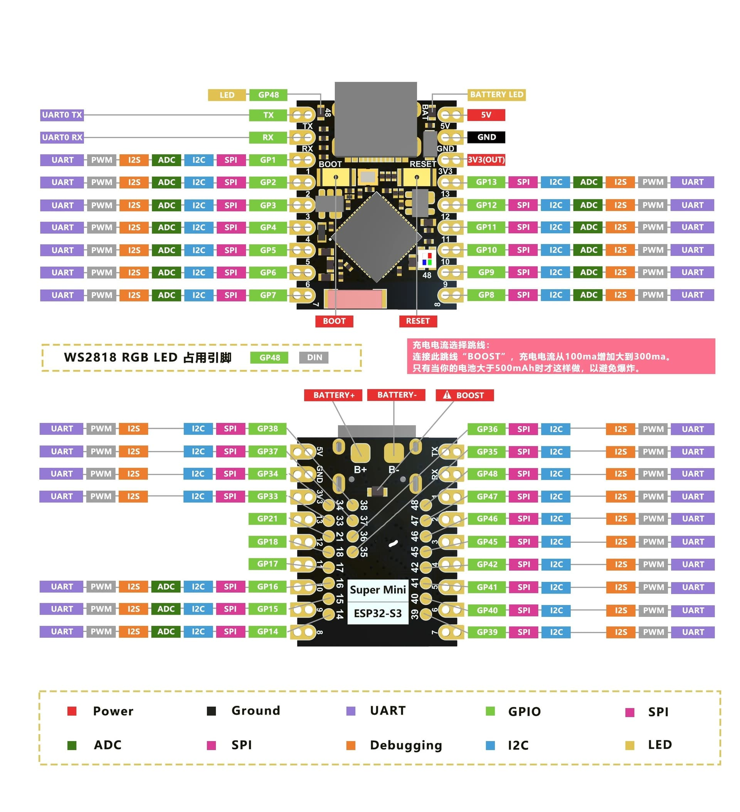

# D1 ESP32-S3 Port with D2 SPI Extension

Branch `d3`: Cody's D3/D6 work on the current D1 (tasks 1–34) and D2 SPI checkpoint from `main`. This is the Pico 2 W edge firmware (configpico2wedge / FlexiEdgePico `project_v3`) ported to the ESP32-S3 Super Mini. Since Tribunal 1 the firmware runs on µT-Kernel 3 SMP through the course port ([MTK_REDESIGN.md](MTK_REDESIGN.md)), and D2's SPI runs on it too; the earlier Arduino-ESP32/FreeRTOS port stays as the measured baseline. The same configuration lines, console commands, MQTT topics, output format and ML model work on both boards, because both builds compile the same shared code.

**D3 integration status (28 October 2026).** ApplicationTask now has µT-Kernel task glue in `esp32s3_mtk/components/edge_mtk/runtime_mtk.c`: EventRecord submission uses an eight-item, nonblocking `app_mbf`; its item is sized from `application_message_t` (an 80-byte event plus a kind field/alignment, 88 bytes in native tests). ApplicationTask processes events and queued reset/status requests on core 1, priority 23, with the existing 4 KiB stack. Portable processing/formatting state stays in EdgeCore BSS mapped to PSRAM. The kernel application buffer stays internal, growing by 192 bytes in the native layout; the target size is reported by `TASKS`, and the stack is unchanged. Native tests pass; target compilation, linked-image inspection, resource/core measurements and hardware acceptance remain pending. Shared-C timing corrections now prevent one-shot self-rearming, recover periodic timeouts, honor disabled streams and discard deadline-exceeding responses; `tools/cody_test.sh` includes scheduler/publisher integration regressions. Synchronous drivers are not preempted. Local validation now rejects non-finite/malformed fields and stale or ambiguous occupancy changes, prevents integer-capacity overflow, and scopes RAM duplicates to source/event pairs (+128 bytes of EdgeCore BSS, unchanged 80-byte EventRecord). Canonical node/boot identity, cross-node time, real-window quality provenance, persistence, asynchronous sonar capture and D2 application logging remain open. Use [section 4](#4-set-up-and-test-from-scratch-d1-and-d2) for the active µT-Kernel setup and tests; the Cody documents retain the earlier implementation history.

**Rule decision guard.** `event:entry` and `event:exit` now submit unverified point decisions rather than inventing a completed observation window. They carry only `RULE_VALID`, print `observation=unverified`, and are rejected by ApplicationTask with `reason=quality` without changing occupancy. The real sensor-node assembler must submit a completed EventRecord with evidence-backed sequence/timing quality; this remains open. `APP EVENT` is the explicit synthetic positive fixture.

**Application smoke check.** Run `sh tools/cody_test.sh` for the portable contract and dispatch tests. Once this revision has been built/flashed, use `sh tools/mtk.sh monitor`, then `APP RESET`, `APP EVENT 1 1 entry`, the same event again, `APP EVENT 2 2 exit`, and `APP STATUS`. Expected occupancy is 0 → 1 → 1 → 0; reset/status completion is printed by ApplicationTask, after it consumes the request. `APP EVENT` is a synthetic plumbing fixture, not a real entrance observation. `publish=1` means enqueued and `publish=2` means enqueue failed/offline; neither is a broker acknowledgement. Repeat with MQTT offline and inspect `APP STATUS` and `TASKS` for publication failures, message drops, stacks, heap and ApplicationTask core residency. Real entrance, overflow and D2 T-23 acceptance still require target evidence.

**Native runtime integration.** `sh tools/mtk_runtime_test.sh` compiles the actual micro T-Kernel application/control task bodies against test-only kernel/SDK boundaries. It checks typed FIFO capacity/deep copies, event/reset drops, publication and benchmark refusal, duplicate handling and malformed lengths. It is included in `tools/cody_test.sh`. These native results do not establish SDK ABI compatibility, real scheduling/core residency, target stack headroom or physical acceptance.

**Automated application smoke check.** After `sh tools/mtk.sh check`, `sh tools/mtk.sh flash` and `sh tools/mtk.sh image`, run `sh tools/mtk.sh app-test` (or `PORT=<usb-port> sh tools/mtk.sh app-test`). This clears volatile sensor/rule configuration and occupancy, checks synthetic entry/exit/floor/duplicate/reorder cases, rejects an unverified GPIO8 rule decision, and validates ApplicationTask's core 1/priority 23 report and typed eight-item buffer sizing. GPIO8 is an input; no jumper or flash-program command is needed. Cleanup stops and clears the probe and resets synthetic occupancy. Timestamped serial logs go to `parity/logs/mtk/d3-application-*.log`; they label the host Git revision/dirty state, not a verified firmware identity, so retain matching build/flash/image evidence separately. This smoke test does not certify queue overflow, real entrance events, the timing budget or D2 T-23. Its parser/failure-path unit tests run offline through `tools/cody_test.sh`.

**D3 pulse-pin validation (29 October 2026).** GPIO pulse configurations require different `gpio.trig` and `gpio.echo` pins. The parser and driver reject a shared pin before hardware setup; native parser/driver regressions run with `sh tools/cody_test.sh`. Cross-sensor pin conflicts and physical timing acceptance remain open.

## Contents

| Section | What's in it |
|---|---|
| [1. Start here](#1-start-here) | What the firmware runs on (µT-Kernel 3 SMP), the 7 commands to try, and every result next to the FreeRTOS baseline |
| [Feedback tracker](WEEK6_FEEDBACK_RESPONSE.md) | Every professor feedback item on the Week 6 design review: owner, status, evidence, next action |
| [D3 tasks](D3_TASKS.md) | Cody's timing checklist: contracts, ultrasonic sequencing, application handoff, tests and acceptance evidence |
| [Cody Week 8 ownership](CODY_WEEK8_SUBMODULE.md) | D3/D6 application contracts, module-owner boundaries and integration responsibilities |
| [Cody PRD implementation](CODY_PRD_IMPLEMENTATION.md) | Earlier portable-code/native-test results and Arduino integration history; µT-Kernel task glue remains pending |
| [2. D1 task checklist](#2-d1-task-checklist) | Tasks 1–23 with status and dev notes; [execution model](#execution-model); [tasks 24–34: µT-Kernel 3 SMP redesign](#d1-redesign-port-to-µt-kernel-3-smp-tasks-2434) |
| [µT-Kernel redesign plan](MTK_REDESIGN.md) | Change requirement, FreeRTOS-to-µT-Kernel mapping, core assignment, compliance matrix |
| [3. D2 task checklist](#3-d2-task-checklist) | D2 SPI tasks D2-1 to D2-11 with status, the checks before the merge, how to run the SPI tests, what D2 still needs; full list in [D2_SPI_TODO.md](D2_SPI_TODO.md) |
| [4. Set up and test from scratch](#4-set-up-and-test-from-scratch-d1-and-d2) | Step-by-step on a new Mac for the µT-Kernel build (D1 and D2) |
| &nbsp;&nbsp;[Part A: Install](#part-a-install) | Steps 1–4: tools, project, ESP-IDF and the course port, version check |
| &nbsp;&nbsp;[Part B: Wi-Fi and broker](#part-b-wi-fi-and-broker) | Steps 5–7: laptop IP, Wi-Fi file, MQTT broker |
| &nbsp;&nbsp;[Board pinout](#board-pinout) | Super Mini pin diagram and how to hold the board |
| &nbsp;&nbsp;[Part C: Flash](#part-c-flash) | Steps 8–10: flash and the live console |
| &nbsp;&nbsp;[Part D: Tests](#part-d-tests) | Steps 11–22: every wiring-free test and what it shows |
| &nbsp;&nbsp;[Part E: Real sensors](#part-e-real-sensors) | GY-511, HC-SR04, the light sensor and jumper tests; why no resistor |
| &nbsp;&nbsp;[Part F: D2 SPI](#part-f-d2-spi) | Host test, loopback suite and benchmark, read-only W25Q32 checks |
| [5. Using any sensor](#5-using-any-sensor-config-cheat-sheet) | Wiring and the config line for every sensor type, including SPI, and rules |
| [6. Completion rule](#6-completion-rule) | When a task counts as done |
| [7. Arduino/FreeRTOS baseline](#7-arduinofreertos-baseline-set-up-and-test-reference) | The earlier build's step-by-step setup and tests, Mac and Windows |

Other documents: [WEEK6_FEEDBACK_RESPONSE.md](WEEK6_FEEDBACK_RESPONSE.md) (professor feedback tracker), [D2_SPI_TODO.md](D2_SPI_TODO.md) (D2 tasks), [SETUP.md](SETUP.md) (board and environment details), [parity/PARITY.md](parity/PARITY.md) (requirements and evidence), [PORTABILITY.md](PORTABILITY.md) (Pico to S3 changes and defects), [ARCHITECTURE.md](ARCHITECTURE.md) (task design), [project_v3/README.md](project_v3/README.md) (full config syntax).


---

# 1. Start here

**What D1 runs on.** Since Tribunal 1 (19 Oct 2026) the D1 firmware runs on µT-Kernel 3 SMP through the course port: [`esp32s3_mtk/`](esp32s3_mtk/) is an ESP-IDF project in which every application task is a µT-Kernel task pinned to a core, and the FreeRTOS scheduler never starts. The design, the FreeRTOS-to-µT-Kernel mapping, the core assignment and the clause-by-clause compliance matrix are in [MTK_REDESIGN.md](MTK_REDESIGN.md) (tasks 24–34). The Arduino-ESP32/FreeRTOS build (`esp32s3_edge/`, `tools/s3.sh`) stays as the measured baseline. D2's SPI runs on the µT-Kernel build as well; its tasks and tests are in [section 3](#3-d2-task-checklist).

**Why it is the same firmware.** All platform-independent code (config parser, scheduler, REPL, rule engine, GPIO/I2C/UART drivers, MQTT payload handling, inference manager) is one library, [`libraries/EdgeCore/`](libraries/EdgeCore/), compiled unchanged by the Pico build and both S3 builds; `tools/check_hal_boundary.sh` proves it uses no Pico, Arduino or ESP-IDF calls. Only the HAL ([Pico](project_v3/platform/pico/hal_pico.c), [S3 on µT-Kernel](esp32s3_mtk/components/edge_mtk/hal_mtk.c), [S3 on Arduino](libraries/EdgeS3/src/hal_esp32s3.cpp)) and the platform services differ. The same test scripts run against every build with the same expected output; only pin numbers are mapped.

**Run it yourself** (µT-Kernel build; macOS or Linux, board on USB; details in [SETUP.md](SETUP.md#esp32-s3-on-µt-kernel-3-smp-tasks-2534)):

| Step | Command | You should see |
|---|---|---|
| 1. Install once | `sh tools/mtk.sh setup` | `Done. Edit esp32s3_mtk/main/wifi_credentials.h, then: sh tools/mtk.sh flash` |
| 2. Check versions and build | `sh tools/mtk.sh check` | course port `e92874d`, ESP-IDF `v6.1-dev-2300-g17a74c925c`, compiler `esp-15.2.0_20251204`, then `Project build complete` |
| 3. Flash | `sh tools/mtk.sh flash` | `Hash of data verified` |
| 4. Use the console | `sh tools/mtk.sh monitor`, then `HELP` and `TASKS` | the Pico's command list; each task with its core, priority and stack headroom |
| 5. Run a parity stage | `sh tools/mtk.sh test 4a` | `14/14 passed` |
| 6. Compare with the Pico | `sh tools/mtk.sh compare 4a` | Pico and µT-Kernel output, line for line the same |
| 7. MQTT (laptop running Mosquitto) | `sh tools/mtk.sh mqtt <laptop-ip>` | `27/27 passed` |

**Results on µT-Kernel 3 SMP** (2026-10-20, HW-747 Super Mini; raw logs in [`parity/logs/mtk/`](parity/logs/mtk/), FreeRTOS and µT-Kernel side by side in [PARITY.md §4](parity/PARITY.md#4-esp32-s3-on-µt-kernel-3-smp-tasks-24-to-34)):

| What | Command | µT-Kernel 3 SMP | FreeRTOS (Arduino) baseline |
|---|---|---|---|
| HAL: timing, GPIO, PWM, pulse, 20,000-edge counter, interrupt-driven echo | `haltest` | 27/27 (1 jumper check skipped) | 23/23 |
| Console, config, rules, inference | `test 4a` | 14/14, MSE 0.4179 | 14/14 |
| Invalid input refused | `test 5-neg` | 27/27 | 27/27 |
| Bad pin, 8 fast sensors, no-echo timeout, false rule | `test t03`, `t04`, `t06`, `t10` | 6/6, 13/13, 7/7, 7/7 | 6/6, 13/13, 6/7, 7/7 |
| I2C, real GY-511 compass and accelerometer | `test 4c-mag` (or `live mag`) | 15/15 | 15/15 |
| Real HC-SR04 distance, and rules on its readings | `test 4c-sonic`, `test sonic-rule` (or `live sonic`) | 4/4, 7/7 | not run |
| MQTT telemetry, config, commands, bridging, model upload | `mqtt <ip>` | 27/27 | 27/27 |
| Model storage: upload, bad uploads, survives reset | `model <ip>` | 8/9 (the miss is a test timing artefact; reload captured separately) | 9/9 |
| Faults: bad JSON, oversized, broker and Wi-Fi loss | `faults <ip>` | 9/9 | 9/9 |
| Queue flooding | `flood <ip>` | Pass | Pass |
| Sample timing (NFR1) | `timing` | Pass | Pass |
| 30-minute run (NFR6) | `endurance <ip>` | 6/6 | 6/6 |
| Every task on its assigned core; hardware watchdog | `TASKS`, `STALL 30000` | Pass | n/a |
| No FreeRTOS kernel code in the firmware image; no FreeRTOS, Arduino or `esp_driver_*` call in our code | `purity` (or `image`) | Pass | n/a (FreeRTOS is the baseline's RTOS) |

The GPIO and UART loopback stages (4b, 4c-uart, t02, t08, t09) need jumper wires and 4d-ir the light sensor; they are listed as hardware pending in PARITY.md §4, with wiring and commands in [SETUP.md](SETUP.md#hardware-checks-on-µt-kernel-jumpers-and-sensors). Two findings about the course port itself are recorded with evidence in MTK_REDESIGN.md: its radio sometimes stops receiving for a minute or more (§10), and its kernel and FreeRTOS shim had to be moved into IRAM before flash writes were safe (§8).

**Where things are.** µT-Kernel design and compliance: [MTK_REDESIGN.md](MTK_REDESIGN.md). Setup and board details: [SETUP.md](SETUP.md). Requirements and parity evidence: [parity/PARITY.md](parity/PARITY.md). Architecture (task 10): [ARCHITECTURE.md](ARCHITECTURE.md). Portability and design-review closure: [PORTABILITY.md](PORTABILITY.md). Config syntax and commands: [project_v3/README.md](project_v3/README.md).


---

# 2. D1 task checklist

> **Before changing the design or any task below, check the [professor feedback tracker](WEEK6_FEEDBACK_RESPONSE.md).** It lists every item of the Week 6 design-review feedback with its deliverable, owner, status, evidence and next action, for D1 to D6.

| # | Task | Required work | Acceptance evidence | Status | Dev notes |
|---:|---|---|---|---|---|
| 1 | Clean the workspace | Set aside unrelated debug edits, remove stale generated output, and ignore machine-specific files such as clangd's `.cache/`. | `git status` contains no unexpected changes, and generated or credential files are not tracked. | Done |  |
| 2 | Create the `s3-port` baseline | Branch from the supplied `Pico_Sample`, restore the TFLite Micro submodule, retain real commit authorship, add the setup guide, and keep the supplied Pico source unchanged except for documented setup repairs. | Branch history is traceable, the submodule commit is recorded, and no unrelated branch changes are included. | Done |  |
| 3 | Rebuild the Pico reference | Configure a clean Pico 2 W build using the pinned Pico SDK and Arm GCC 14.2 toolchain. Record the source commit and exact tool versions. | `Built target project_v3`, `project_v3.uf2` exists, and the build log records the commit, SDK, compiler, and artifact hash. | Done | Build record and artifact hashes in [parity/logs/3-build.txt](parity/logs/3-build.txt) |
| 4 | Define requirements and the parity test plan (the port's rulebook) | Before any porting, write down exactly what "working" means: every Pico feature the ESP32-S3 must reproduce, the numbers it must meet, the defects found in the supplied firmware, and the test that proves each item. The result is [parity/PARITY.md](parity/PARITY.md), which every later task tests against. In detail: write project-specific functional requirements for REPL/configuration, scheduling, GPIO, I2C, UART, rules, MQTT, model transfer, and inference. Add measurable non-functional requirements for timing, latency, memory, reconnect behaviour, watchdog stability, and acceptable parity tolerances. Create the traceability and parity-table skeleton before testing. | Every requirement has an ID, acceptance criterion, planned test, owner, and target evidence; every feature planned in tasks 13–20 has a Pico and ESP32-S3 test row. | Done | Hasif. Signed off by the team. Requirements: [parity/PARITY.md §1](parity/PARITY.md#1-requirements-task-4) |
| 5 | Execute the full Pico baseline | Test the Pico REPL and inline/JSON configuration; scheduler; GPIO digital, pulse, counter, and one-wire modes; I2C; UART; all documented local and remote rule actions; MQTT telemetry/configuration/commands/bridging; model upload; and inference. Include invalid input, missing-sensor, timeout, and disconnect cases where supported. | The Pico column of the parity table contains the exact command/configuration, expected and observed result, tolerance or measurement, result, and linked evidence for every row. | Done | Hasif. UART radar deferred (P-30). Task 8: HC-SR04 Echo needs a divider on the S3. Results: [parity/PARITY.md §2](parity/PARITY.md#2-parity-table-task-5), logs in [parity/logs/](parity/logs/) |
| 6 | Freeze and tag the Pico reference | Resolve or explicitly record every failed baseline test, commit the Pico evidence, and create an annotated `pico-reference` tag before shared firmware is refactored. | The pushed tag resolves to the tested commit; a clean checkout of the tag builds and reproduces the recorded baseline. | Done | Hasif. Tag `pico-reference`. Check: [parity/logs/6-reference-check.txt](parity/logs/6-reference-check.txt) |
| 7 | Standardise the Arduino ESP32-S3 environment | Install the agreed Arduino IDE and the Espressif `esp32` board package through Boards Manager. Pin the exact IDE and Arduino-ESP32 core versions on every machine. Record any Arduino CLI version used for repeatable builds, the board FQBN/profile and options, upload/monitor settings, and every external library version in `SETUP.md`; the minimal bring-up sketch currently needs no external library. | Every machine compiles the same minimal sketch with the recorded IDE/core and board settings. If Arduino CLI is adopted, its version, installed core, FQBN/options, and library list also match the recorded values. | In progress | Sitt (Windows, IDE 2.3.10) and Hasif (macOS, CLI 1.5.1) compile the bring-up sketch to the same 21,592 B globals; a clean clone with a fresh Arduino install builds, flashes and passes 4a/4b/5-neg. Remaining teammates: run `sh tools/s3.sh check` and post the output. [SETUP.md](SETUP.md#arduino-environment-baseline-task-7) |
| 8 | Confirm hardware and produce the integration pin layout | Identify the exact ESP32-S3 Super Mini board/revision and module marking, flash/PSRAM capacity, USB console and upload path, board profile, Flash Size, PSRAM, USB Mode, USB CDC On Boot and Upload Mode selections where offered, first-upload/boot-button procedure, usable and reserved/strapping pins, and power limits. Define the final GPIO, I2C, UART, PWM, HC-SR04 divider, sensor supply, and ground connections, with a driver/task owner for each device. | `SETUP.md` contains the physically verified board settings, upload/serial procedure, pin/power table, cited matching pinout, and readable wiring diagram; the selected settings produce no pin conflicts. | Done | Sitt: HW-747 pinout matched, USB path. Hasif: chip ESP32-S3FH4R2 (4 MB flash, 2 MB PSRAM) read by esptool, final board settings, pin/power table and no-conflict wiring: [SETUP.md](SETUP.md#pin-power-and-wiring-task-8) |
| 9 | Bring up the ESP32-S3 with Arduino | Keep the minimal `esp32s3/esp32s3.ino` sketch independent of framework code. Using the pinned task 7 environment and confirmed task 8 settings, compile and upload it, then observe its repeating `Hello from ESP32-S3` output at 115200 baud on the actual console path. FreeRTOS architecture tests belong to task 13 rather than this hardware-isolation step. | Arduino IDE Verify/Compile, Upload, and Serial Monitor work on the physical Super Mini using recorded settings; the expected line is observed without resets. A successful compile alone does not complete the task. | Done | Sitt. Local HW-747 bring-up on 2026-10-13 using source commit `fe082bd`; [result record](parity/logs/9-arduino-bringup.txt). Task 7 team rollout and Task 8 integration layout remain separate. |
| 10 | Complete the architecture freeze | Consolidate team roles and subsystem ownership; final functional/non-functional requirements; hardware layout; HAL boundary; RTOS task table with priorities, periods/triggers, stack sizes, ownership and core affinity where relevant; task/ISR/queue/mutex/event interaction diagram; system statechart; scheduler/sensor, MQTT, and model-transfer subsystem statecharts; assumptions with risk and validation; and team-reviewed AI design evidence. | All design-review sections are project-specific, internally consistent, readable, reviewed by the team, and traced to implementation tasks and verification cases. Major later deviations require a recorded engineering justification. | Submitted | Team. Submitted as the Week 6 design review. [ARCHITECTURE.md](ARCHITECTURE.md) is Hasif's earlier draft and still needs aligning with the submitted version Feedback tracker: [WEEK6_FEEDBACK_RESPONSE.md](WEEK6_FEEDBACK_RESPONSE.md) |
| 11 | Define the HAL and refactor the Pico backend | Specify time, delay, console, GPIO output, PWM, and any other genuinely shared platform services, including units, return values, timeout/error semantics, thread-safety, and ISR restrictions. Implement the Pico backend and switch shared modules to the HAL without changing external behaviour. | The tagged Pico parity suite passes again after the refactor, and no shared module bypasses the agreed HAL without a documented reason. | Done | Hasif. HAL: [libraries/EdgeCore/src/hal/hal.h](libraries/EdgeCore/src/hal/hal.h); check: [tools/check_hal_boundary.sh](tools/check_hal_boundary.sh); test logs: [parity/logs/task11/](parity/logs/task11/). I2C and HC-SR04 stages not re-run (drivers unchanged, sensors not at hand). One freeze under check (D-13) |
| 12 | Implement the Arduino ESP32-S3 HAL and shared build | Implement the ESP32-S3 HAL using Arduino-ESP32 services such as `micros()`, `delay()`/FreeRTOS delays, `Serial`, GPIO, and LEDC, using lower-level APIs exposed by the Arduino core only where required. Package the platform-independent sources as a local Arduino library or equivalent shared source target without copied forks. Document repeatable Pico and Arduino IDE build procedures and add Arduino CLI commands if the team adopts CLI verification. | Timing and console tests pass on hardware; both targets build cleanly; shared sources remain identical; the Arduino versions, libraries, and board options are reproducible; and unsupported operations return documented errors. | Done | Hasif. Shared code is one library, [libraries/EdgeCore/](libraries/EdgeCore/), built by both targets; S3 HAL in [esp32s3_edge/](esp32s3_edge/); build steps in [SETUP.md](SETUP.md); HAL test 18/18 on the HW-747: [parity/logs/task12/](parity/logs/task12/) |
| 13 | Implement the Arduino-hosted FreeRTOS runtime, main control, and REPL | Implement the architecture from task 10 by creating the required FreeRTOS tasks from Arduino `setup()`, with explicit task ownership and the required queues, mutexes, event groups, notifications, or callbacks. Keep Arduino `loop()` non-blocking or use it only for a documented supervisory role. Ensure every blocking operation yields or times out, shared data is protected, and the watchdog remains serviced. | `HELP`, `SHOW`, `RUN`, `STOP`, and `CLEAR` match the Pico response contract; task priorities and communication paths match the design; stack high-water marks are safe; and the board runs without watchdog resets. | Done | Hasif. Runtime per the Week 6 task table: [libraries/EdgeS3/src/runtime_s3.cpp](libraries/EdgeS3/src/runtime_s3.cpp). S3: 4a 13/14 (inference waits on task 20), 5-neg 26/26, t03, t04, t10 pass; every task keeps over 2 KB of stack free; logs [parity/logs/task13/](parity/logs/task13/) |
| 14 | Port the scheduler and GPIO digital mode | Port scheduling and digital input using the same configuration semantics as the Pico, with only board-specific pins changed. Implement pull, invert, debounce, invalid-pin, and scheduler-overload handling. | Output format and values match the baseline; measured sample period and jitter meet the non-functional requirement; invalid configurations fail safely. | Done | Hasif. Shared GPIO driver, RTOS scheduler, bad pins refused (D-02, D-08); NFR1 measured. [parity/PARITY.md §3](parity/PARITY.md#3-esp32-s3-results-tasks-13-to-21) |
| 15 | Port pulse, counter, and one-wire GPIO modes | Port HC-SR04 pulse measurement, edge counting, and one-wire sensor timing using watchdog-safe and concurrency-safe mechanisms. Define ISR ownership and atomic access where interrupts are used. | Each GPIO parity row passes; distance affects pulse width correctly; counter tests do not lose events within the stated limit; disconnected sensors time out; and timing-sensitive reads do not starve other tasks. | Done | Hasif. Non-blocking pulse, ISR edge counter (20,000 edges, none lost). HC-SR04 needs a 1:2 divider. [parity/PARITY.md §3](parity/PARITY.md#3-esp32-s3-results-tasks-13-to-21) |
| 16 | Port I2C | Implement the Arduino `Wire` I2C path with the same configuration semantics, explicit bus ownership, timeouts, repeated-start behaviour, and recovery handling. Use a lower-level API only when an evidenced framework limitation requires it, and document that exception. | The reference I2C sensor matches the Pico result, and NACK, missing-device, timeout, repeated-start, multiple-device, and recovery tests have recorded outcomes. | Done | Hasif. Shared I2C driver on `Wire`; real GY-511 passes 15/15 (identity, two devices on one bus, with and without repeated start, missing device) ([parity/logs/s3/4c-mag.log](parity/logs/s3/4c-mag.log)) |
| 17 | Port UART | Implement UART polling/streaming with Arduino `HardwareSerial`, including framing, optional pre-bytes, delays, line mode, buffering, and timeout/error handling without conflicting with the USB console. Use a lower-level API only for requirements that `HardwareSerial` cannot meet. | The reference UART sensor matches the Pico result; partial messages, framing settings, timeout, overflow, and sustained-input tests have recorded outcomes. | Done | Hasif. Loopback 8/8, UART flush fix (D-05); radar deferred (P-30). [parity/PARITY.md §3](parity/PARITY.md#3-esp32-s3-results-tasks-13-to-21) |
| 18 | Port the rule engine actions | Preserve RPN evaluation and implement/verify log, GPIO high/low/toggle/pulse, PWM/LEDC, batch, remote configuration/command, and inference-related actions. Defer only the final network/model-dependent checks to tasks 19–21. | Representative true/false expressions and every documented action have deterministic pass/fail tests; GPIO/PWM measurements and emitted events match the required semantics. | Done | Hasif. Rule checks at add time (D-03, D-04), D-11, D-14 fixed; non-blocking PULSE. [parity/PARITY.md §3](parity/PARITY.md#3-esp32-s3-results-tasks-13-to-21) |
| 19 | Port Wi-Fi, MQTT, and sensor bridging | Implement connectivity with Arduino `WiFi` and one selected, version-pinned Arduino-compatible MQTT library. Preserve telemetry, presence/heartbeat, configuration, commands, events, and sensor bridging. Define callback-to-task ownership, queue limits, credentials handling, reconnect/backoff, and malformed/oversized payload behaviour. | Normal telemetry and remote configuration pass; Wi-Fi loss, broker loss, reconnect, malformed JSON, oversized payload, queue saturation, and bridge tests recover safely without leaks or watchdog resets. | Done | Hasif. WiFi + MQTT task, bridging (D-10), fault tests. [parity/PARITY.md §3](parity/PARITY.md#3-esp32-s3-results-tasks-13-to-21) |
| 20 | Port model storage, transfer, and inference | First compatibility-test and pin the selected Arduino-compatible ML integration. Define a safe partition layout; use an Arduino-compatible flash/partition interface, including underlying ESP partition or PSRAM APIs only as documented exceptions where required, for bounded model storage; and preserve normalization, thresholds, score modes, approved model upload/selection/replacement, the `send_model.py` path where compatible, and `infer.set`/`infer.run` behaviour. Add integrity checks and interrupted-upload handling. | Valid models upload without rebuilding the base firmware, persist across reboot, load, and produce scores within the stated tolerance; invalid, oversized, corrupt, and interrupted uploads are rejected or recovered safely; arena/heap use, throughput, and inference latency meet requirements. | Done | Sitt: TFLite Micro inference, 40 invocations match the Pico (`MSE=0.4179`). Hasif: S3 model storage in LittleFS; upload, CRC check, corrupt/oversized/interrupted refusal and reboot persistence pass ([parity/logs/s3/model.log](parity/logs/s3/model.log)). FP32 SVDD needs 17 inputs, beyond the 16-input limit. [Hardware check](parity/task20/README.md) |
| 21 | Run end-to-end parity, fault, timing, and endurance verification | Execute the complete requirements-based suite on the final ESP32-S3 build. Include nominal parity, negative/fault injection, scheduler jitter, REPL latency, MQTT recovery, stack/heap high-water measurements, inference timing, resource contention, and an agreed continuous-run test. | The parity and traceability tables have no unexplained gaps. Every row records pass/partial/fail with reason, measurement, evidence, commit, hardware, tester, and date; every non-functional limit is measured. | Done | Hasif. Full S3 suite, MQTT faults and 30-min endurance pass with no resets ([parity/PARITY.md §3](parity/PARITY.md#3-esp32-s3-results-tasks-13-to-21)). Pico firmware builds with the shared changes; Pico hardware re-run pending (board not detected over USB) |
| 22 | Close portability and design-review documentation | List every Pico-specific dependency and its HAL or Arduino replacement, every necessary underlying ESP-IDF exception, and all timing, concurrency, memory, SDK, hardware, and unsupported-feature differences. Update the architecture, statecharts, assumptions, ownership, and traceability to match the implementation. Complete the AI-supported final gap check with team responses, actions, and evidence, and perform the design-consistency review. | Every rewritten or platform-specific file is covered; each underlying ESP-IDF exception is justified and tested; assumptions are validated or accepted with reasons; all requirements trace to evidence; and no stale names, pins, tasks, interfaces, or unresolved AI-review gaps remain. | Done | Hasif. [PORTABILITY.md](PORTABILITY.md) |
| 23 | Release from a clean Arduino environment | Review and merge `s3-port` into `main`, create the release tag, clone recursively into a new directory, install the pinned Arduino IDE, Arduino-ESP32 core, board settings, and libraries, then follow `SETUP.md` without undocumented steps to compile, upload, monitor, and rerun the release smoke and critical parity tests. Package the final design-review artefacts and link the repository. | The fresh environment builds and runs on the target board and reproduces the parity checks; the tag, submodules, Arduino configuration, documentation, evidence, and repository link are available to the whole team. | Superseded by task 34 | Team confirmed; merge to `main` on hold, now done as task 34 after the µT-Kernel redesign. Steps: [SETUP.md](SETUP.md#release-task-23) |

### D1 redesign: port to µT-Kernel 3 SMP (tasks 24–34)

Change requirement from Tribunal 1 (19 Oct 2026): the firmware must run on the course µT-Kernel 3 SMP port, every application task must be a µT-Kernel task, every queue, mutex, event group and timer must become a µT-Kernel object, the task-to-core assignment must be defined and justified, and ISRs must interact safely with µT-Kernel tasks. The plan, the FreeRTOS-to-µT-Kernel mapping, the core assignment and the clause-by-clause compliance matrix are in [MTK_REDESIGN.md](MTK_REDESIGN.md). The work was done on `s3-port-d1-redesign` (from `s3-port-d2`) and merged into `main`; D2 then ported its SPI onto this runtime, and D3 onwards are ported by their owners. The Arduino/FreeRTOS build stays in the repository as the measured baseline.

| # | Task | Required work | Acceptance evidence | Status | Dev notes |
|---:|---|---|---|---|---|
| 24 | Plan the µT-Kernel 3 SMP redesign | Map every clause of the change requirement to a design decision, a task and its evidence. Record the FreeRTOS-to-µT-Kernel object mapping, the task table with cores, priorities and stacks and the justification for the core assignment, what is kept (EdgeCore, hardware, commands, topics) and what is replaced (the Arduino platform layer), and the Tribunal 1 decisions. | [MTK_REDESIGN.md](MTK_REDESIGN.md) covers every clause; tasks 25–34 trace to it. | Done | Hasif |
| 25 | Pin the course port and the toolchain | Add the course port `sirfonzie/mtk3smp-esp32s3` as an unmodified submodule pinned to a commit. Pin ESP-IDF `v6.1-dev-2300-g17a74c925c` and `xtensa-esp-elf-gcc 15.2.0`, the versions the port is qualified on, and lock every component-manager dependency. Add `tools/mtk.sh` (setup, check, build, flash, monitor, test) and a SETUP.md section. | `sh tools/mtk.sh check` prints the pinned port commit, IDF and compiler versions and builds the firmware; a clean recursive clone builds the same way. | Done | Hasif. Port `e92874d`, IDF `v6.1-dev-2300-g17a74c925c`, `esp-15.2.0_20251204`; `sh tools/mtk.sh check` verifies all three and builds. [SETUP.md](SETUP.md#esp32-s3-on-µt-kernel-3-smp-tasks-2534) |
| 26 | Bring up µT-Kernel 3 SMP on the HW-747 Super Mini | Create the ESP-IDF project `esp32s3_mtk/` on the port's global-SMP profile (`CONFIG_MTK_SMP`, two dispatchers) with the generic board package, the native USB-Serial-JTAG console, a 4 MB partition table and the port's watchdog policy. Create one idle task per core and show a pinned task running on each core. | Boot log on the board: µT-Kernel 3.00 banner, SMP profile, a task on each processor printing its core; no resets. | Done | Hasif. µT-Kernel 3.00 SMP boots with 2 processors; the task pinned to core 0 always reports core 0 and the one pinned to core 1 reports core 1: [parity/logs/mtk/26-bringup.log](parity/logs/mtk/26-bringup.log) |
| 27 | Implement the µT-Kernel HAL backend | Replace Arduino-ESP32 with register-level drivers, following the port's rule of no `esp_driver_*` components: time from SYSTIMER, delays with `tk_dly_tsk`, the USB console with an interrupt-fed receive ring and a priority-inheritance mutex so lines from both cores never interleave, GPIO, PWM (LEDC), I2C master with repeated start and timeouts, UART with an interrupt-fed receive ring, PULSE ended by an alarm handler, edge counting by a GPIO interrupt handler. SPI returns `HAL_ERR_UNSUPPORTED` until the D2 owners port it. Add `tools/check_mtk_purity.sh`, which fails if our code calls any FreeRTOS, Arduino or `esp_driver_*` API, and a HAL test firmware that also measures PWM, PULSE and edge counting on one pin without wiring. | `check_hal_boundary.sh` and `check_mtk_purity.sh` pass; the HAL test passes on the board; jumper-only measurements are recorded as hardware pending. | Done | Hasif. [console_mtk.c](esp32s3_mtk/components/edge_mtk/console_mtk.c), [hal_mtk.c](esp32s3_mtk/components/edge_mtk/hal_mtk.c). HAL test 23/23 on the HW-747 (`sh tools/mtk.sh haltest`): delays, console, GPIO, PWM duty within 0.001, 200 ms PULSE returning in 59 µs, 20,000 edges at 19.8 kHz with none lost, UART loopback, I2C NACK, test task on core 1: [summary](parity/logs/mtk/27-hal_test-summary.txt). Jumper checks 5↔6: hardware pending. `sh tools/mtk.sh purity`: 41 files clean. SPI was ported to this HAL later by D2 ([section 3](#3-d2-task-checklist)) |
| 28 | Implement the µT-Kernel runtime | Create SchedulerTask, MQTTTask, ControlTask, InferenceTask, ApplicationTask, BenchmarkTask and MonitorTask as µT-Kernel tasks pinned at creation (`TA_ASSPRC`, `TA_FPU`) with priorities `25 − FreeRTOS priority`. Replace the five queues with message buffers of the same capacities (drop newest and log when full) and the event group with an event flag. MonitorTask runs from a cyclic handler and checks stacks, heap and task heartbeats. Create every object at boot and check every result. `TASKS` prints each task's ID, assigned and current core, priority, stack headroom, residency per core and the queue drop counters. | `HELP`, `SHOW`, `RUN`, `STOP`, `CLEAR` match the Pico (4a); 5-neg, t03, t04 and t10 pass; `TASKS` shows every task only on its assigned core. | Done | Hasif. [runtime_mtk.c](esp32s3_mtk/components/edge_mtk/runtime_mtk.c): 7 tasks, 5 message buffers, 1 event flag, 1 cyclic handler, 8 alarm handlers, all created and checked at boot. 4a 13/14 (inference waits on task 31), 5-neg 27/27, t03 6/6, t04 13/13, t10 7/7 ([logs](parity/logs/mtk/)). Every task only on its core: [28-core-residency.log](parity/logs/mtk/28-core-residency.log). Hardware watchdog proven by `STALL 30000`: MonitorTask stops feeding 5.3 s into the stall and timer group 0's watchdog resets the chip 10 s later (`TG0WDT_SYS_RST`), while SchedulerTask keeps sampling until the reset: [28-watchdog.log](parity/logs/mtk/28-watchdog.log). This task first used the RTC watchdog; task 30 replaced it with timer group 0's because the RTC watchdog survives the reset into download mode and reset the chip in the middle of a flash. Internal heap free 199 KB before Wi-Fi starts (PSRAM holds EdgeCore's tables: [MTK_REDESIGN.md §8](MTK_REDESIGN.md#8-memory-plan)) |
| 29 | Make the HC-SR04 echo wait interrupt-driven and prove the ISR paths | Add `hal_gpio_measure_pulse` to the HAL so the shared GPIO driver measures echo pulses through it (the Pico keeps its reference busy-wait). On µT-Kernel the GPIO interrupt handler (task 27) timestamps the echo edges and sets an event flag, and the waiting task sleeps on `tk_wai_flg` instead of spinning for up to 25 ms, so the core is free for other tasks. Check every interrupt handler against the rules: registered with `tk_def_int` on core 1, minimal work, no application data, signalling only through µT-Kernel calls allowed in handlers. | Pulse timeout and no-echo cases match the baseline (t06); a self-driven echo test measures known pulse widths; a CPU-release check shows another task on core 1 keeps running while the echo is awaited; real HC-SR04 and the edge-count jumper test are hardware pending. | Done | Hasif. [hal_mtk.c](esp32s3_mtk/components/edge_mtk/hal_mtk.c) `hal_gpio_measure_pulse`; shared driver [gpio.c](libraries/EdgeCore/src/bus/gpio.c) now calls the HAL (Pico and Arduino backends keep the reference busy-wait; both still build). HAL test 27/27: a 5 ms echo measured as 5.26 ms, no echo times out at 25.7 ms, a stuck echo reports 25001 as before (D-07), and a lower-priority task on core 1 ran 560,109 loops during the echo wait against 0 during a busy-wait. t06 7/7 (the Arduino build was 6/7: its GPIO7 pull-down did not hold). [Evidence](parity/logs/mtk/29-echo-and-wcet.txt). A real HC-SR04 (3 V module) was measured on 2026-10-21: `4c-sonic` 4/4 and `sonic-rule` 7/7, see task 32. The 5↔6 edge-count jumper: hardware pending |
| 30 | Port Wi-Fi and MQTT onto the course port | MQTTTask on core 0 owns `esp_wifi` and esp-mqtt (registry component, version locked). Inbound messages are copied by the MQTT event handler into `sched_mbf`; outbound go through `pub_mbf`; Wi-Fi and broker state are event flags. Keep the topics, payloads, bridging, reconnect and back-off, `WIFISCAN`, `WIFIDROP`, oversized-payload truncation and offline refusal. | `mqtt` 27/27, `faults` 9/9 and `flood` pass on the µT-Kernel build. | Done | Hasif. [net_mtk.c](esp32s3_mtk/components/edge_mtk/net_mtk.c): MQTTTask on core 0 owns `esp_wifi` and esp-mqtt 1.1.0; the event handlers only set or clear `net_flg` bits and copy inbound messages into `sched_mbf`. On this build: `mqtt` 25/27, where the two failing steps are the model upload and inference on it, which arrive in task 31; `faults` 9/9 (broker back in 2.1 s, node back on the broker 5.2 s after Wi-Fi returns, heap flat, no reset); `flood` pass (2,544 messages at 50 per second, heartbeat and telemetry kept): [logs](parity/logs/mtk/). MQTTTask has a 16 KB stack because the publish path uses about 8 KB. The watchdog moved to timer group 0 (task 28 row). The course port's radio intermittently stops receiving; this reproduces without our code and is documented with the recovery behaviour in [MTK_REDESIGN.md §10](MTK_REDESIGN.md#10-test-plan-and-hardware-needs) ([evidence](parity/logs/mtk/30-wifi-findings.txt)) |
| 31 | Port model storage and make InferenceTask real | Build TFLite Micro from the registry component (version locked) with its 64 KB arena in PSRAM, as in the Arduino build. Replace LittleFS with a two-slot model store in a raw flash partition (size and CRC32 check, atomic commit, survives reboot). InferenceTask owns the interpreter: the inference manager in SchedulerTask sends the normalised input vector through `infer_mbf`, InferenceTask invokes the model and returns the outputs through a reply message buffer, and SchedulerTask computes the score and fires the chained action. | The 4a inference row passes and the built-in model reproduces the Pico result (MSE 0.4179); `model` 9/9. | Done | Hasif. [model_store_mtk.c](esp32s3_mtk/components/edge_mtk/model_store_mtk.c): two slots in the `model` partition, each with a CRC-checked header written last; an upload goes to the slot not in use and is read back and checked before it replaces the model, and at boot the newest valid slot is used in place through the flash cache. [inference_mtk.cpp](esp32s3_mtk/components/edge_mtk/inference_mtk.cpp): InferenceTask owns TFLite Micro (esp-tflite-micro 1.4.0, the release Arduino-ESP32 3.3.12 bundles) with the 64 KB arena in PSRAM; requests go through `infer_mbf` and replies through a reply buffer, matched by sequence number. 4a 14/14 with MSE 0.4179 as on the Pico; `mqtt` 27/27; `model` 8/9: every upload, refusal and inference step passes, and the one miss (`persists-after-reset`) is the test reopening the port 4 s after its reset, by which time this build has already reloaded the model, as [31-model-persists.log](parity/logs/mtk/31-model-persists.log) shows. Uploads first crashed the chip because the course port's shim and kernel run from flash and Wi-Fi interrupts called them while a flash write had the cache off ([evidence](parity/logs/mtk/31-upload-crash-without-iram-fix.log)); [port_iram.lf](esp32s3_mtk/components/edge_mtk/port_iram.lf) moves both into IRAM without changing the port ([MTK_REDESIGN.md §8](MTK_REDESIGN.md#8-memory-plan)) |
| 32 | Verify on µT-Kernel and compare with FreeRTOS | Re-run the unchanged D1 suite on the µT-Kernel build: parity stages, invalid input, NFR1 sample timing, SchedulerTask cycle time, MQTT faults and flooding, model upload and the 30-minute endurance run. Put the FreeRTOS and µT-Kernel results side by side. | [PARITY.md §4](parity/PARITY.md) has every row with result, measurement, log and date; hardware-dependent rows are marked pending with the wiring they need. | Done | Hasif. [PARITY.md §4](parity/PARITY.md#4-esp32-s3-on-µt-kernel-3-smp-tasks-24-to-34), 2026-10-20, FreeRTOS and µT-Kernel side by side: HAL test 27/27, 4a 14/14, 5-neg 27/27, t03 6/6, t04 13/13, t06 7/7, t10 7/7, `mqtt` 27/27, `model` 8/9, `faults` 9/9, `flood` pass, NFR1 pass at every graded rate, endurance 6/6 over 30 minutes with a flat heap, every task on its own core after the run ([32-tasks-after-suite.log](parity/logs/mtk/32-tasks-after-suite.log)), and SchedulerTask cycle times on both runtimes (the FreeRTOS run is [parity/logs/s3/wcet.log](parity/logs/s3/wcet.log)). Internal heap with Wi-Fi and MQTT running: about 40 KB on µT-Kernel against 48–54 KB on FreeRTOS. `sh tools/mtk.sh image` checks the linked firmware and finds no FreeRTOS scheduler, tick, task or start-up code, and fails as it should on the Arduino build ([32-image-check.txt](parity/logs/mtk/32-image-check.txt)). Real sensors on 2026-10-21: GY-511 `4c-mag` 15/15, 3 V HC-SR04 `4c-sonic` 4/4 and `sonic-rule` 7/7. Hardware pending: 4b, 4c-uart, 4d-ir, t02, t08 and t09, which need jumper wires or the light sensor; the wiring and commands are in [SETUP.md](SETUP.md#hardware-checks-on-µt-kernel-jumpers-and-sensors) |
| 33 | Close the redesign documentation | Fill the evidence column of the compliance matrix, update PORTABILITY.md, ARCHITECTURE.md, SETUP.md and the feedback tracker, and switch "Start here" to the µT-Kernel build. | No document still describes FreeRTOS or Arduino as the D1 runtime except as the baseline; every requirement clause links to evidence. | Done | Hasif. Every clause of the compliance matrix links to its evidence ([MTK_REDESIGN.md §9](MTK_REDESIGN.md#9-compliance-matrix)); [Start here](#1-start-here) runs the µT-Kernel build (`sh tools/mtk.sh compare` added for the Pico comparison); [PORTABILITY.md §6](PORTABILITY.md#6-the-µt-kernel-3-smp-build-tasks-2434) maps every Pico dependency onto the µT-Kernel build; ARCHITECTURE.md and SETUP.md mark the Arduino material as the baseline, and SETUP.md has a µT-Kernel testing section; the [feedback tracker](WEEK6_FEEDBACK_RESPONSE.md) has F6 resolved and redesign evidence on F5, R1, R4 and C2; [MTK_REDESIGN.md §11](MTK_REDESIGN.md#11-checked-against-the-course-ports-own-code) compares the build with the course port's own components and examples, with the reason for every difference and three defects found in the port |
| 34 | Release the µT-Kernel build | Merge `s3-port-d1-redesign` into `main`, tag the release, clone recursively into a new directory and follow SETUP.md to build, flash and rerun the smoke tests. | The tag resolves on origin; the clean clone builds and passes 4a. | Done | Hasif, 2026-10-21. A clean recursive clone (the course port fetched from GitHub) builds firmware identical to the image that passed the suite, apart from the 32-byte ELF fingerprint and the image hash that covers it. The branch merges into `main` with no conflicts (the merged tree equals the branch's) and is tagged `d1-mtk-v1.0`. The D2 SPI work up to the branch point came with it, as this branch is built on `s3-port-d2`; D2's µT-Kernel SPI backend followed in the D2 checkpoint merge ([section 3](#3-d2-task-checklist)) |

> **D2 tasks** (SPI support, Brendan and Jun Yong) are tracked in [D2_SPI_TODO.md](D2_SPI_TODO.md), with the design in [D2_SPI_DESIGN_NOTES.md](D2_SPI_DESIGN_NOTES.md) and [D2_EVENT_RECORD_DESIGN.md](D2_EVENT_RECORD_DESIGN.md). Professor feedback that affects D2 is tracked in the [feedback tracker](WEEK6_FEEDBACK_RESPONSE.md#12-d2-feedback-status).

## Execution model

- Tasks 1–3 establish the common baseline. Their implementation work is complete; any missing build log or artifact metadata must be backfilled before task 10.
- After task 3, tasks 4–6 (Pico requirements and reference evidence) and tasks 7–9 (ESP32-S3 environment and board bring-up) run concurrently.
- Task 10 is the architecture-freeze gate. It cannot be completed until both parallel tracks are finished.
- Tasks 11–13 establish the portable HAL, shared build, and FreeRTOS runtime.
- After task 13, the GPIO path (tasks 14–15), I2C (task 16), and UART (task 17) may be developed in parallel where file ownership does not overlap.
- Tasks 18–20 integrate application services. Final model-transfer verification in task 20 depends on MQTT from task 19.
- Tasks 21–23 are the verification, documentation, and release gates.

Every completed task must identify the tested commit, hardware revision, tool versions, tester, date, and retained evidence. Evidence may include console logs, broker captures, measurements, photographs, or test scripts.


---

# 3. D2 task checklist

Brendan and Jy are extending the D1 port with SPI as a first-class runtime-configurable interface behind the existing `bus_t` abstraction and bus registry. Application code must reach an SPI device through the same path as GPIO, UART, and I2C while runtime configuration selects the bus/host, SCLK, MOSI, MISO, CS, clock, and SPI mode. Transmit and receive failures must be explicit and must never produce valid-looking samples.

The shared driver and schema, Pico compatibility stubs, safe lifecycle, and two ESP32-S3 backends are on `main` since the D2 checkpoint merge: the historical Arduino `SPIClass` adapter and the migrated µT-Kernel SPI2 register-level HAL in [hal_mtk.c](esp32s3_mtk/components/edge_mtk/hal_mtk.c) (polled 64-byte FIFO transfers, no DMA, one `TA_INHERIT` mutex for the bus, no FreeRTOS or `esp_driver_*` call). The W25Q32 device layer and the provisional event-log codec are in [`libraries/EdgeCore/src/flash/`](libraries/EdgeCore/src/flash/); the benchmark and flash console commands run in BenchmarkTask ([spi_bench_mtk.c](esp32s3_mtk/components/edge_mtk/spi_bench_mtk.c)). On 25 October the µT-Kernel firmware passed 22/22 SPI loopback/configuration checks, 6/6 connected fault checks, and five 8–1024-byte benchmark runs totaling 40,000 measured transfers with no mismatches. A physical W25Q32-compatible breakout returned JEDEC `EF4016`; read, one approved scratch write and readback, power-cycle retention, and absent-device detection passed. On 26 October, one separately approved 80-byte **synthetic** D2 record was programmed at `0x3FF100`, read back, and recovered after a USB power cycle without erase; the previous pattern remained intact. The event-log format awaits D3/D6 agreement; real application logging, live T-23 concurrency, remaining target faults and team sign-off are open, so D2 stays in progress. The optional TFT is not the D2 acceptance device. See the [D2 checkpoint and evidence](D2_SPI_TODO.md#d2-checkpoint--25-october-2026), [hardware notes](D2_SPI_DESIGN_NOTES.md), and [provisional event design](D2_EVENT_RECORD_DESIGN.md).

The full checklist with every gate and its evidence is [D2_SPI_TODO.md](D2_SPI_TODO.md); the design is in [D2_SPI_DESIGN_NOTES.md](D2_SPI_DESIGN_NOTES.md) and [D2_EVENT_RECORD_DESIGN.md](D2_EVENT_RECORD_DESIGN.md), and the requirements FR-16, FR-17, NFR-08 and tests T-17 to T-23 in [parity/PARITY.md](parity/PARITY.md).

| # | Task | Required work | Acceptance evidence | Status | Dev notes |
|---:|---|---|---|---|---|
| D2-1 | Freeze the SPI contract | Use `fspi` (alias `spi2`) as the host, poll mode only, typed negative errors, scheduled limits of 64 transmit and 128 receive bytes, and keep 8–1024-byte transfers on a separate benchmark path. | FR-16, FR-17, NFR-08 and T-17 to T-23 in [PARITY.md](parity/PARITY.md); team sign-off of the limits. | Done; team sign-off pending | Brendan and Jy. [D2_SPI_TODO.md, Phase 1](D2_SPI_TODO.md#phase-1--freeze-the-minimum-contract) |
| D2-2 | Add SPI to the shared code | Add `proto_spi` and the `spi.*` fields to `app_cfg_t`, parse and validate them before any hardware changes, show them in `SHOW`, add `bus_spi` to the registry, give `bus_t` a `deinit` callback and correct the scheduler's cleanup; the Pico gets unsupported stubs. | `proto=spi` reaches `bus_spi`; invalid settings are refused; the Pico still builds. | Done | Brendan and Jy. [bus/spi.c](libraries/EdgeCore/src/bus/spi.c), [config_parser.c](libraries/EdgeCore/src/application/config_parser.c), [bus_if.h](libraries/EdgeCore/src/bus/bus_if.h), Pico stubs in [hal_pico.c](project_v3/platform/pico/hal_pico.c). [Phase 2](D2_SPI_TODO.md#phase-2--shared-edgecore-changes) |
| D2-3 | Implement the ESP32-S3 SPI backend | First an Arduino `SPIClass` adapter for the FreeRTOS baseline; after Tribunal 1 a register-level SPI2 driver for µT-Kernel with one `TA_INHERIT` mutex, polled 64-byte FIFO chunks with CS held for the whole transfer, reference-counted devices and refusal of conflicting pins. | No FreeRTOS, Arduino or `esp_driver_*` call (`sh tools/mtk.sh purity`); loopback and flash pass on the µT-Kernel build. | Done; approved clock range and DMA open | Brendan and Jy. µT-Kernel: SPI section of [hal_mtk.c](esp32s3_mtk/components/edge_mtk/hal_mtk.c); baseline: [hal_esp32s3.cpp](libraries/EdgeS3/src/hal_esp32s3.cpp). SPI2 cannot clock below 78.1 kHz. [Phase 3](D2_SPI_TODO.md#phase-3--hal-and-esp32-s3-backend) |
| D2-4 | Functional, fault and lifecycle tests (T-17, T-18, T-21, T-22) | Configuration through the REPL, loopback in modes 0–3 at 2 and 128 bytes, bus sharing and conflicts, refusals, timeouts, 100 open/close cycles with stable heap, connected faults. | `sh tools/mtk.sh spi` 22/22 and `sh tools/mtk.sh spi-fault` 6/6 on µT-Kernel. | Done; lock contention and a corrupted reply on the target still to show | Brendan and Jy, 25 Oct: [spi-20261025.log](parity/logs/mtk/d2-spi/spi-20261025.log), [fault-connected-20261025.log](parity/logs/mtk/d2-spi/fault-connected-20261025.log); [spi_test.py](parity/spi_test.py), [spi_fault_test.py](parity/spi_fault_test.py). [Phase 4](D2_SPI_TODO.md#phase-4--automated-functional-and-fault-tests) |
| D2-5 | Benchmark 8–1024-byte transfers (T-19, NFR-08) | 10 warm-ups and 1,000 measured transfers per size in five clock and mode configurations; median, p95, p99, maximum, throughput, errors, mismatches and heap. | Zero errors and zero mismatched bytes; reports kept. | Done | Brendan and Jy. 40,000 transfers on each runtime; 1024 bytes at 10 MHz take a median 1,045 µs on µT-Kernel against 2,281 µs on Arduino. [Reports](parity/logs/mtk/d2-spi/), [spi_benchmark.py](parity/spi_benchmark.py). [Phase 5](D2_SPI_TODO.md#phase-5--benchmark-and-retained-evidence) |
| D2-6 | Prove the W25Q32 device layer on hardware (T-20, T-21) | A device layer above the generic transport: JEDEC probe, read, page program with blank check, status polling and readback, no erase; host mock tests for the faults. | JEDEC ID, read, one approved scratch write, retention over a reset and a power cycle, missing module refused. | Done | Brendan and Jy. JEDEC `EF4016`. [w25q32.c](libraries/EdgeCore/src/flash/w25q32.c), [test_w25q32.c](tests/test_w25q32.c) (`sh tools/d2_host_test.sh`), [flash logs](parity/logs/mtk/d2-spi/). [Hardware acceptance](D2_SPI_TODO.md#with-the-w25q32-module--hardware-acceptance) |
| D2-7 | Event-record codec and flash log | A versioned 80-byte record with CRC-32 in 128-byte slots, a reboot scan that skips torn slots, append with readback and an explicit full result; freeze the fields once D3 and D6 agree the event identity and result codes. | Host tests pass; a synthetic record is written, read back and recovered after a power cycle; the format is agreed. | In progress: provisional format proven; D3/D6 agreement pending | Brendan and Jy. [d2_event_log.h](libraries/EdgeCore/src/flash/d2_event_log.h), [D2_EVENT_RECORD_DESIGN.md](D2_EVENT_RECORD_DESIGN.md), [write](parity/logs/mtk/d2-spi/flash-log-write-once-20261026.log) and [cold recovery](parity/logs/mtk/d2-spi/flash-log-cold-verify-20261026.log) logs |
| D2-8 | Log every processed event from ApplicationTask | After publishing, offer each processed event to a bounded µT-Kernel log handoff (capacity 8, no wait, drop newest with a counter); write and read it back outside SchedulerTask; report a flash failure without stopping monitoring. | A real application event is stored and retrieved; a flash failure changes no occupancy and stops no sampling. | Not started: needs D3's ApplicationTask on µT-Kernel | Brendan and Jy, with Cody (D3) |
| D2-9 | Concurrent run (T-23) | Flash logging, live sampling and inference together on µT-Kernel: flash-write and lock latency, sampling p95, maximum and skips, log-queue high water and drops, stacks, heap and resets. | No reset, watchdog, missed sample or corruption; numbers compared with the D1 baseline. | Not started: needs D2-8 | Brendan and Jy |
| D2-10 | D1 regression on the D2 firmware | Rerun the D1 suite on the D2 build with Wi-Fi and MQTT running. | The same results as before D2. | Done for the checkpoint merge; timing and endurance not rerun | Hasif, 27 Oct: HAL test 27/27, 4a 14/14, 5-neg 27/27, t03, t04, t06, t10, `mqtt` 27/27, `model` 8/9, `faults` 9/9, `flood`; about 34 KB of heap free. [Logs](parity/logs/mtk/d2-merge/) |
| D2-11 | Documentation, review and merge | The implemented schema and limits in every document, the PARITY results, a wiring diagram of the processing node, team review, clean-clone reproduction and the merge. | Every evidence link resolves on `main`; team sign-off. | In progress: checkpoint merged to `main` and documents updated; wiring diagram, review and sign-off pending | Brendan and Jy; merge by Hasif. [Phase 7](D2_SPI_TODO.md#phase-7--documentation-and-merge-gate) |

**Checked before the merge.** On 2026-10-27 a clean recursive clone of `s3-port-d2` (`d61185b`) built every target: the µT-Kernel firmware, its HAL test and Wi-Fi repro firmwares, the Arduino baseline (bring-up sketch at the recorded 21,592 B) and the Pico image. `sh tools/d2_host_test.sh` passed, `sh tools/mtk.sh purity` passed on 51 files and the linked image contains no FreeRTOS kernel code. On the HW-747 the D2 firmware then passed the D1 suite with the same results as before D2: HAL test 27/27 (1 jumper check skipped), 4a 14/14, 5-neg 27/27, t03 6/6, t04 13/13, t06 7/7, t10 7/7, `mqtt` 27/27, `model` 8/9 (the same `persists-after-reset` timing miss), `faults` 9/9 and `flood` pass, with every task on its own core; with no module attached `SPICHECK EF4016` reported it absent (`-9`). D2 adds 6.9 KB of static internal RAM (DIRAM 97.9%, was 95.9%): with Wi-Fi and MQTT connected about 34 KB of internal heap is free (about 41 KB before D2); the lowest seen was 19,048 B across the network tests and 18,052 B while the hotspot was unreachable and the Wi-Fi driver restarted every 15 s, with no allocation failure or reset. NFR1 timing, cycle time and endurance were not rerun, as D2 changes no scheduler or task code apart from BenchmarkTask's commands. Logs: [`parity/logs/mtk/d2-merge/`](parity/logs/mtk/d2-merge/).

**Run it.** The SPI checks use one of two fixtures, never both at once. With a jumper wire from GPIO12 to GPIO13: `sh tools/mtk.sh spi` (configuration, loopback, sharing, refusals and 100 open/close cycles, 22/22), `sh tools/mtk.sh spi-fault` (6/6) and `sh tools/mtk.sh spi-bench [mode] [hz]` (1,000 transfers at each size from 8 to 1024 bytes). With the W25Q32 module on 3V3, GND, CS GPIO10, CLK GPIO11, DI GPIO12 and DO GPIO13: the read-only console commands `SPIID`, `SPICHECK EF4016` and `SPISCAN EF4016`. Wiring, expected output and the one-time write commands not to repeat are in [SETUP.md](SETUP.md#d2-spi-checks-on-µt-kernel).

**What D2 still needs.** The flash log is written from `ApplicationTask`, which on `main` is still the D1 placeholder that drains `app_mbf`; the event logic it will run is on the `d3` branch, which is still on the Arduino runtime. Once D3 runs on µT-Kernel, D2 adds the bounded log handoff, runs T-23 (flash logging with live sampling and inference) and closes its checklist in [D2_SPI_TODO.md](D2_SPI_TODO.md). The approved clock range is also still open there: the S3's SPI2 divides its 80 MHz clock by at most 16 × 64, so any `spi.hz` below 78.1 kHz, including the 1 kHz boundary case in `spi-fault`, runs at 78.1 kHz.


---

# 4. Set up and test from scratch (D1 and D2)

Follow these steps in order on a Mac (Linux works the same way). They build, flash and test the firmware on `main`: D1 on µT-Kernel 3 SMP with D2's SPI. Each step says what you should see. On Windows, install ESP-IDF at commit `17a74c925c`, load it with its PowerShell `export.ps1` and give `IDF_PATH` forward slashes, as Brendan did ([D2_SPI_TODO.md](D2_SPI_TODO.md)); the Arduino baseline in [section 7](#7-arduinofreertos-baseline-set-up-and-test-reference) has full Windows steps.

## What D1 and D2 are

Our edge firmware (configpico2wedge) ran on the Raspberry Pi Pico 2 W. D1 ports it to the ESP32-S3. You send the board text lines such as `BEGINCFG|...|ENDCFG`; it reads sensors, runs rules and an ML model, and sends data over Wi-Fi/MQTT. Both boards compile the same shared code, and the tests below prove the S3 behaves like the Pico. D2 adds SPI as a fourth bus (`proto=spi`) and a driver for a W25Q32 flash chip that will keep a log of processed events.


---

## Part A: Install

Once per laptop, about 20 minutes and 2 GB.

**Step 1. Install the tools** (Terminal: Cmd+Space, "Terminal"):
```sh
xcode-select --install
brew install cmake ninja dfu-util python3 mosquitto gh
```
No Homebrew yet (`brew -v` fails)? Install it first: `/bin/bash -c "$(curl -fsSL https://raw.githubusercontent.com/Homebrew/install/HEAD/install.sh)"`.

**Step 2. Download the project.**
```sh
gh auth login          # GitHub.com, HTTPS, log in with the browser
cd ~ && gh repo clone junyonggoh2004/EMBSYS-P2-AAI15
cd ~/EMBSYS-P2-AAI15 && git checkout main && git pull
```

**Step 3. Install ESP-IDF, the course port and the test tools.**
```sh
sh tools/mtk.sh setup
```
You should see: `Done. Edit esp32s3_mtk/main/wifi_credentials.h, then: sh tools/mtk.sh flash`.

**Step 4. Check the versions and build.**
```sh
sh tools/mtk.sh check
```
You should see: course port `e92874d`, ESP-IDF `v6.1-dev-2300-g17a74c925c`, compiler `esp-15.2.0_20251204`, then `Project build complete`.


---

## Part B: Wi-Fi and broker

**Step 5. Find the laptop's IP:** `ipconfig getifaddr en0`.

**Step 6. Give the board your Wi-Fi:** `open -e esp32s3_mtk/main/wifi_credentials.h`. Set `WIFI_SSID` (a 2.4 GHz network only; on an iPhone hotspot turn on Maximize Compatibility), `WIFI_PASS` and `MQTT_HOST` (the IP from Step 5). Save. The file is never committed. `MQTT_HOST` is built into the firmware, so when the laptop's IP changes, edit it and flash again.

**Step 7. Start the broker in a second window and leave it open:**
```sh
printf "listener 1883 0.0.0.0\nallow_anonymous true\n" > ~/mosq.conf
/opt/homebrew/sbin/mosquitto -c ~/mosq.conf -v
```
Use this exact path: the fault test stops and restarts the broker by it.


---

## Board pinout



Hold the board with USB-C at the top, chip facing you. Left pins, top to bottom: TX, RX, GP1–GP7. Right pins: 5V, GND, 3V3, GP13–GP8. All GPIO are 3.3 V only.


---

## Part C: Flash

**Step 8. Plug the S3 in** with a USB-C data cable. No wires are needed until Part E.

**Step 9. Flash.**
```sh
sh tools/mtk.sh flash
```
You should see: `Hash of data verified.` If it fails, `mtk.sh` resets the board and tries once more by itself.

**Step 10. Watch it live.**
```sh
sh tools/mtk.sh monitor
```
Within about 20 s: `[WIFI] ip=...` and `[MQTT] Subscribed OK to: broadcast`. Type `HELP` or `TASKS` and press Enter (`TASKS` lists every task with its core, priority and stack headroom); **Ctrl+C** leaves. Close the monitor before running a test.


---

## Part D: Tests

| Step | Command | You should see | What it shows |
|---|---|---|---|
| 11 | `sh tools/mtk.sh test 4a` | `14/14 passed` | HELP, SHOW, RUN, STOP, a sensor, rules and the ML model reply as on the Pico |
| 12 | `sh tools/mtk.sh test 5-neg` | `27/27 passed` | Bad input is refused and never crashes the board |
| 13 | `sh tools/mtk.sh test t03` / `t04` / `t06` / `t10` | 6/6, 13/13, 7/7, 7/7 | Impossible pins refused, 8 fast sensors, missing sensors time out, rules act only when true |
| 14 | `sh tools/mtk.sh haltest` | `27/27 passed, 1 skipped` | The hardware layer: timing, GPIO, PWM, pulse, edge counting, interrupt-driven echo (the skip needs a jumper) |
| 15 | `sh tools/mtk.sh purity` | only `ok` lines | No FreeRTOS, Arduino or `esp_driver_*` call in our code, and no FreeRTOS kernel code in the firmware |
| 16 | `sh tools/mtk.sh mqtt <laptop-ip>` | `27/27 passed` | Configs, commands, data, bridging and a model upload over Wi-Fi |
| 17 | `sh tools/mtk.sh model <laptop-ip>` | `8/9 passed` | Good, corrupt, too-big and cut-off uploads, then a reset; the miss (`persists-after-reset`) is the test reopening the port after the model has already reloaded, and `infer-after-reset` passing shows it survived |
| 18 | `MOSQ_CONF=~/mosq.conf sh tools/mtk.sh faults <laptop-ip>` | `9/9 passed` | Bad and huge messages, broker loss, Wi-Fi loss: the node recovers by itself |
| 19 | `sh tools/mtk.sh flood <laptop-ip>` | `PASS` | 50 messages a second for a minute; heartbeat and telemetry keep going |
| 20 | `sh tools/mtk.sh timing` | `PASS` rows (about 4 min) | Sample spacing for 6 sensors meets NFR1 |
| 21 | `sh tools/mtk.sh compare 4a` | Pico and µT-Kernel text | The same test's output on both boards, line for line |
| 22 | `sh tools/mtk.sh endurance <laptop-ip>` (optional) | `6/6 passed` (30 min, lid open) | Sensors, rules, ML and MQTT for 30 minutes with no reset or leak |


---

## Part E: Real sensors

One sensor at a time; unplug the USB cable before changing wires. No resistor is needed (see below).

**GY-511 compass and accelerometer (I2C):** VIN to 3V3, GND to GND, SDA to GPIO1, SCL to GPIO2. Watch it with `sh tools/mtk.sh live mag` (identity `H43`, about 1 g at rest, heading changing as you turn it flat), then run `sh tools/mtk.sh test 4c-mag`: `15/15 passed`.

**HC-SR04 distance (the kit's 3 V module):** VCC to 3V3, GND to GND, Trig to GPIO1, Echo to GPIO2. Watch it with `sh tools/mtk.sh live sonic` (centimetres following your hand), then run `sh tools/mtk.sh test 4c-sonic` (`4/4 passed`) and `sh tools/mtk.sh test sonic-rule` (`7/7 passed`, moving an object in and out of 30 cm). A 5 V module needs a divider on Echo ([SETUP.md](SETUP.md#hardware-checks-on-µt-kernel-jumpers-and-sensors)).

**Light sensor and jumper tests** (4d-ir, 4b, t02, 4c-uart, t08, t09): wiring, order and expected results are in [SETUP.md](SETUP.md#hardware-checks-on-µt-kernel-jumpers-and-sensors).

### Why no resistor

An S3 pin can take at most 3.3 V. The GY-511, the kit's 3 V HC-SR04, the MH board and the IR board are powered from the S3's **3V3** pin, so their signals can never be higher than 3.3 V, and the pull-up or pull-down a digital input needs is built into the chip (`gpio.pull=up` or `down`). The test wires join an S3 pin to another S3 pin, also 3.3 V. Only the **HC-SR04** needs a resistor divider: it is powered from **5V**, so its Echo signal is 5 V and must be divided down before it reaches an S3 pin (wiring in [SETUP.md](SETUP.md#pin-power-and-wiring-task-8)).


---

## Part F: D2 SPI

| Wiring | Command | You should see |
|---|---|---|
| None (runs on the laptop) | `sh tools/d2_host_test.sh` | `w25q32/log mock: PASS ...` |
| A jumper wire from GPIO12 to GPIO13 | `sh tools/mtk.sh spi`, then `sh tools/mtk.sh spi-fault`, then `sh tools/mtk.sh spi-bench 0 10000000` | `22/22 passed`, `6/6 passed`, `PASS:` and a report path |
| W25Q32 module: VCC to 3V3, GND to GND, CS to GPIO10, CLK to GPIO11, DI to GPIO12, DO to GPIO13 (never together with the jumper) | in `sh tools/mtk.sh monitor`: `SPIID`, `SPICHECK EF4016`, `SPISCAN EF4016` | `[SPIID] raw=EF4016`, `[SPICHECK] PASS read-only ...`, `[SPISCAN] BLANK` (or `NONBLANK` on Brendan's module) |

These are read-only on the module. Never run `SPIPROGRAM` or `SPILOGWRITE` without agreeing a scratch address with Brendan ([SETUP.md](SETUP.md#d2-spi-checks-on-µt-kernel)).

If every step matched, this laptop has built, flashed and verified D1 and D2 by itself.


---

# 5. Using any sensor (config cheat sheet)

The node is not plug-and-play: each sensor needs **one config line** that tells it the protocol, the pins and how to read it. No code change and no re-flash: wire the sensor, send the line, type `RUN`.

**How to use one sensor**

1. Wire it (table below). Use one sensor at a time unless you have a breadboard.
2. `sh tools/mtk.sh monitor` (µT-Kernel build; on the Arduino baseline, `sh tools/s3.sh monitor` and wait for `[MQTT] Subscribed OK to: broadcast`). Type `HELP` and press Enter to check the board answers.
3. Paste its config line and press Enter. The board replies `CFG: ok (added #0: <name>)`.
4. Type `RUN`. Each reading appears as `proto=<bus> src=<name> len=<n> ts=<ms> : <bytes>`.
5. Type `STOP` to pause, `CLEAR` to remove all sensors and rules, Ctrl+C to close the monitor.

In `sh tools/mtk.sh monitor` every key goes straight to the board, which does not process Backspace: if you mistype, press Enter (the board answers `Unknown: ...`) and type the line again. Pasting the lines avoids typos.

For the HC-SR04 and the GY-511 there is a shortcut on the µT-Kernel build: `sh tools/mtk.sh live sonic` or `sh tools/mtk.sh live mag` sends the config lines below for you and prints each reading in units (cm, g, gauss, degrees) next to its bytes.

Paste each config line **once**: pasting it again adds a second sensor with the same name (`CLEAR` removes both). Multi-byte numbers are sent low byte first, so `82 02` means 0x0282.

The same lines work over Wi-Fi instead of USB: `mosquitto_pub -h <laptop-ip> -t pico/s3-001/config -m "<config line>"`, then `mosquitto_pub -h <laptop-ip> -t pico/s3-001/cmd -m RUN`, and watch with `mosquitto_sub -h <laptop-ip> -t "pico/s3-001/#" -v`.

| Sensor | Wiring to the S3 | Config line | Reading the output |
|---|---|---|---|
| Digital: MH sensor (DO), IR, button, PIR | VCC → 3V3, GND → GND, DO/OUT → GP1 | `BEGINCFG\|name=LIGHT\|proto=gpio\|gpio.mode=digital\|gpio.pin=1\|gpio.pull=up\|mode=poll\|freq_hz=2\|ENDCFG` | `00 82 82`: first byte is the reading (`00` low, `01` high); the next two bytes are how long it has held that state in ms, low byte first (`82 82` = 0x8282 = 33,410 ms). The time resets to near 0 when the reading flips |
| Counter (same sensors) | as above | `BEGINCFG\|name=CNT\|proto=gpio\|gpio.mode=counter\|gpio.pin=1\|gpio.pull=up\|mode=poll\|freq_hz=2\|ENDCFG` | 4 bytes, little-endian: edges counted since `RUN` |
| HC-SR04 distance | 3 V module (the one in our kit): VCC → 3V3, GND → GND, Trig → GP1, Echo → GP2, wired straight. A 5 V module needs VCC → 5V and a divider on Echo (see [SETUP.md](SETUP.md#pin-power-and-wiring-task-8)) | `BEGINCFG\|name=HCSR04\|proto=gpio\|gpio.mode=pulse\|mode=poll\|freq_hz=2\|gpio.trig=1\|gpio.echo=2\|gpio.trig_us=10\|gpio.pulse_timeout_us=25000\|ENDCFG` | First 2 bytes, little-endian = echo time in µs; distance in cm = µs ÷ 58 (`C8 06 01` = 1736 µs = 29.9 cm). `A9 61 01` (25001 µs) or a single `00` means no echo |
| GY-511 accelerometer (I2C) | VIN → 3V3, GND → GND, SDA → GP1, SCL → GP2 | `BEGINCFG\|name=ACC\|proto=i2c\|mode=poll\|freq_hz=2\|i2c.sda=1\|i2c.scl=2\|i2c.addr=0x19\|i2c.pre=0x20 0x57\|i2c.reg=0xA8\|i2c.reg_size=1\|i2c.read_len=6\|i2c.restart=1\|ENDCFG` | X, Y, Z: 16-bit little-endian pairs; about 16384 = 1 g |
| GY-511 compass (I2C) | as above | `BEGINCFG\|name=MAG\|proto=i2c\|mode=poll\|freq_hz=2\|i2c.sda=1\|i2c.scl=2\|i2c.addr=0x1E\|i2c.pre=0x00 0x10 0x01 0xE0 0x02 0x00\|i2c.reg=0x03\|i2c.reg_size=1\|i2c.read_len=6\|i2c.restart=1\|ENDCFG` | X, Z, Y: 16-bit big-endian pairs |
| TSL2561 light (I2C) | VIN → 3V3, GND → GND, SDA → GP1, SCL → GP2, ADDR → GND | `BEGINCFG\|name=LUX\|proto=i2c\|mode=poll\|freq_hz=1\|i2c.sda=1\|i2c.scl=2\|i2c.addr=0x29\|i2c.pre=0x80 0x03 0x81 0x02\|i2c.reg=0x8C\|i2c.reg_size=1\|i2c.read_len=4\|i2c.restart=1\|ENDCFG` | Two 16-bit little-endian light channels |
| UART sensor or radar | Sensor TX → GP2, sensor RX → GP1, GND → GND, VCC as the sensor needs | `BEGINCFG\|name=RADAR\|proto=uart\|uart.tx=1\|uart.rx=2\|uart.baud=115200\|uart.read_len=32\|mode=poll\|freq_hz=2\|ENDCFG` | Raw bytes as the sensor sends them; set `uart.baud` and decode the frame from the sensor's datasheet |
| SPI device (D2), or the loopback test | Loopback: a jumper from GP12 to GP13. A device: CS → GP10, SCLK → GP11, MOSI → GP12, MISO → GP13, VCC → 3V3, GND → GND | `BEGINCFG\|name=SPI_LOOP\|proto=spi\|mode=poll\|freq_hz=2\|spi.host=fspi\|spi.sclk=11\|spi.mosi=12\|spi.miso=13\|spi.cs=10\|spi.hz=10000000\|spi.mode=0\|spi.tx=0xA5 0x5A\|spi.read_len=2\|spi.timeout_ms=100\|ENDCFG` | The bytes clocked in while `spi.tx` is sent: `proto=spi src=SPI_LOOP len=2 ... : A5 5A` with the loopback jumper. Poll mode only; `spi.tx` up to 64 bytes and `spi.read_len` up to 128 |

**Acting on a reading (rules).** Example: print a message whenever the light sensor reads 1:
```
BEGINRULE|name=DARK|source=LIGHT|calc=s=u8(0)|when=s==1|action=log:it is dark|ENDRULE
```
`calc` picks the value out of the bytes (`u8(0)` = byte 0), `when` is the condition, and `action` can also switch a pin (`gpio:5=HIGH`), set PWM, publish over MQTT or run the AI model. Every option and action is listed in [project_v3/README.md](project_v3/README.md#%EF%B8%8F-configuration-guide); its examples use Pico pin numbers, so swap in S3 GP numbers.


---

# 6. Completion rule

A task is not complete merely because code compiles or a single happy-path demonstration works. It is complete only when its acceptance evidence is recorded, relevant requirements and assumptions are updated, and any failure or limitation is either fixed or explicitly documented with an owner and disposition.


---

# 7. Arduino/FreeRTOS baseline: set up and test (reference)

These are the steps for the earlier Arduino-ESP32/FreeRTOS build (`esp32s3_edge/`, `tools/s3.sh`), kept as the measured baseline (task 21, [PARITY.md §3](parity/PARITY.md#3-esp32-s3-results-tasks-13-to-21)), with Windows commands. The board pinout is in [section 4](#board-pinout). Going from the µT-Kernel build back to this one, erase the flash first ([SETUP.md](SETUP.md#testing-on-µt-kernel-tasks-2732)).


---

## Baseline Part A: Install

Once per laptop, about 15 minutes.

**Step 1. Install the tools.**

| Mac (Terminal: Cmd+Space, "Terminal") | Windows (PowerShell: Start, "PowerShell") |
|---|---|
| `xcode-select --install` | `winget install Git.Git` |
| Homebrew (skip if `brew -v` works): `/bin/bash -c "$(curl -fsSL https://raw.githubusercontent.com/Homebrew/install/HEAD/install.sh)"` | `winget install GitHub.cli` |
| `brew install arduino-cli mosquitto gh` | `winget install Python.Python.3.12` |
| | `winget install ArduinoSA.CLI` |
| | `winget install EclipseFoundation.Mosquitto` |
| | Close PowerShell. From now on use **Git Bash** (Start, "Git Bash") |

From Step 2 on, the commands are the same on both (Mac Terminal or Windows Git Bash).

**Step 2. Download the project.**
```sh
gh auth login          # GitHub.com, HTTPS, log in with the browser
cd ~ && gh repo clone junyonggoh2004/EMBSYS-P2-AAI15
cd ~/EMBSYS-P2-AAI15 && git checkout main
```
Already have it? `cd` into it and run `git pull`.

**Step 3. Install the board support, MQTT library and test tools.**
```sh
sh tools/s3.sh setup
```
You should see: `Done. Edit esp32s3_edge/wifi_credentials.h ...`

**Step 4. Check the laptop.**
```sh
sh tools/s3.sh check
```
You should see: `esp32 core: 3.3.12`, `MQTT lib: 2.5.3` and `Global variables use 21592 bytes`.


---

## Baseline Part B: Wi-Fi and broker

**Step 5. Find the laptop's IP.** Mac: `ipconfig getifaddr en0`. Windows: `ipconfig`, then **IPv4 Address** under "Wireless LAN adapter Wi-Fi".

**Step 6. Give the board your Wi-Fi.** Mac: `open -e esp32s3_edge/wifi_credentials.h`. Windows: `notepad esp32s3_edge/wifi_credentials.h`. Set `WIFI_SSID` (2.4 GHz network only), `WIFI_PASS`, and `MQTT_HOST` (the IP from Step 5). Save. This file is never committed.

**Step 7. Start the broker in a second window and leave it open.**

| Mac (Cmd+N) | Windows (another Git Bash) |
|---|---|
| `printf "listener 1883 0.0.0.0\nallow_anonymous true\n" > ~/mosq.conf` | same |
| `mosquitto -c ~/mosq.conf -v` | `"/c/Program Files/mosquitto/mosquitto.exe" -c ~/mosq.conf -v` |

The broker is the MQTT message hub: the S3 sends its sensor data and heartbeats to it, and the MQTT tests reach the S3 through it. Keep it open until you finish Part D (Steps 19–21 and 24 need it; the other tests run over USB), then close it with Ctrl+C. Click **Allow** if asked about incoming connections. "Address already in use" means a broker is already running: Mac `pkill mosquitto`; Windows `net stop mosquitto` in an Administrator PowerShell; then run it again.


---

## Baseline Part C: Wire and flash

**Step 8. Two test wires on the S3:** **GP1 ↔ GP2** and **GP5 ↔ GP6**.

**Step 9. Plug the S3 in** with a USB-C data cable. On Windows it appears as a COM port (Device Manager, Ports).

**Step 10. Flash.**
```sh
sh tools/s3.sh flash
```
You should see: `Hash of data verified.` If it says "serial TX path seems to be down", use another cable and try again.

**Step 11. Watch it live.**
```sh
sh tools/s3.sh monitor
```
Within about 20 s: `[WIFI] ip=...` and `[MQTT] Subscribed OK to: broadcast`, and the broker window shows a heartbeat from `s3-001` every 10 s. Type `HELP` and press Enter for the command list; **Ctrl+C** leaves. If you see `Guru Meditation Error ... Interrupt wdt timeout on CPU1` and then `Port closed`, that is the known start-up defect D-15 (mostly the first boot after flashing): the board restarts itself, so run the monitor again.


---

## Baseline Part D: Tests

Close the monitor first (Ctrl+C): a test and the monitor cannot use the USB port at the same time.

| Step | Command | You should see | What it does | Why it matters |
|---|---|---|---|---|
| 12 | `sh tools/s3.sh test 4a` | `14/14 passed` | HELP, SHOW, RUN, STOP, a sensor, rules and the AI model | Same commands and replies as the Pico |
| 13 | `sh tools/s3.sh test 4b` | `25/25 passed` | Switches GP5 and reads it on GP6, counts pulses, PULSE and PWM | Digital in/out, counting and output actions work |
| 14 | `sh tools/s3.sh test 4c-uart` | `8/8 passed` | Sends bytes out of GP1 and reads them on GP2 | Serial (UART) sensors can be read |
| 15 | `sh tools/s3.sh test 5-neg` | `27/27 passed` | Wrong protocols, missing pins, broken rules, too many sensors | Bad input is refused, never crashes the board |
| 16 | `sh tools/s3.sh test t02` / `t03` / `t04` / `t08` / `t09` | 7/7, 6/6, 13/13, 26/26, 5/5 | Inverted input; pin 99; 8 fast sensors; UART settings; UART non-stop | Settings work, impossible pins are refused, no data lost under load |
| 17 | `sh tools/s3.sh test t06` | `6/7 passed` | Pulse and one-wire sensors with nothing connected | Missing sensors time out; the one fail is D-07, kept to match the Pico |
| 18 | Unplug and replug USB, wait 10 s, then `sh tools/s3.sh test t10` | `7/7 passed` | One rule that should fire, one that must not | Rules act only when true (the replug clears GP5) |
| 19 | `sh tools/s3.sh mqtt <your-ip>` | `27/27 passed` | Configs, commands, data and an AI model upload over Wi-Fi | The wireless side works like the Pico; bridging (broken on the Pico, D-10) works |
| 20 | `sh tools/s3.sh model <your-ip>` | `9/9 passed` | Good, corrupt, too-big and cut-off model uploads, then a reboot | Bad uploads never break the AI; the good model survives power-off |
| 21 | `sh tools/s3.sh faults <your-ip>` | every line `PASS` | Garbage and huge messages, a Wi-Fi drop | The node recovers by itself and keeps sampling offline |
| 22 | `sh tools/s3.sh timing` | `PASS` rows (4 min) | Sample spacing for 6 sensors | On time within 5% (the Pico was stuck at 1 per second, D-06) |
| 23 | `sh tools/s3.sh compare 4a` | Pico and S3 text | The Pico's and the S3's log of the same test | See that the output is identical |
| 24 | `sh tools/s3.sh endurance <your-ip>` (optional) | `6/6 passed` (30 min) | Sensors, rules, AI and MQTT for 30 minutes | No crash, gaps or memory leak over time |


---

## Baseline Part E: Real sensors

Use one sensor at a time. No breadboard and no resistor are needed for these two (see "Why no resistor" in section 4).

### Step 25. GY-511 compass and accelerometer (I2C)

1. Unplug the USB cable.
2. Remove the **GP1 ↔ GP2** test wire.
3. Connect 4 wires (leave the GY-511's other pins empty):

   | GY-511 pin | S3 pin | Where on the S3 |
   |---|---|---|
   | VIN | 3V3 | right side, 3rd from the top |
   | GND | GND | right side, 2nd from the top |
   | SDA | GP1 | left side, 3rd from the top |
   | SCL | GP2 | left side, 4th from the top |

4. Plug the USB cable back in.
5. Run:
   ```sh
   sh tools/s3.sh test 4c-mag
   ```

**You should see:** `15/15 passed`.
**Why it proves the sensor is real:** the chip answers with its factory ID `48 34 33` ("H43"), which no wire can fake, and the accelerometer measures gravity (about 1 g).

### Step 26. Real digital input (MH light sensor or the 3-pin IR board)

1. Unplug the USB cable and remove the GY-511.
2. Connect 3 wires (the MH board's 4th pin, **AO**, is an analog output and stays empty: D1 reads digital 0/1):

   | Sensor pin | S3 pin | Where on the S3 |
   |---|---|---|
   | VCC (or +) | 3V3 | right side, 3rd from the top |
   | GND (or −) | GND | right side, 2nd from the top |
   | DO (MH board) or OUT/S (IR board) | GP1 | left side, 3rd from the top |

3. Plug the USB cable back in.
4. **See it live first** (in your main window; the broker window is not needed):
   1. `sh tools/s3.sh monitor` and wait for `[MQTT] Subscribed OK to: broadcast`.
   2. Paste `BEGINCFG|name=LIGHT|proto=gpio|gpio.mode=digital|gpio.pin=1|gpio.pull=up|mode=poll|freq_hz=2|ENDCFG` and press Enter. The board replies `CFG: ok (added #0: LIGHT)`.
   3. Type `RUN`. Watch the lines `proto=gpio src=LIGHT len=3 ts=... : 00 ...`; the first number after the colon is the reading (`00` or `01`). Ignore the `[SCHED]` lines.
   4. In normal light, slowly turn the blue knob until the sensor's right-hand LED just switches; the reading flips `00` ↔ `01` with it. Then cover it with your hand and shine a phone torch on it: the LED and the reading flip each time. (LED flips but the reading never does: the DO wire is not on GP1. LED never flips: check VCC and GND.)
   5. Type `STOP`, then `CLEAR`, then Ctrl+C to close the monitor (a test cannot run while the monitor is open).
5. Run the test:
   ```sh
   sh tools/s3.sh test 4d-ir
   ```
6. When `PASS  cfg-ircnt` appears, the screen goes quiet for **40 seconds**: in that time cover and uncover (or torch) the sensor 5–6 times. For the IR board, wave your hand over it.

**You should see:** `7/7 passed`.
**Why it proves the input works:** a real sensor drives the pin to both 0 and 1, the inverted copy reads the opposite, and the counter counts the changes.

### Why no resistor

An S3 pin can take at most 3.3 V. The GY-511, MH board and IR board are powered from the S3's **3V3** pin, so their signals can never be higher than 3.3 V, and the pull-up or pull-down a digital input needs is built into the chip (`gpio.pull=up` or `down`). The test wires join an S3 pin to another S3 pin, also 3.3 V. Only the **HC-SR04** needs a resistor divider: it is powered from **5V**, so its Echo signal is 5 V and must be divided down before it reaches an S3 pin (wiring in [SETUP.md](SETUP.md#pin-power-and-wiring-task-8)).

If every step matched, this laptop has built, flashed and verified the Arduino baseline by itself.
