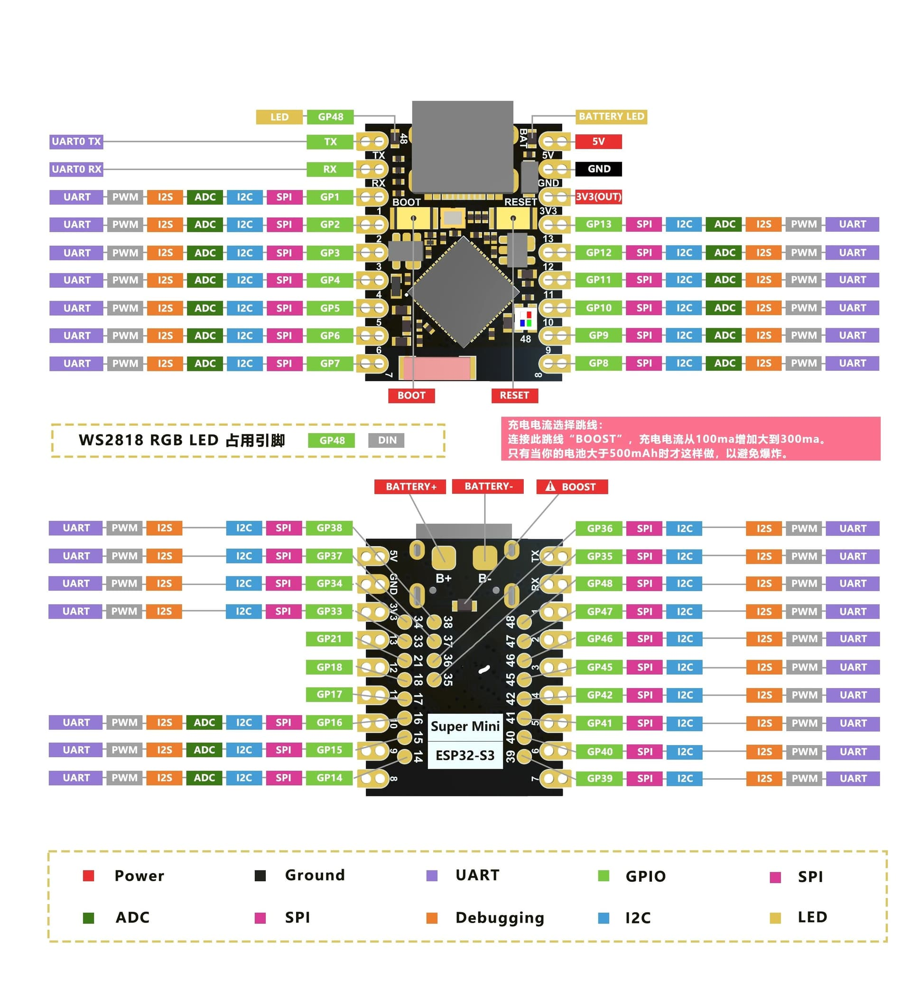

# Configurable Edge Platform on the ESP32-S3 (D1 to D6)

**D6 branch planning (10 November 2026).** The three-board end-to-end demo is
planned in [D6 validation plan](docs/D6_USECASE_VALIDATION_PLAN.md), with a
[session worksheet](docs/D6_TRIAL_WORKSHEET.md). This branch starts from the
older `d3-board` checkpoint; `origin/main` at `b389714` is now integrated in
the prepared merge. The separate `lcd-output` integration and D6 board tests
remain pending.
D3 is the timing/sequencing subsystem, not the scope of the whole project.
The earlier doorway plan is retained as a reference, not the selected final demo.

Project baseline integrated into `d6`: D1 (tasks 1–34), the D2 SPI checkpoint, the D3 timing checkpoint and the first D4 ML checkpoint. The agreed task lists for the D1 MQTT work and for D4 to D6 are in sections 2 and 5 to 7. This is the Pico 2 W edge firmware (configpico2wedge / FlexiEdgePico `project_v3`) ported to the ESP32-S3 Super Mini. Since Tribunal 1 the firmware runs on µT-Kernel 3 SMP through the course port ([MTK_REDESIGN.md](MTK_REDESIGN.md)), and D2's SPI and D3's timing run on it too; the earlier Arduino-ESP32/FreeRTOS port stays as the measured baseline. The same configuration lines, console commands, MQTT topics, output format and ML model work on both boards, because both builds compile the same shared code.

**Current breadboard.** The three-sensor breadboard (AHT temperature and humidity, HC-SR04+ distance and TSL2561 light, with the LCD wiring kept) and its Windows and VS Code build workflow are in [SENSOR_BREADBOARD_README.md](SENSOR_BREADBOARD_README.md). The single-sonar, loopback, radar and SPI fixtures in this guide use other pins; do not apply them to that breadboard.

## Deliverables at a glance

| Deliverable | What it is | Owners | State on `main` (10 Nov 2026) | Details |
|---|---|---|---|---|
| D1 | Port configpico2wedge to the ESP32-S3, on µT-Kernel 3 SMP since Tribunal 1 | Hasif, Cody, Sitt | Done (tag `d1-mtk-v1.0`); MQTT between real boards (1.1–1.5) done 10 Nov, 43/43 on two boards; task 7 rollout and six jumper or light-sensor stages pending | [Section 2](#2-d1-task-checklist) |
| D2 | SPI support on the ESP32-S3 | Brendan, Jun Yong | Checkpoint merged (PR #3 on 27 Oct, PR #5 on 1 Nov); event logging, T-23 and sign-off open | [Section 3](#3-d2-task-checklist) |
| D3 | Configurable timing: periodic, one-shot, event-driven, logical sequence | Cody | Checkpoint merged (PR #6 on 3 Nov, PR #8 on 9 Nov); board results pending | [Section 4](#4-d3-task-checklist) |
| D4 | Embedded ML | Part 1: Jun Yong, Brendan. Part 2: Hasif, Sitt | Three bundled models swap on the board, the int8 one on the S3's vector instructions (2.1, 10 Nov); `ML` commands work over the console and MQTT; live switching (3.1–3.7) open | [Section 5](#5-d4-task-checklist) |
| D5 | Benchmarking, cut down | Sitt, with Hasif | Task list agreed (4.1–4.6); B1–B8 plan on `s3-port-d5`, not merged | [Section 6](#6-d5-task-checklist) |
| D6 | End-to-end use case and demo | Whole team, Cody leads | Task list agreed (5.1–5.8); use case to confirm (5.1) | [Section 7](#7-d6-task-checklist) |

Owners are the team workload split of 28 Sep 2026, with D4 to D6 re-split on 10 Nov 2026. The D1 MQTT tasks 1.1–1.5 (section 2) and the D4 to D6 tasks 2.1–5.8 (sections 5 to 7) are the outline the team agreed on 10 Nov 2026; each owner turns their rows into technical steps later and keeps the numbers. Order: 1.4 and 2.1 come first because D4 part 2 needs them, 2.4 feeds 4.4, and the D1 MQTT tasks and both D4 parts feed D6. Each owner updates their row and section when their work merges.

## Contents

| Section | What's in it |
|---|---|
| [1. Start here](#1-start-here) | What the firmware runs on (µT-Kernel 3 SMP), the 7 commands to try, and every result next to the FreeRTOS baseline |
| [Feedback tracker](WEEK6_FEEDBACK_RESPONSE.md) | Every professor feedback item on the Week 6 design review: owner, status, evidence, next action |
| [2. D1 task checklist](#2-d1-task-checklist) | Tasks 1–23 with status and dev notes; [execution model](#execution-model); [tasks 24–34: µT-Kernel 3 SMP redesign](#d1-redesign-port-to-µt-kernel-3-smp-tasks-2434); [tasks 1.1–1.5: MQTT between real boards](#d1-mqtt-between-real-boards-tasks-1115) |
| [µT-Kernel redesign plan](MTK_REDESIGN.md) | Change requirement, FreeRTOS-to-µT-Kernel mapping, core assignment, compliance matrix |
| [3. D2 task checklist](#3-d2-task-checklist) | D2 SPI tasks D2-1 to D2-11 with status, the checks before the merge, how to run the SPI tests, what D2 still needs; full list in [D2_SPI_TODO.md](D2_SPI_TODO.md) |
| [4. D3 task checklist](#4-d3-task-checklist) | How the timing modes, the radar entrance window and event identity work, D3 tasks D3-1 to D3-12 with status, the D3 commands and tests |
| [5. D4 task checklist](#5-d4-task-checklist) | What is on `main` now; part 1, the ML itself (2.1–2.6); part 2, configuring and switching ML (3.1–3.7) |
| [6. D5 task checklist](#6-d5-task-checklist) | Cut-down benchmarking tasks 4.1–4.6 |
| [7. D6 task checklist](#7-d6-task-checklist) | Use case and demo tasks 5.1–5.8 |
| [8. Set up and test from scratch](#8-set-up-and-test-from-scratch-d1-to-d3) | Step-by-step on a new Mac for the µT-Kernel build (D1 to D3) |
| &nbsp;&nbsp;[Part A: Install](#part-a-install) | Steps 1–4: tools, project, ESP-IDF and the course port, version check |
| &nbsp;&nbsp;[Part B: Wi-Fi and broker](#part-b-wi-fi-and-broker) | Steps 5–7: laptop IP, Wi-Fi file, MQTT broker |
| &nbsp;&nbsp;[Board pinout](#board-pinout) | Super Mini pin diagram and how to hold the board |
| &nbsp;&nbsp;[Part C: Flash](#part-c-flash) | Steps 8–10: flash and the live console |
| &nbsp;&nbsp;[Part D: Tests](#part-d-tests) | Steps 11–22: every wiring-free test and what it shows |
| &nbsp;&nbsp;[Part E: Real sensors](#part-e-real-sensors) | GY-511, HC-SR04, the light sensor and jumper tests; why no resistor |
| &nbsp;&nbsp;[Part F: D2 SPI](#part-f-d2-spi) | Host test, loopback suite and benchmark, read-only W25Q32 checks |
| &nbsp;&nbsp;[Part G: D3 timing and application](#part-g-d3-timing-and-application) | Laptop tests, the application smoke test, a timing-mode example, `PAIR` and `WINDOW` |
| [9. Using any sensor](#9-using-any-sensor-config-cheat-sheet) | Wiring and the config line for every sensor type, including SPI, and rules; [over MQTT](#over-mqtt-how-it-works-and-what-to-send): topics, JSON forms, board to board |
| [10. Completion rule](#10-completion-rule) | When a task counts as done |
| [11. Arduino/FreeRTOS baseline](#11-arduinofreertos-baseline-set-up-and-test-reference) | The earlier build's step-by-step setup and tests, Mac and Windows |

Other documents: [SENSOR_BREADBOARD_README.md](SENSOR_BREADBOARD_README.md) (current three-sensor breadboard and Windows workflow), [WEEK6_FEEDBACK_RESPONSE.md](WEEK6_FEEDBACK_RESPONSE.md) (professor feedback tracker), [D2_SPI_TODO.md](D2_SPI_TODO.md) (D2 tasks), [SETUP.md](SETUP.md) (board and environment details), [parity/PARITY.md](parity/PARITY.md) (requirements and evidence), [PORTABILITY.md](PORTABILITY.md) (Pico to S3 changes and defects), [ARCHITECTURE.md](ARCHITECTURE.md) (task design), [project_v3/README.md](project_v3/README.md) (full config syntax).


---

# 1. Start here

**What D1 runs on.** Since Tribunal 1 (19 Oct 2026) the D1 firmware runs on µT-Kernel 3 SMP through the course port: [`esp32s3_mtk/`](esp32s3_mtk/) is an ESP-IDF project in which every application task is a µT-Kernel task pinned to a core, and the FreeRTOS scheduler never starts. The design, the FreeRTOS-to-µT-Kernel mapping, the core assignment and the clause-by-clause compliance matrix are in [MTK_REDESIGN.md](MTK_REDESIGN.md) (tasks 24–34). The Arduino-ESP32/FreeRTOS build (`esp32s3_edge/`, `tools/s3.sh`) stays as the measured baseline. D2's SPI runs on the µT-Kernel build as well; its tasks and tests are in [section 3](#3-d2-task-checklist). D3's timing modes and entrance window are in [section 4](#4-d3-task-checklist).

**Why it is the same firmware.** All platform-independent code (config parser, scheduler, REPL, rule engine, GPIO/I2C/UART drivers, MQTT payload handling, inference manager) is one library, [`libraries/EdgeCore/`](libraries/EdgeCore/), compiled unchanged by the Pico build and both S3 builds; `tools/check_hal_boundary.sh` proves it uses no Pico, Arduino or ESP-IDF calls. Only the HAL ([Pico](project_v3/platform/pico/hal_pico.c), [S3 on µT-Kernel](esp32s3_mtk/components/edge_mtk/hal_mtk.c), [S3 on Arduino](libraries/EdgeS3/src/hal_esp32s3.cpp)) and the platform services differ. The same test scripts run against every build with the same expected output; only pin numbers are mapped.

**Run it yourself** (µT-Kernel build; macOS or Linux, board on USB; details in [SETUP.md](SETUP.md#esp32-s3-on-µt-kernel-3-smp-tasks-2534)):

| Step | Command | You should see |
|---|---|---|
| 1. Install once | `sh tools/mtk.sh setup` | `Done. Edit esp32s3_mtk/main/wifi_credentials.h, then: sh tools/mtk.sh flash` |
| 2. Check versions and build | `sh tools/mtk.sh check` | course port `e92874d`, ESP-IDF `v6.1-dev-2300-g17a74c925c`, compiler `esp-15.2.0_20251204`, then `Project build complete` |
| 3. Flash | `sh tools/mtk.sh flash` | `Hash of data verified` |
| 4. Use the console | `sh tools/mtk.sh monitor`, then `HELP` and `TASKS` | the Pico's command list; each task with its core, priority and stack headroom |
| 5. Run a parity stage | `sh tools/mtk.sh test 4a` | `14/14 passed` |
| 6. Compare with the Pico | `sh tools/mtk.sh compare 4a` | Pico and µT-Kernel output, line for line the same |
| 7. MQTT (laptop running Mosquitto) | `sh tools/mtk.sh mqtt <laptop-ip>` | `27/27 passed` |

**Results on µT-Kernel 3 SMP** (2026-10-20, HW-747 Super Mini; raw logs in [`parity/logs/mtk/`](parity/logs/mtk/), FreeRTOS and µT-Kernel side by side in [PARITY.md §4](parity/PARITY.md#4-esp32-s3-on-µt-kernel-3-smp-tasks-24-to-34)):

| What | Command | µT-Kernel 3 SMP | FreeRTOS (Arduino) baseline |
|---|---|---|---|
| HAL: timing, GPIO, PWM, pulse, 20,000-edge counter, interrupt-driven echo | `haltest` | 27/27 (1 jumper check skipped) | 23/23 |
| Console, config, rules, inference | `test 4a` | 14/14, MSE 0.4179 | 14/14 |
| Invalid input refused | `test 5-neg` | 27/27 | 27/27 |
| Bad pin, 8 fast sensors, no-echo timeout, false rule | `test t03`, `t04`, `t06`, `t10` | 6/6, 13/13, 7/7, 7/7 | 6/6, 13/13, 6/7, 7/7 |
| I2C, real GY-511 compass and accelerometer | `test 4c-mag` (or `live mag`) | 15/15 | 15/15 |
| Real HC-SR04 distance, and rules on its readings | `test 4c-sonic`, `test sonic-rule` (or `live sonic`) | 4/4, 7/7 | not run |
| MQTT telemetry, config, commands, bridging, model upload | `mqtt <ip>` | 27/27 | 27/27 |
| Two real boards: every command over MQTT, sensor following, `cmd.to`/`cfg.to`, config whole and piecemeal (D1 tasks 1.1–1.4, 10 Nov) | `boards <ip>` | 43/43 | not run |
| Model storage: upload, bad uploads, survives reset | `model <ip>` | 8/9 (the miss is a test timing artefact; reload captured separately) | 9/9 |
| Faults: bad JSON, oversized, broker and Wi-Fi loss | `faults <ip>` | 9/9 | 9/9 |
| Queue flooding | `flood <ip>` | Pass | Pass |
| Sample timing (NFR1) | `timing` | Pass | Pass |
| 30-minute run (NFR6) | `endurance <ip>` | 6/6 | 6/6 |
| Every task on its assigned core; hardware watchdog | `TASKS`, `STALL 30000` | Pass | n/a |
| No FreeRTOS kernel code in the firmware image; no FreeRTOS, Arduino or `esp_driver_*` call in our code | `purity` (or `image`) | Pass | n/a (FreeRTOS is the baseline's RTOS) |

The GPIO and UART loopback stages (4b, 4c-uart, t02, t08, t09) need jumper wires and 4d-ir the light sensor; they are listed as hardware pending in PARITY.md §4, with wiring and commands in [SETUP.md](SETUP.md#hardware-checks-on-µt-kernel-jumpers-and-sensors). Two findings about the course port itself are recorded with evidence in MTK_REDESIGN.md: its radio sometimes stops receiving for a minute or more (§10), and its kernel and FreeRTOS shim had to be moved into IRAM before flash writes were safe (§8).

**Where things are.** µT-Kernel design and compliance: [MTK_REDESIGN.md](MTK_REDESIGN.md). Setup and board details: [SETUP.md](SETUP.md). Requirements and parity evidence: [parity/PARITY.md](parity/PARITY.md). Architecture (task 10): [ARCHITECTURE.md](ARCHITECTURE.md). Portability and design-review closure: [PORTABILITY.md](PORTABILITY.md). Config syntax and commands: [project_v3/README.md](project_v3/README.md).


---

# 2. D1 task checklist

> **Before changing the design or any task below, check the [professor feedback tracker](WEEK6_FEEDBACK_RESPONSE.md).** It lists every item of the Week 6 design-review feedback with its deliverable, owner, status, evidence and next action, for D1 to D6.

| # | Task | Required work | Acceptance evidence | Status | Dev notes |
|---:|---|---|---|---|---|
| 1 | Clean the workspace | Set aside unrelated debug edits, remove stale generated output, and ignore machine-specific files such as clangd's `.cache/`. | `git status` contains no unexpected changes, and generated or credential files are not tracked. | Done |  |
| 2 | Create the `s3-port` baseline | Branch from the supplied `Pico_Sample`, restore the TFLite Micro submodule, retain real commit authorship, add the setup guide, and keep the supplied Pico source unchanged except for documented setup repairs. | Branch history is traceable, the submodule commit is recorded, and no unrelated branch changes are included. | Done |  |
| 3 | Rebuild the Pico reference | Configure a clean Pico 2 W build using the pinned Pico SDK and Arm GCC 14.2 toolchain. Record the source commit and exact tool versions. | `Built target project_v3`, `project_v3.uf2` exists, and the build log records the commit, SDK, compiler, and artifact hash. | Done | Build record and artifact hashes in [parity/logs/3-build.txt](parity/logs/3-build.txt) |
| 4 | Define requirements and the parity test plan (the port's rulebook) | Before any porting, write down exactly what "working" means: every Pico feature the ESP32-S3 must reproduce, the numbers it must meet, the defects found in the supplied firmware, and the test that proves each item. The result is [parity/PARITY.md](parity/PARITY.md), which every later task tests against. In detail: write project-specific functional requirements for REPL/configuration, scheduling, GPIO, I2C, UART, rules, MQTT, model transfer, and inference. Add measurable non-functional requirements for timing, latency, memory, reconnect behaviour, watchdog stability, and acceptable parity tolerances. Create the traceability and parity-table skeleton before testing. | Every requirement has an ID, acceptance criterion, planned test, owner, and target evidence; every feature planned in tasks 13–20 has a Pico and ESP32-S3 test row. | Done | Hasif. Signed off by the team. Requirements: [parity/PARITY.md §1](parity/PARITY.md#1-requirements-task-4) |
| 5 | Execute the full Pico baseline | Test the Pico REPL and inline/JSON configuration; scheduler; GPIO digital, pulse, counter, and one-wire modes; I2C; UART; all documented local and remote rule actions; MQTT telemetry/configuration/commands/bridging; model upload; and inference. Include invalid input, missing-sensor, timeout, and disconnect cases where supported. | The Pico column of the parity table contains the exact command/configuration, expected and observed result, tolerance or measurement, result, and linked evidence for every row. | Done | Hasif. UART radar deferred (P-30). Task 8: HC-SR04 Echo needs a divider on the S3. Results: [parity/PARITY.md §2](parity/PARITY.md#2-parity-table-task-5), logs in [parity/logs/](parity/logs/) |
| 6 | Freeze and tag the Pico reference | Resolve or explicitly record every failed baseline test, commit the Pico evidence, and create an annotated `pico-reference` tag before shared firmware is refactored. | The pushed tag resolves to the tested commit; a clean checkout of the tag builds and reproduces the recorded baseline. | Done | Hasif. Tag `pico-reference`. Check: [parity/logs/6-reference-check.txt](parity/logs/6-reference-check.txt) |
| 7 | Standardise the Arduino ESP32-S3 environment | Install the agreed Arduino IDE and the Espressif `esp32` board package through Boards Manager. Pin the exact IDE and Arduino-ESP32 core versions on every machine. Record any Arduino CLI version used for repeatable builds, the board FQBN/profile and options, upload/monitor settings, and every external library version in `SETUP.md`; the minimal bring-up sketch currently needs no external library. | Every machine compiles the same minimal sketch with the recorded IDE/core and board settings. If Arduino CLI is adopted, its version, installed core, FQBN/options, and library list also match the recorded values. | In progress | Sitt (Windows, IDE 2.3.10) and Hasif (macOS, CLI 1.5.1) compile the bring-up sketch to the same 21,592 B globals; a clean clone with a fresh Arduino install builds, flashes and passes 4a/4b/5-neg. Remaining teammates: run `sh tools/s3.sh check` and post the output. [SETUP.md](SETUP.md#arduino-environment-baseline-task-7) |
| 8 | Confirm hardware and produce the integration pin layout | Identify the exact ESP32-S3 Super Mini board/revision and module marking, flash/PSRAM capacity, USB console and upload path, board profile, Flash Size, PSRAM, USB Mode, USB CDC On Boot and Upload Mode selections where offered, first-upload/boot-button procedure, usable and reserved/strapping pins, and power limits. Define the final GPIO, I2C, UART, PWM, HC-SR04 divider, sensor supply, and ground connections, with a driver/task owner for each device. | `SETUP.md` contains the physically verified board settings, upload/serial procedure, pin/power table, cited matching pinout, and readable wiring diagram; the selected settings produce no pin conflicts. | Done | Sitt: HW-747 pinout matched, USB path. Hasif: chip ESP32-S3FH4R2 (4 MB flash, 2 MB PSRAM) read by esptool, final board settings, pin/power table and no-conflict wiring: [SETUP.md](SETUP.md#pin-power-and-wiring-task-8) |
| 9 | Bring up the ESP32-S3 with Arduino | Keep the minimal `esp32s3/esp32s3.ino` sketch independent of framework code. Using the pinned task 7 environment and confirmed task 8 settings, compile and upload it, then observe its repeating `Hello from ESP32-S3` output at 115200 baud on the actual console path. FreeRTOS architecture tests belong to task 13 rather than this hardware-isolation step. | Arduino IDE Verify/Compile, Upload, and Serial Monitor work on the physical Super Mini using recorded settings; the expected line is observed without resets. A successful compile alone does not complete the task. | Done | Sitt. Local HW-747 bring-up on 2026-10-13 using source commit `fe082bd`; [result record](parity/logs/9-arduino-bringup.txt). Task 7 team rollout and Task 8 integration layout remain separate. |
| 10 | Complete the architecture freeze | Consolidate team roles and subsystem ownership; final functional/non-functional requirements; hardware layout; HAL boundary; RTOS task table with priorities, periods/triggers, stack sizes, ownership and core affinity where relevant; task/ISR/queue/mutex/event interaction diagram; system statechart; scheduler/sensor, MQTT, and model-transfer subsystem statecharts; assumptions with risk and validation; and team-reviewed AI design evidence. | All design-review sections are project-specific, internally consistent, readable, reviewed by the team, and traced to implementation tasks and verification cases. Major later deviations require a recorded engineering justification. | Submitted | Team. Submitted as the Week 6 design review. [ARCHITECTURE.md](ARCHITECTURE.md) is Hasif's earlier draft and still needs aligning with the submitted version Feedback tracker: [WEEK6_FEEDBACK_RESPONSE.md](WEEK6_FEEDBACK_RESPONSE.md) |
| 11 | Define the HAL and refactor the Pico backend | Specify time, delay, console, GPIO output, PWM, and any other genuinely shared platform services, including units, return values, timeout/error semantics, thread-safety, and ISR restrictions. Implement the Pico backend and switch shared modules to the HAL without changing external behaviour. | The tagged Pico parity suite passes again after the refactor, and no shared module bypasses the agreed HAL without a documented reason. | Done | Hasif. HAL: [libraries/EdgeCore/src/hal/hal.h](libraries/EdgeCore/src/hal/hal.h); check: [tools/check_hal_boundary.sh](tools/check_hal_boundary.sh); test logs: [parity/logs/task11/](parity/logs/task11/). I2C and HC-SR04 stages not re-run (drivers unchanged, sensors not at hand). One freeze under check (D-13) |
| 12 | Implement the Arduino ESP32-S3 HAL and shared build | Implement the ESP32-S3 HAL using Arduino-ESP32 services such as `micros()`, `delay()`/FreeRTOS delays, `Serial`, GPIO, and LEDC, using lower-level APIs exposed by the Arduino core only where required. Package the platform-independent sources as a local Arduino library or equivalent shared source target without copied forks. Document repeatable Pico and Arduino IDE build procedures and add Arduino CLI commands if the team adopts CLI verification. | Timing and console tests pass on hardware; both targets build cleanly; shared sources remain identical; the Arduino versions, libraries, and board options are reproducible; and unsupported operations return documented errors. | Done | Hasif. Shared code is one library, [libraries/EdgeCore/](libraries/EdgeCore/), built by both targets; S3 HAL in [esp32s3_edge/](esp32s3_edge/); build steps in [SETUP.md](SETUP.md); HAL test 18/18 on the HW-747: [parity/logs/task12/](parity/logs/task12/) |
| 13 | Implement the Arduino-hosted FreeRTOS runtime, main control, and REPL | Implement the architecture from task 10 by creating the required FreeRTOS tasks from Arduino `setup()`, with explicit task ownership and the required queues, mutexes, event groups, notifications, or callbacks. Keep Arduino `loop()` non-blocking or use it only for a documented supervisory role. Ensure every blocking operation yields or times out, shared data is protected, and the watchdog remains serviced. | `HELP`, `SHOW`, `RUN`, `STOP`, and `CLEAR` match the Pico response contract; task priorities and communication paths match the design; stack high-water marks are safe; and the board runs without watchdog resets. | Done | Hasif. Runtime per the Week 6 task table: [libraries/EdgeS3/src/runtime_s3.cpp](libraries/EdgeS3/src/runtime_s3.cpp). S3: 4a 13/14 (inference waits on task 20), 5-neg 26/26, t03, t04, t10 pass; every task keeps over 2 KB of stack free; logs [parity/logs/task13/](parity/logs/task13/) |
| 14 | Port the scheduler and GPIO digital mode | Port scheduling and digital input using the same configuration semantics as the Pico, with only board-specific pins changed. Implement pull, invert, debounce, invalid-pin, and scheduler-overload handling. | Output format and values match the baseline; measured sample period and jitter meet the non-functional requirement; invalid configurations fail safely. | Done | Hasif. Shared GPIO driver, RTOS scheduler, bad pins refused (D-02, D-08); NFR1 measured. [parity/PARITY.md §3](parity/PARITY.md#3-esp32-s3-results-tasks-13-to-21) |
| 15 | Port pulse, counter, and one-wire GPIO modes | Port HC-SR04 pulse measurement, edge counting, and one-wire sensor timing using watchdog-safe and concurrency-safe mechanisms. Define ISR ownership and atomic access where interrupts are used. | Each GPIO parity row passes; distance affects pulse width correctly; counter tests do not lose events within the stated limit; disconnected sensors time out; and timing-sensitive reads do not starve other tasks. | Done | Hasif. Non-blocking pulse, ISR edge counter (20,000 edges, none lost). HC-SR04 needs a 1:2 divider. [parity/PARITY.md §3](parity/PARITY.md#3-esp32-s3-results-tasks-13-to-21) |
| 16 | Port I2C | Implement the Arduino `Wire` I2C path with the same configuration semantics, explicit bus ownership, timeouts, repeated-start behaviour, and recovery handling. Use a lower-level API only when an evidenced framework limitation requires it, and document that exception. | The reference I2C sensor matches the Pico result, and NACK, missing-device, timeout, repeated-start, multiple-device, and recovery tests have recorded outcomes. | Done | Hasif. Shared I2C driver on `Wire`; real GY-511 passes 15/15 (identity, two devices on one bus, with and without repeated start, missing device) ([parity/logs/s3/4c-mag.log](parity/logs/s3/4c-mag.log)) |
| 17 | Port UART | Implement UART polling/streaming with Arduino `HardwareSerial`, including framing, optional pre-bytes, delays, line mode, buffering, and timeout/error handling without conflicting with the USB console. Use a lower-level API only for requirements that `HardwareSerial` cannot meet. | The reference UART sensor matches the Pico result; partial messages, framing settings, timeout, overflow, and sustained-input tests have recorded outcomes. | Done | Hasif. Loopback 8/8, UART flush fix (D-05); radar deferred (P-30). [parity/PARITY.md §3](parity/PARITY.md#3-esp32-s3-results-tasks-13-to-21) |
| 18 | Port the rule engine actions | Preserve RPN evaluation and implement/verify log, GPIO high/low/toggle/pulse, PWM/LEDC, batch, remote configuration/command, and inference-related actions. Defer only the final network/model-dependent checks to tasks 19–21. | Representative true/false expressions and every documented action have deterministic pass/fail tests; GPIO/PWM measurements and emitted events match the required semantics. | Done | Hasif. Rule checks at add time (D-03, D-04), D-11, D-14 fixed; non-blocking PULSE. [parity/PARITY.md §3](parity/PARITY.md#3-esp32-s3-results-tasks-13-to-21) |
| 19 | Port Wi-Fi, MQTT, and sensor bridging | Implement connectivity with Arduino `WiFi` and one selected, version-pinned Arduino-compatible MQTT library. Preserve telemetry, presence/heartbeat, configuration, commands, events, and sensor bridging. Define callback-to-task ownership, queue limits, credentials handling, reconnect/backoff, and malformed/oversized payload behaviour. | Normal telemetry and remote configuration pass; Wi-Fi loss, broker loss, reconnect, malformed JSON, oversized payload, queue saturation, and bridge tests recover safely without leaks or watchdog resets. | Done | Hasif. WiFi + MQTT task, bridging (D-10), fault tests. [parity/PARITY.md §3](parity/PARITY.md#3-esp32-s3-results-tasks-13-to-21) |
| 20 | Port model storage, transfer, and inference | First compatibility-test and pin the selected Arduino-compatible ML integration. Define a safe partition layout; use an Arduino-compatible flash/partition interface, including underlying ESP partition or PSRAM APIs only as documented exceptions where required, for bounded model storage; and preserve normalization, thresholds, score modes, approved model upload/selection/replacement, the `send_model.py` path where compatible, and `infer.set`/`infer.run` behaviour. Add integrity checks and interrupted-upload handling. | Valid models upload without rebuilding the base firmware, persist across reboot, load, and produce scores within the stated tolerance; invalid, oversized, corrupt, and interrupted uploads are rejected or recovered safely; arena/heap use, throughput, and inference latency meet requirements. | Done | Sitt: TFLite Micro inference, 40 invocations match the Pico (`MSE=0.4179`). Hasif: S3 model storage in LittleFS; upload, CRC check, corrupt/oversized/interrupted refusal and reboot persistence pass ([parity/logs/s3/model.log](parity/logs/s3/model.log)). FP32 SVDD needs 17 inputs, beyond the 16-input limit. [Hardware check](parity/task20/README.md) |
| 21 | Run end-to-end parity, fault, timing, and endurance verification | Execute the complete requirements-based suite on the final ESP32-S3 build. Include nominal parity, negative/fault injection, scheduler jitter, REPL latency, MQTT recovery, stack/heap high-water measurements, inference timing, resource contention, and an agreed continuous-run test. | The parity and traceability tables have no unexplained gaps. Every row records pass/partial/fail with reason, measurement, evidence, commit, hardware, tester, and date; every non-functional limit is measured. | Done | Hasif. Full S3 suite, MQTT faults and 30-min endurance pass with no resets ([parity/PARITY.md §3](parity/PARITY.md#3-esp32-s3-results-tasks-13-to-21)). Pico firmware builds with the shared changes; Pico hardware re-run pending (board not detected over USB) |
| 22 | Close portability and design-review documentation | List every Pico-specific dependency and its HAL or Arduino replacement, every necessary underlying ESP-IDF exception, and all timing, concurrency, memory, SDK, hardware, and unsupported-feature differences. Update the architecture, statecharts, assumptions, ownership, and traceability to match the implementation. Complete the AI-supported final gap check with team responses, actions, and evidence, and perform the design-consistency review. | Every rewritten or platform-specific file is covered; each underlying ESP-IDF exception is justified and tested; assumptions are validated or accepted with reasons; all requirements trace to evidence; and no stale names, pins, tasks, interfaces, or unresolved AI-review gaps remain. | Done | Hasif. [PORTABILITY.md](PORTABILITY.md) |
| 23 | Release from a clean Arduino environment | Review and merge `s3-port` into `main`, create the release tag, clone recursively into a new directory, install the pinned Arduino IDE, Arduino-ESP32 core, board settings, and libraries, then follow `SETUP.md` without undocumented steps to compile, upload, monitor, and rerun the release smoke and critical parity tests. Package the final design-review artefacts and link the repository. | The fresh environment builds and runs on the target board and reproduces the parity checks; the tag, submodules, Arduino configuration, documentation, evidence, and repository link are available to the whole team. | Superseded by task 34 | Team confirmed; merge to `main` on hold, now done as task 34 after the µT-Kernel redesign. Steps: [SETUP.md](SETUP.md#release-task-23) |

### D1 redesign: port to µT-Kernel 3 SMP (tasks 24–34)

Change requirement from Tribunal 1 (19 Oct 2026): the firmware must run on the course µT-Kernel 3 SMP port, every application task must be a µT-Kernel task, every queue, mutex, event group and timer must become a µT-Kernel object, the task-to-core assignment must be defined and justified, and ISRs must interact safely with µT-Kernel tasks. The plan, the FreeRTOS-to-µT-Kernel mapping, the core assignment and the clause-by-clause compliance matrix are in [MTK_REDESIGN.md](MTK_REDESIGN.md). The work was done on `s3-port-d1-redesign` (from `s3-port-d2`) and merged into `main`; D2 then ported its SPI onto this runtime, and D3 onwards are ported by their owners. The Arduino/FreeRTOS build stays in the repository as the measured baseline.

| # | Task | Required work | Acceptance evidence | Status | Dev notes |
|---:|---|---|---|---|---|
| 24 | Plan the µT-Kernel 3 SMP redesign | Map every clause of the change requirement to a design decision, a task and its evidence. Record the FreeRTOS-to-µT-Kernel object mapping, the task table with cores, priorities and stacks and the justification for the core assignment, what is kept (EdgeCore, hardware, commands, topics) and what is replaced (the Arduino platform layer), and the Tribunal 1 decisions. | [MTK_REDESIGN.md](MTK_REDESIGN.md) covers every clause; tasks 25–34 trace to it. | Done | Hasif |
| 25 | Pin the course port and the toolchain | Add the course port `sirfonzie/mtk3smp-esp32s3` as an unmodified submodule pinned to a commit. Pin ESP-IDF `v6.1-dev-2300-g17a74c925c` and `xtensa-esp-elf-gcc 15.2.0`, the versions the port is qualified on, and lock every component-manager dependency. Add `tools/mtk.sh` (setup, check, build, flash, monitor, test) and a SETUP.md section. | `sh tools/mtk.sh check` prints the pinned port commit, IDF and compiler versions and builds the firmware; a clean recursive clone builds the same way. | Done | Hasif. Port `e92874d`, IDF `v6.1-dev-2300-g17a74c925c`, `esp-15.2.0_20251204`; `sh tools/mtk.sh check` verifies all three and builds. [SETUP.md](SETUP.md#esp32-s3-on-µt-kernel-3-smp-tasks-2534) |
| 26 | Bring up µT-Kernel 3 SMP on the HW-747 Super Mini | Create the ESP-IDF project `esp32s3_mtk/` on the port's global-SMP profile (`CONFIG_MTK_SMP`, two dispatchers) with the generic board package, the native USB-Serial-JTAG console, a 4 MB partition table and the port's watchdog policy. Create one idle task per core and show a pinned task running on each core. | Boot log on the board: µT-Kernel 3.00 banner, SMP profile, a task on each processor printing its core; no resets. | Done | Hasif. µT-Kernel 3.00 SMP boots with 2 processors; the task pinned to core 0 always reports core 0 and the one pinned to core 1 reports core 1: [parity/logs/mtk/26-bringup.log](parity/logs/mtk/26-bringup.log) |
| 27 | Implement the µT-Kernel HAL backend | Replace Arduino-ESP32 with register-level drivers, following the port's rule of no `esp_driver_*` components: time from SYSTIMER, delays with `tk_dly_tsk`, the USB console with an interrupt-fed receive ring and a priority-inheritance mutex so lines from both cores never interleave, GPIO, PWM (LEDC), I2C master with repeated start and timeouts, UART with an interrupt-fed receive ring, PULSE ended by an alarm handler, edge counting by a GPIO interrupt handler. SPI returns `HAL_ERR_UNSUPPORTED` until the D2 owners port it. Add `tools/check_mtk_purity.sh`, which fails if our code calls any FreeRTOS, Arduino or `esp_driver_*` API, and a HAL test firmware that also measures PWM, PULSE and edge counting on one pin without wiring. | `check_hal_boundary.sh` and `check_mtk_purity.sh` pass; the HAL test passes on the board; jumper-only measurements are recorded as hardware pending. | Done | Hasif. [console_mtk.c](esp32s3_mtk/components/edge_mtk/console_mtk.c), [hal_mtk.c](esp32s3_mtk/components/edge_mtk/hal_mtk.c). HAL test 23/23 on the HW-747 (`sh tools/mtk.sh haltest`): delays, console, GPIO, PWM duty within 0.001, 200 ms PULSE returning in 59 µs, 20,000 edges at 19.8 kHz with none lost, UART loopback, I2C NACK, test task on core 1: [summary](parity/logs/mtk/27-hal_test-summary.txt). Jumper checks 5↔6: hardware pending. `sh tools/mtk.sh purity`: 41 files clean. SPI was ported to this HAL later by D2 ([section 3](#3-d2-task-checklist)) |
| 28 | Implement the µT-Kernel runtime | Create SchedulerTask, MQTTTask, ControlTask, InferenceTask, ApplicationTask, BenchmarkTask and MonitorTask as µT-Kernel tasks pinned at creation (`TA_ASSPRC`, `TA_FPU`) with priorities `25 − FreeRTOS priority`. Replace the five queues with message buffers of the same capacities (drop newest and log when full) and the event group with an event flag. MonitorTask runs from a cyclic handler and checks stacks, heap and task heartbeats. Create every object at boot and check every result. `TASKS` prints each task's ID, assigned and current core, priority, stack headroom, residency per core and the queue drop counters. | `HELP`, `SHOW`, `RUN`, `STOP`, `CLEAR` match the Pico (4a); 5-neg, t03, t04 and t10 pass; `TASKS` shows every task only on its assigned core. | Done | Hasif. [runtime_mtk.c](esp32s3_mtk/components/edge_mtk/runtime_mtk.c): 7 tasks, 5 message buffers, 1 event flag, 1 cyclic handler, 8 alarm handlers, all created and checked at boot. 4a 13/14 (inference waits on task 31), 5-neg 27/27, t03 6/6, t04 13/13, t10 7/7 ([logs](parity/logs/mtk/)). Every task only on its core: [28-core-residency.log](parity/logs/mtk/28-core-residency.log). Hardware watchdog proven by `STALL 30000`: MonitorTask stops feeding 5.3 s into the stall and timer group 0's watchdog resets the chip 10 s later (`TG0WDT_SYS_RST`), while SchedulerTask keeps sampling until the reset: [28-watchdog.log](parity/logs/mtk/28-watchdog.log). This task first used the RTC watchdog; task 30 replaced it with timer group 0's because the RTC watchdog survives the reset into download mode and reset the chip in the middle of a flash. Internal heap free 199 KB before Wi-Fi starts (PSRAM holds EdgeCore's tables: [MTK_REDESIGN.md §8](MTK_REDESIGN.md#8-memory-plan)) |
| 29 | Make the HC-SR04 echo wait interrupt-driven and prove the ISR paths | Add `hal_gpio_measure_pulse` to the HAL so the shared GPIO driver measures echo pulses through it (the Pico keeps its reference busy-wait). On µT-Kernel the GPIO interrupt handler (task 27) timestamps the echo edges and sets an event flag, and the waiting task sleeps on `tk_wai_flg` instead of spinning for up to 25 ms, so the core is free for other tasks. Check every interrupt handler against the rules: registered with `tk_def_int` on core 1, minimal work, no application data, signalling only through µT-Kernel calls allowed in handlers. | Pulse timeout and no-echo cases match the baseline (t06); a self-driven echo test measures known pulse widths; a CPU-release check shows another task on core 1 keeps running while the echo is awaited; real HC-SR04 and the edge-count jumper test are hardware pending. | Done | Hasif. [hal_mtk.c](esp32s3_mtk/components/edge_mtk/hal_mtk.c) `hal_gpio_measure_pulse`; shared driver [gpio.c](libraries/EdgeCore/src/bus/gpio.c) now calls the HAL (Pico and Arduino backends keep the reference busy-wait; both still build). HAL test 27/27: a 5 ms echo measured as 5.26 ms, no echo times out at 25.7 ms, a stuck echo reports 25001 as before (D-07), and a lower-priority task on core 1 ran 560,109 loops during the echo wait against 0 during a busy-wait. t06 7/7 (the Arduino build was 6/7: its GPIO7 pull-down did not hold). [Evidence](parity/logs/mtk/29-echo-and-wcet.txt). A real HC-SR04 (3 V module) was measured on 2026-10-21: `4c-sonic` 4/4 and `sonic-rule` 7/7, see task 32. The 5↔6 edge-count jumper: hardware pending |
| 30 | Port Wi-Fi and MQTT onto the course port | MQTTTask on core 0 owns `esp_wifi` and esp-mqtt (registry component, version locked). Inbound messages are copied by the MQTT event handler into `sched_mbf`; outbound go through `pub_mbf`; Wi-Fi and broker state are event flags. Keep the topics, payloads, bridging, reconnect and back-off, `WIFISCAN`, `WIFIDROP`, oversized-payload truncation and offline refusal. | `mqtt` 27/27, `faults` 9/9 and `flood` pass on the µT-Kernel build. | Done | Hasif. [net_mtk.c](esp32s3_mtk/components/edge_mtk/net_mtk.c): MQTTTask on core 0 owns `esp_wifi` and esp-mqtt 1.1.0; the event handlers only set or clear `net_flg` bits and copy inbound messages into `sched_mbf`. On this build: `mqtt` 25/27, where the two failing steps are the model upload and inference on it, which arrive in task 31; `faults` 9/9 (broker back in 2.1 s, node back on the broker 5.2 s after Wi-Fi returns, heap flat, no reset); `flood` pass (2,544 messages at 50 per second, heartbeat and telemetry kept): [logs](parity/logs/mtk/). MQTTTask has a 16 KB stack because the publish path uses about 8 KB. The watchdog moved to timer group 0 (task 28 row). The course port's radio intermittently stops receiving; this reproduces without our code and is documented with the recovery behaviour in [MTK_REDESIGN.md §10](MTK_REDESIGN.md#10-test-plan-and-hardware-needs) ([evidence](parity/logs/mtk/30-wifi-findings.txt)) |
| 31 | Port model storage and make InferenceTask real | Build TFLite Micro from the registry component (version locked) with its 64 KB arena in PSRAM, as in the Arduino build. Replace LittleFS with a two-slot model store in a raw flash partition (size and CRC32 check, atomic commit, survives reboot). InferenceTask owns the interpreter: the inference manager in SchedulerTask sends the normalised input vector through `infer_mbf`, InferenceTask invokes the model and returns the outputs through a reply message buffer, and SchedulerTask computes the score and fires the chained action. | The 4a inference row passes and the built-in model reproduces the Pico result (MSE 0.4179); `model` 9/9. | Done | Hasif. [model_store_mtk.c](esp32s3_mtk/components/edge_mtk/model_store_mtk.c): two slots in the `model` partition, each with a CRC-checked header written last; an upload goes to the slot not in use and is read back and checked before it replaces the model, and at boot the newest valid slot is used in place through the flash cache. [inference_mtk.cpp](esp32s3_mtk/components/edge_mtk/inference_mtk.cpp): InferenceTask owns TFLite Micro (esp-tflite-micro 1.4.0, the release Arduino-ESP32 3.3.12 bundles) with the 64 KB arena in PSRAM; requests go through `infer_mbf` and replies through a reply buffer, matched by sequence number. 4a 14/14 with MSE 0.4179 as on the Pico; `mqtt` 27/27; `model` 8/9: every upload, refusal and inference step passes, and the one miss (`persists-after-reset`) is the test reopening the port 4 s after its reset, by which time this build has already reloaded the model, as [31-model-persists.log](parity/logs/mtk/31-model-persists.log) shows. Uploads first crashed the chip because the course port's shim and kernel run from flash and Wi-Fi interrupts called them while a flash write had the cache off ([evidence](parity/logs/mtk/31-upload-crash-without-iram-fix.log)); [port_iram.lf](esp32s3_mtk/components/edge_mtk/port_iram.lf) moves both into IRAM without changing the port ([MTK_REDESIGN.md §8](MTK_REDESIGN.md#8-memory-plan)) |
| 32 | Verify on µT-Kernel and compare with FreeRTOS | Re-run the unchanged D1 suite on the µT-Kernel build: parity stages, invalid input, NFR1 sample timing, SchedulerTask cycle time, MQTT faults and flooding, model upload and the 30-minute endurance run. Put the FreeRTOS and µT-Kernel results side by side. | [PARITY.md §4](parity/PARITY.md) has every row with result, measurement, log and date; hardware-dependent rows are marked pending with the wiring they need. | Done | Hasif. [PARITY.md §4](parity/PARITY.md#4-esp32-s3-on-µt-kernel-3-smp-tasks-24-to-34), 2026-10-20, FreeRTOS and µT-Kernel side by side: HAL test 27/27, 4a 14/14, 5-neg 27/27, t03 6/6, t04 13/13, t06 7/7, t10 7/7, `mqtt` 27/27, `model` 8/9, `faults` 9/9, `flood` pass, NFR1 pass at every graded rate, endurance 6/6 over 30 minutes with a flat heap, every task on its own core after the run ([32-tasks-after-suite.log](parity/logs/mtk/32-tasks-after-suite.log)), and SchedulerTask cycle times on both runtimes (the FreeRTOS run is [parity/logs/s3/wcet.log](parity/logs/s3/wcet.log)). Internal heap with Wi-Fi and MQTT running: about 40 KB on µT-Kernel against 48–54 KB on FreeRTOS. `sh tools/mtk.sh image` checks the linked firmware and finds no FreeRTOS scheduler, tick, task or start-up code, and fails as it should on the Arduino build ([32-image-check.txt](parity/logs/mtk/32-image-check.txt)). Real sensors on 2026-10-21: GY-511 `4c-mag` 15/15, 3 V HC-SR04 `4c-sonic` 4/4 and `sonic-rule` 7/7. Hardware pending: 4b, 4c-uart, 4d-ir, t02, t08 and t09, which need jumper wires or the light sensor; the wiring and commands are in [SETUP.md](SETUP.md#hardware-checks-on-µt-kernel-jumpers-and-sensors) |
| 33 | Close the redesign documentation | Fill the evidence column of the compliance matrix, update PORTABILITY.md, ARCHITECTURE.md, SETUP.md and the feedback tracker, and switch "Start here" to the µT-Kernel build. | No document still describes FreeRTOS or Arduino as the D1 runtime except as the baseline; every requirement clause links to evidence. | Done | Hasif. Every clause of the compliance matrix links to its evidence ([MTK_REDESIGN.md §9](MTK_REDESIGN.md#9-compliance-matrix)); [Start here](#1-start-here) runs the µT-Kernel build (`sh tools/mtk.sh compare` added for the Pico comparison); [PORTABILITY.md §6](PORTABILITY.md#6-the-µt-kernel-3-smp-build-tasks-2434) maps every Pico dependency onto the µT-Kernel build; ARCHITECTURE.md and SETUP.md mark the Arduino material as the baseline, and SETUP.md has a µT-Kernel testing section; the [feedback tracker](WEEK6_FEEDBACK_RESPONSE.md) has F6 resolved and redesign evidence on F5, R1, R4 and C2; [MTK_REDESIGN.md §11](MTK_REDESIGN.md#11-checked-against-the-course-ports-own-code) compares the build with the course port's own components and examples, with the reason for every difference and three defects found in the port |
| 34 | Release the µT-Kernel build | Merge `s3-port-d1-redesign` into `main`, tag the release, clone recursively into a new directory and follow SETUP.md to build, flash and rerun the smoke tests. | The tag resolves on origin; the clean clone builds and passes 4a. | Done | Hasif, 2026-10-21. A clean recursive clone (the course port fetched from GitHub) builds firmware identical to the image that passed the suite, apart from the 32-byte ELF fingerprint and the image hash that covers it. The branch merges into `main` with no conflicts (the merged tree equals the branch's) and is tagged `d1-mtk-v1.0`. The D2 SPI work up to the branch point came with it, as this branch is built on `s3-port-d2`; D2's µT-Kernel SPI backend followed in the D2 checkpoint merge ([section 3](#3-d2-task-checklist)) |

### D1 MQTT between real boards (tasks 1.1–1.5)

Added on 10 Nov 2026 because D4 to D6 depend on it. The professor asked that boards send each other data and commands, and noted that the group that got an A also took data from other groups' MQTT. Every MQTT test so far ran between one board and the laptop, with the laptop playing the second node (`pico-002`); two real S3 boards have not been tested together. Hasif owns these tasks. The team agreed them as an outline on 10 Nov 2026; the rows below are the technical version.

**How they are run.** Two bare ESP32-S3 boards (nothing wired: the tests use GPIO6 and GPIO7 as inputs with internal pulls, and GPIO8) on the laptop's USB, Mosquitto on the laptop (Part B), and both boards on the same 2.4 GHz network. With an iPhone hotspot, turn on Maximize Compatibility and keep the Personal Hotspot screen open while the boards join; otherwise they print `[WIFI] not connected: reason 201` (network not found). Both are flashed from the same checkout; the second node gets its own build directory and node ID at compile time, so `wifi_credentials.h` is not edited between flashes. Every configuration and command goes in over MQTT; the two consoles and the broker are only read.

```sh
PORT=<board A port> sh tools/mtk.sh flash                # s3-001, the NODE_ID in wifi_credentials.h
NODE=s3-002 PORT=<board B port> sh tools/mtk.sh flash    # s3-002, built in esp32s3_mtk/build-s3-002
BOARD=n16r8 NODE=s3-002 PORT=<port> sh tools/mtk.sh flash   # or s3-002 on the N16R8 DevKitC (8 MB octal PSRAM)
sh tools/mtk.sh boards <laptop-ip>                       # 1.4, 1.1, 1.2, 1.3 in turn; or add commands|data|control|config
```

Board B can be the larger ESP32-S3-WROOM-1 N16R8 DevKitC (16 MB flash, 8 MB octal PSRAM) instead of a second HW-747: `BOARD=n16r8` adds [esp32s3_mtk/sdkconfig.board.n16r8](esp32s3_mtk/sdkconfig.board.n16r8), whose only change is the PSRAM mode. Plug it in by the USB-C port wired to the chip's own USB: the console is the chip's USB-Serial-JTAG, and the other port goes through a CH343 UART bridge that shows only the boot messages. The first flash over that port may need BOOT held while RST is pressed, because the firmware it shipped with does not reset into download mode by itself. The script finds which port is which node by sending `SHOW` to each node's command topic, and writes one log per stage to `parity/logs/mtk/d1-mqtt/` with Wi-Fi names and MAC addresses redacted. With one board, `sh tools/mtk.sh boards <laptop-ip> commands` runs 1.4 alone.

| # | Task | Required work | Acceptance evidence | Status | Dev notes |
|---|---|---|---|---|---|
| 1.1 | Two-board data | Board A (`s3-001`) gets a GPIO input `DIG` (GPIO6, pull-down, 2 Hz) over MQTT and publishes `pico/s3-001/sensor/DIG/line`. Board B (`s3-002`) gets, over MQTT only, a sensor `REM` with `proto=mqtt`, `remote_node=s3-001`, `remote_source=DIG`, and two rules on its first byte: `R_LOW` when 0 and `R_HIGH` when 1. A is then reconfigured live with a pull-up. Nothing is reflashed between steps. | `boards data` passes 6/6. B logs `[BRIDGE] on_remote_line: s3-001/DIG -> local=REM`; every byte string B bridges is one A published; `R_LOW` fires while A reads 0 and `R_HIGH` after the live change to 1, never before; `pico/rule/R_LOW/event` reaches the broker. Log `parity/logs/mtk/d1-mqtt/data.log`. | Done | Hasif, 10 Nov 2026. 6/6 on `s3-001` (HW-747 Super Mini) and `s3-002` (N16R8 DevKitC). Every byte string B bridged is one A published; `R_LOW` then, after the live pull-up change, `R_HIGH` fired on B |
| 1.2 | Two-board control | A gets a one-shot GPIO input `GO` (`timing.mode=one_shot`, so each `RUN` or `TRIGGER GO` fires its rules once) and, in turn, rules whose actions are `cmd.to:s3-002:STOP`, `cmd.to:s3-002:RUN`, `cmd.to:s3-002:TASKS`, `cmd.to:s3-002:ML SHOW`, a text block `cfg.to:s3-002:BEGINCFG\|name=LED\|…\|ENDCFG`, a JSON block `cfg.to:s3-002:{"configs":[{"name":"LEDJ",…}]}`, and the same in the bare-word form of the reference project's own example (`test_json/h206_remote.json`), `cfg.to:s3-002:{configs:[{name:LEDR,…}]}`, which a rule written in JSON needs because it cannot hold nested quotes. B runs its own GPIO input `BDIG` meanwhile. | `boards control` passes 10/10. B prints `[CMD] STOP` and `BDIG` prints nothing more than 1 s later; `[CMD] RUN` restarts it; B answers the `TASKS` and `ML SHOW` that A sends; B adds a sensor named exactly `LED` (no trailing `\`, the D-11 symptom on the Pico), then `LEDJ` and `LEDR`, acknowledges each on `pico/s3-002/status/config` and lists all three in `SHOW`. Log `control.log`. | Done | Hasif, 10 Nov 2026. 10/10. The run found two defects, both fixed and covered by host tests: a rule whose action forwarded a payload with `gpio:` in it was refused on the sending board, because the pin check read into the `cfg.to`/`cmd.to` payload (the reference example's `gpio:{pin:26}` included); and the receiver rejected bare-word JSON (`jsmn error=-2`), the part of D-11 the escape fix had not covered. D-11 is now closed |
| 1.3 | Config over MQTT, one message and piece by piece | Send B two sensors (`C1`: GPIO6, pull-down, 1 Hz; `C2`: GPIO7, pull-up, 2 Hz) and a rule `R_C1` as one `{"configs":[…],"rules":[…]}` message, then `SHOW`, `CLEAR`, the same setup as three single-object messages (`{"type":"config",…}` twice, `{"type":"rule",…}`), `SHOW` and `RUN`. Then send one config on `pico/broadcast/config`. | `boards config` passes 9/9. Every item is acknowledged on `pico/s3-002/status/config` or `status/rule`; the two `SHOW` listings are identical; `R_C1` fires after `RUN`; the broadcast config is added and acknowledged by both A and B. Log `config.log`. | Done | Hasif, 10 Nov 2026. 9/9. The single message and the three separate messages give identical `SHOW` listings; the broadcast config was acknowledged by both nodes |
| 1.4 | Every console command over MQTT | Route every console command that arrives on `pico/<node>/cmd` to the handler the console uses. `ML …` goes to the ML parser. `TASKS`, `APP`, `WIFISCAN`, `WIFIDROP`, `SPI*` and `STALL` go to ControlTask through a new message buffer `ctrl_mbf` (4 messages of 128 bytes, newest dropped and counted when full). `WINDOW`, `WINDOW STATUS`, `PAIR`, `TRIGGER`, `SHOWRULES`, `CLEARRULES` and `HELP` go to `repl_command()`, the stateless part of the shared REPL, which the console now uses too. `RUN`, `STOP`, `CLEAR`, `SHOW`, `debug.infer`, `infer.mode` and `batch:` keep the MQTT handler's `[CMD]` replies, and `STOP` and `RUN` also end a `WINDOW` or `PAIR` as on the console. Configuration sent on the command topic is refused with a pointer to the config topic. | Host: `sh tools/mtk_runtime_test.sh` passes (routing, the ControlTask hand-off, a full `ctrl_mbf`, the REPL command table, and an MQTT command arriving in the middle of a typed config block). Board: `boards commands` passes 18/18, each command answering on A's console and `WIFIDROP` reconnecting by itself; the single-board `sh tools/mtk.sh mqtt <ip>` still passes 27/27. Log `commands.log`. | Done | Hasif, 10 Nov 2026. 18/18 on `s3-001`; host tests pass; the single-board `mqtt` regression still passes 27/27 ([mqtt-regression.log](parity/logs/mtk/d1-mqtt/mqtt-regression.log)). Builds checked: µT-Kernel firmware, Arduino baseline, and the shared files cross-compiled for the Pico 2 |
| 1.5 | Record and update | Run `sh tools/mtk.sh boards <ip>` (all stages) on two boards flashed from the same commit, and the single-board `mqtt` regression. Commit the logs, fill in this table's status and notes, and update FR-13 in [parity/PARITY.md](parity/PARITY.md) and the D1 row of [Deliverables at a glance](#deliverables-at-a-glance). | The logs are in `parity/logs/mtk/d1-mqtt/`; this table and FR-13 cite them with the commit and date. | Done | Hasif, 10 Nov 2026. Logs in [parity/logs/mtk/d1-mqtt/](parity/logs/mtk/d1-mqtt/); FR-13 and D-11 updated in [parity/PARITY.md](parity/PARITY.md), with the two-board rows in its section 4 |

> **D2 tasks** (SPI support, Brendan and Jun Yong) are tracked in [D2_SPI_TODO.md](D2_SPI_TODO.md), with the design in [D2_SPI_DESIGN_NOTES.md](D2_SPI_DESIGN_NOTES.md) and [D2_EVENT_RECORD_DESIGN.md](D2_EVENT_RECORD_DESIGN.md). Professor feedback that affects D2 is tracked in the [feedback tracker](WEEK6_FEEDBACK_RESPONSE.md#12-d2-feedback-status).

## Execution model

- Tasks 1–3 establish the common baseline. Their implementation work is complete; any missing build log or artifact metadata must be backfilled before task 10.
- After task 3, tasks 4–6 (Pico requirements and reference evidence) and tasks 7–9 (ESP32-S3 environment and board bring-up) run concurrently.
- Task 10 is the architecture-freeze gate. It cannot be completed until both parallel tracks are finished.
- Tasks 11–13 establish the portable HAL, shared build, and FreeRTOS runtime.
- After task 13, the GPIO path (tasks 14–15), I2C (task 16), and UART (task 17) may be developed in parallel where file ownership does not overlap.
- Tasks 18–20 integrate application services. Final model-transfer verification in task 20 depends on MQTT from task 19.
- Tasks 21–23 are the verification, documentation, and release gates.

Every completed task must identify the tested commit, hardware revision, tool versions, tester, date, and retained evidence. Evidence may include console logs, broker captures, measurements, photographs, or test scripts.


---

# 3. D2 task checklist

Brendan and Jy are extending the D1 port with SPI as a first-class runtime-configurable interface behind the existing `bus_t` abstraction and bus registry. Application code must reach an SPI device through the same path as GPIO, UART, and I2C while runtime configuration selects the bus/host, SCLK, MOSI, MISO, CS, clock, and SPI mode. Transmit and receive failures must be explicit and must never produce valid-looking samples.

The shared driver and schema, Pico compatibility stubs, safe lifecycle, and two ESP32-S3 backends are on `main` since the D2 checkpoint merge: the historical Arduino `SPIClass` adapter and the migrated µT-Kernel SPI2 register-level HAL in [hal_mtk.c](esp32s3_mtk/components/edge_mtk/hal_mtk.c) (polled 64-byte FIFO transfers, no DMA, one `TA_INHERIT` mutex for the bus, no FreeRTOS or `esp_driver_*` call). The W25Q32 device layer and the provisional event-log codec are in [`libraries/EdgeCore/src/flash/`](libraries/EdgeCore/src/flash/); the benchmark and flash console commands run in BenchmarkTask ([spi_bench_mtk.c](esp32s3_mtk/components/edge_mtk/spi_bench_mtk.c)). On 25 October the µT-Kernel firmware passed 22/22 SPI loopback/configuration checks, 6/6 connected fault checks, and five 8–1024-byte benchmark runs totaling 40,000 measured transfers with no mismatches. A physical W25Q32-compatible breakout returned JEDEC `EF4016`; read, one approved scratch write and readback, power-cycle retention, and absent-device detection passed. On 26 October, one separately approved 80-byte **synthetic** D2 record was programmed at `0x3FF100`, read back, and recovered after a USB power cycle without erase; the previous pattern remained intact. The event-log format awaits D3/D6 agreement; real application logging, live T-23 concurrency, remaining target faults and team sign-off are open, so D2 stays in progress. The optional TFT is not the D2 acceptance device. See the [D2 checkpoint and evidence](D2_SPI_TODO.md#d2-checkpoint--25-october-2026), [hardware notes](D2_SPI_DESIGN_NOTES.md), and [provisional event design](D2_EVENT_RECORD_DESIGN.md).

The full checklist with every gate and its evidence is [D2_SPI_TODO.md](D2_SPI_TODO.md); the design is in [D2_SPI_DESIGN_NOTES.md](D2_SPI_DESIGN_NOTES.md) and [D2_EVENT_RECORD_DESIGN.md](D2_EVENT_RECORD_DESIGN.md), and the requirements FR-16, FR-17, NFR-08 and tests T-17 to T-23 in [parity/PARITY.md](parity/PARITY.md).

| # | Task | Required work | Acceptance evidence | Status | Dev notes |
|---:|---|---|---|---|---|
| D2-1 | Freeze the SPI contract | Use `fspi` (alias `spi2`) as the host, poll mode only, typed negative errors, scheduled limits of 64 transmit and 128 receive bytes, and keep 8–1024-byte transfers on a separate benchmark path. | FR-16, FR-17, NFR-08 and T-17 to T-23 in [PARITY.md](parity/PARITY.md); team sign-off of the limits. | Done; team sign-off pending | Brendan and Jy. [D2_SPI_TODO.md, Phase 1](D2_SPI_TODO.md#phase-1--freeze-the-minimum-contract) |
| D2-2 | Add SPI to the shared code | Add `proto_spi` and the `spi.*` fields to `app_cfg_t`, parse and validate them before any hardware changes, show them in `SHOW`, add `bus_spi` to the registry, give `bus_t` a `deinit` callback and correct the scheduler's cleanup; the Pico gets unsupported stubs. | `proto=spi` reaches `bus_spi`; invalid settings are refused; the Pico still builds. | Done | Brendan and Jy. [bus/spi.c](libraries/EdgeCore/src/bus/spi.c), [config_parser.c](libraries/EdgeCore/src/application/config_parser.c), [bus_if.h](libraries/EdgeCore/src/bus/bus_if.h), Pico stubs in [hal_pico.c](project_v3/platform/pico/hal_pico.c). [Phase 2](D2_SPI_TODO.md#phase-2--shared-edgecore-changes) |
| D2-3 | Implement the ESP32-S3 SPI backend | First an Arduino `SPIClass` adapter for the FreeRTOS baseline; after Tribunal 1 a register-level SPI2 driver for µT-Kernel with one `TA_INHERIT` mutex, polled 64-byte FIFO chunks with CS held for the whole transfer, reference-counted devices and refusal of conflicting pins. | No FreeRTOS, Arduino or `esp_driver_*` call (`sh tools/mtk.sh purity`); loopback and flash pass on the µT-Kernel build. | Done; approved clock range and DMA open | Brendan and Jy. µT-Kernel: SPI section of [hal_mtk.c](esp32s3_mtk/components/edge_mtk/hal_mtk.c); baseline: [hal_esp32s3.cpp](libraries/EdgeS3/src/hal_esp32s3.cpp). SPI2 cannot clock below 78.1 kHz. [Phase 3](D2_SPI_TODO.md#phase-3--hal-and-esp32-s3-backend) |
| D2-4 | Functional, fault and lifecycle tests (T-17, T-18, T-21, T-22) | Configuration through the REPL, loopback in modes 0–3 at 2 and 128 bytes, bus sharing and conflicts, refusals, timeouts, 100 open/close cycles with stable heap, connected faults. | `sh tools/mtk.sh spi` 22/22 and `sh tools/mtk.sh spi-fault` 6/6 on µT-Kernel. | Done; lock contention and a corrupted reply on the target still to show | Brendan and Jy, 25 Oct: [spi-20261025.log](parity/logs/mtk/d2-spi/spi-20261025.log), [fault-connected-20261025.log](parity/logs/mtk/d2-spi/fault-connected-20261025.log); [spi_test.py](parity/spi_test.py), [spi_fault_test.py](parity/spi_fault_test.py). [Phase 4](D2_SPI_TODO.md#phase-4--automated-functional-and-fault-tests) |
| D2-5 | Benchmark 8–1024-byte transfers (T-19, NFR-08) | 10 warm-ups and 1,000 measured transfers per size in five clock and mode configurations; median, p95, p99, maximum, throughput, errors, mismatches and heap. | Zero errors and zero mismatched bytes; reports kept. | Done | Brendan and Jy. 40,000 transfers on each runtime; 1024 bytes at 10 MHz take a median 1,045 µs on µT-Kernel against 2,281 µs on Arduino. [Reports](parity/logs/mtk/d2-spi/), [spi_benchmark.py](parity/spi_benchmark.py). [Phase 5](D2_SPI_TODO.md#phase-5--benchmark-and-retained-evidence) |
| D2-6 | Prove the W25Q32 device layer on hardware (T-20, T-21) | A device layer above the generic transport: JEDEC probe, read, page program with blank check, status polling and readback, no erase; host mock tests for the faults. | JEDEC ID, read, one approved scratch write, retention over a reset and a power cycle, missing module refused. | Done | Brendan and Jy. JEDEC `EF4016`. [w25q32.c](libraries/EdgeCore/src/flash/w25q32.c), [test_w25q32.c](tests/test_w25q32.c) (`sh tools/d2_host_test.sh`), [flash logs](parity/logs/mtk/d2-spi/). [Hardware acceptance](D2_SPI_TODO.md#with-the-w25q32-module--hardware-acceptance) |
| D2-7 | Event-record codec and flash log | A versioned 80-byte record with CRC-32 in 128-byte slots, a reboot scan that skips torn slots, append with readback and an explicit full result; freeze the fields once D3 and D6 agree the event identity and result codes. | Host tests pass; a synthetic record is written, read back and recovered after a power cycle; the format is agreed. | In progress: provisional format proven; D3/D6 agreement pending | Brendan and Jy. [d2_event_log.h](libraries/EdgeCore/src/flash/d2_event_log.h), [D2_EVENT_RECORD_DESIGN.md](D2_EVENT_RECORD_DESIGN.md), [write](parity/logs/mtk/d2-spi/flash-log-write-once-20261026.log) and [cold recovery](parity/logs/mtk/d2-spi/flash-log-cold-verify-20261026.log) logs |
| D2-8 | Log every processed event from ApplicationTask | After publishing, offer each processed event to a bounded µT-Kernel log handoff (capacity 8, no wait, drop newest with a counter); write and read it back outside SchedulerTask; report a flash failure without stopping monitoring. | A real application event is stored and retrieved; a flash failure changes no occupancy and stops no sampling. | Not started: D3's µT-Kernel ApplicationTask is now on `main` (section 4); D3/D6 contract agreement and the D2 log call site remain open | Brendan and Jy, with Cody (D3) |
| D2-9 | Concurrent run (T-23) | Flash logging, live sampling and inference together on µT-Kernel: flash-write and lock latency, sampling p95, maximum and skips, log-queue high water and drops, stacks, heap and resets. | No reset, watchdog, missed sample or corruption; numbers compared with the D1 baseline. | Not started: needs D2-8 | Brendan and Jy |
| D2-10 | D1 regression on the D2 firmware | Rerun the D1 suite on the D2 build with Wi-Fi and MQTT running. | The same results as before D2. | Done for the checkpoint merge; timing and endurance not rerun | Hasif, 27 Oct: HAL test 27/27, 4a 14/14, 5-neg 27/27, t03, t04, t06, t10, `mqtt` 27/27, `model` 8/9, `faults` 9/9, `flood`; about 34 KB of heap free. [Logs](parity/logs/mtk/d2-merge/) |
| D2-11 | Documentation, review and merge | The implemented schema and limits in every document, the PARITY results, a wiring diagram of the processing node, team review, clean-clone reproduction and the merge. | Every evidence link resolves on `main`; team sign-off. | In progress: checkpoint merged to `main` and documents updated; wiring diagram, review and sign-off pending | Brendan and Jy; merge by Hasif. [Phase 7](D2_SPI_TODO.md#phase-7--documentation-and-merge-gate) |

**Checked before the merge.** On 2026-10-27 a clean recursive clone of `s3-port-d2` (`d61185b`) built every target: the µT-Kernel firmware, its HAL test and Wi-Fi repro firmwares, the Arduino baseline (bring-up sketch at the recorded 21,592 B) and the Pico image. `sh tools/d2_host_test.sh` passed, `sh tools/mtk.sh purity` passed on 51 files and the linked image contains no FreeRTOS kernel code. On the HW-747 the D2 firmware then passed the D1 suite with the same results as before D2: HAL test 27/27 (1 jumper check skipped), 4a 14/14, 5-neg 27/27, t03 6/6, t04 13/13, t06 7/7, t10 7/7, `mqtt` 27/27, `model` 8/9 (the same `persists-after-reset` timing miss), `faults` 9/9 and `flood` pass, with every task on its own core; with no module attached `SPICHECK EF4016` reported it absent (`-9`). D2 adds 6.9 KB of static internal RAM (DIRAM 97.9%, was 95.9%): with Wi-Fi and MQTT connected about 34 KB of internal heap is free (about 41 KB before D2); the lowest seen was 19,048 B across the network tests and 18,052 B while the hotspot was unreachable and the Wi-Fi driver restarted every 15 s, with no allocation failure or reset. NFR1 timing, cycle time and endurance were not rerun, as D2 changes no scheduler or task code apart from BenchmarkTask's commands. Logs: [`parity/logs/mtk/d2-merge/`](parity/logs/mtk/d2-merge/).

**Run it.** The SPI checks use one of two fixtures, never both at once. With a jumper wire from GPIO12 to GPIO13: `sh tools/mtk.sh spi` (configuration, loopback, sharing, refusals and 100 open/close cycles, 22/22), `sh tools/mtk.sh spi-fault` (6/6) and `sh tools/mtk.sh spi-bench [mode] [hz]` (1,000 transfers at each size from 8 to 1024 bytes). With the W25Q32 module on 3V3, GND, CS GPIO10, CLK GPIO11, DI GPIO12 and DO GPIO13: the read-only console commands `SPIID`, `SPICHECK EF4016` and `SPISCAN EF4016`. Wiring, expected output and the one-time write commands not to repeat are in [SETUP.md](SETUP.md#d2-spi-checks-on-µt-kernel).

**What D2 still needs.** The flash log is not yet written from `ApplicationTask`, which on `main` is still the D1 placeholder that drains `app_mbf`. ApplicationTask now runs D3's event logic on µT-Kernel ([section 4](#4-d3-task-checklist)); after D3/D6 agree the event contract, D2 adds its bounded log handoff, runs T-23 (flash logging with live sampling and inference) and closes its checklist in [D2_SPI_TODO.md](D2_SPI_TODO.md). SPI2's 80 MHz clock has a 16 × 64 maximum divider, so the shared configuration limit and µT-Kernel HAL reject requests below 78,125 Hz. The updated target `spi-fault` boundary test passed on 28 October.


---

# 4. D3 task checklist

D3 replaces the Pico's fixed one-second loop with configurable timing per sensor (owner: Cody; integration and merge by Hasif on 1 Nov 2026). The requirements document asks for periodic, one-shot and event-driven execution and a logical sequence in which one sensor's event opens a window for another, with the requested interval measured against the actual interval on real hardware. Its evidence is a requested-against-measured timing table at 10, 50, 100, 500, 1000 and 2000 ms (timing error, jitter and sample count) and at least one working event-driven or logical sequence. The professor's feedback makes the entrance the acceptance case: radar presence opens a window, then two HC-SR04s are read in a fixed order, without crosstalk, with the whole pair inside 50 ms.

**Kit wiring for D3 (9 November clarification).** Use the kit's 3 V HC-SR04 directly: VCC → 3V3, GND → GND, Trig → GPIO1, Echo → GPIO2. No external resistor or divider is required for that module; resistor values are not firmware configuration or timing parameters. This assumes the 3 V-compatible kit module identified in the setup notes, not an unidentified 5 V replacement. One HC-SR04 supports the single-sensor checks; `PAIR` and `WINDOW` still need two separate sonars.

**Separate fixtures across branches.** GPIO1/2 above belongs only to the standalone single-sonar fixture used by this branch's default `live sonic` and parity commands. The current shared breadboard documented on `origin/main`, `origin/d3` and `origin/dev-jy-sensors` uses a 3.3 V-compatible HC-SR04+ on **Trig GPIO4 / Echo GPIO5**, with GPIO1/2 reserved for AHT/TSL2561 I²C. That fixture also needs no Echo divider. Its instructions are `SENSOR_BREADBOARD_README.md` and `docs/D3_CAPTURE_V2_TEST.md` on those branches, including the explicit `--fixture v2-sonar` test option. Do not apply this branch's default GPIO1/2 sonar commands to that breadboard; the V2 fixture support is included by this merge; select `--fixture v2-sonar` explicitly for that breadboard.

**Latest demo feedback supplied on 9 November.** Prioritise configurable features and the live GPIO/I2C/SPI demo; pause D5 benchmarking. The proposed D6 demo uses three boards for motion/light, temperature/humidity and an LCD. The team still needs to decide whether the doorway counter supplies the motion input or is dropped. The entrance implementation and its unrun checks below are retained pending that decision; this note does not claim a revised D3 acceptance sign-off.

**How it works.** Every sensor keeps its own timing, set in its configuration line; nothing changes for sensors that do not set it, because `periodic` is the default and `freq_hz` still works.

| Mode | The sensor reads | Keys |
|---|---|---|
| Periodic (default) | Every `timing.interval_ms`, from `RUN`; a missed period is skipped, never replayed as a burst | `timing.mode=periodic`, `timing.interval_ms` (or the older `freq_hz`) |
| One-shot | Once per `RUN` or `TRIGGER <name>`, then waits to be armed again | `timing.mode=one_shot` |
| Event-driven | Only after the named source sensor completes a reading, or on `TRIGGER`, inside its window | `timing.mode=event_driven`, `timing.trigger_source=<name>`, `timing.window_ms` |

`timing.timeout_ms` bounds lateness plus acquisition and `timing.enabled=0` switches a sensor off; invalid timing is refused before any hardware changes ([project_v3/README.md](project_v3/README.md) lists every key). On the µT-Kernel build an HC-SR04 read no longer holds SchedulerTask: the trigger fires, the GPIO interrupt timestamps the echo, and SchedulerTask collects the width on a later wake-up while it serves other sensors; a missing or late echo is reported as an error, never as a distance. `PAIR <A> <B> <A|B> <guard_us>` (with sampling stopped) reads two configured HC-SR04s in the chosen order with a guard between them and refuses any pair whose timeouts and guard exceed 50,000 µs. `WINDOW` (below) runs the whole entrance sequence from the radar. Processed events reach ApplicationTask as typed 104-byte messages through `app_mbf`; it validates them, rejects duplicates, keeps the occupancy count and publishes each result on `pico/<node>/application/event`. `APP RESET`, `APP STATUS` and `APP EVENT <id> <seq> <entry|exit|incomplete|false>` drive it with synthetic events for testing. A rule action `event:entry` or `event:exit` only submits an unverified point decision, which ApplicationTask rejects with `reason=quality` without changing occupancy; only `WINDOW` events and `APP EVENT` fixtures change the count. In the `[APP]` lines `publish=1` means the result was queued for MQTT and `publish=2` that queueing failed (for example offline); neither is a broker acknowledgement.

**Changes D1 users will notice.** `HELP` lists `TRIGGER` and `PAIR`. On the µT-Kernel build an HC-SR04 with no echo now prints `[SENSOR] name=<name> error=-1` instead of publishing the empty `00` frame; `t06` accepts either and fails on any valid-looking width. Real echoes still publish the same 3-byte width frame. The Pico and Arduino builds keep the blocking read. At every start the firmware also writes a boot counter to NVS (below); if that fails it prints `[BOOT] durable event identity unavailable: WINDOW disabled` and D1 carries on. The Wi-Fi start-up no longer erases NVS by itself: if the console shows `[WIFI] NVS requires explicit recovery`, erase the flash (`idf.py -C esp32s3_mtk -p <port> erase-flash`) and flash again, which also restarts the boot counter, so event identities from before the erase can repeat.

**Entrance window (`WINDOW`).** With two HC-SR04s (A and B) and an LD2450 radar configured, `STOP`, then `WINDOW <A> <B> <radar> <guard_us> <A_mm> <B_mm> <xmin> <xmax> <ymin> <ymax>`, then `RUN`. The A and B values are the occupied distances in millimetres (1 to 4000) and the four radar values a signed millimetre rectangle (min below max). The radar must be a raw UART source at 256000 baud, 8N1, on pins no other sensor uses, and the two sonars' `gpio.pulse_timeout_us` plus the guard must fit 50,000 µs; no guard or timeout is chosen automatically. The first in-zone radar report opens a window and a second one at least 50 ms later confirms it. The window then reads an A, guard, B pair every 100 ms for at most 2 s or 20 pairs, needs 200 ms and at least three valid clear pairs to close, expires 300 ms after the radar loses the target, and closes after three failed pairs in a row; repeated presence does not extend it. Entry is clear, A only, both, B only, clear; exit is the reverse; anything else is incomplete. Several radar targets, a missed slot, a UART loss or corrupt frame, or a failed essential sensor make the window ambiguous, and an ambiguous window never changes occupancy; a missing echo never counts as clear. Each finished window gives one event to ApplicationTask. While it runs, `WINDOW` owns its three sensors and their normal output is suppressed; other sensors keep running. `SHOW` reports the window state, events and drops, decoder frames and errors, and UART loss. `STOP` and `CLEAR` cancel it. Adding any sensor configuration also cancels it after the add succeeds; a rejected configuration leaves the active window intact. An open window canceled this way emits one incomplete, ambiguous event and cannot change occupancy. To change a WINDOW sensor, use `STOP` and `CLEAR`, add the new sensor configurations, then issue `WINDOW` again. This is the rule-based baseline: the event's eight feature values are window statistics, not a trained D4 feature set.

**Event identity (schema v2).** The event record is 96 bytes (80 before). Real events carry the factory MAC as a 64-bit node ID, a 32-bit boot counter kept in NVS and a 32-bit sequence, and results are published as schema 2 with that identity, the source's window times and quality flags. Synthetic `APP EVENT` and rule events keep zero node and boot fields. Records from another node's clock, future local timestamps and undefined schema-v2 quality flags are rejected; no remote-event decoder or clock synchronisation exists yet. `APP RESET` and `CLEAR` do not reset identity; occupancy and duplicate history stay in RAM only. D2's 80-byte flash record is unchanged, so its mapping to schema v2 is part of D2-7.

| # | Task | Required work | Acceptance evidence | Status | Dev notes |
|---:|---|---|---|---|---|
| D3-1 | Define the timing modes and their configuration | Periodic, one-shot and event-driven semantics; the `timing.*` keys; refusal of invalid timing and of shared Trigger/Echo or conflicting pins before hardware setup. | Parser and scheduler regressions. | Done (laptop tests); successful config addition cancels an active window, rejected addition preserves it; target validation pending | Cody. [timing_contract.c](libraries/EdgeCore/src/application/timing_contract.c), [scheduler.c](libraries/EdgeCore/src/application/scheduler.c), [config_parser.c](libraries/EdgeCore/src/application/config_parser.c) |
| D3-2 | Read the HC-SR04 without blocking SchedulerTask | Asynchronous capture start, poll and cancel in the µT-Kernel HAL; STOP, CLEAR and deadlines cancel a pending read; one capture at a time, a second request is refused as busy. | Laptop tests with the real capture functions and mocked registers; on the board `t06`, `4c-sonic`, `sonic-rule` and STOP/CLEAR during a pending echo. | Done in code; board acceptance pending | Cody. [pulse_capture_mtk.h](esp32s3_mtk/components/edge_mtk/pulse_capture_mtk.h), [hal.h](libraries/EdgeCore/src/hal/hal.h), [gpio.c](libraries/EdgeCore/src/bus/gpio.c) |
| D3-3 | Logical sequence: sonar A, guard, sonar B within 50 ms | Sequence engine with either order, explicit timeouts and guard, cancellation and timestamp checks; the `PAIR` diagnostic. | Laptop tests of both orders, the 50 ms budget, faults and cancellation; a `PAIR` run on the board. | Done as a manual diagnostic; board run pending | Cody. [pulse_sequence.c](libraries/EdgeCore/src/application/pulse_sequence.c) |
| D3-4 | Radar presence opens the observation window | LD2450 decoding and draining, window open, confirm, close, expiry and cooldown, the A, guard, B pairs and the entry and exit patterns, one event per window. | Laptop tests of radar framing, the window policy and the path to occupancy; walk-through entries and exits on the board. | Done in code (`WINDOW`); board run pending | Cody. [entrance_window.c](libraries/EdgeCore/src/application/entrance_window.c), [ld2450.c](libraries/EdgeCore/src/application/ld2450.c), [uart.c](libraries/EdgeCore/src/bus/uart.c) |
| D3-5 | Measure the two-sonar order and guard | Physical trigger order and guard spacing that avoids crosstalk; direction of travel. | Crosstalk and direction measurements. | Not started: board | Cody and Sitt |
| D3-6 | Requested-against-measured timing table | 10, 50, 100, 500, 1000 and 2000 ms with timing error, jitter and sample count; one-shot and event-driven shown working. | The requirements-document table and the mode demonstrations. | Not started: board (`sh tools/mtk.sh timing` covers periodic) | Shares runs and scripts with D5's B3 benchmark |
| D3-7 | Entrance workload timing | The full `WINDOW` workload with p95, p99, maximum, skipped samples and SchedulerTask cycle times (R1, F6). | Measured tables. | Timing counters and read-only report in code; board measurements pending | Cody and Brendan |
| D3-8 | ApplicationTask on µT-Kernel (shared with D6) | Typed 104-byte messages through `app_mbf` (eight messages, no wait, drop newest), validation, duplicate rejection, occupancy, schema-v2 result publishing and the `APP` commands; core 1, priority 23, 4 KB stack; the boot counter in NVS at start-up. | Native runtime and identity tests; `sh tools/mtk.sh app-test` and `TASKS` on the board. | Done in code; `app-test` on the board pending | Cody. [runtime_mtk.c](esp32s3_mtk/components/edge_mtk/runtime_mtk.c), [identity_mtk.c](esp32s3_mtk/components/edge_mtk/identity_mtk.c), [event_identity.c](libraries/EdgeCore/src/application/event_identity.c), [application_dispatch.c](libraries/EdgeCore/src/application/application_dispatch.c), [application_state.c](libraries/EdgeCore/src/application/application_state.c), [event_record.h](libraries/EdgeCore/src/application/event_record.h) |
| D3-9 | Faults never look like readings | Timeouts, missing sensors, busy capture, full queues, invalid configuration and undefined quality flags are explicit errors. | Laptop tests, including entry/exit rejection for undefined schema-v2 quality bits; the same sensor and queue faults on the board. | Laptop tests done; board pending | Cody. [tests/](tests/) |
| D3-10 | D1 regression on the D3 firmware | First a clean boot (the NVS boot counter is written before the tasks start, which has not run on the board yet), then the D1 suite on the exact D3 commit. | A normal boot and the same results as before D3. | Pending: board | Hasif |
| D3-11 | Agree the open contracts | What the 50 ms covers; how the radar opens and closes a window; node, boot and sequence identity; the time base between nodes; occupancy reset and replay; the D2 log handoff. | An agreed table, recorded here. | In progress: the window policy and the node, boot and sequence identity are agreed and in code (above); the time base between nodes, occupancy persistence and the D2 mapping are open | Cody, Brendan, Sitt, Hasif, Jun Yong |
| D3-12 | Documentation, review and merge | This section, the feedback tracker and ARCHITECTURE.md §16; build from a clean clone; merge. | Every link resolves on `main`; team sign-off. | In progress: checkpoint on `main`, integrated 1 Nov with a clean-clone build; board evidence and sign-off pending | Hasif |

**Tests.** `sh tools/cody_test.sh` runs D3's twelve laptop suites (contracts, GPIO pulse configuration, µT-Kernel capture, pulse sequence, entrance window, event identity, UART ready drain, event safety, application dispatch, scheduler timing, rule provenance and the µT-Kernel application glue); `sh tools/mtk_runtime_test.sh` runs the last one alone. On the board, `sh tools/mtk.sh app-test` checks the application path without wiring and must end with `Application smoke PASS` ([section 8, Part G](#part-g-d3-timing-and-application)).

**D3-1 native recheck (5 November 2026).** Parser, timing and scheduler regressions passed through `sh tools/cody_test.sh`; D2 host tests and source/HAL purity also passed. The [review and task mapping](D3_INTERRUPT_WIRING_REVIEW.md#alignment-with-readme-d3-task-list) links each covered D3-1 requirement to its tests and retains the [raw output](parity/logs/d3/d3-1-native-20261105.log). Active-window reconfiguration policy remains open. These native results do not close target build/image, electrical wiring, physical capture or timing acceptance.

**Who waits on it.** D2's flash event logging (D2-8, D2-9), D5's B3 timing benchmark, and D6, the end-to-end use case. The D6 draft, a radar-triggered doorway occupancy counter built on `WINDOW`, has its own [validation plan](docs/D6_USECASE_VALIDATION_PLAN.md) and [trial worksheet](docs/D6_TRIAL_WORKSHEET.md); neither has been run on the board.


---

# 5. D4 task checklist

D4 has two parts, agreed on 10 Nov 2026. Part 1 is the ML itself (Jun Yong and Brendan); part 2 is configuring and switching it live (Hasif and Sitt). The professor's guidance: accuracy does not matter; use the S3's built-in acceleration, starting from its instruction set and then finding models and a format that use it; and a JSON or MQTT command should choose the model, where its data comes from (this board's sensors or the network) and where the result goes (used on the board or published), all switchable live. The point is that models can be changed on the fly, not which model is best. The rows below are the agreed outline; owners add the technical steps later and keep the numbers.

### What is on `main` now

The model upload over MQTT and the two flash model slots are D1 task 31. The D4 checkpoint (branch `d4-live-ml-sitt`, Sitt) integrates Jun Yong's local sensor bindings and selectable bundled models from `dev-jy-ml`, and the existing `ML` commands can now also arrive on `pico/<node>/cmd`; SchedulerTask handles them through the same ML parser as serial commands. This is an integration checkpoint, not a completed live ML workflow or board result.

The current implementation feeds decoded AHT temperature/humidity, TSL2561 light and HC-SR04+ distance into configurable model bindings. Run **MTK: load sensors and ML** for the full setup, including ultrasonic distance. The LCD remains disabled; existing wiring is unchanged. MQTT ML-result publishing is deferred.

The default pretrained **sine-float** model is a 3,164-byte Float32 dense network (1 → 16 → 16 → 1), trained on synthetic x → sin(x) pairs. The four sensor measurements are scaled to [0,1], averaged and multiplied by 2π; the network predicts the sine of that scalar. It does not predict occupancy or environmental conditions. Runtime alternatives are the 2,704-byte sine-int8 model and the existing 16-input autoencoder demonstration.

See the [model specifications and deliverables](docs/embedded-ml/README.md), [step-by-step user guide](docs/embedded-ml/RUNNING.md) and [validation results](docs/embedded-ml/VALIDATION.md). The combined firmware builds and the host tests pass (10 Nov 2026); ML inference on the board still needs verifying (task 2.1).

### Part 1: the ML itself (Jun Yong and Brendan)

| # | Task | What it means | Owner | Status |
|---|---|---|---|---|
| 2.1 | ML running on the real board | Real model output on the S3, not just laptop tests, then merge the branch into `main` | Jun Yong | Done 10 Nov: three sensors and swaps between all three models on the board, outputs checked against the model weights ([BOARD_VALIDATION.md](docs/embedded-ml/BOARD_VALIDATION.md)) |
| 2.2 | Research S3 acceleration | Which S3 instructions speed up ML, which Espressif library uses them, and which model formats benefit (likely int8); a short write-up to explain to the professor | Brendan | Pending |
| 2.3 | A small set of swappable models | Two or three small models with different inputs, at least one that uses the acceleration; note what each takes in and puts out | Jun Yong | Done 10 Nov: sine-float, sine-int8 and the 16-input autoencoder, swapped on the board; sine-int8 runs on ESP-NN's S3 vector kernel ([BOARD_VALIDATION.md](docs/embedded-ml/BOARD_VALIDATION.md#acceleration-evidence)) |
| 2.4 | Prove the acceleration works | Time the same model with and without the acceleration once; this also feeds D5 (4.4) | Brendan | Started: Jun Yong's run shows sine-int8 calling the S3 vector kernel; the with and without timing is still to do |
| 2.5 | Load models without reflashing | Decide whether bundled models are enough or new models must also be sendable over MQTT | Jun Yong, Brendan | Pending |
| 2.6 | Explain the ML flow | Sensor → model → result in plain words, for the report and Tribunal 2 | Jun Yong, Brendan | Pending |

### Part 2: configuring and switching ML (Hasif and Sitt)

Both prerequisites are done: every console command, `ML` included, works over MQTT (task 1.4, [section 2](#d1-mqtt-between-real-boards-tasks-1115)), and the ML runs on the board (task 2.1). How MQTT works and what it supports is in [Over MQTT](#over-mqtt-how-it-works-and-what-to-send).

| # | Task | What it means | Status |
|---|---|---|---|
| 3.1 | Agree the ML setup format | What a user sends to choose model, input and output, in the same style as the sensor config lines and MQTT JSON | Pending team agreement; the existing `ML` command syntax is only a stepping stone |
| 3.2 | Switch model live from the network | Change models over MQTT while sensing continues, not only from the console | Partial: MQTT can deliver existing ML commands, but model changes still require `STOP`, then `ML PRESET`/`ML MODEL`, `ML RUN`, `RUN`; `ML` commands over MQTT answered on the board on 10 Nov (D1 task 1.4) |
| 3.3 | Switch the data source live | Feed the model from this board's sensors or another board's data over MQTT, and swap between them live | Pending; ML bindings currently accept only local configured sensors |
| 3.4 | Choose where results go | Use the result on the board (trigger a rule or the LCD) or publish it for other boards | Pending; ML results currently print to the console |
| 3.5 | Bad input is handled | A wrong model or setup gives a clear error and never stops the sensors | Partial: existing ML command validation; unified setup and recovery still pending |
| 3.6 | User how-to and demo steps | A short guide plus the live demo sequence: switch the model, then switch the source | Pending; current serial/MQTT command guide covers the partial checkpoint |
| 3.7 | Board evidence and update | Logs, then fill this section | Pending real-board verification |

Earlier research remains in [D4_EMBEDDED_ML_RESEARCH.md](D4_EMBEDDED_ML_RESEARCH.md) and [D2_D4_RESEARCH_CONTEXT.md](D2_D4_RESEARCH_CONTEXT.md).


---

# 6. D5 task checklist

D5 is cut down, agreed on 10 Nov 2026. The professor said benchmarking is not for this module and not to run the full study now, and that it is not about which model is best; his own comparison idea is hard-coded against configurable. D5 therefore measures a few differences between the configurable platform and a fixed, hard-coded build, and reuses results already measured. Sitt owns D5, with Hasif. The rows are the agreed outline; the technical steps come later.

| # | Task | What it means | Status |
|---|---|---|---|
| 4.1 | Agree the reduced scope | Drop the full programme, keep a few measurements and confirm them with the team | Pending |
| 4.2 | Changing live against reflashing | How long a sensor or model change takes live, against rebuilding and reflashing | Pending |
| 4.3 | Cost of being configurable | Time and memory per reading through the configurable path, against a fixed hard-coded one | Pending |
| 4.4 | Acceleration result | Take the with and without timing from 2.4 into the table | Pending |
| 4.5 | Reuse what is already measured | FreeRTOS against µT-Kernel, the SPI benchmark and the timing tests, collected into one table | Pending |
| 4.6 | Short write-up | Method, one table and one conclusion paragraph; the rest goes on a list for a later paper | Pending |

**Where the work is.** The first B1 to B8 benchmark plan and its decision record are on branch `s3-port-d5`, not merged; task 4.1 decides which parts stay. Existing measured results, such as µT-Kernel against the FreeRTOS baseline, are in [parity/PARITY.md](parity/PARITY.md).


---

# 7. D6 task checklist

Cody leads D6 with the whole team, agreed on 10 Nov 2026. The professor's suggested use case is three S3 boards: one whose motion and light sensors drive an output, one with temperature and humidity, and an LCD board that shows both over MQTT. He also wants a live multi-bus demo: GPIO, I2C and SPI on one board, writing one byte over SPI and reading it back, then swapping the SPI device and reconfiguring. The rows are the agreed outline; the technical steps come later.

| # | Task | What it means | Owner | Status |
|---|---|---|---|---|
| 5.1 | Confirm the use case | Adopt the three-board setup and decide whether the doorway counter becomes the motion board's input or is dropped | Team | Pending |
| 5.2 | Define each board | Its sensors, what it publishes, what it reacts to and what the LCD shows; parts and wiring per board (jumper wires from Mr Ajah) | Cody | Pending |
| 5.3 | Multi-bus demo script | Step-by-step live demo of GPIO, I2C and SPI on one board, configured live, with the whole setup sent at once and then piece by piece | Cody | Pending |
| 5.4 | SPI write and read by config | Write one byte, read it back, swap the device and reconfigure; config cannot do this yet | Brendan | Pending |
| 5.5 | LCD board shows live data | Merge the LCD work and make it display what the other boards publish | Brendan | Pending |
| 5.6 | ML inside the use case | One board runs a model on its own or another board's data; the result shows on the LCD or is published | Hasif, Sitt | Pending |
| 5.7 | Full rehearsal on three boards | Run the whole thing end to end, record it and fill this section | Team | Pending |
| 5.8 | Tribunal 2 preparation | Each person can explain which of their functions would change under a new requirement (theory only) | Everyone | Pending |

**Where the work is.** The three-board demo has a [validation plan](docs/D6_USECASE_VALIDATION_PLAN.md) and a [trial worksheet](docs/D6_TRIAL_WORKSHEET.md), both planning only and not run. The earlier radar-triggered doorway draft is retained as an [archived plan](docs/d6/reference/D6_USECASE_VALIDATION_PLAN.md) and [archived worksheet](docs/d6/reference/D6_TRIAL_WORKSHEET.md); its inclusion in the final demo remains a team decision. Part of the application logic (the typed event record, ApplicationTask and occupancy) is already on `main` with D3 ([section 4](#4-d3-task-checklist)). Brendan's ST7789 LCD driver and its test pattern, checked on the board, are on branch `lcd-output`, not merged.


---

# 8. Set up and test from scratch (D1 to D3)

Follow these steps in order on a Mac (Linux works the same way). They build, flash and test the firmware on `main`: D1 on µT-Kernel 3 SMP with D2's SPI and D3's timing. Each step says what you should see. On Windows, install ESP-IDF at commit `17a74c925c`, load it with its PowerShell `export.ps1` and give `IDF_PATH` forward slashes, as Brendan did ([D2_SPI_TODO.md](D2_SPI_TODO.md)); the Arduino baseline in [section 11](#11-arduinofreertos-baseline-set-up-and-test-reference) has full Windows steps.

## What D1 and D2 are

Our edge firmware (configpico2wedge) ran on the Raspberry Pi Pico 2 W. D1 ports it to the ESP32-S3. You send the board text lines such as `BEGINCFG|...|ENDCFG`; it reads sensors, runs rules and an ML model, and sends data over Wi-Fi/MQTT. Both boards compile the same shared code, and the tests below prove the S3 behaves like the Pico. D2 adds SPI as a fourth bus (`proto=spi`) and a driver for a W25Q32 flash chip that will keep a log of processed events.


---

## Part A: Install

Once per laptop, about 20 minutes and 2 GB.

**Step 1. Install the tools** (Terminal: Cmd+Space, "Terminal"):
```sh
xcode-select --install
brew install cmake ninja dfu-util python3 mosquitto gh
```
No Homebrew yet (`brew -v` fails)? Install it first: `/bin/bash -c "$(curl -fsSL https://raw.githubusercontent.com/Homebrew/install/HEAD/install.sh)"`.

**Step 2. Download the project.**
```sh
gh auth login          # GitHub.com, HTTPS, log in with the browser
cd ~ && gh repo clone junyonggoh2004/EMBSYS-P2-AAI15
cd ~/EMBSYS-P2-AAI15 && git checkout main && git pull
```

**Step 3. Install ESP-IDF, the course port and the test tools.**
```sh
sh tools/mtk.sh setup
```
You should see: `Done. Edit esp32s3_mtk/main/wifi_credentials.h, then: sh tools/mtk.sh flash`.

**Step 4. Check the versions and build.**
```sh
sh tools/mtk.sh check
```
You should see: course port `e92874d`, ESP-IDF `v6.1-dev-2300-g17a74c925c`, compiler `esp-15.2.0_20251204`, then `Project build complete`.


---

## Part B: Wi-Fi and broker

**Step 5. Find the laptop's IP:** `ipconfig getifaddr en0`.

**Step 6. Give the board your Wi-Fi:** `open -e esp32s3_mtk/main/wifi_credentials.h`. Set `WIFI_SSID` (a 2.4 GHz network only; on an iPhone hotspot turn on Maximize Compatibility), `WIFI_PASS` and `MQTT_HOST` (the IP from Step 5). Save. The file is never committed. `MQTT_HOST` is built into the firmware, so when the laptop's IP changes, edit it and flash again.

**Step 7. Start the broker in a second window and leave it open:**
```sh
printf "listener 1883 0.0.0.0\nallow_anonymous true\n" > ~/mosq.conf
/opt/homebrew/sbin/mosquitto -c ~/mosq.conf -v
```
Use this exact path: the fault test stops and restarts the broker by it.


---

## Board pinout



Hold the board with USB-C at the top, chip facing you. Left pins, top to bottom: TX, RX, GP1–GP7. Right pins: 5V, GND, 3V3, GP13–GP8. All GPIO are 3.3 V only.


---

## Part C: Flash

**Step 8. Plug the S3 in** with a USB-C data cable. No wires are needed until Part E.

**Step 9. Flash.**
```sh
sh tools/mtk.sh flash
```
You should see: `Hash of data verified.` If it fails, `mtk.sh` resets the board and tries once more by itself.

**Step 10. Watch it live.**
```sh
sh tools/mtk.sh monitor
```
Within about 20 s: `[WIFI] ip=...` and `[MQTT] Subscribed OK to: broadcast`. Type `HELP` or `TASKS` and press Enter (`TASKS` lists every task with its core, priority and stack headroom); **Ctrl+C** leaves. Close the monitor before running a test.


---

## Part D: Tests

| Step | Command | You should see | What it shows |
|---|---|---|---|
| 11 | `sh tools/mtk.sh test 4a` | `14/14 passed` | HELP, SHOW, RUN, STOP, a sensor, rules and the ML model reply as on the Pico |
| 12 | `sh tools/mtk.sh test 5-neg` | `27/27 passed` | Bad input is refused and never crashes the board |
| 13 | `sh tools/mtk.sh test t03` / `t04` / `t06` / `t10` | 6/6, 13/13, 7/7, 7/7 | Impossible pins refused, 8 fast sensors, missing sensors time out, rules act only when true |
| 14 | `sh tools/mtk.sh haltest` | `27/27 passed, 1 skipped` | The hardware layer: timing, GPIO, PWM, pulse, edge counting, interrupt-driven echo (the skip needs a jumper) |
| 15 | `sh tools/mtk.sh purity` | only `ok` lines | No FreeRTOS, Arduino or `esp_driver_*` call in our code, and no FreeRTOS kernel code in the firmware |
| 16 | `sh tools/mtk.sh mqtt <laptop-ip>` | `27/27 passed` | Configs, commands, data, bridging and a model upload over Wi-Fi |
| 17 | `sh tools/mtk.sh model <laptop-ip>` | `8/9 passed` | Good, corrupt, too-big and cut-off uploads, then a reset; the miss (`persists-after-reset`) is the test reopening the port after the model has already reloaded, and `infer-after-reset` passing shows it survived |
| 18 | `MOSQ_CONF=~/mosq.conf sh tools/mtk.sh faults <laptop-ip>` | `9/9 passed` | Bad and huge messages, broker loss, Wi-Fi loss: the node recovers by itself |
| 19 | `sh tools/mtk.sh flood <laptop-ip>` | `PASS` | 50 messages a second for a minute; heartbeat and telemetry keep going |
| 20 | `sh tools/mtk.sh timing` | `PASS` rows (about 4 min) | Sample spacing for 6 sensors meets NFR1 |
| 21 | `sh tools/mtk.sh compare 4a` | Pico and µT-Kernel text | The same test's output on both boards, line for line |
| 22 | `sh tools/mtk.sh endurance <laptop-ip>` (optional) | `6/6 passed` (30 min, lid open) | Sensors, rules, ML and MQTT for 30 minutes with no reset or leak |


---

## Part E: Real sensors

One sensor at a time; unplug the USB cable before changing wires. No resistor is needed (see below).

**GY-511 compass and accelerometer (I2C):** VIN to 3V3, GND to GND, SDA to GPIO1, SCL to GPIO2. Watch it with `sh tools/mtk.sh live mag` (identity `H43`, about 1 g at rest, heading changing as you turn it flat), then run `sh tools/mtk.sh test 4c-mag`: `15/15 passed`.

**HC-SR04 distance (the kit's 3 V module):** VCC to 3V3, GND to GND, Trig to GPIO1, Echo to GPIO2. Watch it with `sh tools/mtk.sh live sonic` (centimetres following your hand), then run `sh tools/mtk.sh test 4c-sonic` (`4/4 passed`) and `sh tools/mtk.sh test sonic-rule` (`7/7 passed`, moving an object in and out of 30 cm). A 5 V module needs a divider on Echo ([SETUP.md](SETUP.md#hardware-checks-on-µt-kernel-jumpers-and-sensors)).

**Light sensor and jumper tests** (4d-ir, 4b, t02, 4c-uart, t08, t09): wiring, order and expected results are in [SETUP.md](SETUP.md#hardware-checks-on-µt-kernel-jumpers-and-sensors).

### Why no resistor

The kit's 3 V HC-SR04 uses a 3V3 supply and a 3.3 V Echo signal, so Echo connects directly to GPIO2. The GY-511, MH board and IR board also use the S3's **3V3** supply; digital pull-up or pull-down is configured in the chip (`gpio.pull=up` or `down`). The test jumpers join 3.3 V GPIOs. No external resistor is required for these setups. A replacement HC-SR04 with a 5 V Echo output needs a divider or level shifter: S3 GPIOs are not 5 V tolerant ([SETUP.md](SETUP.md#pin-power-and-wiring-task-8)).


---

## Part F: D2 SPI

| Wiring | Command | You should see |
|---|---|---|
| None (runs on the laptop) | `sh tools/d2_host_test.sh` | `w25q32/log mock: PASS ...` |
| A jumper wire from GPIO12 to GPIO13 | `sh tools/mtk.sh spi`, then `sh tools/mtk.sh spi-fault`, then `sh tools/mtk.sh spi-bench 0 10000000` | `22/22 passed`, `6/6 passed`, `PASS:` and a report path |
| W25Q32 module: VCC to 3V3, GND to GND, CS to GPIO10, CLK to GPIO11, DI to GPIO12, DO to GPIO13 (never together with the jumper) | in `sh tools/mtk.sh monitor`: `SPIID`, `SPICHECK EF4016`, `SPISCAN EF4016` | `[SPIID] raw=EF4016`, `[SPICHECK] PASS read-only ...`, `[SPISCAN] BLANK` (or `NONBLANK` on Brendan's module) |

These are read-only on the module. Never run `SPIPROGRAM` or `SPILOGWRITE` without agreeing a scratch address with Brendan ([SETUP.md](SETUP.md#d2-spi-checks-on-µt-kernel)).

## Part G: D3 timing and application

For a step-by-step Mac walkthrough using the ESP32-S3, one compatible sonar on GP4/GP5 and an LD2450, use [D3_HARDWARE_GUIDE.md](D3_HARDWARE_GUIDE.md). It uses explicit configurations supported by `d3-board` and separates the available smoke checks from pending two-sonar acceptance.

For the single-sonar checks, use the kit's 3 V module with the four direct wires in Part E; no resistor is required. Run `t06` with the sensor disconnected, then unplug USB and connect the sensor before the real-echo tests. The two-sonar checks require a second module and separate pins.

| Wiring | Command | You should see |
|---|---|---|
| None (runs on the laptop) | `sh tools/cody_test.sh` | twelve `PASS` lines, ending `micro T-Kernel application glue: PASS` |
| None | `sh tools/mtk.sh app-test` | `Application smoke PASS` (it clears sensors, rules and occupancy first) |
| None | in `sh tools/mtk.sh monitor`: `APP RESET`, `APP EVENT 1 1 entry`, the same line again, `APP EVENT 2 2 exit`, `APP STATUS` | occupancy 0, 1, 1 (the repeat is rejected as a duplicate), 0 |
| One HC-SR04 (Part E wiring) | `sh tools/mtk.sh test t06` with nothing connected, then `test 4c-sonic` and `test sonic-rule` with the sensor | `7/7`, `4/4`, `7/7 passed` |
| Two HC-SR04s on separate Trigger and Echo pins, each configured with `gpio.pulse_timeout_us` small enough for the pair to fit 50 ms | `STOP`, then `PAIR <A> <B> A <guard_us>` | one `[PAIR] state=complete outcome=0` line and an A and a B record with their widths |
| Both HC-SR04s and the LD2450 radar (raw UART at 256000 baud) | `STOP`, then `WINDOW <A> <B> <radar> <guard_us> <A_mm> <B_mm> <xmin> <xmax> <ymin> <ymax>`, `RUN`, then walk through | `SHOW` lists the window state and decoder counts; each crossing prints one `[APP]` event (entry, exit or incomplete) |
| None, after the trial and `STOP` | `sh tools/mtk.sh window-report --note "fixture and trial description"` | read-only raw/JSON snapshots under `parity/logs/mtk/d3/`; physical acceptance remains pending |

**Window timing evidence (1 November 2026).** The controller now retains
cumulative pair count, valid/failed/cancelled outcomes, deadline misses,
skipped slots, min/mean/max duration and p95/p99 upper bounds in 1 ms buckets.
Durations include cooldown captures, failures and cancelled/overdue attempts;
an over-budget tail is represented as `>50000`, not clipped into a passing
percentile. These fixed-size counters/histogram stay in EdgeCore's PSRAM-mapped
BSS. They reset on WINDOW configuration or CLEAR, not when queried. Early
turnaround/incomplete closure has its own reason and does not count as a
two-second window deadline.

After the desired trials, type `STOP` in the serial console and exit the
monitor, then collect before CLEAR or another WINDOW configuration:

```sh
sh tools/mtk.sh window-report --note "fixture and trial description"
```

The equivalent manual console query is `WINDOW STATUS`; the host collector
uses an eight-digit request nonce to reject old/mixed USB replies. Reporting
is refused during RUN or an active PAIR diagnostic so serial printing cannot
disturb the timed capture. The collector sends only WINDOW STATUS, requests no
reset and saves raw `.log` plus structured `.json` under `parity/logs/mtk/d3/`.
It records timing outcomes, event/fault/drop counts and calibration/pin/zone
settings. It rejects incomplete/inconsistent reports and reset output. Empty
sample sets retain null timing assessments, and JSON acceptance remains `not_evaluated`;
bucket bounds are not exact percentiles or a physical-accuracy certificate.
Host Git metadata is labeled separately from the unverified firmware revision;
retain matching build/flash/image, board/wiring and workload evidence. Target
RAM, timing, core residency and physical qualification remain open.

A timing-mode example: a sensor read every 100 ms and a second one that reads only after it.
```
BEGINCFG|name=SRC|proto=gpio|gpio.mode=digital|gpio.pin=8|gpio.pull=up|mode=poll|timing.mode=periodic|timing.interval_ms=100|ENDCFG
BEGINCFG|name=FOLLOW|proto=gpio|gpio.mode=digital|gpio.pin=9|gpio.pull=up|mode=poll|timing.mode=event_driven|timing.trigger_source=SRC|timing.window_ms=50|ENDCFG
RUN
```

If every step matched, this laptop has built and flashed the µT-Kernel firmware and verified the listed D2 SPI and D3 checks. D2's real application logging and concurrent T-23 run, and D3's board evidence (section 4), remain open.


---

# 9. Using any sensor (config cheat sheet)

The node is not plug-and-play: each sensor needs **one config line** that tells it the protocol, the pins and how to read it. No code change and no re-flash: wire the sensor, send the line, type `RUN`.

**How to use one sensor**

1. Wire it (table below). Use one sensor at a time unless you have a breadboard.
2. `sh tools/mtk.sh monitor` (µT-Kernel build; on the Arduino baseline, `sh tools/s3.sh monitor` and wait for `[MQTT] Subscribed OK to: broadcast`). Type `HELP` and press Enter to check the board answers.
3. Paste its config line and press Enter. The board replies `CFG: ok (added #0: <name>)`.
4. Type `RUN`. Each reading appears as `proto=<bus> src=<name> len=<n> ts=<ms> : <bytes>`.
5. Type `STOP` to pause, `CLEAR` to remove all sensors and rules, Ctrl+C to close the monitor.

In `sh tools/mtk.sh monitor` every key goes straight to the board, which does not process Backspace: if you mistype, press Enter (the board answers `Unknown: ...`) and type the line again. Pasting the lines avoids typos.

For the HC-SR04 and the GY-511 there is a shortcut on the µT-Kernel build: `sh tools/mtk.sh live sonic` or `sh tools/mtk.sh live mag` sends the config lines below for you and prints each reading in units (cm, g, gauss, degrees) next to its bytes.

Paste each config line **once**: pasting it again adds a second sensor with the same name (`CLEAR` removes both). Multi-byte numbers are sent low byte first, so `82 02` means 0x0282.

The same lines work over Wi-Fi instead of USB: `mosquitto_pub -h <laptop-ip> -t pico/s3-001/config -m "<config line>"`, then `mosquitto_pub -h <laptop-ip> -t pico/s3-001/cmd -m RUN`, and watch with `mosquitto_sub -h <laptop-ip> -t "pico/s3-001/#" -v`. Every topic, the JSON forms and board-to-board use are in [Over MQTT](#over-mqtt-how-it-works-and-what-to-send) at the end of this section.

| Sensor | Wiring to the S3 | Config line | Reading the output |
|---|---|---|---|
| Digital: MH sensor (DO), IR, button, PIR | VCC → 3V3, GND → GND, DO/OUT → GP1 | `BEGINCFG\|name=LIGHT\|proto=gpio\|gpio.mode=digital\|gpio.pin=1\|gpio.pull=up\|mode=poll\|freq_hz=2\|ENDCFG` | `00 82 82`: first byte is the reading (`00` low, `01` high); the next two bytes are how long it has held that state in ms, low byte first (`82 82` = 0x8282 = 33,410 ms). The time resets to near 0 when the reading flips |
| Counter (same sensors) | as above | `BEGINCFG\|name=CNT\|proto=gpio\|gpio.mode=counter\|gpio.pin=1\|gpio.pull=up\|mode=poll\|freq_hz=2\|ENDCFG` | 4 bytes, little-endian: edges counted since `RUN` |
| HC-SR04 distance | 3 V module (the one in our kit): VCC → 3V3, GND → GND, Trig → GP1, Echo → GP2, wired straight. A 5 V module needs VCC → 5V and a divider on Echo (see [SETUP.md](SETUP.md#pin-power-and-wiring-task-8)) | `BEGINCFG\|name=HCSR04\|proto=gpio\|gpio.mode=pulse\|mode=poll\|freq_hz=2\|gpio.trig=1\|gpio.echo=2\|gpio.trig_us=10\|gpio.pulse_timeout_us=25000\|ENDCFG` | First 2 bytes, little-endian = echo time in µs; distance in cm = µs ÷ 58 (`C8 06 01` = 1736 µs = 29.9 cm). `A9 61 01` (25001 µs) or a single `00` means no echo |
| GY-511 accelerometer (I2C) | VIN → 3V3, GND → GND, SDA → GP1, SCL → GP2 | `BEGINCFG\|name=ACC\|proto=i2c\|mode=poll\|freq_hz=2\|i2c.sda=1\|i2c.scl=2\|i2c.addr=0x19\|i2c.pre=0x20 0x57\|i2c.reg=0xA8\|i2c.reg_size=1\|i2c.read_len=6\|i2c.restart=1\|ENDCFG` | X, Y, Z: 16-bit little-endian pairs; about 16384 = 1 g |
| GY-511 compass (I2C) | as above | `BEGINCFG\|name=MAG\|proto=i2c\|mode=poll\|freq_hz=2\|i2c.sda=1\|i2c.scl=2\|i2c.addr=0x1E\|i2c.pre=0x00 0x10 0x01 0xE0 0x02 0x00\|i2c.reg=0x03\|i2c.reg_size=1\|i2c.read_len=6\|i2c.restart=1\|ENDCFG` | X, Z, Y: 16-bit big-endian pairs |
| TSL2561 light (I2C) | VIN → 3V3, GND → GND, SDA → GP1, SCL → GP2, ADDR → GND | `BEGINCFG\|name=LUX\|proto=i2c\|mode=poll\|freq_hz=1\|i2c.sda=1\|i2c.scl=2\|i2c.addr=0x29\|i2c.pre=0x80 0x03 0x81 0x02\|i2c.reg=0x8C\|i2c.reg_size=1\|i2c.read_len=4\|i2c.restart=1\|ENDCFG` | Two 16-bit little-endian light channels |
| UART sensor or radar | Sensor TX → GP2, sensor RX → GP1, GND → GND, VCC as the sensor needs | `BEGINCFG\|name=RADAR\|proto=uart\|uart.tx=1\|uart.rx=2\|uart.baud=115200\|uart.read_len=32\|mode=poll\|freq_hz=2\|ENDCFG` | Raw bytes as the sensor sends them; set `uart.baud` and decode the frame from the sensor's datasheet |
| SPI device (D2), or the loopback test | Loopback: a jumper from GP12 to GP13. A device: CS → GP10, SCLK → GP11, MOSI → GP12, MISO → GP13, VCC → 3V3, GND → GND | `BEGINCFG\|name=SPI_LOOP\|proto=spi\|mode=poll\|freq_hz=2\|spi.host=fspi\|spi.sclk=11\|spi.mosi=12\|spi.miso=13\|spi.cs=10\|spi.hz=10000000\|spi.mode=0\|spi.tx=0xA5 0x5A\|spi.read_len=2\|spi.timeout_ms=100\|ENDCFG` | The bytes clocked in while `spi.tx` is sent: `proto=spi src=SPI_LOOP len=2 ... : A5 5A` with the loopback jumper. Poll mode only; `spi.tx` up to 64 bytes and `spi.read_len` up to 128 |

**Acting on a reading (rules).** Example: print a message whenever the light sensor reads 1:
```
BEGINRULE|name=DARK|source=LIGHT|calc=s=u8(0)|when=s==1|action=log:it is dark|ENDRULE
```
`calc` picks the value out of the bytes (`u8(0)` = byte 0), `when` is the condition, and `action` can also switch a pin (`gpio:5=HIGH`), set PWM, publish over MQTT or run the AI model. Every option and action is listed in [project_v3/README.md](project_v3/README.md#%EF%B8%8F-configuration-guide); its examples use Pico pin numbers, so swap in S3 GP numbers.


## Over MQTT: how it works and what to send

**It is always on.** If `wifi_credentials.h` names a network, the board joins it at boot, connects to the broker in `MQTT_HOST` (Mosquitto on the laptop, [Part B](#part-b-wi-fi-and-broker)) and subscribes to its own topics; it reconnects by itself after a drop. No config line turns MQTT on: config lines only decide which sensors and rules exist. Boards never talk to each other directly; every message goes through the broker. A board's topics start with `pico/<node>/` (the prefix comes from the original Pico project and is kept on purpose, so S3 boards, the Pico reference and other groups' nodes built on the same base can exchange messages, and every MQTT test still applies), where `<node>` is its `NODE_ID` (`s3-001` unless changed; flash another board as `s3-002` with `NODE=s3-002 sh tools/mtk.sh flash`).

| Topic | Direction | What goes on it |
|---|---|---|
| `pico/<node>/config` | to the board | Sensors and rules: the same `BEGINCFG…ENDCFG` and `BEGINRULE…ENDRULE` lines as the console, or JSON (below). Each item is answered on `pico/<node>/status/config` or `status/rule` with `OK:<name>` or `FAIL:<name>` |
| `pico/broadcast/config` | to every board | The same as `config`, for all boards at once |
| `pico/<node>/cmd` | to the board | Any console command: `RUN`, `STOP`, `CLEAR`, `SHOW`, `SHOWRULES`, `TASKS`, `ML …`, `WINDOW …`, `TRIGGER …`, the `SPI…` commands and the rest (D1 task 1.4). Configuration sent here is refused with a pointer to `config`. A command's printed reply (the `SHOW` list, `TASKS`) appears on the board's console (`sh tools/mtk.sh monitor`), not over MQTT |
| `pico/<node>/sensor/<name>/line` | from the board | Every reading while the board runs, the same line the console prints |
| `pico/<node>/presence`, `pico/<node>/heartbeat` | from the board | Sent on connect, then uptime every 10 s |
| `pico/rule/<rule>/event` | from the board | Each time a rule fires |
| `pico/<node>/model/…` | to the board | A new ML model and its parameters, sent by `project_v3/models/send_model.py`; the board checks it, keeps it in flash and loads it |

**JSON forms** (on either config topic). Several items at once: `{"configs":[{…},{…}],"rules":[{…}]}`. One item: `{"type":"config","name":"C1","proto":"gpio","mode":"poll","freq_hz":1,"gpio":{"pin":6,"pull":"down","mode":"digital"}}` or `{"type":"rule","name":"R1","source":"C1","calc":["s=u8(0)"],"when":"s==0","action":"log:C1 low"}`. Both give the same result as the text lines, whole or piece by piece (D1 task 1.3). Keys and values may also be written without quotes, `{configs:[{name:C1,…}]}`, which a rule needs when it forwards JSON to another board; a value with spaces still needs quotes.

**Board to board** (tested between two boards in D1 tasks 1.1 and 1.2):

| To | Use |
|---|---|
| Use another board's sensor | A config line with `proto=mqtt`, `remote_node=<node>` and `remote_source=<sensor>`: each line that sensor publishes becomes a reading of the local one, so rules work on it as if it were wired here |
| Send another board a command | A rule action `cmd.to:<node>:<command>`, for example `cmd.to:s3-002:STOP` |
| Configure another board | A rule action `cfg.to:<node>:<config>`: a text block with its separators written `\|`, or JSON |

**Try it** with two boards, `s3-001` and `s3-002`, and nothing wired (GPIO6 is read with its internal pull-down):

```sh
mosquitto_sub -h <laptop-ip> -t 'pico/#' -v      # watch everything, in its own window
mosquitto_pub -h <laptop-ip> -t pico/s3-001/config -m 'BEGINCFG|name=DIG|proto=gpio|gpio.mode=digital|gpio.pin=6|gpio.pull=down|mode=poll|freq_hz=2|ENDCFG'
mosquitto_pub -h <laptop-ip> -t pico/s3-002/config -m 'BEGINCFG|name=REM|proto=mqtt|mode=poll|freq_hz=2|remote_node=s3-001|remote_source=DIG|ENDCFG'
mosquitto_pub -h <laptop-ip> -t pico/s3-002/config -m 'BEGINRULE|name=R_LOW|source=REM|calc=s=u8(0)|when=s==0|action=log:A reads low|ENDRULE'
mosquitto_pub -h <laptop-ip> -t pico/s3-002/cmd -m RUN
mosquitto_pub -h <laptop-ip> -t pico/s3-001/cmd -m RUN   # board B now prints "A reads low"
```

`sh tools/mtk.sh boards <laptop-ip>` runs all of this and more as a test (D1 tasks 1.1 to 1.4).

**Not there yet** (D4 part 2, [section 5](#5-d4-task-checklist)): ML results are printed on the console but not published; the ML input cannot yet come from another board; a model change over MQTT works but needs `STOP` first; and there is no single message that sets the model, its input and its output (tasks 3.1 to 3.4). The LCD board does not yet show what the other boards publish (D6 task 5.5).
---

# 10. Completion rule

A task is not complete merely because code compiles or a single happy-path demonstration works. It is complete only when its acceptance evidence is recorded, relevant requirements and assumptions are updated, and any failure or limitation is either fixed or explicitly documented with an owner and disposition.


---

# 11. Arduino/FreeRTOS baseline: set up and test (reference)

These are the steps for the earlier Arduino-ESP32/FreeRTOS build (`esp32s3_edge/`, `tools/s3.sh`), kept as the measured baseline (task 21, [PARITY.md §3](parity/PARITY.md#3-esp32-s3-results-tasks-13-to-21)), with Windows commands. The board pinout is in [section 8](#board-pinout). Going from the µT-Kernel build back to this one, erase the flash first ([SETUP.md](SETUP.md#testing-on-µt-kernel-tasks-2732)).


---

## Baseline Part A: Install

Once per laptop, about 15 minutes.

**Step 1. Install the tools.**

| Mac (Terminal: Cmd+Space, "Terminal") | Windows (PowerShell: Start, "PowerShell") |
|---|---|
| `xcode-select --install` | `winget install Git.Git` |
| Homebrew (skip if `brew -v` works): `/bin/bash -c "$(curl -fsSL https://raw.githubusercontent.com/Homebrew/install/HEAD/install.sh)"` | `winget install GitHub.cli` |
| `brew install arduino-cli mosquitto gh` | `winget install Python.Python.3.12` |
| | `winget install ArduinoSA.CLI` |
| | `winget install EclipseFoundation.Mosquitto` |
| | Close PowerShell. From now on use **Git Bash** (Start, "Git Bash") |

From Step 2 on, the commands are the same on both (Mac Terminal or Windows Git Bash).

**Step 2. Download the project.**
```sh
gh auth login          # GitHub.com, HTTPS, log in with the browser
cd ~ && gh repo clone junyonggoh2004/EMBSYS-P2-AAI15
cd ~/EMBSYS-P2-AAI15 && git checkout main
```
Already have it? `cd` into it and run `git pull`.

**Step 3. Install the board support, MQTT library and test tools.**
```sh
sh tools/s3.sh setup
```
You should see: `Done. Edit esp32s3_edge/wifi_credentials.h ...`

**Step 4. Check the laptop.**
```sh
sh tools/s3.sh check
```
You should see: `esp32 core: 3.3.12`, `MQTT lib: 2.5.3` and `Global variables use 21592 bytes`.


---

## Baseline Part B: Wi-Fi and broker

**Step 5. Find the laptop's IP.** Mac: `ipconfig getifaddr en0`. Windows: `ipconfig`, then **IPv4 Address** under "Wireless LAN adapter Wi-Fi".

**Step 6. Give the board your Wi-Fi.** Mac: `open -e esp32s3_edge/wifi_credentials.h`. Windows: `notepad esp32s3_edge/wifi_credentials.h`. Set `WIFI_SSID` (2.4 GHz network only), `WIFI_PASS`, and `MQTT_HOST` (the IP from Step 5). Save. This file is never committed.

**Step 7. Start the broker in a second window and leave it open.**

| Mac (Cmd+N) | Windows (another Git Bash) |
|---|---|
| `printf "listener 1883 0.0.0.0\nallow_anonymous true\n" > ~/mosq.conf` | same |
| `mosquitto -c ~/mosq.conf -v` | `"/c/Program Files/mosquitto/mosquitto.exe" -c ~/mosq.conf -v` |

The broker is the MQTT message hub: the S3 sends its sensor data and heartbeats to it, and the MQTT tests reach the S3 through it. Keep it open until you finish Part D (Steps 19–21 and 24 need it; the other tests run over USB), then close it with Ctrl+C. Click **Allow** if asked about incoming connections. "Address already in use" means a broker is already running: Mac `pkill mosquitto`; Windows `net stop mosquitto` in an Administrator PowerShell; then run it again.


---

## Baseline Part C: Wire and flash

**Step 8. Two test wires on the S3:** **GP1 ↔ GP2** and **GP5 ↔ GP6**.

**Step 9. Plug the S3 in** with a USB-C data cable. On Windows it appears as a COM port (Device Manager, Ports).

**Step 10. Flash.**
```sh
sh tools/s3.sh flash
```
You should see: `Hash of data verified.` If it says "serial TX path seems to be down", use another cable and try again.

**Step 11. Watch it live.**
```sh
sh tools/s3.sh monitor
```
Within about 20 s: `[WIFI] ip=...` and `[MQTT] Subscribed OK to: broadcast`, and the broker window shows a heartbeat from `s3-001` every 10 s. Type `HELP` and press Enter for the command list; **Ctrl+C** leaves. If you see `Guru Meditation Error ... Interrupt wdt timeout on CPU1` and then `Port closed`, that is the known start-up defect D-15 (mostly the first boot after flashing): the board restarts itself, so run the monitor again.


---

## Baseline Part D: Tests

Close the monitor first (Ctrl+C): a test and the monitor cannot use the USB port at the same time.

| Step | Command | You should see | What it does | Why it matters |
|---|---|---|---|---|
| 12 | `sh tools/s3.sh test 4a` | `14/14 passed` | HELP, SHOW, RUN, STOP, a sensor, rules and the AI model | Same commands and replies as the Pico |
| 13 | `sh tools/s3.sh test 4b` | `25/25 passed` | Switches GP5 and reads it on GP6, counts pulses, PULSE and PWM | Digital in/out, counting and output actions work |
| 14 | `sh tools/s3.sh test 4c-uart` | `8/8 passed` | Sends bytes out of GP1 and reads them on GP2 | Serial (UART) sensors can be read |
| 15 | `sh tools/s3.sh test 5-neg` | `27/27 passed` | Wrong protocols, missing pins, broken rules, too many sensors | Bad input is refused, never crashes the board |
| 16 | `sh tools/s3.sh test t02` / `t03` / `t04` / `t08` / `t09` | 7/7, 6/6, 13/13, 26/26, 5/5 | Inverted input; pin 99; 8 fast sensors; UART settings; UART non-stop | Settings work, impossible pins are refused, no data lost under load |
| 17 | `sh tools/s3.sh test t06` | `6/7 passed` | Pulse and one-wire sensors with nothing connected | Missing sensors time out; the one fail is D-07, kept to match the Pico |
| 18 | Unplug and replug USB, wait 10 s, then `sh tools/s3.sh test t10` | `7/7 passed` | One rule that should fire, one that must not | Rules act only when true (the replug clears GP5) |
| 19 | `sh tools/s3.sh mqtt <your-ip>` | `27/27 passed` | Configs, commands, data and an AI model upload over Wi-Fi | The wireless side works like the Pico; bridging (broken on the Pico, D-10) works |
| 20 | `sh tools/s3.sh model <your-ip>` | `9/9 passed` | Good, corrupt, too-big and cut-off model uploads, then a reboot | Bad uploads never break the AI; the good model survives power-off |
| 21 | `sh tools/s3.sh faults <your-ip>` | every line `PASS` | Garbage and huge messages, a Wi-Fi drop | The node recovers by itself and keeps sampling offline |
| 22 | `sh tools/s3.sh timing` | `PASS` rows (4 min) | Sample spacing for 6 sensors | On time within 5% (the Pico was stuck at 1 per second, D-06) |
| 23 | `sh tools/s3.sh compare 4a` | Pico and S3 text | The Pico's and the S3's log of the same test | See that the output is identical |
| 24 | `sh tools/s3.sh endurance <your-ip>` (optional) | `6/6 passed` (30 min) | Sensors, rules, AI and MQTT for 30 minutes | No crash, gaps or memory leak over time |


---

## Baseline Part E: Real sensors

Use one sensor at a time. No breadboard and no resistor are needed for these two (see "Why no resistor" in section 8).

### Step 25. GY-511 compass and accelerometer (I2C)

1. Unplug the USB cable.
2. Remove the **GP1 ↔ GP2** test wire.
3. Connect 4 wires (leave the GY-511's other pins empty):

   | GY-511 pin | S3 pin | Where on the S3 |
   |---|---|---|
   | VIN | 3V3 | right side, 3rd from the top |
   | GND | GND | right side, 2nd from the top |
   | SDA | GP1 | left side, 3rd from the top |
   | SCL | GP2 | left side, 4th from the top |

4. Plug the USB cable back in.
5. Run:
   ```sh
   sh tools/s3.sh test 4c-mag
   ```

**You should see:** `15/15 passed`.
**Why it proves the sensor is real:** the chip answers with its factory ID `48 34 33` ("H43"), which no wire can fake, and the accelerometer measures gravity (about 1 g).

### Step 26. Real digital input (MH light sensor or the 3-pin IR board)

1. Unplug the USB cable and remove the GY-511.
2. Connect 3 wires (the MH board's 4th pin, **AO**, is an analog output and stays empty: D1 reads digital 0/1):

   | Sensor pin | S3 pin | Where on the S3 |
   |---|---|---|
   | VCC (or +) | 3V3 | right side, 3rd from the top |
   | GND (or −) | GND | right side, 2nd from the top |
   | DO (MH board) or OUT/S (IR board) | GP1 | left side, 3rd from the top |

3. Plug the USB cable back in.
4. **See it live first** (in your main window; the broker window is not needed):
   1. `sh tools/s3.sh monitor` and wait for `[MQTT] Subscribed OK to: broadcast`.
   2. Paste `BEGINCFG|name=LIGHT|proto=gpio|gpio.mode=digital|gpio.pin=1|gpio.pull=up|mode=poll|freq_hz=2|ENDCFG` and press Enter. The board replies `CFG: ok (added #0: LIGHT)`.
   3. Type `RUN`. Watch the lines `proto=gpio src=LIGHT len=3 ts=... : 00 ...`; the first number after the colon is the reading (`00` or `01`). Ignore the `[SCHED]` lines.
   4. In normal light, slowly turn the blue knob until the sensor's right-hand LED just switches; the reading flips `00` ↔ `01` with it. Then cover it with your hand and shine a phone torch on it: the LED and the reading flip each time. (LED flips but the reading never does: the DO wire is not on GP1. LED never flips: check VCC and GND.)
   5. Type `STOP`, then `CLEAR`, then Ctrl+C to close the monitor (a test cannot run while the monitor is open).
5. Run the test:
   ```sh
   sh tools/s3.sh test 4d-ir
   ```
6. When `PASS  cfg-ircnt` appears, the screen goes quiet for **40 seconds**: in that time cover and uncover (or torch) the sensor 5–6 times. For the IR board, wave your hand over it.

**You should see:** `7/7 passed`.
**Why it proves the input works:** a real sensor drives the pin to both 0 and 1, the inverted copy reads the opposite, and the counter counts the changes.

### Why no resistor

The GY-511, MH board and IR board use the S3's **3V3** supply, and digital pull-up or pull-down is configured in the chip (`gpio.pull=up` or `down`). The test jumpers join 3.3 V GPIOs. The kit's 3 V HC-SR04 also connects directly when powered from 3V3, as described in section 5. A replacement HC-SR04 with a 5 V Echo output needs a divider or level shifter before Echo reaches an S3 GPIO ([SETUP.md](SETUP.md#pin-power-and-wiring-task-8)).

If every step matched, this laptop has built, flashed and verified the Arduino baseline by itself.
