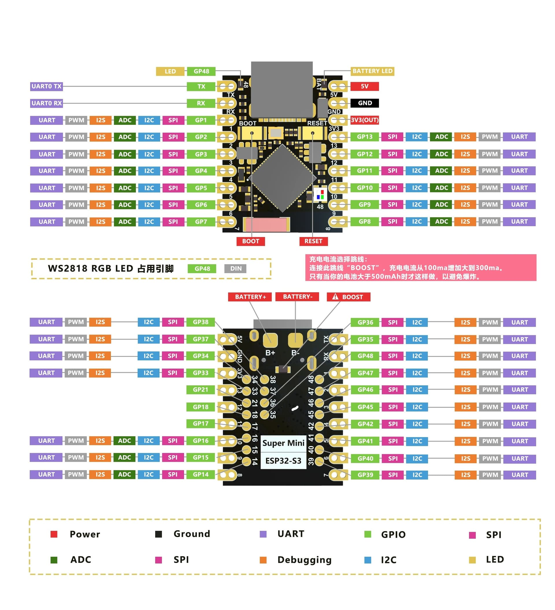

# Configurable Edge Platform on the ESP32-S3 (D1 to D6)

The Pico 2 W edge firmware (configpico2wedge / FlexiEdgePico `project_v3`) ported to the ESP32-S3 Super Mini. Since Tribunal 1 it runs on µT-Kernel 3 SMP through the course port ([MTK_REDESIGN.md](MTK_REDESIGN.md)); the earlier Arduino-ESP32/FreeRTOS port is kept as the measured baseline. Both builds compile the same shared code, so the configuration lines, console commands, MQTT topics, output format and ML models are the same on both. `main` contains D1 to D5 and the merged D6 integration work; the three-board use case remains in progress.

**D6 N16R8 integration.** Board A uses AHT, TSL2561 and two sonars without radar; Board B owns the flash, ML and occupancy decision; Board C owns the landscape LCD. Use the [current Board A wiring](docs/d6/BOARD_A_SONAR_ONLY_WIRING.md), [use case](docs/d6/SONAR_ONLY_USECASE.md) and [PowerShell MQTT commands](MQTT_commands.md). Earlier radar fixtures and the Super Mini breadboard remain historical references.

**Earlier three-sensor breadboard.** The three-sensor breadboard (AHT temperature and humidity, HC-SR04+ distance and TSL2561 light, with the LCD wiring kept) and its Windows and VS Code build workflow are in [SENSOR_BREADBOARD_README.md](SENSOR_BREADBOARD_README.md). The single-sonar, loopback, radar and SPI fixtures in this guide use other pins; do not apply them to that breadboard.

## Deliverables at a glance

| Deliverable | What it is | Owners | State (23 Nov 2026) | Details |
|---|---|---|---|---|
| D1 | Port configpico2wedge to the ESP32-S3, on µT-Kernel 3 SMP since Tribunal 1 | Hasif, Cody, Sitt | Done (tag `d1-mtk-v1.0`). MQTT between two real boards passed 43/43 on 10 Nov. The jumper and light-sensor stages were signed off by the team on 22 Nov without a separate board run | [Section 2](#2-d1-task-checklist) |
| D2 | SPI support on the ESP32-S3 | Brendan, Jun Yong | Done 22 Nov: SPI driver and tests, W25Q32 flash log, event logging from ApplicationTask (D2-8) and the concurrent run (D2-9) | [Section 3](#3-d2-task-checklist) |
| D3 | Configurable timing: periodic, one-shot, event-driven, logical sequence | Cody | Done 22 Nov: timing modes, non-blocking sonar reads and ApplicationTask run on the board on 21 Nov; the two-sonar sequence ran on the D6 setup; the radar workload closed when the radar was dropped | [Section 4](#4-d3-task-checklist) |
| D4 | Embedded ML | Part 1: Jun Yong. Part 2: Sitt | Done 23 Nov. Five bundled models run on the board with the S3's acceleration, and the model, its inputs and where its result goes can be switched live over MQTT. The uploaded model, remote input and local output added on 22 Nov have laptop tests only | [Section 5](#5-d4-task-checklist) |
| D5 | Benchmarking the D4 models on the S3 | Hasif | Done 20 Nov: ESP-NN's S3 assembly makes INT8 inference 1.36 to 3.35 times faster with the same outputs, and people-counter keeps a 2.55 times gain in the running firmware | [Section 6](#6-d5-task-checklist-hasif) |
| D6 | End-to-end use case and demo | Cody (lead), Brendan | D6 code and guides merged 23 Nov; A→B sensor MQTT and B→C landscape mock snapshots were tested separately on 21 Nov. The timed crossing, live B→C result and full three-board run remain open | [Section 7](#7-d6-task-checklist) |

Owners follow the team split of 28 Sep 2026, with D4 to D6 re-split on 10 Nov and confirmed on 16 Nov. The D1 MQTT tasks (1.1–1.5) and the D4 to D6 tasks (2.1–5.8) are the outline the team agreed on 10 Nov. Each owner updates their row when their work merges.

## Contents

| Section | What's in it |
|---|---|
| [1. Start here](#1-start-here) | What the firmware runs on, the commands to try, and every result next to the FreeRTOS baseline |
| [2. D1 task checklist](#2-d1-task-checklist) | Tasks 1–34 and the MQTT tasks 1.1–1.5 |
| [3. D2 task checklist](#3-d2-task-checklist) | SPI tasks D2-1 to D2-11 and how to run the SPI tests |
| [4. D3 task checklist](#4-d3-task-checklist) | The timing modes, tasks D3-1 to D3-12 and the measured timing |
| [5. D4 task checklist](#5-d4-task-checklist) | How to use the ML, the ML itself (2.1–2.6) and switching it live (3.1–3.7) |
| [6. D5 task checklist (Hasif)](#6-d5-task-checklist-hasif) | Benchmarking the D4 models on the S3, tasks 4.1–4.6 |
| [7. D6 task checklist](#7-d6-task-checklist) | Use case and demo, tasks 5.1–5.8 |
| [8. Set up and test from scratch](#8-set-up-and-test-from-scratch) | Step by step on a new Mac for the µT-Kernel build, D1 to D5 |
| &nbsp;&nbsp;[Part A: Install](#part-a-install) | Steps 1–4: tools, project, ESP-IDF and the course port, version check |
| &nbsp;&nbsp;[Part B: Wi-Fi and broker](#part-b-wi-fi-and-broker) | Steps 5–7: laptop IP, Wi-Fi file, MQTT broker |
| &nbsp;&nbsp;[Board pinout](#board-pinout) | Super Mini pin diagram |
| &nbsp;&nbsp;[Part C: Flash](#part-c-flash) | Steps 8–10: flash and the live console |
| &nbsp;&nbsp;[Part D: Tests](#part-d-tests) | Steps 11–22: every wiring-free test |
| &nbsp;&nbsp;[Part E: Real sensors](#part-e-real-sensors) | GY-511, HC-SR04, the light sensor and jumper tests |
| &nbsp;&nbsp;[Part F: D2 SPI](#part-f-d2-spi) | Host test, loopback, benchmark, read-only W25Q32 checks |
| &nbsp;&nbsp;[Part G: D3 timing and application](#part-g-d3-timing-and-application) | Laptop tests, the application smoke test, `PAIR`, a timing-mode example |
| &nbsp;&nbsp;[Part H: D4 ML](#part-h-d4-ml) | Laptop tests, the bundled models, ML on a real sensor, switching live over MQTT |
| &nbsp;&nbsp;[Part I: D5 benchmark](#part-i-d5-benchmark) | Laptop tests and `MLBENCH` |
| &nbsp;&nbsp;[Part J: D6 demo](#part-j-d6-demo-to-be-finalised) | Placeholder for the three-board demo |
| [9. Using any sensor](#9-using-any-sensor-config-cheat-sheet) | Wiring and the config line for every sensor type, rules, and [MQTT](#over-mqtt-how-it-works-and-what-to-send) |
| [10. Completion rule](#10-completion-rule) | When a task counts as done |
| [11. Arduino/FreeRTOS baseline](#11-arduinofreertos-baseline-set-up-and-test-reference) | Where the baseline's setup guide is |

Other documents: [TASK_RECORD.md](TASK_RECORD.md) (full D1 to D3 task tables), [WEEK6_FEEDBACK_RESPONSE.md](WEEK6_FEEDBACK_RESPONSE.md) (professor feedback tracker), [MTK_REDESIGN.md](MTK_REDESIGN.md) (µT-Kernel design and compliance), [SETUP.md](SETUP.md) (board and environment details), [parity/PARITY.md](parity/PARITY.md) (requirements and evidence), [PORTABILITY.md](PORTABILITY.md) (Pico to S3 changes and defects), [ARCHITECTURE.md](ARCHITECTURE.md) (task design), [D2_SPI_TODO.md](D2_SPI_TODO.md) (D2 tasks), [SENSOR_BREADBOARD_README.md](SENSOR_BREADBOARD_README.md) (three-sensor breadboard and Windows workflow), [project_v3/README.md](project_v3/README.md) (full config syntax).


---

# 1. Start here

**What it runs on.** [`esp32s3_mtk/`](esp32s3_mtk/) is an ESP-IDF project in which every application task is a µT-Kernel task pinned to a core, and the FreeRTOS scheduler never starts. The design, the FreeRTOS-to-µT-Kernel mapping, the core assignment and the compliance matrix are in [MTK_REDESIGN.md](MTK_REDESIGN.md). The Arduino-ESP32/FreeRTOS build (`esp32s3_edge/`, `tools/s3.sh`) stays as the measured baseline.

**Why it is the same firmware.** All platform-independent code (config parser, scheduler, REPL, rule engine, GPIO/I2C/UART drivers, MQTT payload handling, inference manager) is one library, [`libraries/EdgeCore/`](libraries/EdgeCore/), compiled unchanged by the Pico build and both S3 builds; `tools/check_hal_boundary.sh` proves it uses no Pico, Arduino or ESP-IDF calls. Only the HAL ([Pico](project_v3/platform/pico/hal_pico.c), [S3 on µT-Kernel](esp32s3_mtk/components/edge_mtk/hal_mtk.c), [S3 on Arduino](libraries/EdgeS3/src/hal_esp32s3.cpp)) and the platform services differ. The same test scripts run against every build with the same expected output; only pin numbers are mapped.

**Run it yourself** (µT-Kernel build; macOS or Linux, board on USB; details in [SETUP.md](SETUP.md#esp32-s3-on-µt-kernel-3-smp-tasks-2534)):

| Step | Command | You should see |
|---|---|---|
| 1. Install once | `sh tools/mtk.sh setup` | `Done. Edit esp32s3_mtk/main/wifi_credentials.h, then: sh tools/mtk.sh flash` |
| 2. Check versions and build | `sh tools/mtk.sh check` | course port `e92874d`, ESP-IDF `v6.1-dev-2300-g17a74c925c`, compiler `esp-15.2.0_20251204`, then `Project build complete` |
| 3. Flash | `sh tools/mtk.sh flash` | `Hash of data verified` |
| 4. Use the console | `sh tools/mtk.sh monitor`, then `HELP` and `TASKS` | the Pico's command list; each task with its core, priority and stack headroom |
| 5. Run a parity stage | `sh tools/mtk.sh test 4a` | `14/14 passed` |
| 6. Compare with the Pico | `sh tools/mtk.sh compare 4a` | Pico and µT-Kernel output, line for line the same |
| 7. MQTT (laptop running Mosquitto) | `sh tools/mtk.sh mqtt <laptop-ip>` | `27/27 passed` |

**Results on µT-Kernel 3 SMP** (2026-10-20, HW-747 Super Mini; raw logs in [`parity/logs/mtk/`](parity/logs/mtk/), FreeRTOS and µT-Kernel side by side in [PARITY.md §4](parity/PARITY.md#4-esp32-s3-on-µt-kernel-3-smp-tasks-24-to-34)):

| What | Command | µT-Kernel 3 SMP | FreeRTOS (Arduino) baseline |
|---|---|---|---|
| HAL: timing, GPIO, PWM, pulse, 20,000-edge counter, interrupt-driven echo | `haltest` | 27/27 (1 jumper check skipped) | 23/23 |
| Console, config, rules, inference | `test 4a` | 14/14, MSE 0.4179 | 14/14 |
| Invalid input refused | `test 5-neg` | 27/27 | 27/27 |
| Bad pin, 8 fast sensors, no-echo timeout, false rule | `test t03`, `t04`, `t06`, `t10` | 6/6, 13/13, 7/7, 7/7 | 6/6, 13/13, 6/7, 7/7 |
| I2C, real GY-511 compass and accelerometer | `test 4c-mag` (or `live mag`) | 15/15 | 15/15 |
| Real HC-SR04 distance, and rules on its readings | `test 4c-sonic`, `test sonic-rule` (or `live sonic`) | 4/4, 7/7 | not run |
| MQTT telemetry, config, commands, bridging, model upload | `mqtt <ip>` | 27/27 | 27/27 |
| Two real boards: every command over MQTT, sensor following, `cmd.to`/`cfg.to`, config whole and piecemeal (D1 tasks 1.1–1.4, 10 Nov) | `boards <ip>` | 43/43 | not run |
| Model storage: upload, bad uploads, survives reset | `model <ip>` | 8/9 (the miss is a test timing artefact; reload captured separately) | 9/9 |
| Faults: bad JSON, oversized, broker and Wi-Fi loss | `faults <ip>` | 9/9 | 9/9 |
| Queue flooding | `flood <ip>` | Pass | Pass |
| Sample timing (NFR1) | `timing` | Pass | Pass |
| 30-minute run (NFR6) | `endurance <ip>` | 6/6 | 6/6 |
| Every task on its assigned core; hardware watchdog | `TASKS`, `STALL 30000` | Pass | n/a |
| No FreeRTOS kernel code in the firmware image; no FreeRTOS, Arduino or `esp_driver_*` call in our code | `purity` (or `image`) | Pass | n/a (FreeRTOS is the baseline's RTOS) |

The GPIO and UART loopback stages (4b, 4c-uart, t02, t08, t09), which need jumper wires, and 4d-ir, which needs the light sensor, were signed off by the team on 22 Nov 2026 without a separate board run; their wiring and commands are in [SETUP.md](SETUP.md#hardware-checks-on-µt-kernel-jumpers-and-sensors). Two findings about the course port itself are recorded with evidence in MTK_REDESIGN.md: its radio sometimes stops receiving for a minute or more (§10), and its kernel and FreeRTOS shim had to be moved into IRAM before flash writes were safe (§8).


---

# 2. D1 task checklist

D1 ports configpico2wedge to the ESP32-S3. Tasks 1–23 built the Arduino/FreeRTOS port, now the baseline; tasks 24–34 moved it onto µT-Kernel 3 SMP after Tribunal 1; tasks 1.1–1.5 added MQTT between real boards. The required work and acceptance evidence for every task are in [TASK_RECORD.md](TASK_RECORD.md). Check the [professor feedback tracker](WEEK6_FEEDBACK_RESPONSE.md) before changing the design.

| # | Task | Status | Evidence |
|---:|---|---|---|
| 1 | Clean the workspace | Done | |
| 2 | Create the `s3-port` baseline from `Pico_Sample` | Done | |
| 3 | Rebuild the Pico reference | Done | [Build record](parity/logs/3-build.txt) |
| 4 | Requirements and the parity test plan | Done (Hasif), signed off by the team | [PARITY.md §1](parity/PARITY.md#1-requirements-task-4) |
| 5 | Run the full Pico baseline | Done (Hasif) | [PARITY.md §2](parity/PARITY.md#2-parity-table-task-5) |
| 6 | Freeze and tag the Pico reference | Done (Hasif), tag `pico-reference` | [Check](parity/logs/6-reference-check.txt) |
| 7 | Standardise the Arduino environment | Superseded on 21 Nov by task 25 | [SETUP.md](SETUP.md#arduino-environment-baseline-task-7) |
| 8 | Confirm the hardware and the pin layout | Done (Sitt, Hasif): ESP32-S3FH4R2, 4 MB flash, 2 MB PSRAM | [SETUP.md](SETUP.md#pin-power-and-wiring-task-8) |
| 9 | Bring up the S3 with Arduino | Done (Sitt) | [Record](parity/logs/9-arduino-bringup.txt) |
| 10 | Architecture freeze | Submitted as the Week 6 design review (team) | [ARCHITECTURE.md](ARCHITECTURE.md), [feedback](WEEK6_FEEDBACK_RESPONSE.md) |
| 11 | Define the HAL and refactor the Pico backend | Done (Hasif) | [hal.h](libraries/EdgeCore/src/hal/hal.h), [logs](parity/logs/task11/) |
| 12 | Arduino S3 HAL and shared build | Done (Hasif): HAL test 18/18 | [Logs](parity/logs/task12/) |
| 13 | FreeRTOS runtime, main control and REPL | Done (Hasif) | [Logs](parity/logs/task13/) |
| 14 | Scheduler and GPIO digital mode | Done (Hasif) | [PARITY.md §3](parity/PARITY.md#3-esp32-s3-results-tasks-13-to-21) |
| 15 | Pulse, counter and one-wire GPIO | Done (Hasif): 20,000 edges counted, none lost | [PARITY.md §3](parity/PARITY.md#3-esp32-s3-results-tasks-13-to-21) |
| 16 | I2C | Done (Hasif): real GY-511 15/15 | [Log](parity/logs/s3/4c-mag.log) |
| 17 | UART | Done (Hasif): loopback 8/8 | [PARITY.md §3](parity/PARITY.md#3-esp32-s3-results-tasks-13-to-21) |
| 18 | Rule engine actions | Done (Hasif) | [PARITY.md §3](parity/PARITY.md#3-esp32-s3-results-tasks-13-to-21) |
| 19 | Wi-Fi, MQTT and sensor bridging | Done (Hasif) | [PARITY.md §3](parity/PARITY.md#3-esp32-s3-results-tasks-13-to-21) |
| 20 | Model storage, transfer and inference | Done (Sitt: inference, MSE 0.4179 as on the Pico; Hasif: storage and uploads) | [Log](parity/logs/s3/model.log), [hardware check](parity/task20/README.md) |
| 21 | End-to-end parity, fault, timing and endurance | Done (Hasif): 30-minute run, no resets | [PARITY.md §3](parity/PARITY.md#3-esp32-s3-results-tasks-13-to-21) |
| 22 | Portability and design-review documentation | Done (Hasif) | [PORTABILITY.md](PORTABILITY.md) |
| 23 | Release from a clean Arduino environment | Superseded by task 34 | [SETUP.md](SETUP.md#release-task-23) |

### D1 redesign: port to µT-Kernel 3 SMP (tasks 24–34)

Tribunal 1 (19 Oct 2026) required the firmware to run on the course µT-Kernel 3 SMP port, with every task, queue, mutex, event group and timer a µT-Kernel object, a justified task-to-core assignment, and safe interaction between interrupts and tasks. The plan and the compliance matrix are in [MTK_REDESIGN.md](MTK_REDESIGN.md).

| # | Task | Status | Evidence |
|---:|---|---|---|
| 24 | Plan the redesign | Done (Hasif) | [MTK_REDESIGN.md](MTK_REDESIGN.md) |
| 25 | Pin the course port and the toolchain | Done (Hasif): port `e92874d`, ESP-IDF `v6.1-dev-2300-g17a74c925c`, compiler `esp-15.2.0_20251204`, checked by `sh tools/mtk.sh check` | [SETUP.md](SETUP.md#esp32-s3-on-µt-kernel-3-smp-tasks-2534) |
| 26 | Bring up µT-Kernel 3 SMP on the board | Done (Hasif): two processors, each pinned task stays on its core | [Log](parity/logs/mtk/26-bringup.log) |
| 27 | µT-Kernel HAL backend | Done (Hasif): register-level drivers, HAL test 23/23, no FreeRTOS, Arduino or `esp_driver_*` call | [Summary](parity/logs/mtk/27-hal_test-summary.txt) |
| 28 | µT-Kernel runtime | Done (Hasif): 7 tasks, 5 message buffers, an event flag and a cyclic monitor; every task only on its core; the hardware watchdog proven with `STALL 30000` | [Core residency](parity/logs/mtk/28-core-residency.log), [watchdog](parity/logs/mtk/28-watchdog.log) |
| 29 | Interrupt-driven HC-SR04 echo | Done (Hasif): HAL test 27/27; another task on core 1 keeps running during the echo wait | [Evidence](parity/logs/mtk/29-echo-and-wcet.txt) |
| 30 | Wi-Fi and MQTT on the course port | Done (Hasif): `faults` 9/9, `flood` pass; the port's radio sometimes stops receiving, documented in MTK_REDESIGN.md §10 | [Logs](parity/logs/mtk/), [radio finding](parity/logs/mtk/30-wifi-findings.txt) |
| 31 | Model storage and InferenceTask | Done (Hasif): two-slot flash store, TFLite Micro in InferenceTask, 4a 14/14 with MSE 0.4179, `model` 8/9 (a test timing miss) | [Log](parity/logs/mtk/31-model-persists.log) |
| 32 | Verify and compare with FreeRTOS | Done (Hasif): the full suite side by side, 30-minute endurance 6/6 | [PARITY.md §4](parity/PARITY.md#4-esp32-s3-on-µt-kernel-3-smp-tasks-24-to-34) |
| 33 | Close the redesign documentation | Done (Hasif): every compliance clause links to its evidence | [MTK_REDESIGN.md §9](MTK_REDESIGN.md#9-compliance-matrix) |
| 34 | Release the µT-Kernel build | Done (Hasif, 21 Oct): a clean clone builds, merged to `main`, tag `d1-mtk-v1.0` | |

### D1 MQTT between real boards (tasks 1.1–1.5)

Added on 10 Nov 2026 because D4 to D6 need boards to talk to each other (Hasif). Two bare ESP32-S3 boards on the laptop's USB, Mosquitto on the laptop ([Part B](#part-b-wi-fi-and-broker)) and both boards on the same 2.4 GHz network; every configuration and command goes in over MQTT. With an iPhone hotspot, turn on Maximize Compatibility and keep the hotspot screen open while the boards join. The second board gets its own node ID and build directory at compile time:

```sh
PORT=<board A port> sh tools/mtk.sh flash                # s3-001, the NODE_ID in wifi_credentials.h
NODE=s3-002 PORT=<board B port> sh tools/mtk.sh flash    # s3-002, built in esp32s3_mtk/build-s3-002
BOARD=n16r8 NODE=s3-002 PORT=<port> sh tools/mtk.sh flash   # or s3-002 on the N16R8 DevKitC (8 MB octal PSRAM)
sh tools/mtk.sh boards <laptop-ip>                       # 1.4, 1.1, 1.2, 1.3 in turn; or add commands|data|control|config
```

On the N16R8, use the USB-C port wired to the chip's own USB; the other one only shows boot messages. The first flash may need BOOT held while RST is pressed. Logs go to `parity/logs/mtk/d1-mqtt/` with Wi-Fi names and MAC addresses redacted.

| # | Task | Status |
|---|---|---|
| 1.1 | Two-board data: board B follows a sensor on board A and its rules fire on A's readings | Done 10 Nov: 6/6 |
| 1.2 | Two-board control: rules on board A send board B commands and configuration (`cmd.to`, `cfg.to`) | Done 10 Nov: 10/10; two defects found and fixed, closing D-11 |
| 1.3 | Configuration over MQTT, in one message and piece by piece | Done 10 Nov: 9/9, the same result both ways |
| 1.4 | Every console command over MQTT | Done 10 Nov: 18/18; the single-board `mqtt` test still 27/27 |
| 1.5 | Record and update | Done 10 Nov: [logs](parity/logs/mtk/d1-mqtt/), FR-13 and D-11 in [PARITY.md](parity/PARITY.md) |


---

# 3. D2 task checklist

D2 adds SPI as a fourth bus (`proto=spi`) behind the same interface as GPIO, I2C and UART, so an SPI device is configured the same way (Brendan and Jun Yong). On µT-Kernel it is a register-level SPI2 driver with polled 64-byte FIFO transfers, no DMA and one priority-inheritance mutex for the bus. A W25Q32 flash chip on the bus keeps a log of processed events. The full checklist is [D2_SPI_TODO.md](D2_SPI_TODO.md), the design is in [D2_SPI_DESIGN_NOTES.md](D2_SPI_DESIGN_NOTES.md) and [D2_EVENT_RECORD_DESIGN.md](D2_EVENT_RECORD_DESIGN.md), and the full rows are in [TASK_RECORD.md](TASK_RECORD.md#d2-spi).

| # | Task | Status | Owner |
|---:|---|---|---|
| D2-1 | Freeze the SPI contract | Done; signed off by the team 22 Nov ([Phase 1](D2_SPI_TODO.md#phase-1--freeze-the-minimum-contract)) | Brendan, Jun Yong |
| D2-2 | Add SPI to the shared code | Done ([spi.c](libraries/EdgeCore/src/bus/spi.c)) | Brendan, Jun Yong |
| D2-3 | ESP32-S3 SPI backend | Done: register-level SPI2 on µT-Kernel; the 78.1 kHz minimum clock and polled transfers without DMA signed off by the team 22 Nov ([hal_mtk.c](esp32s3_mtk/components/edge_mtk/hal_mtk.c)) | Brendan, Jun Yong |
| D2-4 | Functional, fault and lifecycle tests | Done 25 Oct: `spi` 22/22, `spi-fault` 6/6 ([logs](parity/logs/mtk/d2-spi/)) | Brendan, Jun Yong |
| D2-5 | Benchmark 8–1024-byte transfers | Done: 40,000 transfers on each runtime, no errors; 1024 bytes at 10 MHz take 1,045 µs on µT-Kernel against 2,281 µs on Arduino ([reports](parity/logs/mtk/d2-spi/)) | Brendan, Jun Yong |
| D2-6 | W25Q32 device layer on hardware | Done: JEDEC `EF4016`, read, one approved write, retention over a power cycle ([w25q32.c](libraries/EdgeCore/src/flash/w25q32.c)) | Brendan, Jun Yong |
| D2-7 | Event record and flash log | Done; format signed off by the team 22 Nov ([design](D2_EVENT_RECORD_DESIGN.md)) | Brendan, Jun Yong |
| D2-8 | Log every event from ApplicationTask | Done 22 Nov: every processed event is offered to the log, and BenchmarkTask writes and reads it back; with no chip attached every write reported `-9` while sampling carried on ([logs](parity/logs/mtk/d2-log-20261122/)) | Brendan, Jun Yong; code by Hasif |
| D2-9 | Concurrent run (T-23) | Done 22 Nov (N16R8, no W25Q32): 60 s with the sonar feeding sine-int8, a 100 ms input and logging on; 216 events, none dropped, no sample skipped, no reset ([logs](parity/logs/mtk/d2-log-20261122/)) | Run by Hasif |
| D2-10 | D1 regression on the D2 firmware | Done 27 Oct, rerun 21 Nov with D3 ([logs](parity/logs/mtk/d2-merge/)) | Hasif |
| D2-11 | Documentation, review and merge | Done; signed off by the team 22 Nov | Brendan, Jun Yong; merge by Hasif |

**Run it.** With a jumper wire from GPIO12 to GPIO13: `sh tools/mtk.sh spi` (22/22), `sh tools/mtk.sh spi-fault` (6/6) and `sh tools/mtk.sh spi-bench [mode] [hz]`. With the W25Q32 on 3V3, GND, CS GPIO10, CLK GPIO11, DI GPIO12 and DO GPIO13 (never together with the jumper): the read-only commands `SPIID`, `SPICHECK EF4016` and `SPISCAN EF4016`. For the event log, send `LOG ON`, then events (`APP EVENT` fixtures); each gives a `[LOG] ... readback=verified` line, and `LOG READ <slot>` prints a stored record, also after a reboot. The log area holds 30 records and is never erased. `.venv/bin/python parity/t23_test.py --port <port>` repeats the concurrent run. Wiring and the write commands not to repeat are in [SETUP.md](SETUP.md#d2-spi-checks-on-µt-kernel).


---

# 4. D3 task checklist

D3 replaces the Pico's fixed one-second loop with timing set per sensor (Cody; integration and merge by Hasif). The professor's acceptance case was a doorway: radar presence opens a window, then two HC-SR04s are read in a fixed order, without crosstalk, within 50 ms. The radar gave no output on two boards and was dropped on 19 Nov, so the two-sonar sequence is the part that ran. The full task rows and the design detail (the entrance window, event identity and the window timing report) are in [TASK_RECORD.md](TASK_RECORD.md#d3-configurable-timing).

| Mode | The sensor reads | Keys |
|---|---|---|
| Periodic (default) | Every `timing.interval_ms`, from `RUN`; a missed period is skipped, never replayed as a burst | `timing.mode=periodic`, `timing.interval_ms` (or the older `freq_hz`) |
| One-shot | Once per `RUN` or `TRIGGER <name>`, then waits to be armed again | `timing.mode=one_shot` |
| Event-driven | Only after the named source sensor completes a reading, or on `TRIGGER`, inside its window | `timing.mode=event_driven`, `timing.trigger_source=<name>`, `timing.window_ms` |

`timing.timeout_ms` bounds lateness plus acquisition and `timing.enabled=0` switches a sensor off; invalid timing is refused before any hardware changes ([project_v3/README.md](project_v3/README.md) lists every key). On µT-Kernel an HC-SR04 read no longer holds SchedulerTask: the GPIO interrupt timestamps the echo and the width is collected on a later wake-up, and a missing echo prints `error=-1` instead of a distance. `PAIR <A> <B> <A|B> <guard_us>` reads two HC-SR04s in the chosen order with a guard between them and refuses a pair that cannot fit 50 ms. Processed events go to ApplicationTask, which rejects duplicates, keeps the occupancy count and publishes each result on `pico/<node>/application/event`; `APP RESET`, `APP STATUS` and `APP EVENT <id> <seq> <entry|exit|incomplete|false>` drive it by hand. Each event is identified by the board's MAC, a boot counter kept in NVS and a sequence number. If the console shows `[WIFI] NVS requires explicit recovery`, erase the flash (`idf.py -C esp32s3_mtk -p <port> erase-flash`) and flash again.

| # | Task | Status | Owner |
|---:|---|---|---|
| D3-1 | Define the timing modes and their configuration | Done (laptop tests); signed off by the team 22 Nov | Cody |
| D3-2 | Read the HC-SR04 without blocking SchedulerTask | Done 21 Nov on the board: `t06` 7/7, `4c-sonic` 6/6, `sonic-rule` 9/9; `STOP` and `CLEAR` cancel a pending echo | Cody |
| D3-3 | Logical sequence: sonar A, guard, sonar B within 50 ms | Done: run on the team's D6 two-sonar setup, signed off by the team 22 Nov | Cody |
| D3-4 | Radar presence opens the observation window | Done in code (`WINDOW`) with laptop tests; the board run was dropped with the radar on 19 Nov | Cody |
| D3-5 | Measure the two-sonar order and guard | Done: run on the D6 two-sonar setup, signed off by the team 22 Nov | Cody, Sitt |
| D3-6 | Requested against measured timing | Done 21 Nov on the board (table below); event-driven and one-shot shown working | Cody |
| D3-7 | Entrance workload timing | Closed 22 Nov: `WINDOW` needs the radar, which was removed | Cody, Brendan |
| D3-8 | ApplicationTask on µT-Kernel | Done 21 Nov on the board: `app-test` PASS, core 1, priority 23 | Cody |
| D3-9 | Faults never look like readings | Done 21 Nov on the board: no echo gives `error=-1`, a busy capture `error=-6`, `5-neg` 27/27 | Cody |
| D3-10 | D1 regression on the D3 firmware | Done 21 Nov on the board: the D1 suite with the same results as before | Hasif |
| D3-11 | Agree the open contracts | Done; signed off by the team 22 Nov | Team |
| D3-12 | Documentation, review and merge | Done; signed off by the team 22 Nov | Hasif |

The board logs for D3-2, D3-6, D3-8, D3-9 and D3-10 and their [provenance note](parity/logs/mtk/d3-board-20261121/board-20261121.txt) are in [parity/logs/mtk/d3-board-20261121/](parity/logs/mtk/d3-board-20261121/).

**Measured timing** (21 Nov 2026, N16R8, six sensors at once, `sh tools/mtk.sh timing`):

| Requested (ms) | Intervals | Mean (ms) | p95 (ms) | Min to max (ms) | Std dev (ms) | Skipped | Result |
|---:|---:|---:|---:|---:|---:|---:|---|
| 10 | 21,389 | 10.07 | 11 | 9 to 21 | 0.97 | 147 | Measured |
| 50 | 4,279 | 50.33 | 51 | 49 to 101 | 4.06 | 28 | Measured |
| 100 | 2,136 | 100.80 | 101 | 98 to 201 | 8.88 | 17 | Pass |
| 500 | 426 | 504.70 | 501 | 498 to 1001 | 48.28 | 4 | Pass |
| 1000 | 213 | 1009.40 | 1001 | 998 to 2001 | 96.45 | 2 | Pass |
| 2000 | 106 | 2018.88 | 2001 | 1998 to 4000 | 193.34 | 1 | Pass |

A pass is a mean within 5% of the request over at least 100 intervals. A skipped sample is a gap of more than 1.5 periods; it is skipped, never replayed. The 10 ms sensor alone publishes 100 lines a second, so the board also reported MQTT queue-full drops during this run.

**Tests.** `sh tools/cody_test.sh` runs D3's twelve laptop suites. On the board, `sh tools/mtk.sh app-test` checks the application path without wiring and ends with `Application smoke PASS` ([Part G](#part-g-d3-timing-and-application)).


---

# 5. D4 task checklist

D4 has two parts, split on 16 Nov 2026: the ML itself (part 1, Jun Yong) and configuring and switching it live (part 2, Sitt). The professor's guidance was that accuracy does not matter, that the models should use the S3's built-in acceleration, and that a JSON or MQTT command should choose the model, where its data comes from and where its result goes, all switchable live.

### How to use it

Five models are bundled. **sine-float** and **sine-int8** take the sine of a scaled reading; they demonstrate the pipeline and, for sine-int8, ESP-NN's S3 vector kernels. The **autoencoder** takes 16 inputs. **comfort-summer** gives a comfort score from AHT temperature and humidity (26.3 °C and 67% RH gives 92/100). **people-counter** is an INT8 doorway classifier with 31 inputs, run with `ML REPLAY`. A sixth choice, **uploaded**, is the model last sent over MQTT (D1 task 31). `ML LIST` shows which are available.

From the console, stop sampling, pick a model and start again. In VS Code run **MTK: build → MTK: flash → MTK: load sensors and ML → MTK: monitor** first.

```text
STOP
ML PRESET comfort-summer
ML RUN
RUN
```

Over MQTT, without stopping the sensors, send one `ml_setup` message to `pico/<node>/cmd`. It names the model, its inputs (this board's sensors or another board's) and where results go: published on `pico/<node>/ml/result`, printed only, or fed back as a local sensor called `ML` that rules can act on. The board answers on `pico/<node>/ml/status`. The format, every option and the board steps are in [LIVE_SETUP_PROPOSAL.md](docs/embedded-ml/LIVE_SETUP_PROPOSAL.md). For example, once board `s3-002` follows board `s3-001`'s `DISTANCE` sensor (a `proto=mqtt` config with `remote_profile=pulse`), this runs sine-int8 on it:

```sh
mosquitto_pub -h <laptop-ip> -t pico/s3-002/cmd -m '{"ml_setup":{"version":1,"model":"sine-int8","inputs":[{"index":0,"source":{"kind":"remote","node":"s3-001","name":"DISTANCE"},"field":"distance_cm","min":2,"max":400}],"output":{"kind":"publish"}}}'
```

More: [model specifications](docs/embedded-ml/README.md), [user guide](docs/embedded-ml/RUNNING.md), [the ML flow from sensor to result](docs/embedded-ml/ML_FLOW.md), [validation](docs/embedded-ml/VALIDATION.md) and [board results](docs/embedded-ml/BOARD_VALIDATION.md).

### Part 1: the ML itself (Jun Yong)

| # | Task | Status |
|---|---|---|
| 2.1 | ML running on the real board | Done 10 Nov: three sensors and swaps between three models on the board, outputs checked against the model weights ([BOARD_VALIDATION.md](docs/embedded-ml/BOARD_VALIDATION.md)) |
| 2.2 | Research S3 acceleration | Done 19 Nov: the library is ESP-NN, and its S3 assembly runs for sine-int8 ([evidence](docs/embedded-ml/BOARD_VALIDATION.md#acceleration-evidence)); the write-up is [docs/d5 section 2](docs/d5/README.md#2-how-the-s3-speeds-up-int8-models-task-46-explanation) |
| 2.3 | A small set of swappable models | Done: five bundled models, with what each takes in and puts out in [docs/d5 section 3](docs/d5/README.md#3-the-models-task-43-static-part); comfort-summer and people-counter replayed on the board on 20 Nov ([log](parity/logs/mtk/d5/replay-20261120.log)) |
| 2.4 | Prove the acceleration works | Done as D5 task 4.2: 1.36 to 3.35 times faster with the S3 assembly ([docs/d5](docs/d5/README.md#6-results)) |
| 2.5 | Load models without reflashing | Done 19 Nov: bundled models are chosen at runtime and new ones sent over MQTT into flash; `parity/model_test.py` 8/9 on the N16R8, the miss being the script reopening the port late ([logs](parity/logs/mtk/d4-2.5/)) |
| 2.6 | Explain the ML flow | Done 21 Nov (written by Hasif): [ML_FLOW.md](docs/embedded-ml/ML_FLOW.md) |

### Part 2: configuring and switching ML (Sitt)

Sitt wrote the `ml_setup` command with local inputs and console and MQTT results, and checked it on one board on 19 Nov. Hasif finished the rest on 22 Nov: the uploaded model, another board's sensor as input, and a local output for rules. Those three pass the laptop tests (`sh tools/ml_test.sh`) but have not been run on a board; the steps for that run are in [LIVE_SETUP_PROPOSAL.md](docs/embedded-ml/LIVE_SETUP_PROPOSAL.md#running-it-on-boards). D6 task 5.6 builds on them.

| # | Task | Status |
|---|---|---|
| 3.1 | Define the ML setup format | Done 19 Nov (Sitt): the `ml_setup` JSON command ([format](docs/embedded-ml/LIVE_SETUP_PROPOSAL.md#the-command)) |
| 3.2 | Switch the model live from the network | Done. Bundled models switched over MQTT on the board on 19 Nov (Sitt, no sensor attached). The uploaded model can be picked by name, 22 Nov (Hasif, laptop tests) |
| 3.3 | Switch the data source live | Done 22 Nov (Hasif, laptop tests): an input can name another board's sensor; switching from local to remote and back is one message each way, and a stopped feed gives `MISSING_OR_STALE` |
| 3.4 | Choose where results go | Done. Publish and console checked on the board on 19 Nov (Sitt). Local output, 22 Nov (Hasif, laptop tests): each result becomes a reading of sensor `ML`, so rules act on it and other boards can follow it. Showing it on the LCD is D6 task 5.5 |
| 3.5 | Bad input is handled | Done. An unknown model, a bad output and malformed JSON were refused on the board with the previous model still running, 19 Nov (Sitt). The new refusals (unfollowed board, undecoded field, wrong input count) are in the laptop tests |
| 3.6 | User how-to and demo steps | Done 23 Nov: [LIVE_SETUP_PROPOSAL.md](docs/embedded-ml/LIVE_SETUP_PROPOSAL.md) has the command, every option and the two-board demo steps |
| 3.7 | Board evidence and update | Done 23 Nov: Sitt's [board check](docs/embedded-ml/LIVE_SETUP_PROPOSAL.md#board-check-19-november-2026) and the [laptop tests](docs/embedded-ml/LIVE_SETUP_PROPOSAL.md#laptop-tests-22-november-2026) are recorded; the 22 Nov additions were not run on a board |

Earlier research is in [D4_EMBEDDED_ML_RESEARCH.md](D4_EMBEDDED_ML_RESEARCH.md) and [D2_D4_RESEARCH_CONTEXT.md](D2_D4_RESEARCH_CONTEXT.md).


---

# 6. D5 task checklist (Hasif)

D5 measures and explains how the D4 models run on the S3 and what its acceleration adds. The professor said a full benchmarking study is not for this module and accuracy does not matter, so D5 was cut down on 10 Nov and refocused on 17 Nov. Every comparison uses the same board, build and settings, and each reports the run count, median, 95th percentile and maximum.

| # | Task | What it means | Status |
|---|---|---|---|
| 4.1 | Agree the scope | The models measured, the numbers kept (inference time, model size, memory, speed-up) and the run rule (at least 100 inferences per case, after a warm-up), confirmed with the team | Done 20 Nov: proposed 17 Nov and confirmed by the team ([docs/d5](docs/d5/README.md#1-scope-task-41)) |
| 4.2 | Acceleration on against off | The same INT8 models (sine-int8, the autoencoder and the people-counter) on the same inputs, built once with ESP-NN's S3 path (`CONFIG_NN_OPTIMIZED=y`, the default) and once with its plain C path (`CONFIG_NN_ANSI_C=y`); the speed-up is the D4 task 2.4 result | Done 20 Nov: `Invoke()` is 1.36 times faster with the S3 assembly for sine-int8, 2.83 times for the autoencoder and 3.35 times for people-counter, with the same outputs; the Float32 models do not change ([docs/d5](docs/d5/README.md#6-results), [logs](parity/logs/mtk/d5/)) |
| 4.3 | Float against INT8, and does it fit | sine-float against sine-int8 (the same network and task) for inference time, model bytes and tensor arena bytes, plus comfort-summer as a float model; ESP-NN speeds up INT8 operations only, so float models run on plain CPU code. Also whether everything fits: flash, arena and the memory left with Wi-Fi and MQTT running | Build sizes measured 19 Nov with all five models: the S3 assembly costs 35.7 KB of flash and 56 B of internal RAM ([docs/d5](docs/d5/README.md#3-the-models-task-43-static-part)); board run 20 Nov: sine-int8 is 15% smaller than sine-float but not faster (28 against 26 µs), arenas are 716 to 6,204 B of the 64 KB PSRAM arena, and 30,684 B of internal RAM and 8.2 MB of PSRAM stay free with Wi-Fi and MQTT running ([docs/d5](docs/d5/README.md#6-results)) |
| 4.4 | Where the time goes | The `Invoke()` time inside InferenceTask against the full request time seen by SchedulerTask, which adds the `infer_mbf` round trip; for models this small the round trip can be most of the time and hide the speed-up | Done 20 Nov: outside `Invoke()` each request costs 94 to 118 µs (208 µs for people-counter), so `Invoke()` is 22% of the request for the sine models, 54% for the autoencoder and comfort-summer and 86% for people-counter; sine-int8's whole request is only 1.08 times faster with the S3 assembly, people-counter's 3.00 times ([docs/d5](docs/d5/README.md#6-results)) |
| 4.5 | In the running system | 4.2's fastest case again with the sensors and MQTT running, with `TASKS` checked for drops and stack use, to show the result holds in the real firmware | Done 20 Nov with one ultrasonic sensor and MQTT: sine-int8 takes 451 µs (median of 100 live results) against 123 µs in `MLBENCH`, because each inference starts with cold caches; every reading OK and no dropped messages. In that condition the S3 assembly still makes people-counter 2.55 times faster but gives sine-int8 nothing ([docs/d5](docs/d5/README.md#6-results)) |
| 4.6 | Explanation and write-up | How the S3's vector instructions speed up INT8 through ESP-NN, why the chosen models and format, one results table and a conclusion; uses Jun Yong's 2.2 research | Done 20 Nov: the [explanation](docs/d5/README.md#2-how-the-s3-speeds-up-int8-models-task-46-explanation) (drafted 17 Nov), and the results and conclusion, including 4.5, in [docs/d5 sections 6 and 7](docs/d5/README.md#6-results) |

**What it shows and what it feeds.** D5 is the evidence behind the D4 choice of INT8 models: ESP-NN's S3 assembly makes their inference 1.36 to 3.35 times faster with the same outputs, Float32 models cannot use it, and it costs about 36 KB of flash. The result that matters in practice is people-counter's. It is the only bundled model with enough INT8 work to keep the gain in the running firmware, 2.55 times faster (about 2.1 against 5.3 ms per inference), while sine-int8 is a demonstration model whose gain is lost there. For D6, if the doorway counter is kept (tasks 5.1 and 5.6), people-counter fits and runs on the S3 in about 2 ms with a 6,204 B arena in PSRAM. That is small against the 500 ms sensor period used in 4.5, which showed no dropped readings or messages with ML running. The resource D6 has to watch is internal RAM, not the ML: about 30 KB stays free with Wi-Fi and MQTT running. The limits of this evidence are that 4.5 used one sensor (the ultrasonic) rather than three, that the board runs are of `main` at 06bf79d (later ML changes do not touch the timed code), and that cold caches are the likely cause of the slower live inferences but were not measured directly.

**Where the work is.** The scope, method, results and board-session steps are in [docs/d5/README.md](docs/d5/README.md), and the board logs with their provenance in [parity/logs/mtk/d5/](parity/logs/mtk/d5/). Every ML result line prints `invoke_us`, and every model load prints its tensor arena use.

**Run it.** Laptop tests, no board: `sh tools/d5_test.sh` (ends with `OK`). Board session, one board on the same Wi-Fi network as the laptop running the broker (`MQTT_HOST` in the credentials file must be the laptop's address) and no sensors until step 4 (add `PORT=...` or `BOARD=n16r8` as usual):

| Step | Command | You should see |
|---|---|---|
| 1. Normal firmware | `sh tools/mtk.sh flash`, then `.venv/bin/python tools/d5_bench.py bench --port <port> --build optimized` | A table per model (arena, S3 vector calls, request and `Invoke()` times) and `Saved parity/logs/mtk/d5/optimized-<date>` |
| 2. Plain C firmware | `NN=ansi sh tools/mtk.sh flash`, then `.venv/bin/python tools/d5_bench.py bench --port <port> --build ansi` | The same table, with 0 vector calls for sine-int8 |
| 3. Compare | `.venv/bin/python tools/d5_bench.py compare parity/logs/mtk/d5/optimized-<date>/results.json parity/logs/mtk/d5/ansi-<date>/results.json` | The speed-up of each model; sine-float unchanged |
| 4. With sensors and MQTT | `sh tools/mtk.sh flash` on the sensor breadboard, load the sensors and ML (**MTK: load sensors and ML**, or the AHT, light and distance configs then `ML PRESET sine-int8`, `ML RUN`, `RUN`; one sensor is enough, for example the ultrasonic config alone then `ML MODEL sine-int8`, `ML RESET`, `ML BIND 0 DISTANCE distance_cm 2 400`, `ML RUN`, `RUN` as on 20 Nov), then `.venv/bin/python tools/d5_bench.py live --port <port> --samples 100` | `invoke_us` statistics and the free heap before and after |

On the console, `STOP`, `ML MODEL <id>` and `MLBENCH <runs> [RAW]` run one model by hand; `MLBENCH` also works on `pico/<node>/cmd`.


---

# 7. D6 task checklist

D6 uses three ESP32-S3 N16R8 boards. [Board A](docs/d6/BOARD_A_SONAR_ONLY_WIRING.md) reads AHT temperature/humidity, TSL2561 light and two sonars; the LD2450 radar is no longer part of the selected use case. Board A must assemble a timed crossing candidate. Board B is the only occupancy writer and owns ML, event logging and the W25Q32 flash. Board C displays Board B's validated snapshot on a landscape ST7789 LCD. The [sonar-only use case](docs/d6/SONAR_ONLY_USECASE.md), [integration status](docs/d6/INTEGRATION_STATUS.md), [Board A test commands](docs/d6/BOARD_A_SENSOR_TEST.md) and [MQTT commands](MQTT_commands.md) hold the current details. The earlier radar plans are preserved under [reference](docs/d6/reference/).

| # | Current status after merge |
|---|---|
| 5.1 | Two-sonar, no-radar direction selected; timed crossing trials and team sign-off remain open. |
| 5.2 | A/B/C roles, N16R8 wiring and diagrams recorded; verify the assembled fixture against the current guides. |
| 5.3 | Multi-bus live demonstration and its evidence remain open. |
| 5.4 | SPI config byte write/read and device swap remain open; D2 event logging is separate. |
| 5.5 | Board C LCD test and landscape MQTT mock snapshots passed, including an occupancy change from 2 to 3; live B result display remains open. |
| 5.6 | D4 remote ML inputs and output routing are now in the same codebase; Board B inference from Board A's real AHT and delivery to C need a three-board test. The 31-input people-counter remains replay-only until a model-ready window exists. |
| 5.7 | Full three-board rehearsal and recorded acceptance trials remain open. |
| 5.8 | Tribunal 2 preparation remains open. |

Board A to B MQTT frames were observed for AHT, light and both sonars. Board B to C mock snapshots were visible on the LCD, but those separate tests do not yet establish a complete A→B→C doorway decision. See the [LCD reference](docs/d6/ROOM_MONITOR_REFERENCE.md) and [next steps](docs/d6/NEXT_STEPS.md). The new main merge combines D4/D5 with D6 code; it does not itself count as new board validation.

---

# 8. Set up and test from scratch

Follow these steps in order on a Mac (Linux works the same way). They build, flash and test the firmware on `main`: D1 on µT-Kernel 3 SMP, D2's SPI, D3's timing, D4's ML and D5's benchmark. Part J is kept for the D6 demo. Each step says what you should see. On Windows, install ESP-IDF at commit `17a74c925c`, load it with its PowerShell `export.ps1` and give `IDF_PATH` forward slashes, as Brendan did ([D2_SPI_TODO.md](D2_SPI_TODO.md)); the Arduino baseline in [section 11](#11-arduinofreertos-baseline-set-up-and-test-reference) has full Windows steps.

## What the deliverables are

Our edge firmware (configpico2wedge) ran on the Raspberry Pi Pico 2 W. D1 ports it to the ESP32-S3. You send the board text lines such as `BEGINCFG|...|ENDCFG`; it reads sensors, runs rules and an ML model, and sends data over Wi-Fi/MQTT. Both boards compile the same shared code, and the tests below prove the S3 behaves like the Pico. D2 adds SPI as a fourth bus (`proto=spi`) and a W25Q32 flash chip that keeps a log of processed events. D3 lets each sensor keep its own timing. D4 runs small ML models on the readings and lets the model, its inputs and where its result goes be switched live. D5 measures what the S3's acceleration adds to those models. D6 joins three boards into one demo.


---

## Part A: Install

Once per laptop, about 20 minutes and 2 GB.

**Step 1. Install the tools** (Terminal: Cmd+Space, "Terminal"):
```sh
xcode-select --install
brew install cmake ninja dfu-util python3 mosquitto gh
```
No Homebrew yet (`brew -v` fails)? Install it first: `/bin/bash -c "$(curl -fsSL https://raw.githubusercontent.com/Homebrew/install/HEAD/install.sh)"`.

**Step 2. Download the project.**
```sh
gh auth login          # GitHub.com, HTTPS, log in with the browser
cd ~ && gh repo clone junyonggoh2004/EMBSYS-P2-AAI15
cd ~/EMBSYS-P2-AAI15 && git checkout main && git pull
```

**Step 3. Install ESP-IDF, the course port and the test tools.**
```sh
sh tools/mtk.sh setup
```
You should see: `Done. Edit esp32s3_mtk/main/wifi_credentials.h, then: sh tools/mtk.sh flash`.

**Step 4. Check the versions and build.**
```sh
sh tools/mtk.sh check
```
You should see: course port `e92874d`, ESP-IDF `v6.1-dev-2300-g17a74c925c`, compiler `esp-15.2.0_20251204`, then `Project build complete`.


---

## Part B: Wi-Fi and broker

**Step 5. Find the laptop's IP:** `ipconfig getifaddr en0`.

**Step 6. Give the board your Wi-Fi:** `open -e esp32s3_mtk/main/wifi_credentials.h`. Set `WIFI_SSID` (a 2.4 GHz network only; on an iPhone hotspot turn on Maximize Compatibility), `WIFI_PASS` and `MQTT_HOST` (the IP from Step 5). Save. The file is never committed. `MQTT_HOST` is built into the firmware, so when the laptop's IP changes, edit it and flash again.

**Step 7. Start the broker in a second window and leave it open:**
```sh
printf "listener 1883 0.0.0.0\nallow_anonymous true\n" > ~/mosq.conf
/opt/homebrew/sbin/mosquitto -c ~/mosq.conf -v
```
Use this exact path: the fault test stops and restarts the broker by it.


---

## Board pinout



Hold the board with USB-C at the top, chip facing you. Left pins, top to bottom: TX, RX, GP1–GP7. Right pins: 5V, GND, 3V3, GP13–GP8. All GPIO are 3.3 V only.


---

## Part C: Flash

**Step 8. Plug the S3 in** with a USB-C data cable. No wires are needed until Part E.

**Step 9. Flash.**
```sh
sh tools/mtk.sh flash
```
You should see: `Hash of data verified.` If it fails, `mtk.sh` resets the board and tries once more by itself.

**Step 10. Watch it live.**
```sh
sh tools/mtk.sh monitor
```
Within about 20 s: `[WIFI] ip=...` and `[MQTT] Subscribed OK to: broadcast`. Type `HELP` or `TASKS` and press Enter (`TASKS` lists every task with its core, priority and stack headroom); **Ctrl+C** leaves. Close the monitor before running a test.


---

## Part D: Tests

| Step | Command | You should see | What it shows |
|---|---|---|---|
| 11 | `sh tools/mtk.sh test 4a` | `14/14 passed` | HELP, SHOW, RUN, STOP, a sensor, rules and the ML model reply as on the Pico |
| 12 | `sh tools/mtk.sh test 5-neg` | `27/27 passed` | Bad input is refused and never crashes the board |
| 13 | `sh tools/mtk.sh test t03` / `t04` / `t06` / `t10` | 6/6, 13/13, 7/7, 7/7 | Impossible pins refused, 8 fast sensors, missing sensors time out, rules act only when true |
| 14 | `sh tools/mtk.sh haltest` | `27/27 passed, 1 skipped` | The hardware layer: timing, GPIO, PWM, pulse, edge counting, interrupt-driven echo (the skip needs a jumper) |
| 15 | `sh tools/mtk.sh purity` | only `ok` lines | No FreeRTOS, Arduino or `esp_driver_*` call in our code, and no FreeRTOS kernel code in the firmware |
| 16 | `sh tools/mtk.sh mqtt <laptop-ip>` | `27/27 passed` | Configs, commands, data, bridging and a model upload over Wi-Fi |
| 17 | `sh tools/mtk.sh model <laptop-ip>` | `8/9 passed` | Good, corrupt, too-big and cut-off uploads, then a reset; the miss (`persists-after-reset`) is the test reopening the port after the model has already reloaded, and `infer-after-reset` passing shows it survived |
| 18 | `MOSQ_CONF=~/mosq.conf sh tools/mtk.sh faults <laptop-ip>` | `9/9 passed` | Bad and huge messages, broker loss, Wi-Fi loss: the node recovers by itself |
| 19 | `sh tools/mtk.sh flood <laptop-ip>` | `PASS` | 50 messages a second for a minute; heartbeat and telemetry keep going |
| 20 | `sh tools/mtk.sh timing` | `PASS` rows (about 4 min) | Sample spacing for 6 sensors meets NFR1 |
| 21 | `sh tools/mtk.sh compare 4a` | Pico and µT-Kernel text | The same test's output on both boards, line for line |
| 22 | `sh tools/mtk.sh endurance <laptop-ip>` (optional) | `6/6 passed` (30 min, lid open) | Sensors, rules, ML and MQTT for 30 minutes with no reset or leak |


---

## Part E: Real sensors

One sensor at a time; unplug the USB cable before changing wires. No resistor is needed (see below).

**GY-511 compass and accelerometer (I2C):** VIN to 3V3, GND to GND, SDA to GPIO1, SCL to GPIO2. Watch it with `sh tools/mtk.sh live mag` (identity `H43`, about 1 g at rest, heading changing as you turn it flat), then run `sh tools/mtk.sh test 4c-mag`: `15/15 passed`.

**HC-SR04 distance (the kit's 3 V module):** VCC to 3V3, GND to GND, Trig to GPIO1, Echo to GPIO2. Watch it with `sh tools/mtk.sh live sonic` (centimetres following your hand), then run `sh tools/mtk.sh test 4c-sonic` (`6/6 passed`) and `sh tools/mtk.sh test sonic-rule` (`9/9 passed`, moving an object in and out of 30 cm). A 5 V module needs a divider on Echo ([SETUP.md](SETUP.md#hardware-checks-on-µt-kernel-jumpers-and-sensors)).

**Light sensor and jumper tests** (4d-ir, 4b, t02, 4c-uart, t08, t09): wiring, order and expected results are in [SETUP.md](SETUP.md#hardware-checks-on-µt-kernel-jumpers-and-sensors).

### Why no resistor

An S3 pin can take at most 3.3 V. The GY-511, the kit's 3 V HC-SR04, the MH board and the IR board are powered from the S3's **3V3** pin, so their signals can never be higher than 3.3 V, and the pull-up or pull-down a digital input needs is built into the chip (`gpio.pull=up` or `down`). The test wires join an S3 pin to another S3 pin, also 3.3 V. Only the **HC-SR04** needs a resistor divider: it is powered from **5V**, so its Echo signal is 5 V and must be divided down before it reaches an S3 pin (wiring in [SETUP.md](SETUP.md#pin-power-and-wiring-task-8)).


---

## Part F: D2 SPI

| Wiring | Command | You should see |
|---|---|---|
| None (runs on the laptop) | `sh tools/d2_host_test.sh` | `w25q32/log mock: PASS ...` |
| A jumper wire from GPIO12 to GPIO13 | `sh tools/mtk.sh spi`, then `sh tools/mtk.sh spi-fault`, then `sh tools/mtk.sh spi-bench 0 10000000` | `22/22 passed`, `6/6 passed`, `PASS:` and a report path |
| W25Q32 module: VCC to 3V3, GND to GND, CS to GPIO10, CLK to GPIO11, DI to GPIO12, DO to GPIO13 (never together with the jumper) | in `sh tools/mtk.sh monitor`: `SPIID`, `SPICHECK EF4016`, `SPISCAN EF4016` | `[SPIID] raw=EF4016`, `[SPICHECK] PASS read-only ...`, `[SPISCAN] BLANK` (or `NONBLANK` on Brendan's module) |

These are read-only on the module. Never run `SPIPROGRAM` or `SPILOGWRITE` without agreeing a scratch address with Brendan ([SETUP.md](SETUP.md#d2-spi-checks-on-µt-kernel)).

## Part G: D3 timing and application

| Wiring | Command | You should see |
|---|---|---|
| None (runs on the laptop) | `sh tools/cody_test.sh` | twelve `PASS` lines, ending `micro T-Kernel application glue: PASS` |
| None | `sh tools/mtk.sh app-test` | `Application smoke PASS` (it clears sensors, rules and occupancy first) |
| None | in `sh tools/mtk.sh monitor`: `APP RESET`, `APP EVENT 1 1 entry`, the same line again, `APP EVENT 2 2 exit`, `APP STATUS` | occupancy 0, 1, 1 (the repeat is rejected as a duplicate), 0 |
| One HC-SR04 (Part E wiring) | `sh tools/mtk.sh test t06` with nothing connected, then `test 4c-sonic` and `test sonic-rule` with the sensor | `7/7`, `6/6`, `9/9 passed` |
| Two HC-SR04s on separate Trigger and Echo pins, each configured with `gpio.pulse_timeout_us` small enough for the pair to fit 50 ms | `STOP`, then `PAIR <A> <B> A <guard_us>` | one `[PAIR] state=complete outcome=0` line and an A and a B record with their widths |

`WINDOW`, the radar-triggered entrance sequence, needs the LD2450 radar, which was dropped; how to run it and its timing report are in [TASK_RECORD.md](TASK_RECORD.md#d3-configurable-timing).

A timing-mode example: a sensor read every 100 ms and a second one that reads only after it.
```
BEGINCFG|name=SRC|proto=gpio|gpio.mode=digital|gpio.pin=8|gpio.pull=up|mode=poll|timing.mode=periodic|timing.interval_ms=100|ENDCFG
BEGINCFG|name=FOLLOW|proto=gpio|gpio.mode=digital|gpio.pin=9|gpio.pull=up|mode=poll|timing.mode=event_driven|timing.trigger_source=SRC|timing.window_ms=50|ENDCFG
RUN
```

## Part H: D4 ML

| Wiring | Command | You should see |
|---|---|---|
| None (runs on the laptop) | `sh tools/ml_test.sh` | `sensor ML integration tests PASS`, `ML manager lifecycle tests PASS` and `Actual REPL input editing tests PASS` |
| None | in `sh tools/mtk.sh monitor`: `STOP`, then `ML LIST` | one `ML:` line per model with its inputs and outputs, and whether a model has been uploaded |
| None | `ML MODEL comfort-summer`, then `ML REPLAY 26.3 67` | `ML: OK MODEL comfort-summer`, then a result line with `"comfort_score":92` |
| None | `ML MODEL sine-int8`, then `ML REPLAY 1.57` | `[ML-ACCEL] esp_nn_fc_s16_esp32s3 vector_calls=2` (the S3 vector kernel ran) and an output close to 1.0 |
| One HC-SR04 (Part E wiring) | `STOP`, then `BEGINCFG\|name=DISTANCE\|proto=gpio\|gpio.mode=pulse\|mode=poll\|freq_hz=2\|gpio.trig=1\|gpio.echo=2\|gpio.trig_us=10\|gpio.pulse_timeout_us=25000\|ENDCFG`, `ML MODEL sine-int8`, `ML RESET`, `ML BIND 0 DISTANCE distance_cm 2 400`, `ML RUN`, `RUN` | a `{"type":"ml",…,"model":"sine-int8",…,"status":"OK"}` line after each reading, changing as your hand moves |
| Laptop running the broker | `sh tools/mtk.sh model <laptop-ip>` | `8/9 passed`: a model sent over MQTT is checked, stored and loaded (the miss is explained in Part D, step 17) |

To switch the model live, keep the HC-SR04 running, watch the ML topics in one window and send one `ml_setup` message from another:

```sh
mosquitto_sub -h <laptop-ip> -t 'pico/s3-001/ml/#' -v
mosquitto_pub -h <laptop-ip> -t pico/s3-001/cmd -m '{"ml_setup":{"version":1,"model":"sine-float","inputs":[{"index":0,"source":{"kind":"local","name":"DISTANCE"},"field":"distance_cm","min":2,"max":400}],"output":{"kind":"publish"}}}'
```

You should see `{"ok":true,"reason":"applied","generation":…}` on `pico/s3-001/ml/status`, then results with `"model":"sine-float"` on `pico/s3-001/ml/result` while the readings carry on, without a `STOP`. Another board's sensor as input, the result fed to rules and the uploaded model are in [LIVE_SETUP_PROPOSAL.md](docs/embedded-ml/LIVE_SETUP_PROPOSAL.md#running-it-on-boards).

## Part I: D5 benchmark

| Wiring | Command | You should see |
|---|---|---|
| None (runs on the laptop) | `sh tools/d5_test.sh` | `OK` at the end |
| None | in `sh tools/mtk.sh monitor`: `STOP`, `ML MODEL sine-int8`, then `MLBENCH 200` | `[MLBENCH] runs=200 …`, then the `request_us`, `invoke_us` and `overhead_us` medians and a `memory` line |
| None, then the HC-SR04 | the comparison of the S3 assembly against plain C, and the live run | the steps and results in the [Run it table of section 6](#6-d5-task-checklist-hasif) |

## Part J: D6 demo (to be finalised)

The three-board demo is being finalised by the team (D6 task 5.7). This part will hold, for each board, its wiring, how to flash it and the commands that set it up, then the demo sequence in order. Until then the draft material is on `D6-Integration`.

| Board | Role | Wiring | Flash | Set-up commands |
|---|---|---|---|---|
| A | Senses | To be added | To be added | To be added |
| B | Runs the ML and handles the data | To be added | To be added | To be added |
| C | Shows the results on the LCD | To be added | To be added | To be added |

**Demo sequence.** To be added.

If every step up to Part I matched, this laptop has built, flashed and tested the µT-Kernel firmware for D1 to D5.


---

# 9. Using any sensor (config cheat sheet)

The node is not plug-and-play: each sensor needs **one config line** that tells it the protocol, the pins and how to read it. No code change and no re-flash: wire the sensor, send the line, type `RUN`.

**How to use one sensor**

1. Wire it (table below). Use one sensor at a time unless you have a breadboard.
2. `sh tools/mtk.sh monitor` (µT-Kernel build; on the Arduino baseline, `sh tools/s3.sh monitor` and wait for `[MQTT] Subscribed OK to: broadcast`). Type `HELP` and press Enter to check the board answers.
3. Paste its config line and press Enter. The board replies `CFG: ok (added #0: <name>)`.
4. Type `RUN`. Each reading appears as `proto=<bus> src=<name> len=<n> ts=<ms> : <bytes>`.
5. Type `STOP` to pause, `CLEAR` to remove all sensors and rules, Ctrl+C to close the monitor.

In `sh tools/mtk.sh monitor` every key goes straight to the board, which does not process Backspace: if you mistype, press Enter (the board answers `Unknown: ...`) and type the line again. Pasting the lines avoids typos.

For the HC-SR04 and the GY-511 there is a shortcut on the µT-Kernel build: `sh tools/mtk.sh live sonic` or `sh tools/mtk.sh live mag` sends the config lines below for you and prints each reading in units (cm, g, gauss, degrees) next to its bytes.

Paste each config line **once**: pasting it again adds a second sensor with the same name (`CLEAR` removes both). Multi-byte numbers are sent low byte first, so `82 02` means 0x0282.

The same lines work over Wi-Fi instead of USB: `mosquitto_pub -h <laptop-ip> -t pico/s3-001/config -m "<config line>"`, then `mosquitto_pub -h <laptop-ip> -t pico/s3-001/cmd -m RUN`, and watch with `mosquitto_sub -h <laptop-ip> -t "pico/s3-001/#" -v`. Every topic, the JSON forms and board-to-board use are in [Over MQTT](#over-mqtt-how-it-works-and-what-to-send) at the end of this section.

| Sensor | Wiring to the S3 | Config line | Reading the output |
|---|---|---|---|
| Digital: MH sensor (DO), IR, button, PIR | VCC → 3V3, GND → GND, DO/OUT → GP1 | `BEGINCFG\|name=LIGHT\|proto=gpio\|gpio.mode=digital\|gpio.pin=1\|gpio.pull=up\|mode=poll\|freq_hz=2\|ENDCFG` | `00 82 82`: first byte is the reading (`00` low, `01` high); the next two bytes are how long it has held that state in ms, low byte first (`82 82` = 0x8282 = 33,410 ms). The time resets to near 0 when the reading flips |
| Counter (same sensors) | as above | `BEGINCFG\|name=CNT\|proto=gpio\|gpio.mode=counter\|gpio.pin=1\|gpio.pull=up\|mode=poll\|freq_hz=2\|ENDCFG` | 4 bytes, little-endian: edges counted since `RUN` |
| HC-SR04 distance | 3 V module (the one in our kit): VCC → 3V3, GND → GND, Trig → GP1, Echo → GP2, wired straight. A 5 V module needs VCC → 5V and a divider on Echo (see [SETUP.md](SETUP.md#pin-power-and-wiring-task-8)) | `BEGINCFG\|name=HCSR04\|proto=gpio\|gpio.mode=pulse\|mode=poll\|freq_hz=2\|gpio.trig=1\|gpio.echo=2\|gpio.trig_us=10\|gpio.pulse_timeout_us=25000\|ENDCFG` | First 2 bytes, little-endian = echo time in µs; distance in cm = µs ÷ 58 (`C8 06 01` = 1736 µs = 29.9 cm). `A9 61 01` (25001 µs) or a single `00` means no echo |
| GY-511 accelerometer (I2C) | VIN → 3V3, GND → GND, SDA → GP1, SCL → GP2 | `BEGINCFG\|name=ACC\|proto=i2c\|mode=poll\|freq_hz=2\|i2c.sda=1\|i2c.scl=2\|i2c.addr=0x19\|i2c.pre=0x20 0x57\|i2c.reg=0xA8\|i2c.reg_size=1\|i2c.read_len=6\|i2c.restart=1\|ENDCFG` | X, Y, Z: 16-bit little-endian pairs; about 16384 = 1 g |
| GY-511 compass (I2C) | as above | `BEGINCFG\|name=MAG\|proto=i2c\|mode=poll\|freq_hz=2\|i2c.sda=1\|i2c.scl=2\|i2c.addr=0x1E\|i2c.pre=0x00 0x10 0x01 0xE0 0x02 0x00\|i2c.reg=0x03\|i2c.reg_size=1\|i2c.read_len=6\|i2c.restart=1\|ENDCFG` | X, Z, Y: 16-bit big-endian pairs |
| TSL2561 light (I2C) | VIN → 3V3, GND → GND, SDA → GP1, SCL → GP2, ADDR → GND | `BEGINCFG\|name=LUX\|proto=i2c\|mode=poll\|freq_hz=1\|i2c.sda=1\|i2c.scl=2\|i2c.addr=0x29\|i2c.pre=0x80 0x03 0x81 0x02\|i2c.reg=0x8C\|i2c.reg_size=1\|i2c.read_len=4\|i2c.restart=1\|ENDCFG` | Two 16-bit little-endian light channels |
| UART sensor or radar | Sensor TX → GP2, sensor RX → GP1, GND → GND, VCC as the sensor needs | `BEGINCFG\|name=RADAR\|proto=uart\|uart.tx=1\|uart.rx=2\|uart.baud=115200\|uart.read_len=32\|mode=poll\|freq_hz=2\|ENDCFG` | Raw bytes as the sensor sends them; set `uart.baud` and decode the frame from the sensor's datasheet |
| SPI device (D2), or the loopback test | Loopback: a jumper from GP12 to GP13. A device: CS → GP10, SCLK → GP11, MOSI → GP12, MISO → GP13, VCC → 3V3, GND → GND | `BEGINCFG\|name=SPI_LOOP\|proto=spi\|mode=poll\|freq_hz=2\|spi.host=fspi\|spi.sclk=11\|spi.mosi=12\|spi.miso=13\|spi.cs=10\|spi.hz=10000000\|spi.mode=0\|spi.tx=0xA5 0x5A\|spi.read_len=2\|spi.timeout_ms=100\|ENDCFG` | The bytes clocked in while `spi.tx` is sent: `proto=spi src=SPI_LOOP len=2 ... : A5 5A` with the loopback jumper. Poll mode only; `spi.tx` up to 64 bytes and `spi.read_len` up to 128 |

**Acting on a reading (rules).** Example: print a message whenever the light sensor reads 1:
```
BEGINRULE|name=DARK|source=LIGHT|calc=s=u8(0)|when=s==1|action=log:it is dark|ENDRULE
```
`calc` picks the value out of the bytes (`u8(0)` = byte 0), `when` is the condition, and `action` can also switch a pin (`gpio:5=HIGH`), set PWM, publish over MQTT or run the AI model. Every option and action is listed in [project_v3/README.md](project_v3/README.md#%EF%B8%8F-configuration-guide); its examples use Pico pin numbers, so swap in S3 GP numbers.


## Over MQTT: how it works and what to send

**It is always on.** If `wifi_credentials.h` names a network, the board joins it at boot, connects to the broker in `MQTT_HOST` (Mosquitto on the laptop, [Part B](#part-b-wi-fi-and-broker)) and subscribes to its own topics; it reconnects by itself after a drop. No config line turns MQTT on: config lines only decide which sensors and rules exist. Boards never talk to each other directly; every message goes through the broker. A board's topics start with `pico/<node>/` (the prefix comes from the original Pico project and is kept on purpose, so S3 boards, the Pico reference and other groups' nodes built on the same base can exchange messages, and every MQTT test still applies), where `<node>` is its `NODE_ID` (`s3-001` unless changed; flash another board as `s3-002` with `NODE=s3-002 sh tools/mtk.sh flash`).

| Topic | Direction | What goes on it |
|---|---|---|
| `pico/<node>/config` | to the board | Sensors and rules: the same `BEGINCFG…ENDCFG` and `BEGINRULE…ENDRULE` lines as the console, or JSON (below). Each item is answered on `pico/<node>/status/config` or `status/rule` with `OK:<name>` or `FAIL:<name>` |
| `pico/broadcast/config` | to every board | The same as `config`, for all boards at once |
| `pico/<node>/cmd` | to the board | Any console command: `RUN`, `STOP`, `CLEAR`, `SHOW`, `SHOWRULES`, `TASKS`, `ML …`, `WINDOW …`, `TRIGGER …`, the `SPI…` commands and the rest (D1 task 1.4). Configuration sent here is refused with a pointer to `config`. A command's printed reply (the `SHOW` list, `TASKS`) appears on the board's console (`sh tools/mtk.sh monitor`), not over MQTT |
| `pico/<node>/sensor/<name>/line` | from the board | Every reading while the board runs, the same line the console prints |
| `pico/<node>/presence`, `pico/<node>/heartbeat` | from the board | Sent on connect, then uptime every 10 s |
| `pico/rule/<rule>/event` | from the board | Each time a rule fires |
| `pico/<node>/model/…` | to the board | A new ML model and its parameters, sent by `project_v3/models/send_model.py`; the board checks it, keeps it in flash and loads it |

**JSON forms** (on either config topic). Several items at once: `{"configs":[{…},{…}],"rules":[{…}]}`. One item: `{"type":"config","name":"C1","proto":"gpio","mode":"poll","freq_hz":1,"gpio":{"pin":6,"pull":"down","mode":"digital"}}` or `{"type":"rule","name":"R1","source":"C1","calc":["s=u8(0)"],"when":"s==0","action":"log:C1 low"}`. Both give the same result as the text lines, whole or piece by piece (D1 task 1.3). Keys and values may also be written without quotes, `{configs:[{name:C1,…}]}`, which a rule needs when it forwards JSON to another board; a value with spaces still needs quotes.

**Board to board** (the first three were tested between two boards in D1 tasks 1.1 and 1.2; the ML rows have laptop tests only):

| To | Use |
|---|---|
| Use another board's sensor | A config line with `proto=mqtt`, `remote_node=<node>` and `remote_source=<sensor>`: each line that sensor publishes becomes a reading of the local one, so rules work on it as if it were wired here |
| Send another board a command | A rule action `cmd.to:<node>:<command>`, for example `cmd.to:s3-002:STOP` |
| Configure another board | A rule action `cfg.to:<node>:<config>`: a text block with its separators written `\|`, or JSON |
| Feed another board's sensor into ML | Follow it with `remote_profile=aht`, `tsl2561` or `pulse`, then name it in an `ml_setup` input with `"source":{"kind":"remote",…}` (D4 task 3.3) |
| Act on an ML result | An `ml_setup` output of `{"kind":"local"}`, then rules with `source=ML` (D4 task 3.4) |

**Try it** with two boards, `s3-001` and `s3-002`, and nothing wired (GPIO6 is read with its internal pull-down):

```sh
mosquitto_sub -h <laptop-ip> -t 'pico/#' -v      # watch everything, in its own window
mosquitto_pub -h <laptop-ip> -t pico/s3-001/config -m 'BEGINCFG|name=DIG|proto=gpio|gpio.mode=digital|gpio.pin=6|gpio.pull=down|mode=poll|freq_hz=2|ENDCFG'
mosquitto_pub -h <laptop-ip> -t pico/s3-002/config -m 'BEGINCFG|name=REM|proto=mqtt|mode=poll|freq_hz=2|remote_node=s3-001|remote_source=DIG|ENDCFG'
mosquitto_pub -h <laptop-ip> -t pico/s3-002/config -m 'BEGINRULE|name=R_LOW|source=REM|calc=s=u8(0)|when=s==0|action=log:A reads low|ENDRULE'
mosquitto_pub -h <laptop-ip> -t pico/s3-002/cmd -m RUN
mosquitto_pub -h <laptop-ip> -t pico/s3-001/cmd -m RUN   # board B now prints "A reads low"
```

`sh tools/mtk.sh boards <laptop-ip>` runs all of this and more as a test (D1 tasks 1.1 to 1.4).

**Not there yet.** The LCD board does not yet show what other boards publish (D6 task 5.5). `ML PRESET` and `ML MODEL` still need `STOP`; `ml_setup` does not.


---

# 10. Completion rule

A task is not complete merely because code compiles or a single happy-path demonstration works. It is complete only when its acceptance evidence is recorded, relevant requirements and assumptions are updated, and any failure or limitation is either fixed or explicitly documented with an owner and disposition.


---

# 11. Arduino/FreeRTOS baseline: set up and test (reference)

The earlier Arduino-ESP32/FreeRTOS build (`esp32s3_edge/`, `tools/s3.sh`) is kept as the measured baseline (D1 task 21, [PARITY.md §3](parity/PARITY.md#3-esp32-s3-results-tasks-13-to-21)). Its step-by-step setup and tests for Mac and Windows are in [ARDUINO_BASELINE.md](ARDUINO_BASELINE.md). Going from the µT-Kernel build back to it, erase the flash first ([SETUP.md](SETUP.md#testing-on-µt-kernel-tasks-2732)).
