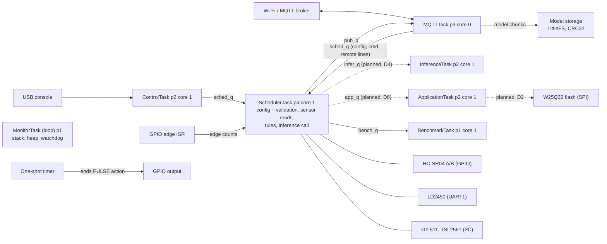

# Professor Feedback Tracker: Week 6 Design Review

This file is the single record of the professor's feedback on the Week 6 design review and of how the team is answering it. Every feedback item has an ID, an owning deliverable, a status, the evidence behind that status and the next action. Section 3 is the at-a-glance status; section 4 holds the full detail for each item; sections 5 to 11 hold the corrected design content that resolves the D1-owned items, ready to copy into the review and the Tribunal documents.

| | |
|---|---|
| Tracker branch | `d3`, incorporating the current D1/D2 baseline from `main` |
| Last updated | 2026-10-28, D3 baseline merge and branch-specific progress restored; D1/D2 evidence retained |
| Feedback received | After the Week 6 design review submission (before 2026-10-18) |
| Reviewed document | Week 6 Design Review "P2-AAI15", local copy `ESP_P2_AAI15 (2).pdf` |
| Next event | Tribunal 1, Monday 2026-10-19 (see section 1) |

**Rules for updating.** Change a status only when the evidence column can point to a file, a log or a measurement. Never delete an item: mark it resolved or superseded and say why. Copy any new professor feedback into section 2 word for word before adding items for it. Add a line to the change log (section 14) for every update. Owners update their own items; anyone may add evidence.

## 1. Context

**Deliverables and owners** (team workload split of 2026-09-28):

| Deliverable | Scope | Owners |
|---|---|---|
| D1 | Port configpico2wedge to the ESP32-S3 (23 tasks; task 10 is the Week 6 design review) | Hasif, Cody, Sitt |
| D2 | SPI support on the ESP32-S3 | Brendan, Jun Yong |
| D3 | Configurable timing: periodic, one-shot, event-driven, logical sequence | Cody |
| D4 | Embedded ML efficiency | Brendan, Jun Yong |
| D5 | Benchmarking programme (B1–B6) | Hasif, Sitt |
| D6 | End-to-end use case: people-flow and occupancy monitoring at an entrance | Whole team |

**Sub-module owners in the Week 6 review**, which the Tribunal asks each member to speak for: Hasif, ESP32-S3 platform, HAL, ControlTask, MQTTTask and the rule engine; Sitt, sensor drivers (GPIO, I²C, UART, SPI) and the bus mutexes; Brendan, SchedulerTask configuration, validation and timing, and MonitorTask; Jun Yong, InferenceTask, model storage and inference; Cody, ApplicationTask, BenchmarkTask, integration and validation.

**Tribunal 1** (prof's email): Monday 2026-10-19 on Zoom at 11:00; a 15-minute brief on a requirement change, then a 90-minute recorded group discussion of its impact on resources, memory, processing time, hardware constraints and module dependencies, in which every member explains their own sub-module. Documents (.doc or .pdf): `[Group ID]_PreTri1` before 11:00, `[Group ID]_ImmTri1` by 13:10, `[Group ID]_PostTri1` by 2026-10-23 23:59; the recording is uploaded as soon as possible. This tracker is the source for the feedback-related parts of those documents. Confirm whether the group ID is `AAI15` or `P2-AAI15`.

**Where the evidence lives.** D1 results: [parity/PARITY.md §3](parity/PARITY.md#3-esp32-s3-results-tasks-13-to-21) and `parity/logs/s3/` for the Arduino/FreeRTOS build, and [§4](parity/PARITY.md#4-esp32-s3-on-µt-kernel-3-smp-tasks-24-to-34) and `parity/logs/mtk/` for the µT-Kernel 3 SMP build required since Tribunal 1 ([MTK_REDESIGN.md](MTK_REDESIGN.md)). Board and wiring: [SETUP.md](SETUP.md). Pico-to-S3 changes and defects D-01 to D-15: [PORTABILITY.md](PORTABILITY.md). D2 work: [D2_SPI_TODO.md](D2_SPI_TODO.md), [D2_SPI_DESIGN_NOTES.md](D2_SPI_DESIGN_NOTES.md), [D2_EVENT_RECORD_DESIGN.md](D2_EVENT_RECORD_DESIGN.md), `parity/logs/d2-spi/`.

## 2. The feedback, word for word

> The requirements are numerous and mostly testable, and the single-firmware, three-node architecture is a reasonable way to demonstrate configurability. However, several artefacts contradict each other, and almost all timing-critical work is concentrated in one task without evidence that it fits.
>
> Pin selection on the ESP32-S3 is sound: it avoids strapping, flash, octal-PSRAM, native-USB and console pins, places ECHO dividers on GPIO7/GPIO9, and uses one I²C bus and one SPI bus with bus mutexes. Replace the stock DevKitC-1 pinout with your own wiring diagram for each node.
>
> SchedulerTask (P4, core 1) handles configuration, all sensor reads, rule evaluation and window assembly, but the echo-timing method is not stated. A blocking pulseIn-style wait can take 25–38 ms on timeout, so two ultrasonic sensors cannot both be sampled every 50 ms. Time ECHO with RMT/MCPWM capture or with timestamped edge interrupts that notify the task (as your GPIO ISR already does for counters), and measure SchedulerTask WCET.
>
> Define trigger spacing and order for the two HC-SR04s to avoid crosstalk (8.3), since entry/exit direction depends on which fires first.
>
> The LD2450 streams continuously at 256,000 baud but is read only when "due". Specify who drains UART1 and how often, the RX buffer size, and how presence is derived, or frames will overflow.
>
> Sections 6.1 and 6.4 disagree on which node builds the observation window. Assemble the event on the sensor node and publish one timestamped record with an event ID, rather than reassembling raw 20 Hz readings over MQTT (A9).
>
> Decide now on event IDs and de-duplication for QoS 1 delivery, and whether the occupancy count (FR18) survives a processing-node reset.
>
> infer_q carries both events and model chunks, and flash writes on the ESP32-S3 suspend the cache on both cores, which can disturb sampling (NFR1). Separate model upload from inference, and define the chunk protocol (size, sequence, CRC, atomic switch-over).
>
> List the MQTT topics, payloads and commands (FR1 refers to the Pico 2 W reference build), and how configuration messages are validated.
>
> All five queues have "Needs validation" for length and overflow. Give provisional sizes and drop policies now, including pub_q behaviour while offline (FR21).
>
> Update the diagrams: the interaction diagram shows placeholder hardware ("e.g. BME280") and ConfigTask/SensorTask remnants remain.
>
> Explain the role of the TSL2561 and GY-511 in entrance counting, or drop them.
>
> NFR1 uses the mean interval, which hides jitter; add a p95 or maximum bound. Add a fault table separating critical faults from DEGRADED.
>
> Key Risks to Validate Early: SchedulerTask timing with two ultrasonic sensors, radar UART and I²C sensors at the 50 ms window rate. Correct entry/exit ordering when readings travel over MQTT between nodes. Collecting enough labelled entrance events to reach NFR10 for all four classes. Model upload and flash writes running alongside live sampling. Occupancy count integrity under duplicate messages and node resets.
>
> Resolve the inconsistencies between artefacts first, then prove the sampling path on real hardware before investing further in ML optimisation. Just a reminder that project must be in C.

## 3. Status at a glance

✅ resolved · 🟡 partly resolved · ❌ open for its owner

| # | Feedback item | Deliverable | Owner | Status | Detail |
|---|---|---|---|---|---|
| F1 | Requirements testable; three-node design reasonable | none | none | ✅ | [F1](#f1-requirements-and-architecture-praise) |
| F2 | Pin selection sound | none | none | ✅ | [F2](#f2-pin-selection-praise) |
| F3 | Artefacts contradict each other | D1 | Hasif | ✅ | [F3](#f3-contradictions-between-artefacts) |
| F4 | Own wiring diagram per node | D6, D2 | Team, Brendan | 🟡 | [F4](#f4-wiring-diagram-per-node) |
| F5 | Echo-timing method; no blocking wait | D3 | Cody | ❌ | [F5](#f5-echo-timing-method) |
| F6 | Measure SchedulerTask WCET | D3, D5 | Cody, Hasif | ✅ | [F6](#f6-schedulertask-wcet) |
| F7 | HC-SR04 trigger order and spacing | D3 | Cody | ❌ | [F7](#f7-hc-sr04-trigger-order-and-spacing) |
| F8 | LD2450 UART drain, buffer, presence | D6 | Team | ❌ | [F8](#f8-ld2450-uart-handling) |
| F9 | One observation-window owner; event record with ID | D6 | Team | ❌ | [F9](#f9-observation-window-owner-and-event-record) |
| F10 | Event IDs, de-duplication, occupancy after reset | D6 | Team | ❌ | [F10](#f10-event-ids-de-duplication-and-occupancy-persistence) |
| F11 | Separate model upload from inference; chunk protocol | D4 | Brendan, Jun Yong | 🟡 | [F11](#f11-model-upload-separation-and-chunk-protocol) |
| F12 | MQTT topics, payloads, commands, validation | D1 | Hasif | ✅ | [F12](#f12-mqtt-interface-and-validation) |
| F13 | Queue sizes, drop policy, offline pub_q | D1 | Hasif | ✅ | [F13](#f13-queue-sizes-and-drop-policy) |
| F14 | Diagrams: placeholder hardware, old task names | D1 | Hasif | ✅ | [F14](#f14-diagrams) |
| F15 | Role of TSL2561 and GY-511 | D6 | Team | ❌ | [F15](#f15-role-of-the-tsl2561-and-gy-511) |
| F16 | NFR1 p95 or maximum bound | D5 | Hasif | ✅ | [F16](#f16-nfr1-jitter-bound) |
| F17 | Fault table: critical vs DEGRADED | D1 | Hasif | ✅ | [F17](#f17-fault-table) |
| R1 | Risk: SchedulerTask timing at 50 ms with all sensors | D3, D5 | Cody, Hasif | ❌ | [R1](#r1-schedulertask-timing-at-50-ms) |
| R2 | Risk: entry/exit order over MQTT | D6 | Team | ❌ | [R2](#r2-entryexit-order-over-mqtt) |
| R3 | Risk: labelled events for NFR10 | D4, D6 | Brendan, Jun Yong | ❌ | [R3](#r3-labelled-events-for-nfr10) |
| R4 | Risk: model upload and flash writes during sampling | D4, D2 | Brendan, Jun Yong | 🟡 | [R4](#r4-model-upload-and-flash-writes-during-sampling) |
| R5 | Risk: occupancy integrity under duplicates and resets | D6 | Team | ❌ | [R5](#r5-occupancy-integrity) |
| C1 | Resolve inconsistencies, then prove sampling before ML | D3, D6 | Cody, team | 🟡 | [C1](#c1-sampling-path-before-ml) |
| C2 | The project must be in C | D1 | Hasif, team | 🟡 | [C2](#c2-use-of-c) |

**Totals:** ✅ 9 · 🟡 5 · ❌ 10. Every open (❌) item belongs to D3, D4 or D6. Of the D1 and D5 items, only C2 (the professor's confirmation) remains.

## 4. Item details

Each entry gives the feedback, the review sections it affects, what exists now, the evidence and the next action.

### F1. Requirements and architecture (praise)
Feedback: requirements numerous and mostly testable; the single-firmware, three-node architecture is a reasonable way to demonstrate configurability. Status ✅. No action.

### F2. Pin selection (praise)
Feedback: pin selection avoids strapping, flash, octal-PSRAM, native-USB and console pins, puts the ECHO dividers on GPIO7/GPIO9, and uses one I²C and one SPI bus with bus mutexes. Status ✅. The plan was re-checked against the board actually used, which is not the DevKitC-1 the review assumed; it still holds (section 5). D2 implements the SPI bus mutex (D2 feedback list, section 12).

### F3. Contradictions between artefacts
Feedback: several artefacts contradict each other; resolve these first. Affects: review §2 (hardware), the interaction diagram (§4) and §6.1/§6.4. Status ✅ for the D1 contradictions (board, console, task names; section 5). The §6.1/§6.4 window-owner contradiction is F9 (D6). Next action: paste section 5 into the review.

### F4. Wiring diagram per node
Feedback: replace the stock DevKitC-1 pinout with your own wiring diagram for each node. Status 🟡. Done: the D1 sensor node's pin table and wiring diagram ([SETUP.md, Pin, power and wiring](SETUP.md#pin-power-and-wiring-task-8)) and the board pinout image (`Pinout_Super_Mini_S3.png`). Open: diagrams for the other two nodes (D6) and the W25Q32 fixture (D2, in Brendan's list). Next action: D6 agrees each node's devices, then each diagram is drawn from the SETUP format.

### F5. Echo-timing method
Feedback: the echo-timing method is not stated; a blocking wait can take 25–38 ms on timeout, so two ultrasonic sensors cannot both be sampled every 50 ms; time ECHO with RMT/MCPWM capture or timestamped edge interrupts that notify the task. Status ❌. Fact: the D1 pulse driver (`measure_pulse_us` in `libraries/EdgeCore/src/bus/gpio.c`) busy-waits inside SchedulerTask, for up to its 25 ms timeout when nothing answers. Next action (D3): replace it with capture or timestamped edge interrupts; the D1 edge ISR for counters (`hal_gpio_count_edges`) is the starting point. Section 8 measures the current cost. Update 2026-10-20 (D1 task 29, µT-Kernel redesign): on the µT-Kernel build the busy-wait is gone. `hal_gpio_measure_pulse` timestamps both echo edges in the GPIO interrupt and the measuring task sleeps on an event flag; a lower-priority task on core 1 ran 563,596 loops during an echo wait against 0 during a busy-wait ([29-echo-and-wcet.txt](parity/logs/mtk/29-echo-and-wcet.txt), HAL test). The wait still lasts up to the timeout inside SchedulerTask's cycle, so the sampling plan for two sensors per window (F7, R1) stays with D3.

### F6. SchedulerTask WCET
Feedback: measure SchedulerTask WCET. Status 🟡. Done: SchedulerTask measures the work of every wake-up and `TASKS` reports the count, mean, p95 bucket and maximum; `parity/wcet_test.py` runs six load scenarios (section 8). Open: the run itself, which needs the board. Next action: `sh tools/s3.sh flash`, then `.venv/bin/python parity/wcet_test.py`; copy the table into section 8 and set ✅. Update 2026-10-20: measured on the µT-Kernel build and on the FreeRTOS build for comparison (section 8, [PARITY.md §4](parity/PARITY.md#4-esp32-s3-on-µt-kernel-3-smp-tasks-24-to-34)); status ✅.

### F7. HC-SR04 trigger order and spacing
Feedback: define trigger spacing and order for the two HC-SR04s to avoid crosstalk (review §8.3), since entry/exit direction depends on which fires first. Status ❌. Nothing defined yet. Next action (D3): choose the order and minimum spacing (an echo can last up to 25 ms), and test crosstalk with both sensors facing the entrance.

### F8. LD2450 UART handling
Feedback: the LD2450 streams at 256,000 baud but is read only when due; specify who drains UART1 and how often, the RX buffer size, and how presence is derived. Status ❌. Fact: the D1 UART driver reads only when a sample is due, with the default RX buffer. Next action (D6): assign a task to drain UART1 continuously, size its buffer for the frame rate, and define the presence rule from the radar frames.

### F9. Observation-window owner and event record
Feedback: review §6.1 and §6.4 disagree on which node builds the observation window; assemble the event on the sensor node and publish one timestamped record with an event ID instead of reassembling raw 20 Hz readings over MQTT (review A9). Status ❌. Related: D2's flash-log record already carries an event sequence number ([D2_EVENT_RECORD_DESIGN.md](D2_EVENT_RECORD_DESIGN.md)). Next action (D6): rewrite §6.1 and §6.4 so the sensor node owns the window, and define the record (event ID, node ID, start and end time, features).

### F10. Event IDs, de-duplication and occupancy persistence
Feedback: decide now on event IDs and de-duplication for QoS 1 delivery, and whether the FR18 occupancy count survives a processing-node reset. Status ❌. The review says persistence "remains a design decision". Next action (D6): an event ID of node ID plus boot ID plus sequence, de-duplicated at the processing node; decide whether the count is stored (LittleFS or W25Q32) or rebuilt.

### F11. Model upload separation and chunk protocol
Feedback: infer_q carries both events and model chunks, and flash writes suspend the cache on both cores, which can disturb sampling (NFR1); separate model upload from inference, and define the chunk protocol (size, sequence, CRC, atomic switch-over). Status 🟡. Done in the D1 code: uploads never use infer_q, and the size check, CRC32 and atomic switch-over exist (section 7). Open (D4): enforce chunk order, update the review's description, and measure flash writes against live sampling (R4).

### F12. MQTT interface and validation
Feedback: list the MQTT topics, payloads and commands, and how configuration messages are validated. Status ✅ (section 6). Evidence: `mqtt_test.py` 27/27, `5-neg` 27/27, `net_fault_test.py` 9/9. Next action: paste section 6 into the review.

### F13. Queue sizes and drop policy
Feedback: all five queues say "Needs validation" for length and overflow (review §8.3); give provisional sizes and drop policies, including pub_q behaviour while offline (FR21). Status ✅ (section 7). Evidence: `flood_test.py` and `net_fault_test.py`. D2 adds its own log queue (capacity 8, drop newest) in [D2_EVENT_RECORD_DESIGN.md](D2_EVENT_RECORD_DESIGN.md). Next action: paste section 7 into the review.

### F14. Diagrams
Feedback: the interaction diagram shows placeholder hardware ("e.g. BME280") and ConfigTask/SensorTask remnants remain. Status ✅. Section 9 gives the corrected diagram with the real task names, priorities, cores, queues and hardware. Next action: redraw the review's diagram from it.

### F15. Role of the TSL2561 and GY-511
Feedback: explain the role of the TSL2561 and GY-511 in entrance counting, or drop them. Status ❌. Fact: the GY-511 works on the S3 (`4c-mag` 15/15); the TSL2561 is no longer in the kit (`4c-i2c` was verified on the Pico only). Next action (D6): keep each with a stated role, or remove it from the review and the parts list.

### F16. NFR1 jitter bound
Feedback: NFR1 uses the mean interval, which hides jitter; add a p95 or maximum bound. Status ✅ (section 10): p95, p99, maximum and skipped samples measured, with proposed NFR1 wording that the current build meets. Next action: update NFR1 in the review; Brendan reports SPI transfer p95 separately (D2).

### F17. Fault table
Feedback: add a fault table separating critical faults from DEGRADED. Status ✅ (section 11). Next action: paste it into the review's statechart section. No deliverable owns fault handling yet; the team should assign it.

### R1. SchedulerTask timing at 50 ms
Risk: SchedulerTask timing with two ultrasonic sensors, radar UART and I²C sensors at the 50 ms window rate. Status ❌. Depends on F5, F6 and F8 and needs the entrance hardware. The F6 scenarios already include two ultrasonic reads with no echo, the worst case of the current driver. Update 2026-10-20: measured (section 8). Two no-echo reads take 52.0 ms on average and 53.5 ms at most per cycle on the µT-Kernel build, more than the 50 ms window, so the risk is confirmed; one read takes at most 26.7 ms.

### R2. Entry/exit order over MQTT
Risk: correct entry/exit ordering when readings travel over MQTT between nodes. Status ❌. Removed by design once F9 moves window assembly to the sensor node, so ordering never depends on MQTT delivery.

### R3. Labelled events for NFR10
Risk: collecting enough labelled entrance events to reach NFR10 (80% accuracy) for all four classes. Status ❌. No dataset yet; it is shared by D4 and D6.

### R4. Model upload and flash writes during sampling
Risk: model upload and flash writes running alongside live sampling. Status 🟡. Model upload is proven on the S3 (`model_test.py` 9/9) but not under measured live sampling. Brendan's T-23 combined run (SPI flash writes, sampling and inference) covers the rest. Update 2026-10-20 (D1 task 31): on the µT-Kernel build an upload is written to the flash slot not in use while sampling and inference continue (`mqtt_test.py` 27/27, `model_test.py` 8/9, [PARITY.md §4](parity/PARITY.md#4-esp32-s3-on-µt-kernel-3-smp-tasks-24-to-34)). Each flash write briefly parks the other core, and the course port needed its kernel and shim moved into IRAM before writes were safe while Wi-Fi was active ([MTK_REDESIGN.md §8](MTK_REDESIGN.md#8-memory-plan)).

### R5. Occupancy integrity
Risk: occupancy count integrity under duplicate messages and node resets. Status ❌. Follows F10.

### C1. Sampling path before ML
Feedback: resolve the inconsistencies first, then prove the sampling path on real hardware before investing further in ML optimisation. Status 🟡. The generic sampling path is proven on the S3 (NFR1 timing, 30-minute endurance run, all D1 parity stages). The entrance sampling path (two ultrasonic sensors and the radar) is not.

### C2. Use of C
Feedback: the project must be in C. Status 🟡: the boundary is documented (section 13), but the team and the professor must confirm it. Next action: ask the professor whether the thin C++ Arduino layer is acceptable. Update 2026-10-20: the µT-Kernel build has no Arduino layer; its platform code is C apart from the TFLite Micro wrapper (section 13).

## 5. Corrected hardware and naming (F3)

The review describes three ESP32-S3-WROOM-1-N16R8 DevKitC-1 boards with the console on GPIO43/44 through a UART bridge. Every D1 build and test ran on the HW-747 ESP32-S3 Super Mini, whose chip esptool identifies as an ESP32-S3FH4R2 (QFN56, revision v0.2) with 4 MB in-package flash and 2 MB in-package quad PSRAM. The console and uploads use the native USB-Serial/JTAG on GPIO19/20. The firmware needs the Huge APP partition (1.33 MB image) and QSPI PSRAM; details are in [SETUP.md](SETUP.md).

The review's pin plan still holds on this board: HC-SR04 A on GPIO6 (Trig) and GPIO7 (Echo); HC-SR04 B on GPIO8 and GPIO9; the LD2450 on UART1 with RX GPIO17 and TX GPIO18 (pads on the underside); I²C SDA GPIO1 and SCL GPIO2. With quad rather than octal PSRAM, GPIO33–37 are free, and GPIO43/44 are free because the console is on USB. The firmware refuses GPIO19–20, 22–25 and 26–32 at configuration time. D2 uses SPI2 on GPIO10 (CS), 11 (SCLK), 12 (MOSI) and 13 (MISO) ([ARCHITECTURE.md](ARCHITECTURE.md)).

The review's diagrams still name ConfigTask and SensorTask. The implemented task set is SchedulerTask, MQTTTask, ControlTask, InferenceTask, ApplicationTask, BenchmarkTask and MonitorTask. Configuration validation is a module inside SchedulerTask (section 9).

## 6. MQTT interface and configuration validation (F12)

`<node>` is the node ID (for example `s3-001`). The node subscribes to `pico/<node>/#` and `pico/broadcast/config` at QoS 1. The topics, payloads and commands match the Pico 2 W reference build, which FR1 cites.

| Direction | Topic | Payload | QoS |
|---|---|---|---|
| In | `pico/<node>/config`, `pico/broadcast/config` | One or more `BEGINCFG\|…\|ENDCFG` and `BEGINRULE\|…\|ENDRULE` blocks (inline or multi-line), or JSON `{"configs":[…],"rules":[…]}` | 1 |
| In | `pico/<node>/cmd` | `RUN`, `STOP`, `CLEAR`, `SHOW`, `debug.infer on\|off`, `infer.mode <mode>`, `batch: <action> \| <action>` | 1 |
| In | `pico/<node>/in` | Text message from another node | 1 |
| In | `pico/<node>/model/start` | `{"size":<bytes>,"crc32":<value>}` | 1 |
| In | `pico/<node>/model/chunk/<i>` | Binary, at most 1,024 bytes | 0 |
| In | `pico/<node>/model/end` | Empty: verify, save and activate | 1 |
| In | `pico/<node>/model/params` | Binary normalisation parameters | 1 |
| In | `pico/<other>/sensor/<src>/line` | Followed remote sensor (bridging; D-10 fixed on the S3) | 1 |
| Out | `pico/<node>/sensor/<name>/line` | `proto=<bus> src=<name> len=<n> ts=<ms> : <hex bytes>` | 0 |
| Out | `pico/<node>/status/config`, `pico/<node>/status/rule` | `OK:<name>` or `FAIL:<name>` | 0 |
| Out | `pico/rule/<rule>/event` | `ts=<ms> rule=<name> type=<type> value=<v> msg=<text>` | 0 |
| Out | `pico/<node>/presence` | `{"node":"<node>","cap":["config","telemetry","node-msg"]}`, retained | 1 |
| Out | `pico/<node>/heartbeat` | `{"uptime_s":<seconds>}` every 10 s | 0 |

The rule actions `cfg.to:<node>:<block>` and `cmd.to:<node>:<cmd>` publish to that node's `config` and `cmd` topics. The same lines are accepted on the USB console.

Configuration messages are validated in this order, and every refusal is reported on the console and on the `status` topic:
1. **Size.** A payload above 2,047 bytes is truncated with a warning; one larger than the MQTT client buffer is dropped by the client, which reconnects.
2. **Format.** JSON is converted to inline blocks; malformed JSON is refused.
3. **Sensor blocks.** Each is refused for an unknown protocol (D-01), a missing or non-existent pin (D-02, D-08), a reserved pin, or an I²C device that fails its set-up writes. The ninth sensor is refused (`no free slots`). On `s3-port-d2`, `proto=spi` is a valid protocol with its own runtime checks (D2).
4. **Rules.** Each is refused without a source, with a malformed expression (D-03) or with an invalid action pin (D-04). The fifth rule is refused.

Evidence: `5-neg` 27/27, `mqtt_test.py` 27/27, `net_fault_test.py` 9/9 ([PARITY.md §3](parity/PARITY.md#3-esp32-s3-results-tasks-13-to-21)).

## 7. Queues, drop policy, offline behaviour and model upload (F13, F11)

All sizes are the implemented values in `libraries/EdgeS3/src/runtime_s3.cpp`. No send blocks for long, and every drop is logged, so overload is visible rather than silent.

| Queue | Item | Length | Producer → consumer | Send wait | When full |
|---|---|---|---|---|---|
| `sched_q` | `sched_msg_t`: kind, 96 B topic, 2,048 B text (about 2.2 KB) | 6 | MQTTTask, ControlTask → SchedulerTask | MQTT 0 ms; console 100 ms | Newest dropped and logged (`inbound queue full`, `scheduler busy, line dropped`) |
| `pub_q` | `pub_msg_t`: op, 160 B topic, 512 B payload (about 680 B) | 16 | SchedulerTask and runtime → MQTTTask | 0 ms | Newest dropped and logged |
| `infer_q` | 64 B | 4 | SchedulerTask → InferenceTask | provisional | Provisional: InferenceTask is a placeholder until D4; inference currently runs from the rule action in SchedulerTask |
| `app_q` | 64 B | 8 | SchedulerTask → ApplicationTask | provisional | Provisional until D6 and the D2 event log |
| `bench_q` | `bench_msg_t`: 24 B name, 32-bit µs value | 16 | Timed sections → BenchmarkTask | 0 ms | Newest dropped |

**Offline (FR21).** While MQTT is disconnected, sampling, rules and console output continue, and publications are refused at the source instead of being queued, so `pub_q` never fills with stale data. On reconnection the node re-subscribes and republishes its retained presence. Readings taken while offline are therefore not delivered later; if the use case needs them, D6 must add a bounded store-and-forward buffer. Measured: 20 samples taken during a 10 s Wi-Fi drop; reconnection 1.6–2.2 s after Wi-Fi or the broker returned; a 60 s flood of 2,547 messages with no reset.

**Model upload (F11).** Uploads do not use `infer_q` in the implementation. MQTTTask passes each `model/` message straight to the transfer module (`libraries/EdgeS3/src/model_transfer_s3.cpp`). The module checks the announced size (at most 256 KB) and the CRC32, writes the 1,024-byte chunks to a temporary LittleFS file, and replaces the saved model only after both checks pass. A corrupt, oversized or interrupted upload therefore leaves the previous model running, and the saved model reloads after a reboot (`model_test.py` 9/9). Two parts remain for D4: chunk order is not enforced (chunks are appended as they arrive), and the cache suspension caused by flash writes has not been measured against live sampling (R4).

## 8. SchedulerTask worst-case execution time (F6, R1)

SchedulerTask measures the work it does on each wake-up: messages, sensor reads, rules, and model and inference polling. `TASKS` prints `SchedulerTask cycles=… mean_us=… p95_us=… max_us=…` and then resets the statistics. The maximum is the largest observed cycle, not a proven bound. `parity/wcet_test.py` runs these scenarios for 20 s each:

Measured on 2026-10-20 on the HW-747 with Wi-Fi and MQTT connected (`parity/logs/mtk/wcet.log`, `parity/logs/s3/wcet.log`):

| Scenario | FreeRTOS cycles | FreeRTOS mean | FreeRTOS p95 | FreeRTOS max | µT-Kernel cycles | µT-Kernel mean | µT-Kernel p95 | µT-Kernel max |
|---|---|---|---|---|---|---|---|---|
| Idle, sampling on, no sensors | 25 | 229 | <250 | 244 | 25 | 188 | <250 | 320 |
| 8 digital inputs at 50 ms | 1,643 | 1,447 | <5,000 | 7,006 | 748 | 1,595 | <5,000 | 3,838 |
| 1 digital input + rule at 50 ms | 794 | 692 | <2,500 | 2,336 | 410 | 1,024 | <2,500 | 1,698 |
| 1 HC-SR04 at 50 ms, no echo (25 ms timeout) | 281 | 25,522 | <50,000 | 26,098 | 277 | 26,168 | <50,000 | 26,704 |
| 2 HC-SR04 at 50 ms, no echo | 315 | 45,776 | >50,000 | 52,257 | 277 | 51,979 | >50,000 | 53,511 |
| Inference rule at 50 ms | 428 | 1,608 | <2,500 | 2,541 | 415 | 1,964 | <5,000 | 3,033 |

On both runtimes two ultrasonic reads with no echo take longer than the 50 ms window, because each read waits for its 25 ms timeout inside SchedulerTask's cycle. On µT-Kernel the CPU is free during that wait (the HAL test's spinner ran 563,596 loops), on FreeRTOS it busy-waits. The inference cycle is longer on µT-Kernel, where each invocation crosses to InferenceTask and back and the build uses the port's default `-Og` optimisation where Arduino-ESP32 uses `-Os`: one invocation takes about 500 µs against 265–280 µs on the Arduino build, measured in the same session. How much of the difference each factor causes was not measured. In the multi-sensor scenarios the FreeRTOS build woke SchedulerTask about twice as often in the same 20 s, so its mean is spread over more, shorter cycles.

Components measured earlier: rule evaluation 77–646 µs per sample (`[TRACE] Total Rule Eval` on the light-sensor run); inference 242–462 µs per invocation (D1 task 20). The pulse driver busy-waits inside SchedulerTask for up to 25 ms when no echo returns, so two ultrasonic sensors with no echo would use about 50 ms of every 50 ms window. That confirms the risk in F5 and R1, and the scenarios above will show it directly.

## 9. Corrected task interaction diagram (F14)

This replaces the review's diagram: no placeholder hardware, and no ConfigTask or SensorTask. Items marked "planned" are not yet implemented.

## 10. NFR1 jitter: p95, maximum and skipped samples (F16)

The mean hides jitter, as the feedback says. The NFR1 run (six sensors, Wi-Fi and MQTT active, `parity/logs/s3/nfr1-timing.log`) was re-analysed for percentiles and gaps. `parity/timing_test.py` now prints the p95, maximum and skipped-sample columns in every run.

| Target | Samples | Mean | p95 | p99 | Maximum | Skipped samples (interval > 1.5 × target) |
|---|---|---|---|---|---|---|
| 10 ms | 19,558 | 10.99 | 12 | 12 | 23 | 68 (0.35%) |
| 50 ms | 4,203 | 51.15 | 52 | 52 | 103 | 12 (0.29%) |
| 100 ms | 2,122 | 101.28 | 102 | 102 | 202 | 6 (0.28%) |
| 500 ms | 426 | 504.52 | 502 | 503 | 1,003 | 3 (0.70%) |
| 1,000 ms | 213 | 1,005.72 | 1,002 | 1,002 | 2,002 | 1 (0.47%) |
| 2,000 ms | 106 | 2,019.88 | 2,002 | 2,002 | 4,001 | 1 (0.94%) |

The p95 interval is within +2% at every graded rate. However, in 0.3–0.9% of intervals one sample was skipped, giving a gap of two periods: this is the jitter the mean concealed, and its cause is a D3/D5 follow-up.

Proposed NFR1 wording: "For configured intervals of 100, 500, 1000 and 2000 ms, measured over at least 100 samples with Wi-Fi and MQTT active, the mean interval shall be within ±5% of the configured value, the 95th-percentile interval shall be within +5%, and no more than 1% of intervals shall exceed 1.5 times the configured value. Intervals of 10 and 50 ms shall be reported with the same statistics." The current build meets this proposal.

## 11. Fault classification (F17)

A recoverable fault keeps the node in DEGRADED: it continues sampling and reporting what it can. A critical fault leaves no safe way to continue. The ESP-IDF panic handler restarts the board, which returns to READY with sensor configurations and rules cleared (they are held in RAM) and the uploaded model kept (LittleFS). Whether configuration and the occupancy count should persist across a restart is F10 (D6).

| Fault | Class | Detection | Response | Evidence |
|---|---|---|---|---|
| Wi-Fi lost | DEGRADED | Wi-Fi event | Keep sampling; publications refused; reconnect automatically | Back 1.6–2.2 s after Wi-Fi returns; 20 samples taken offline |
| Broker lost | DEGRADED | MQTT client | Retry every 5 s, then re-subscribe and republish presence | Back in 1.8–2.2 s |
| Malformed or oversized message | DEGRADED | Parser and size check | Refuse and report; continue | `net_fault_test.py` 9/9 |
| Invalid configuration or rule | DEGRADED | Validation (section 6) | Refuse and report | `5-neg` 27/27 |
| Sensor absent or not answering | DEGRADED | Driver timeout | No reading published (I²C), or the no-echo frame `len=1 : 00` (pulse) | `5-neg`, `t06`, `4c-mag` |
| Echo outside the valid range | Not detected | None | Reported as a valid width (D-07, kept for parity with the Pico); must be fixed for NFR4 | `t06` |
| Queue full | DEGRADED | Send fails | Drop the newest item and log it | `flood_test.py` |
| Bad model upload | DEGRADED | Size and CRC32 check | Refuse; previous model keeps running | `model_test.py` 9/9 |
| Model storage unavailable | DEGRADED | LittleFS mount | Uploads disabled; built-in model used | Code path |
| SPI transfer or flash-log failure | DEGRADED | SPI driver and log check (D2) | Reported; monitoring must continue (D2 open item) | `parity/logs/d2-spi/` |
| Low task stack | DEGRADED (warning) | MonitorTask, below 1 KB | Logged | `TASKS` |
| Allocation failure | DEGRADED | `malloc` returns NULL | Configuration refused (`alloc fail`) | Seen before PSRAM was enabled |
| Task stuck (SchedulerTask or ControlTask) | Critical | Task watchdog, 5 s | Panic and restart | Never triggered in any test |
| CPU lock-up or exception | Critical | Interrupt watchdog (300 ms) or CPU exception | Panic and restart | D-15: about one start-up in 6–15 |
| Supply drop | Critical | Brown-out detector | Hardware reset | Not observed |

## 12. D2 feedback status

Brendan's [D2_SPI_TODO.md](D2_SPI_TODO.md) is the current D2 checklist. The D2 status below was refreshed on 25 October 2026 for the µT-Kernel transport and physical W25Q32 checks; event logging and live concurrency remain open.

| D2 item (from D2_SPI_TODO.md) | Tracker item | Status |
|---|---|---|
| Retain one shared SPI bus protected by `spi_mutex` | F2 | ✅ Migrated SPI2 backend uses a bounded µT-Kernel `TA_INHERIT` mutex; target contention test remains open |
| Keep flash logging out of SchedulerTask; perform it through ApplicationTask | F11, R4 | ❌ Open |
| Define capacity, timeout, overflow response and drop policy for every logging or benchmarking queue | F13 | ❌ Open; a provisional log queue (capacity 8, drop newest) is drafted in [D2_EVENT_RECORD_DESIGN.md](D2_EVENT_RECORD_DESIGN.md) |
| Measure p95 and maximum sampling/transfer latency in addition to means | F16 | 🟡 Five 8–1024-byte µT-Kernel loopback reports include p95/p99/max; live flash-write and sampling timing remains open (T-23) |
| Demonstrate model activity and SPI flash writes alongside live sampling | R4 | ❌ Open (D2 T-23) |
| Replace placeholder artwork with a per-node wiring diagram including the W25Q32 | F4 | ❌ Open |
| Confirm failed or delayed SPI logging never stops occupancy processing or causes a valid-looking reading | F17 | 🟡 Physical absent-device rejection passed; application logging and live failure isolation remain open |

## 13. Use of C (C2)

All platform-independent logic is C. The EdgeCore library (`libraries/EdgeCore/src/`, 17 `.c` files, about 6,200 lines with headers on `s3-port-d2`) holds configuration and validation, the scheduler, REPL, rule engine, GPIO/I²C/UART/SPI drivers, MQTT payload handling and the inference manager, and is compiled unchanged by the Pico and ESP32-S3 builds.

C++ is limited to a thin platform layer of five files, about 1,800 lines (`libraries/EdgeS3/src/`), because the Arduino-ESP32 interfaces it must call (`Serial`, `WiFi`, `Wire`, `HardwareSerial`, `SPIClass`, `LittleFS`) are C++ classes. TensorFlow Lite Micro is also C++, on the Pico as well (`project_v3/inference_engine/tflite_wrapper.cpp`). Every C++ file exposes C functions (`extern "C"`) behind C headers such as `hal/hal.h`, so no C++ type crosses into the shared code.

Removing C++ entirely would mean replacing Arduino with the ESP-IDF C drivers, which conflicts with D1's Arduino requirement and repeats verified work. D2 also chose to keep `SPIClass` and record the C/C++ boundary (D2_SPI_TODO.md). Recommendation: keep this boundary, and confirm with the professor that "in C" refers to the application code.

**µT-Kernel build (since Tribunal 1).** The platform layer that replaces the Arduino one (`esp32s3_mtk/components/edge_mtk/` and `main/`) is C: the console, HAL, µT-Kernel runtime, Wi-Fi and MQTT, and model store, about 2,700 lines. The one C++ file is `inference_mtk.cpp` (about 350 lines), because TensorFlow Lite Micro's interface is C++; it exposes C functions behind `inference_engine/tflite_wrapper.h`, as on the Pico.

## 14. Decisions needed and change log

### D3/D6 branch progress and ownership (28 October 2026)

The current `main` tracker and its measured D1/D2 results are preserved, including the completed F6 baseline measurement. Cody's portable D3 timing, EventRecord and occupancy modules, native tests, and earlier Arduino ApplicationTask integration are retained on this branch. See [D3_TASKS.md](D3_TASKS.md), [CODY_WEEK8_SUBMODULE.md](CODY_WEEK8_SUBMODULE.md) and [CODY_PRD_IMPLEMENTATION.md](CODY_PRD_IMPLEMENTATION.md) for the 18 October implementation and ownership record. Those documents describe the earlier runtime; they do not establish that the D3 ApplicationTask runs on µT-Kernel.

Cody directly owns timing/window contracts, EventRecord and application/occupancy/output semantics, integration acceptance criteria and evidence interpretation. Sitt owns sensor-driver work, Brendan owns SchedulerTask sequencing, Hasif supports platform/MQTT/runtime integration and measurements, and Jun Yong owns inference integration. Cody coordinates and reviews those interfaces rather than taking over every low-level implementation.

| D3/D6 item | Retained progress | Remaining gate |
|---|---|---|
| F5/F7/R1: acquisition and sequencing | Main's interrupt-driven µT-Kernel echo evidence and D3 timing contracts | Approve the 50 ms boundary, asynchronous scheduler behavior, two-sonar order/guard and crosstalk; measure the complete workload |
| F9: sensor-node EventRecord | An 80-byte pointer-free record, rule sink and native tests | Complete the real observation-window assembler and MQTT schema; port the typed handoff into the 64-byte-limit µT-Kernel `app_mbf` |
| F10/R2/R5: event identity and occupancy | Boot-local IDs, bounded duplicate/reorder handling and a native-tested occupancy state machine | Agree node/boot/sequence identity, cross-node time and reset/persistence policy; close review defects and prove replay behavior on the target |
| F8/F15: radar and auxiliary sensors | Cody's presence/expiry and feature-contract ownership is documented | Sitt/Brendan supply radar draining/parsing; Cody agrees sensor roles with Jun Yong/Sitt |
| D2 logging handoff | D2's provisional codec and physical synthetic-record recovery evidence are retained | Cody and Brendan/JY agree event/result mappings, publication-enqueue status and the bounded ApplicationTask log handoff; run T-23 |

This baseline merge does not close F9, F10, R2, R5, the D3 hardware checklist or D2 T-23. Subsequent source work on 28 October replaces the µT-Kernel ApplicationTask placeholder with typed event/reset/status processing, bounded publisher requests and application benchmark samples. Its core 1/priority 23/4 KiB stack is preserved, its kernel message storage stays internal (192-byte growth in the native layout; target size reported by `TASKS`), and portable state/formatting lives in EdgeCore BSS mapped to PSRAM. Native dispatch tests cover publication failure, reset ordering and malformed input. Target build/image, core/stack/heap and queue-overflow evidence remain pending; the reviewed timing/identity/quality defects and D2 log handoff remain open. No feedback status is closed by this source port.

**Decisions needed:**

| Decision | Owner | Blocks |
|---|---|---|
| Is the thin C++ Arduino layer acceptable under "must be in C"? | Professor (ask Hasif) | C2 |
| Which node builds the observation window; the event record format | D6 team | F9, R2 |
| Event ID, de-duplication, occupancy persistence | D6 team | F10, R5 |
| Keep or drop the TSL2561 and GY-511 | D6 team | F15 |
| LD2450 drain task, buffer and presence rule | D6 team | F8, R1 |
| Echo capture method and HC-SR04 trigger order | D3 (Cody) | F5, F7, R1 |
| Who owns fault handling (no deliverable does yet) | Team | F17 follow-up |
| Group ID format for the Tribunal files (`AAI15` or `P2-AAI15`) | Team | Tribunal 1 |

**Change log:**

| Date | By | Change |
|---|---|---|
| 2026-10-28 | Cody/Codex runtime port | Added AGENTS.md and µT-Kernel ApplicationTask event/reset/status glue with typed FIFO, nonblocking publication, portable dispatch/state and native tests. Preserved task placement/stack and SPI command dispatch. Hardware/image/resource gates, reviewed behavior findings and D2 logging remain open. |
| 2026-10-28 | Cody/Codex baseline merge | Merged current D1/D2 `main` into `d3`; retained main's setup, measured F6 and D2 evidence, and restored Cody's D3/D6 progress and ownership as branch-specific notes. ApplicationTask migration, reviewed behavior fixes, hardware acceptance and D2 logging remain open; no feedback item is closed by this merge. |
| 2026-10-18 | Cody/Codex implementation (historical D3) | Added portable timing/configuration, EventRecord and occupancy modules, rule-to-event submission, typed Arduino queue integration and native tests. The earlier branch recorded F9/F10/R2/R5 as partial code progress; µT-Kernel and multi-node/reset acceptance remain open. |
| 2026-10-18 | Cody/Codex ownership drafts (historical D3) | Added the D3 execution checklist and Cody ownership/PRD documents, separating application contracts and acceptance from low-level driver, scheduler, inference and platform implementation. |
| 2026-10-18 | Hasif | Tracker created on `s3-port-d2`. F3, F12, F13, F14, F16 and F17 resolved; F6 instrumented (`TASKS` cycle statistics, `parity/wcet_test.py`), run pending; `parity/timing_test.py` reports p95, maximum and skipped samples; D2 status recorded from D2_SPI_TODO.md at `548d2e3`. Before this update: ✅ 2, 🟡 8, ❌ 14. After: ✅ 8, 🟡 6, ❌ 10. |
| 2026-10-20 | Hasif | D1 µT-Kernel 3 SMP redesign (tasks 24–34, [MTK_REDESIGN.md](MTK_REDESIGN.md)): F6 measured on both runtimes and set ✅ (section 8); evidence added to F5 (interrupt-driven echo wait), R1 (two no-echo reads exceed the 50 ms window), R4 (uploads during sampling) and C2 (the µT-Kernel platform layer is C). |
