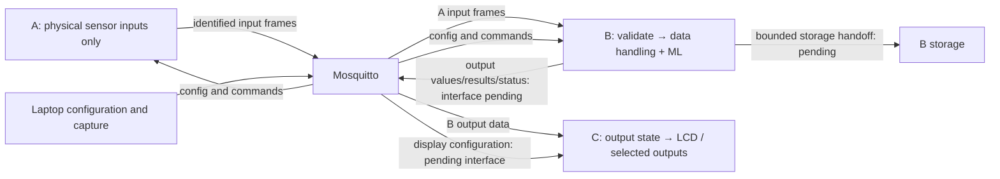

# D6: three-board end-to-end validation plan

Prepared 10 November 2026; refined 11 November 2026 on branch `d6`.
Status: **integration in progress; D6 trials NOT RUN**. See the [next three integration steps](d6/NEXT_STEPS.md)
for concrete changes, dependencies and review gates.
The [13 November handoff](d6/D6_INTEGRATION_HANDOFF.md) records the user's
selected doorway scenario, revised A-local WINDOW / B-occupancy ownership,
materials and proposed board diagrams. It is the current integration direction;
the detailed fixture, transport and storage decisions below still need review.
See [integration status](d6/INTEGRATION_STATUS.md) for the LCD/parser changes
and actual native/build evidence; all physical trials remain NOT RUN.
Lead: Cody. Brendan implements the SPI-config demonstration and remote-data LCD
path; Hasif/Sitt integrate the D4 network/configuration path; Jun Yong supplies
the verified model/input/output contract. These follow the task split recorded
in `origin/main` README section 7 at `b389714`.

## 1. Objective and scope

Demonstrate one configurable edge system: acquire physical sensor data, process
it through rules and ML, send it over MQTT and show it on a separate LCD board.
Change supported configuration on the same firmware image and show the effect.
Also demonstrate GPIO, I2C and SPI together, including a configured SPI byte
write/read and a device substitution after safe power-off and reconfiguration.

The selected application is a radar-and-two-sonar doorway counter with light,
temperature and humidity readings. A locally acquires and assembles the timed
crossing using D3 `WINDOW`, then sends one identified candidate event to B.
B validates and deduplicates events, decides and changes occupancy, stores the
agreed record, and publishes the output state. C displays B's latest valid
state. A has no actuator or final occupancy role. The exact devices, fixture,
event contract and team acceptance still need recording.
D3 supplies timing and sequencing; D4 supplies ML. Neither the whole repository
nor D6 is a D3-only project.

The original doorway plan's readiness checks, controlled workloads, failure
trials, provenance and evidence discipline are reused here. Because the user
selected doorway inclusion, its occupancy integrity and 50 ms two-sonar
acceptance become target gates once the fixture and A-to-B event design are
approved; no existing run is presumed to pass them.
The original [plan](d6/reference/D6_USECASE_VALIDATION_PLAN.md) and
[worksheet](d6/reference/D6_TRIAL_WORKSHEET.md) are archived without claiming
their tests ran. Use the [current worksheet](D6_TRIAL_WORKSHEET.md) for new runs.

## 2. Branch readiness: first integration gate

The new branch starts at `1c30eeb` (the `d3-board` checkpoint), not the latest
project baseline. `origin/main` at `b389714`, containing the merged MQTT and
first ML checkpoints, was integrated by merge `3e029d0`. Conflicts in
README, feedback history and the two D6 documents were reconciled: the current
three-board plan is retained here and the upstream doorway documents remain
archived references. Automatic merging of runtime files is not behavioral
verification; combined validation and LCD integration retain separate gates.

1. Inspect branch, dirty state and local files before integration; preserve
   unrelated changes. The tree was clean at the start of the 11 November review.
2. Retain the completed `main` integration at `3e029d0` and its reconciled
   document history. New upstream changes require a fresh review; this
   checkpoint does not establish the current state of the remote server.
3. The LCD driver and typed diagnostic handoff from `lcd-output` at `b1c1675`
   are selectively imported in the current working change. Current MQTT/ML,
   application and SPI dispatch are retained. Live output routing is pending.
   Keep LCD geometry, offsets and pins specific to the verified panel.
4. Build and audit the combined target, then run regressions before wiring the
   multi-board system. Record the exact revisions actually integrated.

The main merge itself includes no LCD work; the subsequent local LCD import
does not flash boards or implement the live display/storage adapters.
`D3_TASKS.md` and `CODY_WEEK8_SUBMODULE.md` are
absent from this checkpoint; use the current upstream README task list rather
than claiming those missing local handoffs were reviewed.

## 3. Board responsibilities and visible result

Node IDs below are proposed deployment names; record actual names before runs.
They do not redefine canonical event identity or cross-node time contracts.

| Board | Proposed node | Input and responsibility | Visible evidence |
|---|---|---|---|
| A: acquisition and timed assembly | `s3-001` | Physical AHT/light, two sonar and radar acquisition; locally pair sonar samples and run the radar `WINDOW`; publish one identified crossing candidate/event per completed window plus environmental frames. Exact pins and event schema pending | Ground-truth input and window evidence; no final occupancy update or actuator output on A |
| B: decision and storage | `s3-002` | Receive/validate/deduplicate A events, make the final occupancy update, later apply ML, own agreed SPI-flash records and onward communication to C; storage and B→C contracts pending | Correlated accepted event, single occupancy transition, storage outcome when implemented, and outgoing publication |
| C: output | `s3-003` | Consume B's agreed output snapshot/status and draw through Brendan's LCD driver; other output devices pending selection | Correctly associated readings, occupancy and validity from B are visibly rendered |
| Laptop | Broker and evidence | Mosquitto, command publication, raw MQTT/serial capture | Independent evidence that messages reach a subscriber |



Do not label a raw ultrasonic distance as motion or occupancy. A assembles a
timed crossing candidate, while B validates it and changes occupancy at most
once. Select exact devices, pins, thresholds and failure behaviour with the
team before writing runnable presets.
Output behavior belongs to C; B handles its data and control routing. The
doorway alternative needs an approved second sonar, radar, geometry and
its own acceptance; the existing one-sonar fixture does not provide that proof.

## 4. Close these decisions before implementation

| Decision | Responsible participants | Required recorded result |
|---|---|---|
| 5.1 final scenario and doorway inclusion | Cody, Brendan, team | User selected radar + Sonar A/B doorway on 13 Nov; record team acceptance, fixture and final demo boundary |
| 5.2 inventory and per-board fixture | Cody, Sitt, Brendan | Exact board/module, voltages, unique node, pin/power diagram; no conflicts |
| Rule/output behavior | Cody, Sitt, Brendan | B processing/control routing and C output: condition, thresholds/units, debounce or hysteresis, polarity and fault behavior |
| Display and remote validity | Cody, Brendan, Hasif | Fields, source names, decoding, age limit, reconnect/reset behavior, refresh budget |
| 5.4 SPI device substitution | Brendan | Two real devices, device-specific operations, supported settings, reusable script; approved writable byte/location if storage is used |
| 5.6 ML feature/model contract | Jun Yong, Hasif, Sitt, Cody | Model ID/hash, input order and units, preprocessing, freshness, output meaning and chosen local/remote source |
| ML transport and activation | Hasif, Sitt, Brendan | Agreed bounded payload, topic, status/error response, generation handling and display adapter |
| B data storage and onward transport | Cody, Brendan, Jun Yong, Hasif | What is stored, format/identity/result mapping, bounded writer ownership, failure policy and B→C payload/topic; no automatic D2 mapping approval |

Avoid choosing numeric freshness, timing or persistent-identity policies by
accident. Record the team decision and matching implementation before testing.

## 5. Existing interfaces and implementation gaps

| Path | Existing upstream behavior | D6 work and acceptance |
|---|---|---|
| `pico/<node>/config` | Sensor/rule configuration, same text lines as USB; per-board acknowledgements on `status/config` or `status/rule` | Save complete per-board presets and expected acknowledgements; do not broadcast fixture-specific pins |
| `pico/<node>/cmd` | Commands including RUN/STOP/SHOW and existing ML commands | Verify applied behavior; SHOW's printed output remains USB-console evidence |
| `pico/<node>/sensor/<name>/line` | Protocol/source/length/timestamp plus hex bytes | B validates A input and decodes with an explicit profile; shared strict parser now rejects malformed frames. B→C output transport is still to agree; console JSON is not an MQTT payload contract |
| Presence and heartbeat | Connection presence and periodic uptime | Record connectivity separately from valid, fresh sensor data |
| ML result | Current configurable ML demo prints local results | D4 3.4 must add publishing/local routing; C needs an agreed decoder. Do not claim a current ML MQTT result topic exists |
| LCD output | Driver and diagnostic imported from `b1c1675`; its branch retains prior visible test-pattern evidence | Add B→C output-state adapter and bounded update handoff; verify combined firmware visibly, not only `LCDTEST result=0` |
| Live ML changes | Existing presets require STOP before a model change | Continuous-sampling switch is D4 3.2; show paused switching honestly until the live path passes |
| Remote ML input | Sensor bridging exists; configurable ML bindings currently use local sensors | D4 3.3 must implement typed remote inputs/freshness before demonstrating local ↔ remote switching |
| Configured SPI write/read | Diagnostic/device-layer work exists; task 5.4 is pending | Define/implement supported config-driven transaction semantics with Brendan; a manually invoked diagnostic alone does not close 5.4 |

Reuse existing sensor decoders and publication queues. MQTT callbacks should
validate and enqueue bounded data; they must not draw the LCD, invoke the model
or mutate task-owned state directly. Choose one task owner for LCD drawing;
the existing synchronous driver is single-caller. Do not assume its temporary
BenchmarkTask test owner is the final display architecture.

Keep portable decoding/state in EdgeCore and platform task glue in the MTK
layer. Preserve bounded nonblocking producer sends, error/drop counters,
InferenceTask interpreter ownership and existing ApplicationTask placement.
Budget new typed messages, queues, display state and RAM explicitly.

On C, an expired or failed source must show a clear unavailable/stale state
according to the agreed policy. Never substitute zero for missing data.
Use local receive-age checks unless a different time contract is agreed; do
not subtract uptime timestamps from different boards as synchronized clocks.

## 6. ML interpretation for the demo

Physical inputs belong to A. B therefore needs D4's typed remote-input path
before the selected D6 ML trial can run; B's existing local-only sensor bindings
do not satisfy this architecture. First validate A's AHT fields through B's
handling/forwarding path, then use an explicitly agreed remote sine-model
binding. Do not load the all-three-sensor preset on a node missing required
inputs. Have the D4 owners provide the binding and scalar transformation.
Existing local ML tests remain component evidence, not this D6 end-to-end run.

Sine-float/int8 demonstrate configurable execution, not anomaly detection.
The current autoencoder preset repeats features and is also an execution demo.
Display model ID, result and status with that meaning; do not label a raw output
as an anomaly probability, temperature prediction or occupancy count.

If the team selects anomaly detection as the application, add a separate gate:
establish the inherited model's training provenance, full feature construction,
normalization and matching threshold, then validate held-out normal/abnormal
trials. A reconstruction output or arbitrary threshold is insufficient.

## 7. Implementation sequence and task ownership

End-to-end stages remain **NOT RUN**. G0 has a completed main merge, with LCD
live output integration and the remaining readiness gates still open. The LCD
diagnostic import is in the current working change. A completed earlier
upstream component does not mark the combined D6 stage passed.

| Stage | Work | Lead/support | Exit gate |
|---|---|---|---|
| G0: scope and baseline | Close section 4 decisions; integrate main and reviewed LCD component | Cody + Brendan; owners review shared changes | Combined clean build/image, regressions, agreed fixtures and interfaces |
| G1: isolated boards | Configure A sensors, B processing/communication and C outputs; confirm panel geometry/colors/text | Cody + Sitt; Brendan on LCD | Ground-truth input matches A reading; C panel visibly correct |
| G2: sensor network | Start broker and unique nodes; A publishes, B validates/handles input; independent subscriber | Hasif + Cody | A source/topic identified; B accepted input matches physical change |
| G3: remote LCD | Implement B→C output transport, profile decoding, display handoff, validity and failure handling | Brendan + Cody; Hasif transport | C shows the same units/value as B and subscriber evidence; stale sources marked |
| G4: multi-bus/config | Prepare full and piecewise configurations; GPIO/I2C/SPI coexist; byte round trip then device swap | Cody script; Brendan SPI; Sitt fixture | Same image, both configuration styles work; SPI read equals intended byte; replacement works with new config |
| G5: ML result end to end | D4 remote input on B, agreed result publication and C rendering | Hasif/Sitt + Jun Yong; Brendan display | A real input → B inference → subscriber → C labelled output |
| G6: live changes | Network model/input switching once D4 provides it; local↔remote demonstration needs a separately recorded fixture/scope since A owns physical inputs | Hasif/Sitt; Cody + Brendan validate | Sampling continues, generations do not mix, bad setup preserves prior working state |
| G7: full rehearsal | Combined workloads and fault trials, capture all evidence and limitations | Cody + Brendan; team | Every required trial has evidence and all unresolved gates remain explicit |

For G4, get actual device protocols from Brendan before writing transaction
payloads. A flash program/read is not interchangeable with an LCD write. Do
not reuse occupied LCD CS pins for flash, erase storage, or repeat the historical
one-time scratch write. Storage writes require a separately agreed disposable
location and device owner approval. Power off before physical substitution.

## 8. End-to-end rehearsal order

1. Record branch/dirty state, actual image hashes, board identities, SDK and
   full fixture/configuration revisions. Start raw serial capture per board.
2. Put laptop and all boards on the same reachable 2.4 GHz network; set local
   ignored credentials, broker address and unique node names, then flash the
   reviewed images. Do not put credentials in plans or evidence archives.
3. Start a broker log and an independent subscriber, for example:

   ```sh
   mosquitto_sub -h <broker-ip> -t 'pico/#' -v
   ```

   Replace the placeholder with the real address. Verify all three nodes are
   connected; heartbeat alone does not prove sensor or LCD operation.
4. Apply approved input presets to A, processing/routing setup to B and output
   setup to C.
   Record ACKs, RUN state and a first valid sample from every displayed source.
   Configuration is volatile; record and reload presets after reset.
5. Change A's light/activity physically and demonstrate B's handling and C's
   agreed output. Change A's measured environment using a documented safe
   stimulus; correlate A input, B handling/publication and C temperature/humidity.
6. Show G4's multi-bus path on the approved fixture. Compare complete versus
   piecewise configuration, acknowledgements and behavior on the same image.
   Repeated configs can add duplicates: deliberately STOP/CLEAR and reload the
   intended preset when demonstrating full replacement, and label that pause.
7. Show B's numeric ML result locally, at the subscriber and on C. Record model,
   raw features, transformed inputs, outputs, generation and validity.
8. If G6 is implemented, switch models and sources over the network while
   measuring continued sensor output. Otherwise record this portion BLOCKED;
   a STOP-based swap is only the earlier checkpoint, not live acceptance.
9. Run fault trials below separately, restore the known preset after each and
   capture recovery. Save TASKS/resources and independent display evidence.

Runnable per-board `.cfg` files and exact SPI/display/ML commands are next-stage
implementation artifacts after fixture and parser agreement. This plan does
not present proposed interfaces as executable commands.

## 9. Trials and acceptance

Suggested pilot counts/durations are recorded in the worksheet before running;
the team must agree numerical timing, freshness and resource limits. Do not
claim general accuracy or hard real-time bounds from a pilot.

| Trial | Required outcome/evidence |
|---|---|
| Light/activity stimulus | Correct A input, B processing/routing and agreed C output/LCD update; repeat both transitions |
| Temperature/humidity | C's decoded values/units match source and independently captured MQTT bytes within decoder/display precision |
| Complete then piecewise config | Same intended final state, explicit ACKs; no unintended duplicate sensors or stale bindings |
| SPI byte round trip/device swap | Device, location/operation, write value, read value and new configuration recorded; no firmware rebuild between supported substitutions |
| ML result | Successful actual invocation, correct model meaning and matching subscriber/display result; no console-only result claimed as network delivery |
| Live model/source changes | Continuous acquisition measured; old cached inputs/results never labelled as the new setup |
| Invalid configuration/model | Explicit rejection; previously valid setup continues according to the agreed control contract |
| Malformed/truncated/wrong-source frame | No fabricated reading, no buffer overrun/reset; error/drop diagnostic captured |
| Sensor stops updating | After agreed age limit, C marks that source stale; other sources continue |
| Broker outage/reconnect | Local acquisition/rules/ML continue; C indicates unavailable/stale data; subscriptions and fresh display recover without stale replay |
| Source reset | Volatile configuration loss is visible; old reading is not treated as fresh; reload restores the path |
| C reset | Correct startup and re-subscription; no old values presented as current before fresh data |
| Missing ML feature | Explicit missing/stale result rather than a fabricated successful output |
| Combined load | No unexplained resets, queue losses, invalid display or acquisition stalls; measure stack, heap and drops against agreed limits |

Workloads: W1 = A physical inputs and B handling; W2 = W1 + B→C transport and C outputs;
W3 = W2 + verified ML publication/display; W4 = W3 + live reconfiguration and
approved SPI activity. Use unchanged fixtures/rates or assign a new revision.
B storage is required by the clarified role split, but its writer, record
contract and dedicated acceptance trials must be defined before enabling
writes. The existing D3 `WINDOW` implementation runs with local application
state; the A-local event export and B-only occupancy path described in the
13 November handoff are **not yet implemented or physically validated**.

## 10. Verification and evidence handoff

For implementation changes run appropriate focused decoder/state/queue tests
and the existing regressions: `sh tools/cody_test.sh`,
`sh tools/d2_host_test.sh`, `sh tools/check_hal_boundary.sh`,
`sh tools/mtk.sh purity`, plus the imported LCD component's tests when relevant.
Build with the pinned SDK, run `sh tools/mtk.sh image`, then D1 `4a`, `5-neg`
and MQTT tests on the correctly isolated fixture before the end-to-end run.
Check TASKS for task placement, stack/heap and error/drop counts. Native tests
and image audits do not replace board evidence.

Store each new session under `parity/logs/mtk/d6/<session-id>/`: completed
worksheet, redacted setup/configs, source/firmware provenance, broker/subscriber
logs, raw per-board serial, display photos/video, stimulus timeline and
resource/timing results. Publication enqueue is not subscriber delivery; only
subscriber capture plus actual screen evidence proves the final path.

Completion requires team review of tasks 5.1–5.7 with evidence, plus each
member's 5.8 explanation of which functions/interfaces change under a new
requirement. Keep D3 board acceptance, D4 remaining work and D2 logging/T-23
statuses independent. Update the shared README and feedback tracker when
implementation/evidence changes, preserving older records.
