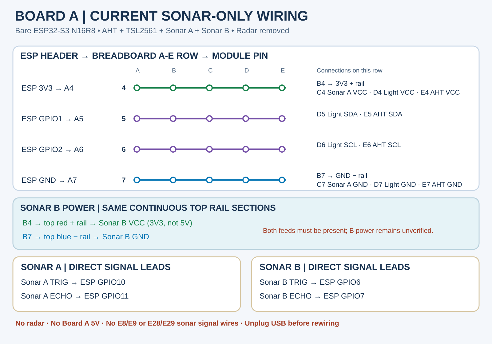

# Current Board A wiring: N16R8, AHT, light and two sonars

**Current proposed fixture, updated 21 November 2026.** This table follows
the [19 November physical bring-up](BOARD_A_BRINGUP_20261119.md) and
[`config/board_a.cfg`](../../config/board_a.cfg). The ESP32-S3 N16R8 and
modules sit outside the breadboard. The radar and its 5V lead are omitted.
Older [compact](PIN_TO_HOLE_WIRING.md) and
[65-row spaced](BOARD_A_SPACED_65_ROW_LAYOUT.md) diagrams are retained as
historical proposals; their sonar signal GPIOs and breadboard rows do **not**
match this config.

## ESP32 to breadboard

| ESP32 printed header pin | Breadboard hole | Use |
|---|---|---|
| 3V3 | A4 | 3.3 V for AHT, light, Sonar A and Sonar B rail feed |
| GPIO1 | A5 | Shared I2C SDA |
| GPIO2 | A6 | Shared I2C SCL |
| GND | A7 | Shared GND for all four modules |

Holes A-E on the **same numbered row** connect across. Thus row 4 is 3V3,
row 5 SDA, row 6 SCL and row 7 GND. Different rows and the F-J half across
the breadboard center gap are separate.

## Breadboard rail jumpers and module power

| From | To | Purpose |
|---|---|---|
| B4 | A hole on the top red `+` rail | Feed that **continuous rail section** from ESP 3V3 |
| B7 | A hole on the top blue `-` rail | Feed that **continuous rail section** from ESP GND |

Use two male-to-male jumpers for those rail feeds. The rail colours do not
create electrical connections by themselves; a split rail needs a bridge
within the **same voltage** section or all power leads on one continuous
section. Never join `+` to `-`. The 19 November record found these feeds
missing at different points, and Sonar B stopped responding after rewiring.
Its rail-powered path must be checked before claiming a combined pass.

| Module | VCC | GND | Signal connections |
|---|---|---|---|
| AHT temperature/humidity | E4 | E7 | SDA E5, SCL E6 |
| TSL2561 light | D4 | D7 | SDA D5, SCL D6 |
| Sonar A, verified 3.3 V-compatible module | C4 | C7 | TRIG **direct to ESP GPIO10**; ECHO **direct to ESP GPIO11** |
| Sonar B, verified 3.3 V-compatible module | Hole on the fed top red `+` rail | Hole on the fed top blue `-` rail | TRIG **direct to ESP GPIO6**; ECHO **direct to ESP GPIO7** |

The four I2C module pins and sonar power pins use jumper leads suited to
their actual connectors. The two sonar signal pairs use female-to-female leads
from each module pin to the **printed ESP header pin**, bypassing breadboard
signal rows. Do not use the former E8/E9, E28/E29, GPIO4/5 or old radar
GPIO17/18 paths with `board_a.cfg`. GPIO35/36/37 are octal PSRAM pins on
these N16R8 boards; leave them unused.

No radar 5V, GND, TX or RX wire belongs to the current Board A fixture. All
four active modules use 3V3 and a common GND. Unplug USB before any wiring
change, and keep the ESP's 5V pin isolated from these 3V3 connections.

## What has been shown

AHT and light returned valid values. Sonar A returned valid distances when
its TRIG/ECHO were taken directly to GPIO10/11. Sonar B returned valid values
once on direct GPIO6/7, then lost power after the rail wiring changed.
Neither a complete two-sonar run nor sonar-triggered occupancy has passed.
Use the [sensor test procedure](BOARD_A_SENSOR_TEST.md) to record those
results; wiring labels alone cannot establish electrical contact or a pass.
