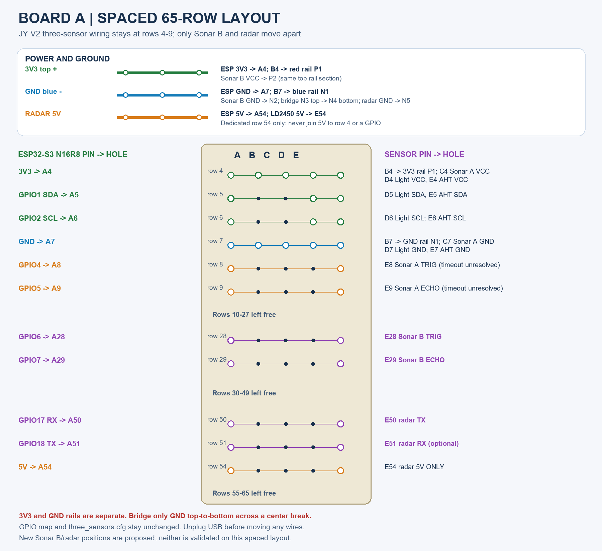

# Board A: spacious 65-row extension of JY V2

This is an **additional proposed physical layout** for the user's 65-row breadboard. It does not replace [JY's original Super Mini wiring](../../esp32s3_mtk/WIRING.md) or the [earlier compact N16R8 proposal](PIN_TO_HOLE_WIRING.md#board-a-aht-light-two-sonars-and-radar). The original AHT, TSL2561 and Sonar A connections on rows 4-9 remain exactly where JY placed them. Only the new Sonar B and radar connections are spread out. Firmware GPIO assignments remain GPIO1/2/4/5 for JY's sensors, GPIO6/7 for Sonar B and GPIO17/18 for radar. `config/three_sensors.cfg` remains the three-sensor firmware profile; breadboard row numbers are not firmware settings.

## Keep JY V2 rows 4-9

| ESP32-S3 N16R8 pin | Hole | Sensor or jumper on the same A-E row |
|---|---|---|
| 3V3 | A4 | Sonar A VCC C4; TSL2561 VCC D4; AHT VCC E4; **new** 3V3 rail feed B4 |
| GPIO1 SDA | A5 | TSL2561 SDA D5; AHT SDA E5 |
| GPIO2 SCL | A6 | TSL2561 SCL D6; AHT SCL E6 |
| GND | A7 | Sonar A GND C7; TSL2561 GND D7; AHT GND E7; **new** GND rail feed B7 |
| GPIO4 | A8 | Sonar A TRIG E8 |
| GPIO5 | A9 | Sonar A ECHO E9 |

B4 and B7 were unused holes in JY's rows; adding rail feeds there does not move any of the original sensor wires. Before using B4 for the new rail feed, move Sonar A VCC from its temporary test hole B4 back to JY's C4 with USB unplugged. Do not put Sonar B VCC in B4 as in the earlier compact D6 proposal, and do not combine the compact and spacious add-on rows. The current physical test passed AHT and light but Sonar A repeatedly timed out, including after a replacement module and jumper leads. The GPIO4/5 loopback passed. See the [Stage 1 record](BOARD_A_STAGE1_BRINGUP_20261118.md). This new spacing does not claim to repair Sonar A.

## Add Sonar B at rows 28-29

| Connection | Destination |
|---|---|
| ESP GPIO6 | A28 |
| Sonar B TRIG | E28 |
| ESP GPIO7 | A29 |
| Sonar B ECHO | E29 |
| Sonar B VCC | P2, a hole on the same **top 3V3 + rail section** as P1 |
| Sonar B GND | N2, a hole on the same **top blue GND rail section** as N1 |

Add a male-to-male jumper **B4 -> P1** on the top 3V3 + rail, and another **B7 -> N1** on the top blue GND rail. P1/P2 and N1/N2 are example rail-hole names; choose holes in continuous sections. Sonar B has not passed a test on this new layout.

## Add LD2450 radar at rows 50-54

| Connection | Destination |
|---|---|
| ESP GPIO17, UART receive | A50 |
| Radar TX | E50 |
| ESP GPIO18, UART transmit | A51, optional |
| Radar RX | E51, optional |
| ESP USB-backed 5V | A54 |
| Radar 5V | E54 |
| Radar GND | N5, a hole on the lower blue GND rail section |

Row 54 is a **5V-only A-E junction**, isolated from row 4 and every GPIO. Bridge **N3 (top blue GND section) -> N4 (lower blue GND section)** with a male-to-male jumper across any center rail break. N5 must be on that same lower blue section. If the rail has no break, the same-voltage bridge is redundant but harmless. Never bridge a GND rail to a + rail. Follow the labelled LD2450 connector and cross radar TX to ESP RX. Do not use header pins merely marked TX/RX, which are different GPIOs. Radar power and UART remain physically unverified on this layout.

## Wiring sequence and checks

1. Disconnect USB. Restore Sonar A VCC from temporary B4 to original C4; keep its GND C7, TRIG E8 and ECHO E9. Keep AHT and light on JY's rows 4-7.
2. Add B4->P1 and B7->N1; label the upper rails `3V3` and `GND`. Use the same continuous top rail section for Sonar B power.
3. Add Sonar B at 28/29 and test it separately on GPIO6/7. Do not treat an old uncertain pulse as a pass on these holes.
4. Bridge only the blue GND sections across any center break. Add radar signal rows 50/51, dedicated 5V row 54 and radar GND at N5. Test the radar separately before a combined run.
5. Re-run AHT, light and each sonar after physical changes. Leave rows 10-27, 30-49 and 55-65 available for later labelled expansion.

This is a **pin-hole proposal**, not evidence that all sensors function together. The two sonar modules were reported as 3.3V-compatible by the user; verify actual ECHO voltage before any change to their power scheme. USB-backed radar 5V requires a stable board and USB supply.

## Physical test update: 18 November 2026

This image remains the **proposed full fixture**, not a verified final wiring
map. During isolated checks with AHT and light removed, Sonar B returned only
invalid 10-35 us pulses through the drawn top power rails, then returned valid
distance captures after VCC and GND were moved directly to the ESP's row 4
and row 7. Both sonar modules produced valid captures on GPIO4/5 when using
the proven four-lead set. Sonar A still timed out with its original lead set.
Radar UART on GPIO17/18 remained silent at 256000 baud even after radar GND
was moved directly to row 7; its 5V at the module was not measured. See the
[dated test record](BOARD_A_STAGE1_BRINGUP_20261118.md#later-board-a-isolation-checks-on-18-november).

The direct-row positions used during diagnostics are temporary while the AHT
and light are absent. Restore their historical rows only after selecting a
verified power distribution and rechecking every connected sensor. A combined
test must stagger the two sonar captures; polling them simultaneously produced
`HAL_ERR_BUSY` from the single pulse-capture resource.

The [Board A serial bring-up](BOARD_A_SERIAL_BRINGUP.md) records the separate
`-1` Sonar A timeout, the sequential `PAIR` command and the native USB console
procedure. The image remains a proposed conflict-free hole allocation, not a
claim that the rail-fed power paths or all sensors have passed together.
