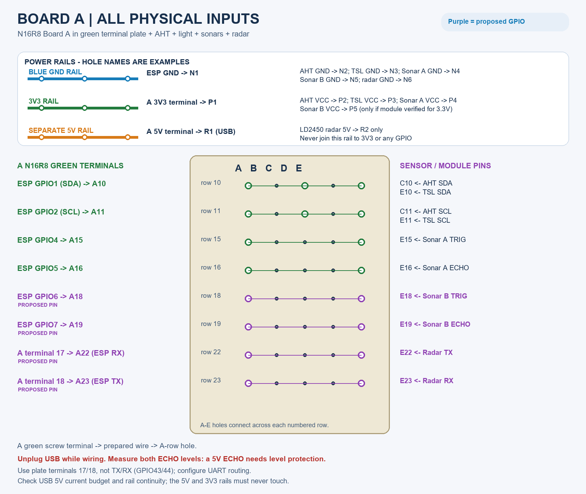
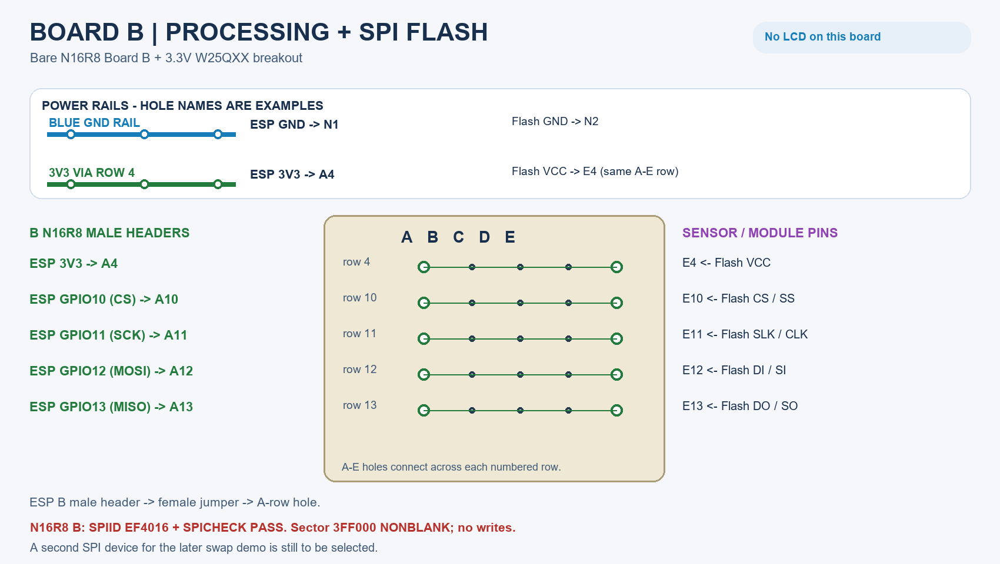

# D6 pin-to-hole breadboard diagrams

**Current Board A (21 November 2026):** [sonar-only N16R8 wiring and diagram](BOARD_A_SONAR_ONLY_WIRING.md). The Board A radar and GPIO4/5 maps below are earlier proposals retained for context. They do not match [`config/board_a.cfg`](../../config/board_a.cfg). Board B and C tables below remain their separate fixtures.

Updated 18 November 2026 for three separate bare ESP32-S3 N16R8
development boards with accessible male headers. These are **proposed integration fixtures**, not
evidence that all D6 devices have been powered or tested together. See the
[D6 checklist](../../README.md#26-d6-task-checklist) for what was completed, and the [jumper-wire count](JUMPER_WIRE_COUNT.md) for the
proposed fixture materials.

The modules and all three ESP32 boards sit outside their breadboards.
For A, B and C, connect the ESP's **printed, labelled male header pin** to
the named breadboard hole with a male-to-female jumper. Confirm the labels
on each actual board before wiring. See the
[N16R8 board setup](N16R8_BOARD_SETUP.md). Holes A-E on the
**same numbered row** connect electrically; F-J across the center gap do not
connect to A-E. N and R are **example names** assigned here to holes in a
continuous power-rail section, not labels printed on a breadboard. If a rail
has a center break, bridge it deliberately or choose a single continuous
section. Check continuity with USB unplugged.

## Historical Board A proposal: AHT, light, two sonars and radar

This N16R8 translation **retains Jun Yong's Version 2 Super Mini three-sensor
rows**: 3V3 at A4, I2C at A5/A6, GND at A7 and Sonar A at A8/A9.
Only the ESP32 board changes for those pins. Remove **all** old A-board
LCD wires (rows 10-14, LCD power/GND and BL) before using rows 10-13
for Sonar B and radar. The LCD belongs on Board C. [Jun Yong's original fixture](../../esp32s3_mtk/WIRING.md) is preserved
separately; its successful readings do not establish a pass on this N16R8.

Use the **printed pin labels**, not physical pin order or jumper colours.
Each listed A-E row is connected internally; adjacent rows are separate.
The ESP32 and modules sit outside the breadboard. Assign rail names N1-N3
and R1-R2 to holes in **continuous** sections; they are examples, not
breadboard markings. On a full breadboard, use the left blue/minus rail for
GND and a separate right red/plus rail for radar 5V. Do not put 3V3 on
that 5V rail; 3V3 is supplied by row 4 only.

| ESP32 N16R8 pin | Breadboard hole | Module pin in the same row / rail | Status |
|---|---|---|---|
| 3V3 | A4 | Sonar B VCC B4; Sonar A VCC C4; TSL2561 VCC D4; AHT VCC E4 | Jun Yong V2 row retained; Sonar B added |
| GPIO1 (I2C SDA) | A5 | TSL2561 SDA D5; AHT SDA E5 | Jun Yong V2 row retained |
| GPIO2 (I2C SCL) | A6 | TSL2561 SCL D6; AHT SCL E6 | Jun Yong V2 row retained |
| GND | A7 | Sonar A GND C7; TSL2561 GND D7; AHT GND E7; B7 bridges to blue GND rail N1 | Jun Yong V2 row retained |
| GPIO4 | A8 | Sonar A TRIG E8 | Jun Yong V2 row retained |
| GPIO5 | A9 | Sonar A ECHO E9 | Jun Yong V2 row retained |
| GPIO6 | A10 | Sonar B TRIG E10 | Added; GPIO proposed for D6 |
| GPIO7 | A11 | Sonar B ECHO E11 | Added; GPIO proposed for D6 |
| GPIO17 (UART RX) | A12 | LD2450 TX E12 | Added; GPIO proposed for D6 |
| GPIO18 (UART TX) | A13 | LD2450 RX E13 | Optional transmit path; GPIO proposed for D6 |
| 5V, USB powered | Separate 5V rail R1 | LD2450 5V at R2 | Added; isolate from row 4 and 3V3 |
| GND via A7/B7 | Blue GND rail N1 | Sonar B GND N2; LD2450 GND N3 | Same ground, separate from 5V |

**B7 to N1 requires one male-to-male rail jumper.** A4 is full: its five
holes A-E are assigned exactly once. Likewise A7 uses A-E exactly once.
Do not put another lead in those occupied holes. The 5V rail serves only
the radar; the 3V3 supply is confined to row 4. If a rail is split in the
middle, use one continuous section or bridge only matching-voltage sections.
Do not bridge 5V to 3V3 or GND.

This is a **conflict-free proposed fixture**, not a verified five-sensor
physical pass. The two sonars were reported as 3.3V-compatible by the team;
confirm the actual ECHO level before connection to a GPIO. The radar's 5V
feed is from the USB-powered N16R8 header only if the board and USB supply
remain stable. Disconnect USB while moving wires. Radar TX crosses to ESP
RX, and optional radar RX crosses to ESP TX. Use header GPIO17/18, not the
pins marked TX/RX (GPIO43/44 on the DevKitC-style map). Firmware UART
routing must use GPIO17/18 and the LD2450's actual baud rate.

**Observed on 17 November:** with the prior N16R8 wiring, TSL2561 returned
valid lux readings; AHT returned an I2C error; Sonar A timed out. Sonar B
returned pulse readings with uncertain distance, and LD2450 raw UART returned
no bytes. On 18 November, the corrected Jun Yong V2 rows 4-9 were tested
with AHT, light and Sonar A. AHT and light passed; Sonar A still timed out,
although GPIO4-to-GPIO5 loopback passed. Sonar B and radar have not been
retested on the corrected map. See [Stage 1 bring-up](BOARD_A_STAGE1_BRINGUP_20261118.md).
Test each remaining device before the combined doorway run. The existing [`three_sensors.cfg`](../../config/three_sensors.cfg)
configures only AHT, light and Sonar A on GPIO1/2/4/5. It does not enable
Sonar B or radar; add their GPIO6/7 and GPIO17/18 profiles only after each
isolated read passes. The older [`dual-ultrasonic.cfg`](../../config/demos/dual-ultrasonic.cfg)
uses GPIO11/12 for its second sonar and is a different fixture, not this map.

## Board A spacious 65-row extension

The earlier Board A table and image above remain as the compact proposal. For the team's 65-row breadboard, the **additional spacious layout** keeps Jun Yong's rows 4-9 unchanged, then places Sonar B at 28/29 and radar at 50/51 with radar 5V on isolated row 54. See the [spacious diagram and complete connection list](BOARD_A_SPACED_65_ROW_LAYOUT.md). GPIOs and `three_sensors.cfg` do not change. The spacious layout is proposed and has not been physically validated.

## Board B: external SPI flash

This keeps the D2 six-wire GPIO map. On 18 November, bare N16R8
Board B returned external-flash `SPIID raw=EF4016` with the corrected
wiring; the [bring-up record](BOARD_B_BRINGUP_20261118.md) includes
read-only follow-up results.
Check the breakout's printed
`VCC`, `GND`, `CS`, `SLK/CLK`, `DI/SI` and `DO/SO` labels; wire color and
connector order are not pin definitions.

| Device pin | Breadboard hole | Connected to |
|---|---|---|
| ESP32 GND | Blue rail N1 | Flash GND at N2 |
| ESP32 3V3 | A4 | Flash VCC at E4 on the same A-E row |
| Flash CS / SS | E10 | ESP GPIO10 at A10 |
| Flash SLK / CLK | E11 | ESP GPIO11 at A11, SPI SCK |
| Flash DI / SI | E12 | ESP GPIO12 at A12, SPI MOSI |
| Flash DO / SO | E13 | ESP GPIO13 at A13, SPI MISO |

Board B's corrected fixture passed read-only `SPIID EF4016` and
`SPICHECK EF4016`. `SPISCAN EF4016` found 94 non-FF bytes in sector
`3FF000`; do not assume it is an empty scratch area. The D6 record format
and writable flash area are not yet approved. The second SPI device for the later swap demonstration
has not been selected, so it is not drawn here.

## Board C: tested LCD fixture

This reuses the isolated pin map previously verified with a Super Mini.
On 18 November 2026 the photographed bare N16R8 Board C also passed the
physical LCD test: `LCDTEST 76 284 82 18 00 0` returned `result=0`, and the
user confirmed the colour bands and `LCD READY` on the screen.
The module is the team's DIYUSER 76x284 ST7789P3 display. `SCL` and `SDA` on this LCD mean **SPI SCK and MOSI**, not
the I2C signals on Board A. Its BL-to-GND arrangement is specific to this
tested active-low breakout.

| Device pin | Breadboard hole | Connected to |
|---|---|---|
| ESP32 GND | Blue rail N1 | LCD GND at N2 and LCD BL at N3 |
| ESP32 3V3 | A4 | LCD VCC at E4 on the same A-E row |
| LCD SCL / SCK | E10 | ESP GPIO12 at A10 |
| LCD SDA / MOSI | E11 | ESP GPIO11 at A11 |
| LCD RST | E12 | ESP GPIO8 at A12 |
| LCD DC | E13 | ESP GPIO9 at A13 |
| LCD CS | E14 | ESP GPIO10 at A14 |

Board C was flashed as node `s3-003` via its CH343 USB port (COM12).
The interactive console appeared on native USB (COM13) after reset. Run
`LCDTEST 76 284 82 18 00 0` there to repeat the isolated test. This
verifies the display fixture; the D6 firmware still needs B-to-C live
display transport and status handling. See [Board C bring-up](BOARD_C_BRINGUP_20261118.md).
