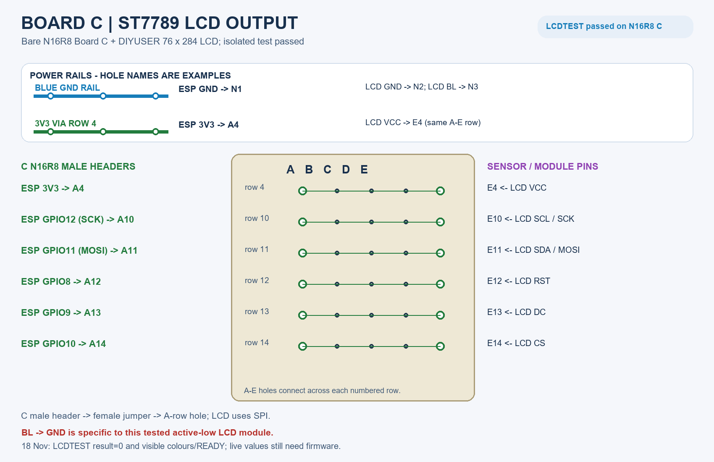

# D6 pin-to-hole breadboard diagrams

Prepared 16 November 2026 as clear wiring sketches for the three separate
ESP32-S3 Super Mini boards. These are **proposed integration fixtures**, not
evidence that all D6 devices have been powered or tested together. See the`n[integration handoff](D6_INTEGRATION_HANDOFF.md) for implementation status and`ntest gates, and the [jumper-wire count](JUMPER_WIRE_COUNT.md) for the`nproposed fixture materials.

The module and ESP32 boards sit outside each breadboard. Holes A-E on the
**same numbered row** connect electrically; F-J across the center gap do not
connect to A-E. P, N and R are **example names** assigned here to holes in a
continuous power-rail section, not labels printed on a breadboard. If a rail
has a center break, bridge it deliberately or choose a single continuous
section. Check continuity with USB unplugged.

## Board A: AHT, light, two sonars and radar

Use **three separate rails**: 3V3, 5V and GND. In this initial fixture the
radar's 5V comes from the USB-powered ESP32 **5V** pin, subject to a measured
power budget. The radar alone uses the 5V rail. Do not join it to 3V3 or GPIO.
All A devices share A's GND rail; there is no wire from A to B or C.

| Device pin | Breadboard hole | Connected to |
|---|---|---|
| ESP32 GND | Blue rail N1 | Continuous ground section |
| ESP32 3V3 | 3V3 rail P1 | AHT, light and verified 3.3V sonars |
| ESP32 5V | Separate 5V rail R1 | Radar 5V only, while USB powered |
| AHT GND / VCC | N2 / P2 | ESP GND / 3V3 |
| AHT SDA / SCL | C10 / C11 | ESP GPIO1 at A10 / GPIO2 at A11 |
| TSL2561 GND / VCC | N3 / P3 | ESP GND / 3V3 |
| TSL2561 SDA / SCL | E10 / E11 | Shares the AHT's GPIO1 / GPIO2 rows |
| Sonar A GND / VCC | N4 / P4 | ESP GND / 3V3, verified compatible module only |
| Sonar A TRIG / ECHO | E15 / E16 | ESP GPIO4 at A15 / GPIO5 at A16 |
| Sonar B GND / VCC | N5 / P5 | ESP GND / 3V3, verified compatible module only |
| Sonar B TRIG / ECHO | E18 / E19 | **Proposed** ESP GPIO6 at A18 / GPIO7 at A19 |
| LD2450 GND / 5V | N6 / R2 | ESP GND / USB-backed 5V rail |
| LD2450 TX / RX | E22 / E23 | **Proposed** ESP UART RX GPIO17 at A22 / UART TX GPIO18 at A23 |

GPIO17/18 are underside pads on the HW-747 Super Mini and need reliable
soldered access. Radar TX connects to ESP RX; radar RX connects to ESP TX if
required by the agreed UART configuration. Sonar B and radar UART GPIOs are
**not approved** in the D6 decision register. Confirm them before wiring
those signal lines. Verify each sonar's actual Echo level; a 5V Echo needs
level protection. Verify the radar supply current and that the board remains
stable when the radar starts. Unplug USB while changing wires.

## Board B: external SPI flash

This follows the D2 six-wire flash fixture. Check the breakout's printed
`VCC`, `GND`, `CS`, `SLK/CLK`, `DI/SI` and `DO/SO` labels; wire color and
connector order are not pin definitions.

| Device pin | Breadboard hole | Connected to |
|---|---|---|
| ESP32 GND | Blue rail N1 | Flash GND at N2 |
| ESP32 3V3 | A4 | Flash VCC at E4 on the same A-E row |
| Flash CS / SS | E10 | ESP GPIO10 at A10 |
| Flash SLK / CLK | E11 | ESP GPIO11 at A11, SPI SCK |
| Flash DI / SI | E12 | ESP GPIO12 at A12, SPI MOSI |
| Flash DO / SO | E13 | ESP GPIO13 at A13, SPI MISO |

Start with read-only `SPIID`. The D6 record format and writable flash area
are not yet approved. The second SPI device for the later swap demonstration
has not been selected, so it is not drawn here.

## Board C: tested LCD fixture

This is the known working isolated pin map for the user's DIYUSER 76x284
ST7789P3 module. `SCL` and `SDA` on this LCD mean **SPI SCK and MOSI**, not
the I2C signals on Board A. Its BL-to-GND arrangement is specific to this
tested active-low breakout.

| Device pin | Breadboard hole | Connected to |
|---|---|---|
| ESP32 GND | Blue rail N1 | LCD GND at N2 and LCD BL at N3 |
| ESP32 3V3 | A4 | LCD VCC at E4 on the same A-E row |
| LCD SCL / SCK | E10 | ESP GPIO12 at A10 |
| LCD SDA / MOSI | E11 | ESP GPIO11 at A11 |
| LCD RST | E12 | ESP GPIO8 at A12 |
| LCD DC | E13 | ESP GPIO9 at A13 |
| LCD CS | E14 | ESP GPIO10 at A14 |

First run the isolated `LCDTEST 76 284 82 18 00 0` on Board C. The D6
firmware still needs B-to-C live display transport and status handling.
