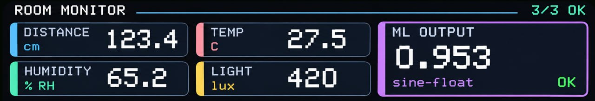

# Room monitor display reference

The team supplied this landscape mockup as the visual reference on
18 November 2026. Board C's 76 x 284 panel can be rotated in firmware to
284 x 76. On 21 November, `LCDTEST 284 76 18 82 60 0` produced a full
landscape pattern, confirmed visually by the team. The D6 MQTT view now uses
that orientation and a compact version of the reference layout: four reading
cards on the left and ML output on the right. It labels synthetic values
`MOCK` and labels the interim real-sensor relay `LIVE`. The distance card has
separate A and B lines in the current local implementation. See
[LIVE_LCD_TWO_SONARS.md](LIVE_LCD_TWO_SONARS.md) for the v3 payload and its
limitations; its updated layout requires a Board C firmware flash and fresh
visual confirmation.

## Temporary USB relay trial

Board B ran `APP RESET` and a synthetic `APP EVENT` entry. Its application
accepted event 493239 and changed occupancy from 0 to 1. A temporary PC
serial relay sent that occupancy to Board C on `LCDMOCK 1 493239`. C
reported `result=0`; the team confirmed all portrait fields were visible.
Distance 123.4 cm, temperature 27.5 C, humidity 65.2%, light 420 lux,
and ML score 0.953 were visual fixture values from this reference, not
readings from Board A or computed ML output.

After the trial, Board B's synthetic occupancy was reset to 0. The
temporary `LCDMOCK` firmware code was removed, Board C's normal `s3-003`
D6 firmware was rebuilt and reflashed, and isolated
`LCDTEST 76 284 82 18 00 0` again returned `result=0`. Board B's
firmware was not changed. The PC relay was later replaced by B's own
MQTT snapshots; see the [live LCD guide](LIVE_LCD_TWO_SONARS.md).

## Private MQTT mock follow-up

The opt-in Board B to C mock snapshot path and local broker commands are in
[MQTT_commands.md](../commands/MQTT_commands.md#board-c-lcd-and-board-b--c-mock-mqtt-test).
Board B's v2 fixture sends distance 123.4 cm, temperature 27.5 C, humidity
65.2%, light 420 lux, and ML score 0.953 (`sine-float`). Board C accepted and
drew the v2 snapshot in landscape; the team confirmed every field visible.
A second snapshot changed occupancy from 2 to 3 without re-entering view mode.
All accepted D6 snapshots use this landscape renderer. Legacy v1 snapshots
show placeholders for absent distance and ML fields. The independent
`LCDTEST 76 284 82 18 00 0` remains available. MQTT values remain
synthetic until Board A events and B's final application snapshot are integrated.
