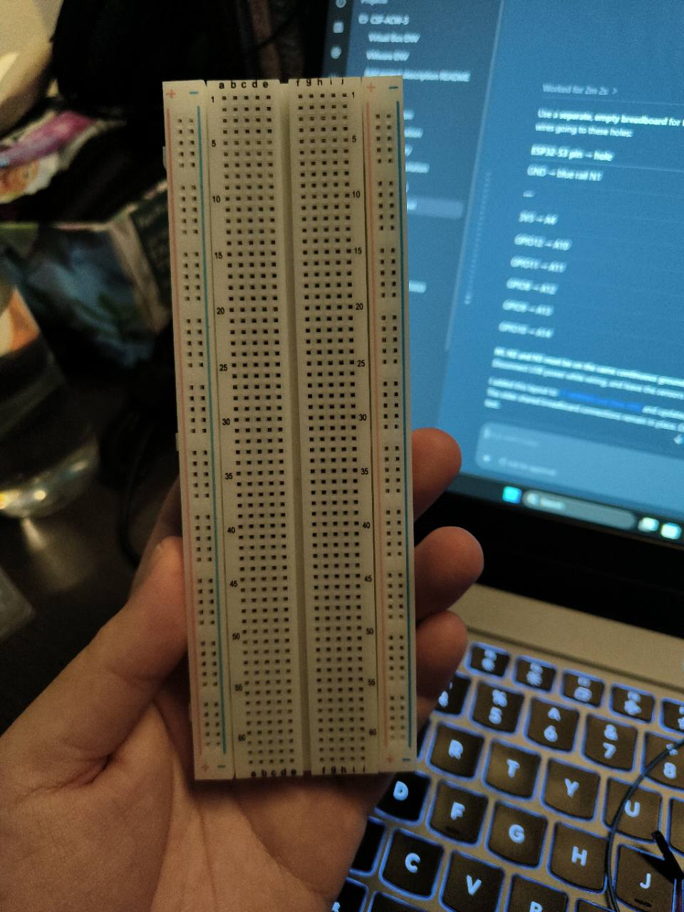
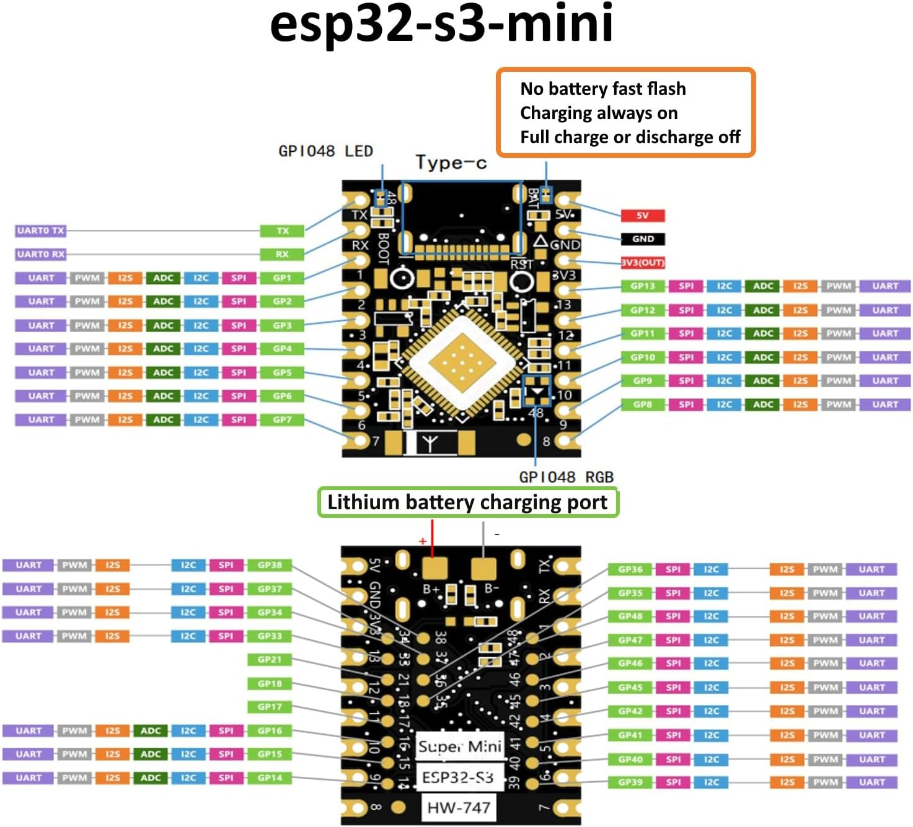

# Version 2 wiring — ESP32-S3 Super Mini

AHT, HC-SR04+ and Grove TSL2561 have worked in the user's hardware tests. The Version 2 shared breadboard below retains its earlier ST7789 connections. For the current opt-in `LCDTEST` driver, use the separate LCD-only breadboard section at the end of this file. User photos confirm visible bands and text; inversion `0` produced the intended colours.

## Complete breadboard connections

These tables retain the Version 2 layout. They apply to the ESP32-S3 Super Mini, AHT temperature/humidity module, **3.3 V-compatible HC-SR04+**, Grove TSL2561 and the existing ST7789 display wiring. Disconnect USB before changing connections. Follow the printed pin labels on each module.

### Breadboard layout and jumper leads

- On the terminal strip, **A–E share the same numbered row**. F–J share a separate row on the other side of the centre gap. Adjacent numbered rows are separate.
- The ESP32 and modules remain outside the breadboard. Each connection can use **device male header → female-to-female lead → male-to-male lead → breadboard hole**. Seat the male-to-male pin fully inside the female connector.
- The light sensor uses its Grove cable; route its four signal leads to the holes listed below, using adapters as required by the cable ends. Identify leads by signal, rather than assuming a colour or connector orientation.
- **N1, N2 and N3 are chosen hole names, not printed breadboard coordinates.** Use your selected top hole and the next two consecutive holes in the **same continuous blue/minus power-rail section**. A split in a rail breaks continuity.
- All grounds are common. Power comes from the ESP32 **3V3** pin; the 5V pin is not used in this layout.

### ESP32-S3 → breadboard

| ESP32 printed pin | Breadboard hole | Purpose | Current firmware |
|---|---|---|---|
| 3V3 | A4 | Shared 3.3 V supply | Used |
| GPIO1 | A5 | Shared I²C SDA for AHT and TSL2561 | Used |
| GPIO2 | A6 | Shared I²C SCL for AHT and TSL2561 | Used |
| GND | A7 | Shared ground | Used |
| GPIO4 | A8 | Ultrasonic TRIG output | Used |
| GPIO5 | A9 | Ultrasonic ECHO input | Used |
| GPIO6 | A10 | LCD SPI clock | Retain; LCD disabled |
| GPIO7 | A11 | LCD SPI MOSI | Retain; LCD disabled |
| GPIO9 | A12 | LCD reset | Retain; LCD disabled |
| GPIO8 | A13 | LCD data/command | Retain; LCD disabled |
| GPIO10 | A14 | LCD chip select | Retain; LCD disabled |

### AHT temperature/humidity → breadboard

| AHT printed pin | Breadboard hole | Connected through that row to |
|---|---|---|
| VCC / VIN | E4 | ESP32 3V3 at A4 |
| SDA | E5 | ESP32 GPIO1 at A5 |
| SCL | E6 | ESP32 GPIO2 at A6 |
| GND | E7 | ESP32 GND at A7 |

The AHT uses I²C address **0x38**. Position wires by the module's printed labels; pin order can differ between AHT boards.

### HC-SR04+ ultrasonic → breadboard

| Ultrasonic printed pin | Breadboard hole | Connected through that row to |
|---|---|---|
| VCC | C4 | ESP32 3V3 at A4 |
| TRIG | E8 | ESP32 GPIO4 at A8 |
| ECHO | E9 | ESP32 GPIO5 at A9 |
| GND | C7 | ESP32 GND at A7 |

This layout uses the identified **HC-SR04+ with 3.3 V operation and a 3.3 V-compatible ECHO output**, so the ECHO voltage divider is omitted. It is not the wiring specification for a standard 5 V HC-SR04.

### Grove TSL2561 digital light sensor → breadboard

| Grove cable signal | Breadboard hole | Connected through that row to |
|---|---|---|
| VCC | D4 | ESP32 3V3 at A4 |
| SDA | D5 | ESP32 GPIO1 at A5; shared with AHT |
| SCL | D6 | ESP32 GPIO2 at A6; shared with AHT |
| GND | D7 | ESP32 GND at A7 |

The TSL2561 shares the I²C bus with the AHT. The profile validates the part ID at its configured address. The preset uses **0x29**; set `i2c.addr` to **0x39** or **0x49** if that is your module's address. These addresses do not conflict with the AHT's 0x38.

### ST7789 TFT LCD → breadboard (retain existing wiring)

**Historical Version 2 layout:** this shared-fixture wiring previously showed
a dim/white LCD without text. It remains documented for the sensor setup, but
its LCD signal pins do not match the current `lcd_output` driver. Use the
separate LCD-only table below for `LCDTEST`.

| LCD printed pin | Breadboard hole | Electrical connection | Version 2 status |
|---|---|---|---|
| GND | Blue rail N2 | Ground via N1 and B7 | Retain |
| VCC | B4 | ESP32 3V3 via A4 | Retain |
| SCL | E10 | ESP32 GPIO6 via A10; SPI SCK | Retain; unused |
| SDA | E11 | ESP32 GPIO7 via A11; SPI MOSI | Retain; unused |
| RST | E12 | ESP32 GPIO9 via A12 | Retain; unused |
| DC | E13 | ESP32 GPIO8 via A13 | Retain; unused |
| CS | E14 | ESP32 GPIO10 via A14 | Retain; unused |
| BL | Blue rail N3 | Ground; retained active-low BL arrangement | Retain; module-specific |

The LCD's **SCL/SDA labels mean SPI clock/MOSI**, not the I²C SCL/SDA used by the AHT and TSL2561. Do not join those display signals to rows 5/6. No MISO connection is used.

The BL-to-ground entry preserves the active-low backlight arrangement previously selected for this display module. BL wiring differs between ST7789 breakout boards; this is not a universal ST7789 pinout.

### Ground-rail jumper

| From | To | Lead | Purpose |
|---|---|---|---|
| B7 | Blue rail N1 | One male-to-male wire | Connect the blue rail to ESP32 GND through row 7 |
| LCD GND | Blue rail N2 | LCD connection above | Share the same grounded rail section |
| LCD BL | Blue rail N3 | LCD connection above | Retain the existing module's BL connection |

**B7 is ground. B5 is SDA and must not be connected to the ground rail.** N2/N3 are connected through the continuous rail; no extra N1→N2 or N2→N3 jumper is needed within that section.

### Resistors

| Connection | Extra resistor in this setup |
|---|---|
| HC-SR04+ ECHO → GPIO5 | None for the identified 3.3 V-compatible module |
| AHT/TSL2561 I²C SDA and SCL | No additional pull-ups with the existing breakout modules' pull-ups; pull-ups must go to 3V3 |
| LCD signal/BL connections | No new resistor added; preserve the existing breakout arrangement |

Bare sensors or different breakout revisions may need different power, pull-up or backlight circuitry. These tables describe the current modules and retained wiring.

## (TEST) Separate LCD-only breadboard test (current `lcd_output` firmware)

This is a **separate setup** for the DIYUSER 2.25-inch ST7789P3, 76×284 LCD
and ESP32-S3 Super Mini. Disconnect the sensors and remove the Version 2 LCD
wires above before using this map. The Version 2 tables remain as a record of
the earlier shared breadboard. The current `lcd_output` pin definitions are in
[`components/lcd_output/lcd_board_config.h`](components/lcd_output/lcd_board_config.h).

| User's breadboard before wiring | ESP32-S3 Super Mini pinout reference |
|---|---|
|  |  |

These are reference images, not a photo of the completed connections. Check
the actual printed pin labels. The [working LCD photo](components/lcd_output/images/lcd-test-rgb.jpg)
and [module identification photos](components/lcd_output/images/README.md)
are stored with the driver.

Place the ESP32 and LCD outside an empty breadboard. Use one continuous
blue/minus rail section for all three ground leads below. Choose three holes
on that same section and call them N1, N2 and N3; these are example names, not
printed coordinates. If the rail is split, use one side of the split or bridge
it with a jumper. On the terminal strip, A–E of the same numbered row are
connected; different numbered rows are separate.
The [LCD-only breadboard diagram](components/lcd_output/LCD_BREADBOARD.svg)
shows these holes on a simplified version of the user's board.

| Device pin | Breadboard hole | Electrical connection |
|---|---|---|
| ESP32 GND | Blue rail N1 | Grounds the rail |
| LCD GND | Blue rail N2 | ESP32 GND through the same rail |
| LCD BL | Blue rail N3 | ESP32 GND through the same rail |
| ESP32 3V3 | A4 | Supplies row 4 |
| LCD VCC | E4 | ESP32 3V3 through row 4 |
| ESP32 GPIO12 | A10 | LCD SPI clock through row 10 |
| LCD SCL / SCK | E10 | ESP32 GPIO12 through row 10 |
| ESP32 GPIO11 | A11 | LCD SPI MOSI through row 11 |
| LCD SDA / MOSI | E11 | ESP32 GPIO11 through row 11 |
| ESP32 GPIO8 | A12 | LCD reset through row 12 |
| LCD RST | E12 | ESP32 GPIO8 through row 12 |
| ESP32 GPIO9 | A13 | LCD data/command through row 13 |
| LCD DC | E13 | ESP32 GPIO9 through row 13 |
| ESP32 GPIO10 | A14 | LCD chip select through row 14 |
| LCD CS | E14 | ESP32 GPIO10 through row 14 |

The GND/BL rail is a ground junction: **N1, N2 and N3 must be electrically
continuous.** Do not connect that rail to 3V3. LCD `SCL` and `SDA` are SPI
clock and MOSI, not the sensor I²C signals. No LCD MISO wire is used. The BL
connection follows the previously selected active-low arrangement for this
particular breakout; its current rating has not been verified, so the firmware
does not use GPIO13 for BL. Unplug USB power before adding or moving wires.
For this isolated setup, leave external flash disconnected and use `LCDTEST`.

For the display pattern and console command, see the
[`lcd_output` test instructions](components/lcd_output/README.md#how-to-run-the-physical-lcd-test).

## (TEST) Proposed LCD plus external SPI flash breadboard prototype

This is a separate additional test of the **working LCD wiring plus an external
flash module**. The isolated LCD setup and earlier Version 2 wiring above
are preserved. See the [LCD plus SPI flash breadboard diagram](components/lcd_output/LCD_SPI_FLASH_BREADBOARD.svg).
Keep all current LCD wires, including LCD BL on the blue ground rail. The
flash module in the supplied photo says `W25QXX`, but its actual chip marking,
connector labels and electrical ratings cannot be read. Verify those before
powering it; the proposed VCC connection below is for a breakout confirmed to
accept 3.3 V.

| Device pin | Breadboard hole | Connection |
|---|---|---|
| Flash GND | Blue ground rail N4 | Same continuous rail as ESP32 GND, LCD GND and LCD BL |
| Flash VCC, if 3.3 V is confirmed | C4 | ESP32 3V3 at A4; LCD VCC at E4 |
| Flash CLK / SCK | C10 | ESP32 GPIO12 at A10; LCD SCL / SCK at E10 |
| Flash DI / SI / MOSI | C11 | ESP32 GPIO11 at A11; LCD SDA / MOSI at E11 |
| ESP32 GPIO13 | A15 | New SPI MISO input |
| Flash DO / SO / MISO | E15 | Flash output to ESP32 GPIO13 |
| ESP32 GPIO6 | A16 | New flash chip select output |
| Flash CS / SS | E16 | Flash CS, separate from LCD CS on GPIO10 |

The LCD does not have a MISO connection. N4 is an example hole on the same
continuous ground rail as N1–N3. Check for a split rail and check the flash
module's actual pin names; the photo does not establish connector order or
wire-colour meanings. Leave any other module pins unconnected until their
functions and required pull-ups are confirmed.

The updated firmware uses SCK GPIO12, MOSI GPIO11, MISO GPIO13 and separate
chip selects: LCD GPIO10, flash GPIO6. `FLASHLCD` reads only the flash's JEDEC
ID (command `9F`) and shows it on the LCD. `SPIID` reads the same ID in the
serial monitor. These commands do not write or erase flash. `LCDTEST 76 284
82 18 00 0` remains the **separate isolated LCD test** with flash disconnected.
Both display and flash diagnostics run sequentially in BenchmarkTask; another
task must not use this SPI host concurrently without whole-operation bus
ownership. The actual flash part must be identified before using any
W25Q32-specific test, especially a write or erase operation. On 10 November
2026, the user reported `SPIID` ID `EF4016`, `FLASHLCD` flash and LCD results
of `0`, and visible `FLASH TEST` / `SPI OK` / `ID EF4016` text. `TASKS` then
showed `BenchmarkTask stack_free=1756 B` and zero message-buffer drops. This
validates the read-only combined test; it does not validate flash writes,
stored data or long-run timing.
