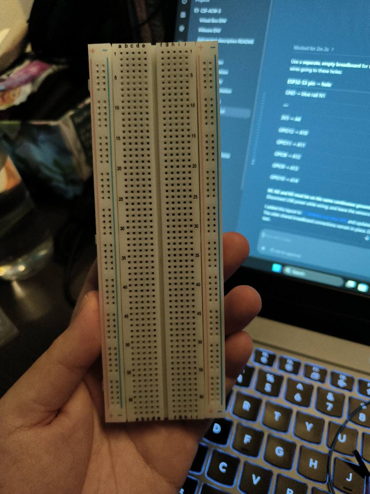
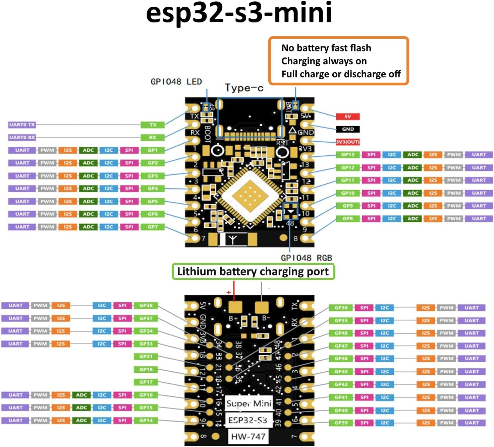
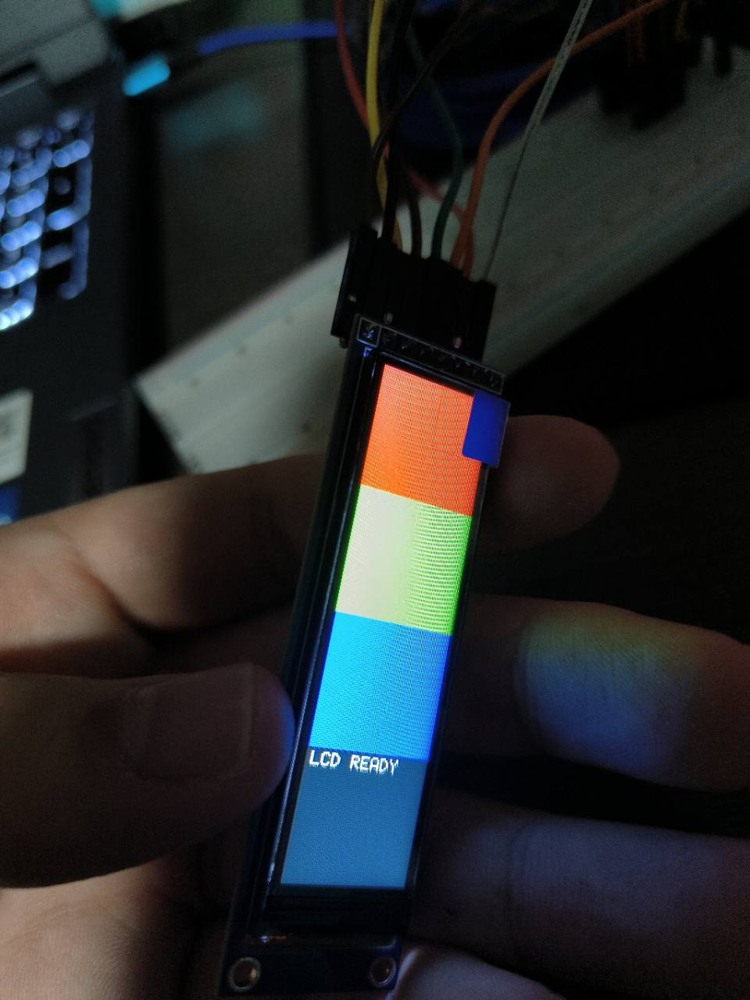

# LCD output component

**D6 import, 11 November 2026:** selectively imported from `lcd-output` at
`b1c1675`. Hardware observations below belong to that reference branch and
fixture. This D6 change adds native checks via `sh tools/d6_test.sh` and
retains current MQTT command routing. Combined D6 panel tests remain NOT RUN;
normal startup leaves the panel inactive. Board C is output; Board B owns
processing/storage/communication and Board A is input only.

This folder contains the first ESP32-S3 ST7789 LCD output implementation.
The files compile and pass a host test with mocked GPIO/SPI. The opt-in
`LCDTEST` has returned `result=0` on the connected ESP32-S3 and LCD. A user
photo confirms visible colour bands and `LCD READY`. Inversion `0` produced
the intended red, green, blue and dark bands with white text. The RAM offsets
still need an edge-alignment check on the panel.
The active firmware is `esp32s3_mtk/`, built
with ESP-IDF and the course µT-Kernel 3 SMP port. The LCD component must not
introduce Arduino tasks or APIs. The ESP32 target already depends on ESP-IDF;
"no Espressif" would require a different target/toolchain decision, while
avoiding a high-level Espressif LCD library is compatible with this plan.

## What the display needs to do

The configurable edge project reads sensors through GPIO, I²C, UART and SPI,
then processes their readings, rules and application events. The LCD is an
**output device**. It should receive already-decided values and status from the
application, rather than acquiring sensors or changing their configuration.

The first hardware milestone is a repeatable screen bring-up (reset,
initialise, fill with known colours, then draw test text). Application results
should be wired in only after that works on the physical board. A successful
build or SPI transfer alone does not prove that pixels are visible.

## Files and responsibilities

```text
esp32s3_mtk/components/lcd_output/
├── README.md                  Component guide and hardware/test notes
├── LCD_BREADBOARD.svg         Schematic of the separate breadboard layout
├── images/                    Board references and physical-test photos
│   └── README.md              Image descriptions and evidence limits
├── CMakeLists.txt             Register the component and dependencies
├── include/
│   └── lcd_output.h           Small public API used by the application
├── lcd_board_config.h         SPI settings and current fixture pins
├── lcd_internal.h             Private interfaces between component files
├── lcd_output.c               Public API, drawing and update coordination
├── lcd_st7789.c               ST7789 commands, reset/init and pixel windows
├── lcd_transport_mtk.c        SPI and GPIO transfers for this µT-Kernel target
├── lcd_font_5x7.c             Small bitmap font for status text
└── tests/test_lcd_output.c    Host test with mocked GPIO/SPI
```

| File | Responsibility |
|---|---|
| `CMakeLists.txt` | Compile the component and expose its public header. The transport calls existing `hal_*` symbols, without a component dependency cycle with `edge_mtk`. |
| `include/lcd_output.h` | Public init, shutdown, fill, rectangle, text and test-pattern API. The caller supplies panel geometry, offsets, orientation register and inversion after confirming the module. No sensor or application types appear here. |
| `lcd_board_config.h` | Isolated-test SPI/control pin assignments, TX-only SPI mode 0 at a conservative 1 MHz, transfer timeout and chunk size. It deliberately does not guess the panel geometry. |
| `lcd_internal.h` | Private interfaces between transport, panel, font and public API. |
| `lcd_transport_mtk.c` | Own the display's SPI handle and D/C/reset GPIO. Send commands and data through the existing µT-Kernel-compatible HAL, with bounded transfers and returned errors. The HAL drives CS for each transfer. |
| `lcd_st7789.c` | Basic ST7789 software reset, sleep-out, RGB565, orientation, inversion and display-on sequence; visible-window addressing and streamed RGB565 pixels. The sequence produced visible output on this module at 1 MHz; edge alignment and power/gamma characteristics have not been fully checked. |
| `lcd_font_5x7.c` | Uppercase letters, numbers and basic punctuation for status text. Lowercase renders as uppercase; unsupported characters become `?`. |
| `lcd_output.c` | Single-caller display API, state tracking, RGB565 fills, scaled text and a red/green/blue/black test pattern. It has no sensor acquisition or automatic startup. |
| `tests/test_lcd_output.c` | Host checks for invalid geometry, startup commands, offsets, RGB565 byte order, text transfer and SPI error propagation. |
| `README.md`, `LCD_BREADBOARD.svg`, `images/` | Current status, wiring schematic, reference photos, physical result and remaining checks. |

`lcd_output_init()` must be called from one task with verified width, height,
X/Y offsets, `MADCTL` and inversion settings. Drawing is synchronous and not
safe to call concurrently or from an ISR. BenchmarkTask is the sole caller
when an explicit `LCDTEST` command is received; normal startup leaves the LCD
untouched.

## Existing files that integration would touch

| Existing location | Expected change |
|---|---|
| `esp32s3_mtk/main/CMakeLists.txt` | **Already changed:** list `lcd_output` as a dependency so the component is compiled, without initializing the LCD. |
| `esp32s3_mtk/components/edge_mtk/CMakeLists.txt` | **Already changed:** add the `lcd_output` dependency for the opt-in test call. |
| `esp32s3_mtk/components/edge_mtk/runtime_mtk.c` and `include/runtime_mtk.h` | **Already changed:** ControlTask validates `LCDTEST` arguments and queues a typed message; BenchmarkTask runs the pattern so console input and sensor scheduling are not held by drawing. Application-result updates are still to be designed after board bring-up. |
| `tests/test_mtk_application_runtime.c` and `tools/mtk_runtime_test.sh` | **Already changed:** cover valid/invalid command handoff under the modelled kernel and provide the LCD header path. |
| `esp32s3_mtk/WIRING.md`, target and root READMEs | **Updated:** retain the Version 2 shared breadboard tables, add the separate LCD-only map and record the physical result. |

The host test can be built with GCC from the repository root:

```powershell
gcc -std=c11 -Wall -Wextra -Werror -I esp32s3_mtk/components/lcd_output/include -I esp32s3_mtk/components/lcd_output -I libraries/EdgeCore/src esp32s3_mtk/components/lcd_output/lcd_output.c esp32s3_mtk/components/lcd_output/lcd_st7789.c esp32s3_mtk/components/lcd_output/lcd_transport_mtk.c esp32s3_mtk/components/lcd_output/lcd_font_5x7.c esp32s3_mtk/components/lcd_output/tests/test_lcd_output.c -o build/lcd_output_test.exe
.\build\lcd_output_test.exe
```

It passed on 7 November 2026. The runtime command handoff host test also
passed. The full ESP-IDF / µT-Kernel build and its post-build audit passed
after adding `LCDTEST`, using the locally installed, revision-pinned
dependencies. The generated binary was flashed and
`LCDTEST 76 284 82 18 00 1` completed with `result=0` on 7 November 2026.
The user photo confirms a lit panel, four bands and readable text. With
inversion `1`, the expected red/green/blue/black bands appeared as
cyan/magenta/yellow/white. A second `LCDTEST 76 284 82 18 00 0` run returned
`result=0`, and the user photo shows the intended colours and readable white
text. That first run also reported `BenchmarkTask stack low:
892 B free`. After moving the glyph buffer off the task stack, the revised
firmware passed the host test and full build audit, was flashed, and a
`TASKS` capture after another LCD test showed `BenchmarkTask stack_free=1740 B`.
A further run on the revised firmware showed `[LCD] test queued`,
`[LCD] starting test 76x284 offset=82,18 madctl=00 invert=0`, and
`[LCD] test complete result=0`. The user also confirmed the screen still
showed the correct bands and `LCD READY`.

## Hardware and test images

The [image index](images/README.md) identifies each source and what it proves.
The empty breadboard photo shows the user's board; use the
[breadboard schematic](LCD_BREADBOARD.svg) and the
[LCD-only wiring table](../../WIRING.md#separate-lcd-only-breadboard-test-current-lcd_output-firmware)
for the connections. The pinout image is a reference; check labels on the
physical Super Mini before placing leads.

| Breadboard before wiring | ESP32-S3 Super Mini pinout | Working LCD screen |
|---|---|---|
|  |  |  |

The [module back](images/lcd-module-back.jpg) and
[package label](images/lcd-package-label.jpg) identify the 76×284 ST7789P3
breakout. The [first screen photo](images/lcd-test-inverted.jpg) records why
the test command now uses inversion `0`.

## Current fixture and constraints

The existing breadboard [wiring guide](../../WIRING.md) identifies an ST7789 TFT module
with SPI SCK on GPIO6, MOSI on GPIO7, D/C on GPIO8, reset on GPIO9 and CS on
GPIO10. It records 3V3 and ground, and an active-low backlight connection to
ground for this particular module. Its printed `SCL`/`SDA` pins are the LCD's
SPI clock/data; they are **not** the I²C bus used by the AHT and TSL2561.
The panel has no wired MISO. The display previously showed a dim/white screen
without text; the active firmware does not initialise it automatically.

The owner's photos identify the breakout as **DIYUSER
`M35-2.25TFT-lanban`**, PCB marking `VER:tft 2.25 2.0`, driver
**ST7789P3**, **76×284 pixels**. A
[first-hand implementation for a 76×284 module](https://github.com/Bodmer/TFT_eSPI/pull/3769/files)
uses X/Y offsets **82/18** in portrait orientation. The user's working test
used those offsets, `MADCTL=00` and inversion `0`. The image looks correctly
oriented and the colours are right; full edge-pixel alignment, maximum SPI
speed and power/gamma behaviour remain unverified.

For the isolated test, use the [separate LCD-only breadboard map](../../WIRING.md#separate-lcd-only-breadboard-test-current-lcd_output-firmware):
LCD `SCL/SCK` to GPIO12, `SDA/MOSI` to GPIO11, `RST` to GPIO8, `DC` to
GPIO9, and `CS` to GPIO10. LCD `VCC` goes to 3V3. ESP32 GND, LCD GND and
LCD BL share one continuous ground rail. This pin map replaces the older
breadboard map in the LCD firmware only; the earlier breadboard tables remain
in `WIRING.md`. GPIO11/12 also appear in the SPI fixture commands; do not
run those commands while the LCD is wired for this isolated test.

The photos do not provide a backlight schematic or current rating. Do not
connect `BL` directly to ESP32 GPIO13 as a substitute for ground until its
electrical load is confirmed. The present driver does not configure a BL GPIO.
The isolated test uses the breadboard ground rail as the common junction for
ESP32 GND, LCD GND and LCD BL. No sensors need to be connected.
The course port includes a third-party ST7789P3 driver under
`third_party/mtk3smp-esp32s3/device/lcd/`, but its board header describes a
135×240 M5StickS3 panel and different pins. Treat it as a reference, not as a
drop-in driver or proof that this breadboard display works. Keep changes out
of the course submodule.

GPIO10 is also used as CS by an upstream SPI flash test fixture. The current
breadboard has the LCD there, so do not run that flash fixture with the LCD
connected. If another SPI device is later added, plan separate CS pins and
whole-operation bus ownership; the existing HAL locks and toggles CS for each
transfer, which does not protect a complete LCD command plus its data from
another user of the same host. The current implementation assumes one LCD
caller and no concurrent device on its SPI host.

## Implementation and verification sequence

1. Identify the exact LCD breakout and confirm its resolution, voltage,
   backlight behaviour and pin labels against the physical board.
2. Flash the current build, open the USB monitor and run `LCDTEST` with the
   confirmed geometry and panel settings (see below).
3. Check the red, green, blue and black bands plus the `LCD READY` label.
   Check visible area, rotation and backlight; record the outcome.
4. Add a bounded display update path for selected application results and
   errors. Decide the update owner, queue/drop policy and refresh rate so a
   missing LCD cannot stall sensor sampling or occupancy processing.
5. Build and run the existing sensor configuration with the LCD enabled.
   Check that sensor readings, task timing and error reporting still work.

The source, build registration, host tests, opt-in diagnostic and first
visible-screen test and stack-margin retest are in place. A panel-edge
alignment check and the application-result hook remain pending.

## How to run the physical LCD test

See the [beginner breadboard diagram](LCD_BREADBOARD.svg) for the hole
positions used in the table below. It is a schematic of the user's board;
the printed row numbers on the physical breadboard are the final reference.

1. With USB power disconnected, follow the
   [LCD-only breadboard table](../../WIRING.md#separate-lcd-only-breadboard-test-current-lcd_output-firmware).
   It joins ESP32 GND, LCD GND and LCD BL on one continuous blue rail; VCC
   uses the 3V3 row and the five SPI/control signals use separate rows.
   GPIO13 is not enabled in firmware. Leave the sensors disconnected and do
   not run the SPI fixture commands while the LCD is connected.
2. The owner reports a 76×284 visible area. Use candidate RAM offsets 82/18
   and portrait `MADCTL=00`. Inversion `0` gave the intended colours in the
   physical test; inversion `1` visibly inverted them. The offset comes from another
   76×284 module and may need adjustment. The bundled M5StickS3 values must
   not be assumed.
3. Flash the new `esp32s3_mtk/build/esp32s3_mtk.bin` using the repository's
   `tools/build.ps1 flash -Port COMx` command after setting the local ESP-IDF
   paths described by the project setup. Close any open serial monitor before
   flashing. For reset/boot diagnostics on Windows, open ESP-IDF Monitor with
   CRLF input (from `esp32s3_mtk/` in the same configured PowerShell session):

   ```powershell
   & "$env:IDF_PYTHON_ENV_PATH\Scripts\python.exe" "$env:IDF_PATH\tools\idf_monitor.py" -p COMx -b 115200 --eol CRLF --target esp32s3 .\build\esp32s3_mtk.elf
   ```

   ESP-IDF Monitor's default CR-only Enter does not finish this firmware's
   command lines; `--eol CRLF` is required. Press Ctrl+] to exit the monitor.
4. Type the following on one line, replacing each value with the confirmed
   module setting:

   ```text
   LCDTEST <width> <height> <x_offset> <y_offset> <madctl_hex> <invert_0_or_1>
   ```

   The visually verified pattern command for this 76×284 module is:

   ```text
   LCDTEST 76 284 82 18 00 0
   ```
5. Expect `[LCD] test queued`, then `[LCD] starting test ...`, then
   `[LCD] test complete result=0`. The screen should show three colour bands,
   a black band and `LCD READY`. A nonzero result indicates a software-side
   GPIO/SPI/init error. `result=0` only means transfers completed: this panel
   has no connected MISO, so a visible screen is the actual pass criterion.

If the display stays white, note the exact command and serial output and take
a photo of the front and back of the module and the wiring. If colours appear
but are shifted or rotated, record that too: offsets and `MADCTL` can then be
adjusted without rebuilding. The LCD is still a diagnostic display; sensor
and application results have not yet been connected to it.

### COM5 quick start on this Windows checkout

There is no command to start COM5: connect the ESP32-S3 with a USB data cable,
then confirm **USB Serial Device (COM5)** in Windows Device Manager under
**Ports (COM & LPT)**. Windows may choose a different COM number after
reconnecting; use the number it shows. Check the
[ESP32-S3 pinout reference](images/esp32s3-super-mini-pinout.jpg),
[breadboard diagram](LCD_BREADBOARD.svg) and
[LCD-only wiring table](../../WIRING.md#separate-lcd-only-breadboard-test-current-lcd_output-firmware)
before powering the board.

In a new PowerShell window, this is the complete setup for the paths used in
the physical test. `Set-ExecutionPolicy` affects only this PowerShell process.
Close any serial monitor before flashing. If the latest LCD firmware is
already on the board, skip the flash line and open the monitor directly.

```powershell
cd C:\Users\brend\EMBSYS-P2-AAI15\esp32s3_mtk
Set-ExecutionPolicy -Scope Process -ExecutionPolicy Bypass -Force
$env:MTKERNEL_PATH = 'C:\Users\brend\EMBSYS-P2-AAI15\esp32s3_mtk\third_party\mtk3smp-esp32s3'
$env:IDF_PATH = 'C:\Users\brend\esp\esp-idf-v6.1'
$env:IDF_TOOLS_PATH = 'C:\Users\brend\.espressif'
$env:IDF_PYTHON_ENV_PATH = 'C:\Users\brend\.espressif\python_env\idf6.1_py3.14_env'
.\tools\build.ps1 flash -Port COM5
& "$env:IDF_PYTHON_ENV_PATH\Scripts\python.exe" "$env:IDF_PATH\tools\idf_monitor.py" -p COM5 -b 115200 --eol CRLF --target esp32s3 .\build\esp32s3_mtk.elf
```

After the ESP-IDF monitor opens, type each command **inside the monitor**, not
at the `PS>` prompt, and press Enter after each:

```text
LCDTEST 76 284 82 18 00 0
TASKS
```

The LCD test should print `[LCD] test complete result=0` and show red,
green, blue and dark bands plus white `LCD READY`. `TASKS` shows the task
stack values; the tested firmware reported `BenchmarkTask stack_free=1740 B`.
Press Ctrl+] to exit ESP-IDF Monitor. If COM5 is busy, close any other serial
monitor before retrying. These paths and COM5 describe this user's Windows
checkout; other computers need their own SDK paths and port number.
